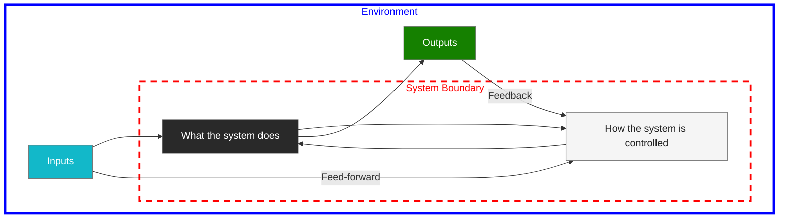

---
tags:
  - CO1605
  - Systems-Analysis-and-Database-Design
---
[[CO1605 Systems Analysis and Database Design]]

---
# Lecture Documents
[[CO1605 Lecture 1.pdf]]
[[CO1605 L1 - Lab 1 - Introduction to Systems Analysis.pdf]]

---

---
[[CO1605 Lecture 2 - UML - Use Case Diagrams]]
