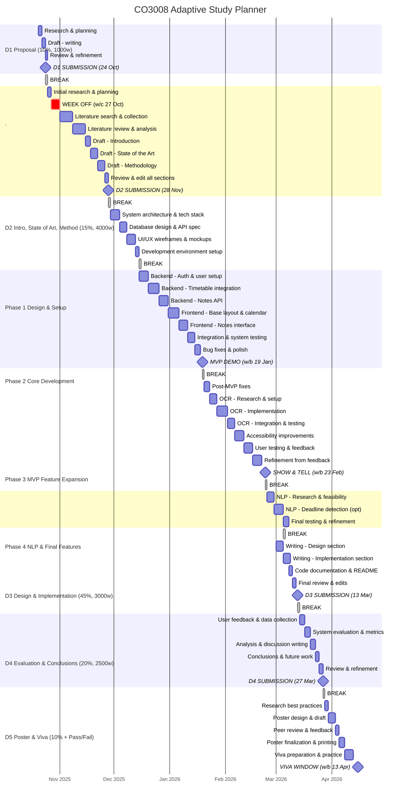

---
tags:
  - CO3008
  - Honours-Degree-Project
---
[[CO3008 Honours Degree Project]]

---
# Proposal Template
[[CO3008 Proposal Template.pdf]]

---
# Brief Specification for D1
> [!PDF|orange] [[CO3008 Assignment Brief 2026 Final.pdf#page=1&selection=41,11,41,67&color=orange|CO3008 Assignment Brief 2026 Final, p.1]]
> > produce a proposal document of approximately 1000 words 
> 

> [!PDF|orange] [[CO3008 Assignment Brief 2026 Final.pdf#page=1&selection=44,0,75,11&color=orange|CO3008 Assignment Brief 2026 Final, p.1]]
> > • **Problem Statement** - A brief outline of the problem your project aims to address.
> >  
> > • **Ethical Analysis** – a discussion of the potential ethical issues surrounding the problem domain and any considerations you will need to make to ensure your project is completed in line with the ethical standards expected of a computing professional, including potential issues relating to equality, diversity and inclusion. 
> > 
> > • **Risk Assessment** – An investigation into the potential risks of the project itself, i.e. risks that could lead to project failure, contingencies and how risks can be mitigated.
> > 
> > • **Health & Safety Assessment** – An investigation into the potential health and safety risks to yourself, the public and users of your artefact. 
> > 
> > • **Potential for Commercial Development** – A short outline of any envisioned potential for commercialisation/commercial development of your solution. 
> > 
> > • **Time & Resources Plan** – How you present your plan for managing your time and project resources is up to you. Your plan should detail how you intend to spend the time and resources on the project to work towards solving the problem outlined in your problem statement.
> 

> [!PDF|orange] [[CO3008 Assignment Brief 2026 Final.pdf#page=1&selection=77,0,81,88&color=orange|CO3008 Assignment Brief 2026 Final, p.1]]
> > With the submission of your proposal you also will be required to complete a project ethics form online. The link for the form is located with the submission link for this assessment on Blackboard. Your supervisor must review this and approve this. Failure to complete the form and receive ethical approval for your project from your supervisor may result in a fail grade for the modules.

---
# Assignment Feedback
>[!success] 62 / 100 marks
## Supervisor
```
Ethical analysis and risk assessment sections are really nicely done. Time chart is very impressive. Problem statement needs explicit identifcation of the main aim and objectives. Risks section will look much better if it is organised in the from of table. Some issues with citations.
```
### Areas for Improvement
```
1. Use Harvard referncing style consistently, avoid direct citations.
2. Follow your module lead and supervisor's advice about structure and style for submission.
3. Improve problem statement for your introduction.
```

>[!success] 62 / 100 supervisor marks
## Second Marker
```
Report is suitably presented, with each section offering a sufficient level of detail. Problem statement is well-considered with reference to applicable literature. Ethical analysis makes good use of BCS resources, which is beneficial for the project. Time and resources plan uses a Gantt chart which shows good consideration for project planning (see improvements here). Resources plan shows good consideration, although project topic (time management) suggests that extra scrutiny will be placed on your work as you describe and integrate good practice here.
```
### Areas for Improvement
```
Risks are discussed (good) but lack clarity re. presentation (bad). This could be mitigated by using a table to summarise your observations here. The composition of the Gantt chart requires explanation, as this is highly waterfall in nature (which is fine) although only has one instance of concurrent tasking (the big question is: will you continue to work agile? And so will this plan be reviewed periodically?)
```

>[!success] 62 / 100 second marker marks

---
# MVP Basic Wireframe
![[CO3008 MVP Basic Wireframe.png]]

---
# Cover Page
Adaptive Study Planner

BSc (Hons) Software Engineering
School of Engineering and Computing
University of Lancashire
# Proposal Headings
## Problem Statement
The problem this project seeks to address is that many students struggle with effective time management (Hyseni Duraku, Z., Davis, H. and Hamiti, E. (2023)), particularly when attempting to balance coursework, part-time employment, and exam deadlines. While numerous planning tools exist, that are highly popularised, such as Google Calendar, Notion, and Obsidian, all have the same inherent flaw, that they are manual and require the user to remember and adjust everything change that is necessary. For example, a problem that may arise is updating their calendar for an upcoming exam. 

To meet the minimal viable, this project proposes to develop an adaptive study planner, a web-based system designed to pull student information from university-provided sources (e.g. Timetable System) to automate the process of scheduling these activities into the calendar. For examination timetables, optical character recognition, planned to be used as to extract the relevant character data from the image provided, deducing exam dates and adding them to the user's calendar. 

The expansive version of this project seeks to use other tools like natural language processing to analyse notes, for keywords or dates that could be recommended to add to the calendar. Further integrating with existing university platforms such as BlackBoard could also be implemented allowing for updates when coursework deadlines are assigned.
## Ethical Analysis
This analysis seeks to justify any moral or ethical implications associated in the data collection involved the adaptive study planner.

Due to the handling student information, it is important to consider how the data is stored, protected, and processed. The planner will use details such as the timetable, and user-uploaded examination timetables; therefore the collection and storage of this data must handled, in the system by design, in accordance with GDPR legislation (Art. 1 GDPR – subject-matter and objectives (2016)).

All information requested from the user will be limited to what is necessary for the system to function. Data will be encoded during transfer, and encrypted during storage (i.e. if the user permits persistence). User-uploaded images will be deleted immediately after they have been processed by the OCR library to ensure no unnecessary retention of personal data.

Where authentication details are required such as, for accessing the university timetable, they will be encrypted on the backend using a key generated from the user's unique identifier (UUID). The encrypted credentials will be stored securely and decrypted only when necessary to perform scheduled retrieval of the timetable data, ensuring that plaintext credentials are never retrained. Requests to university resources will use secure HTTPS communication.

In-line, with the British Computer Society's (BCS) Code of Conduct (BCS Code of conduct (no date) BCS.) the project will be carried in a way that conforms to the standards of being professional, fair, and inclusive, and will be an important aspect throughout development. The system will be designed to promote equal access to IT by implementing accessibility features for example, a high contrast mode, or font alterations, as to accommodate users regardless of personal circumstances.
## Risk Assessment
### Risks to Project
The main risks related to the project can be categorised into reliability, data security, and project scope. 

Reliability refers to the rise of risks that may arise in integration issues between the university timetable, the OCR library, and the backend, which may hinder the user-interface if not properly handled.

Data Security refers to risks in the chosen method of encryption, or transferring insecurely over the HTTP protocol. If sensitive information, such as timetable details or user credentials were intercepted or improperly encrypted, leading to the exposure of unanonymised data, it could potentially result in a violation of GDPR law (Art. 32 GDPR – security of processing (2016)).

Project Scope refers to the risks around feature creep, described in Wu, Y., et al. (2015) A preliminary analysis and case study of feature-based software customization (Extended abstract) as "A phenomenon of importing and [implementing] redundant features" being potentially unplanned additions or ideas beyond the initially specified scope such as, attempting to implement NLP before the notes system is fully completed which may divert focus, time, and resources of other key areas stalling the project's progress.
### Risks of Project Failure
Project failure could occur for various reasons such as improper time management, underestimation of technical complexity, or security vulnerabilities, such as failure to properly secure user data, leading to a breach of GDPR legislation.
### Risk Contingency and Preventative Mitigation Measures
To manage the risks mentioned several preventative and contingency measures will be applied throughout the project.

To ensure that the system is reliable each part of it will be unit tested to ensure that independently each feature works within intended behaviour. Early development, designs, and mock-ups will allow me to assess the system in its entirety before development allowing me to identify any compatibility or integration problems before they arise. Another risk is data security, to ensure and maintain secure communications and storage under data protection, I plan to use HTTPS to communicate with the backend, and any data that is stored will be encrypted with an appropriate method (e.g. AES-256).
## Health and Safety Assessment
Due to the nature of this project, being software engineering, the health and safety risks physically are minimal compared to other projects where further travel may be necessary. Some potential risks as described in a paper (Devi, K.A. and Singh, S.K. (2023)) "include eye strain, neck and shoulder pain, and back pain" furthermore there are associated mental health hazards associated with long-term screen time. 

There are numerous preventative measures that will be put in place over the course of the project for the purposes of health and safety, these being ergonomic desk, and seating arrangements to ensure proper lumbar support and maintain a comfortable posture during extended computer use. Further previsions also include regular breaks, proper lighting, and supporting monitor adjustments will be made as to reduce and minimise the risk of eye strain, or repetitive strain injuries.
## Potential for Commercial Development
For commercial development of my project I could use a free daily note limit based on a subscription model for the amount of daily notes available per day, and validated based on a scheduled function by the backend to ensure the user's reset count resets per day in line with their plan choice.
## Time and Resources Plan


|           Resource           | Usage of Resource                                                     |
| :--------------------------: | --------------------------------------------------------------------- |
| University TimeTable System  | Pull student timetable data to auto-fill the user’s calendar.         |
|         Notes System         | Manages note creation, updates, and deletions.                        |
|     Relational Database      | Stores encrypted user accounts and timetable data                     |
|            HTTPS             | Secures communication between front end and backend                   |
| At-Rest Encryption (AES-256) | Protects stored credentials and sensitive data; no plaintext storage  |
| UUID (Unique User Identifer) | Derives server-side AES-256 keys for credential encryption/decryption |
|        Authentication        | Uses HTTPOnly cookies for secure, persistent user sessions            |

---
## References
- _Art. 1 GDPR – subject-matter and objectives_ (2016) _General Data Protection Regulation (GDPR)_. Available at: [https://gdpr-info.eu/art-1-gdpr/](https://gdpr-info.eu/art-1-gdpr/) (Accessed: 19 October 2025).  
    
- _Art. 32 GDPR – security of processing_ (2016) _General Data Protection Regulation (GDPR)_. Available at: [https://gdpr-info.eu/art-32-gdpr/](https://gdpr-info.eu/art-32-gdpr/) (Accessed: 21 October 2025).  
    
- _BCS Code of conduct_ (no date) _BCS_. Available at: [https://www.bcs.org/membership-and-registrations/become-a-member/bcs-code-of-conduct/](https://www.bcs.org/membership-and-registrations/become-a-member/bcs-code-of-conduct/) (Accessed: 20 October 2025).  
    
- Devi, K.A. and Singh, S.K. (2023) _The hazards of excessive screen time: Impacts on physical health, mental health, and overall well-being_, _Journal of education and health promotion_. Available at: [https://pmc.ncbi.nlm.nih.gov/articles/PMC10852174/](https://pmc.ncbi.nlm.nih.gov/articles/PMC10852174/) (Accessed: 22 October 2025).  
    
- Hyseni Duraku, Z., Davis, H. and Hamiti, E. (2023) _Mental health, study skills, social support, and barriers to seeking psychological help among university students: A call for mental health support in Higher Education_, _Frontiers in Public Health_. Available at: 0[1ttps://pmc.ncbi.nlm.nih.gov/articles/PMC10619655/](https://pmc.ncbi.nlm.nih.gov/articles/PMC10619655/) (Accessed: 14 October 2025).  
    
- Wu, Y., et al. (2015) _A preliminary analysis and case study of feature-based software customization (Extended abstract)_. Available at: [https://ieeexplore.ieee.org/abstract/document/7322142/](https://ieeexplore.ieee.org/abstract/document/7322142/) (Accessed: 21 October 2025).

>[!NOTE] **Possible Subscriptions Models**
>- **Freemium plan:** Basic OCR uploads and calendar syncing free with limited usage.
>- **Premium subscription:** Unlimited uploads, NLP deadline detection, and integration with third-party apps (Google Calendar, Outlook, Notion).  
>- **Institutional licensing:** Universities can deploy a white-labelled version for all students, integrated into their internal systems.

---
[[CO3008 D2 - Introduction, State of The Art, Methodology]]