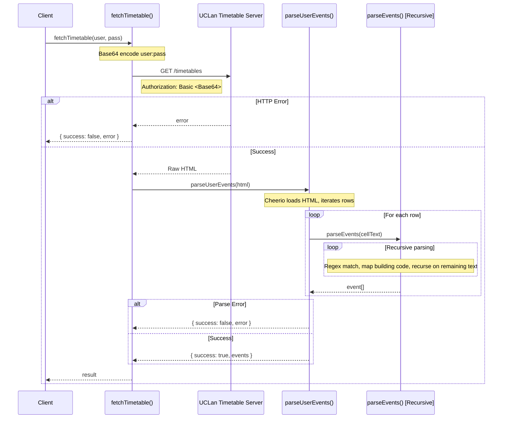
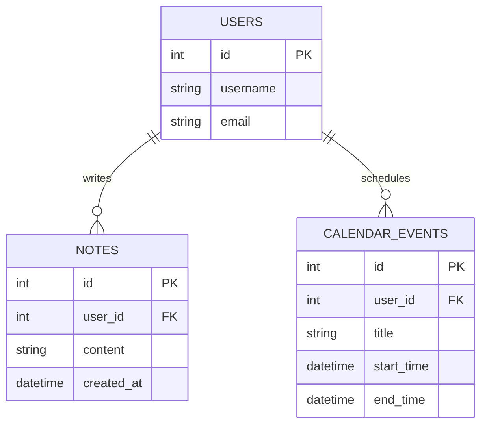
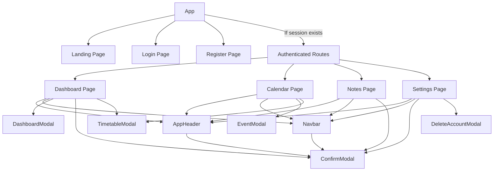
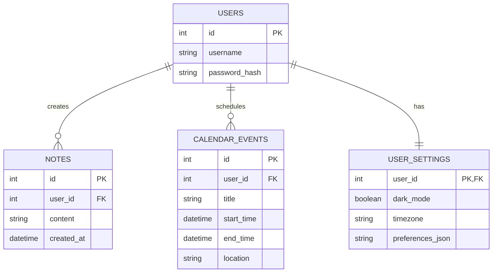
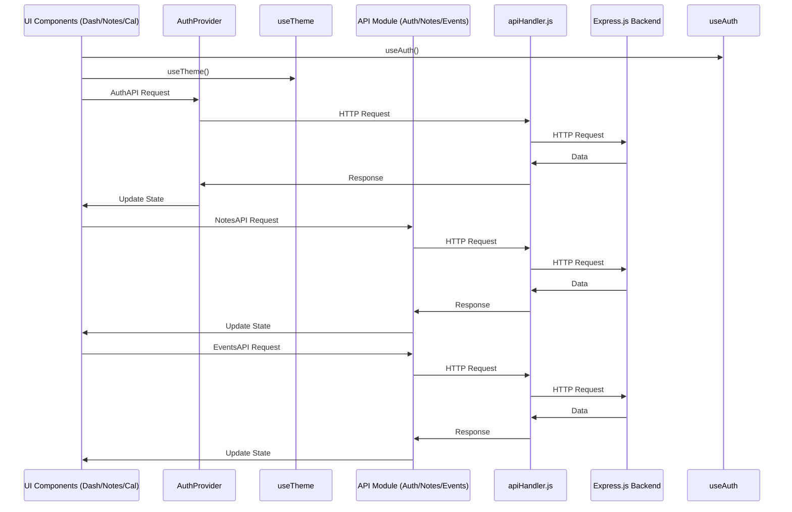
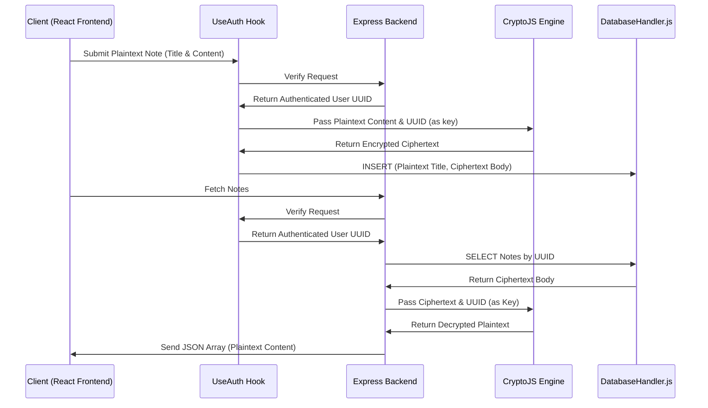

---
tags:
---
[[CO3008 Honours Degree Project]]
[[CO3008 D2 - Introduction, State of The Art, Methodology]]

---
# Assignment Feedback
## D3a & D3b
>[!success] 87 / 100 marks
## Supervisor

```
Advantages:  The testing section is exceptionally strong, offering a detailed description of the testing scenarios and demonstrating a good understanding of GET and POST queries. The report includes a range of sophisticated, professionally formatted diagrams, which enhance clarity and strengthen the technical presentation. The work reflects solid expertise in both React development and MySQL database design, indicating strong practical programming skills. Profound understanding of GDPR concepts. Disadvantages: In Table 1, the use of objective numbers without naming the objectives reduces clarity and weakens the connection between requirements and project goals. The ERD diagrams lack arrows or indicators showing explicit relationships between fields across tables, which makes interpretation less intuitive. 

The Key Problems section is primarily reflective in nature rather than a structured list of concrete technical or methodological challenges. A number of small figures have been moved to the appendices, which reduces readability and disrupts the flow of the main report. The descriptions of key algorithmsare overly brief and lack accompanying visual or technical support  (e.g., TF‑IDF, importing functionality, note‑processing logic) .
```
### Areas for Improvement
```
1. Replace numerical references in Table 1 with full objective names tostrengthen alignment with project aims.
2. Enhance ERD diagrams by adding connectors that explicitly show how fields in tables relate to one another.
3. Rework the Key Problems section to focus on specific, well‑defined challenges rather than general reflections.
4. Integrate essential diagrams and figures into the main chapters rather than the appendices to improve readability and narrative coherence.
5. Expand the explanation of core algorithms by adding supporting code or pseudocode snippets, application screenshots, or illustrative examples to demonstrate how these mechanisms operate within the system.
```

>[!success] 87 / 100 supervisor marks
## Second Marker
```
Report works well to communicate design ideas (for an ambitious design). System architecture is clear. Design requirements are clear. Report makes good use of visual media to communicate points. Sections are detailed and project appears to have been successful based on the available descriptions of testing (5.3). Very good work.
```
### Areas for Improvement
```
REACT front-end visualisation (Figure 4) lacks clarity and thus requires additional description or explanation (unless the point here is to communicate the ambition of the design, and the dynamism of the solution). Implementation does not separate reporting for key problems (or enumerate these). Thus, it is not clear where this relates to front vs. back-end, usability vs. security. Testing is evident although the results are not made clear.
```

>[!success] 80 / 100 second marker marks

---
# 1. Design
## 1.1 Requirements Analysis & Specification
The requirements for the project were deprived from the project’s initial objectives following the problem analyse and security planning phases. Functional requirements were prioritised using MoSCoW notation.

| Functional Requirement | Requirement                                                                                                                                                                            | Objective Met |
| :--------------------: | -------------------------------------------------------------------------------------------------------------------------------------------------------------------------------------- | :-----------: |
|           01           | The user must have the ability to register and login with an account with hashed and AES-128 encrypted passwords for security.                                                         |      03       |
|           02           | All note content must be encrypted at rest using AES-128 with decryption performed exclusively within the backend.                                                                     |      03       |
|           03           | The user must have the ability under GDPR law to remove their full account and all associated data under Right of Erasure.                                                             |      04       |
|           04           | Full CRUD operations must be supported for the user’s notes for full saving to the user’s account.                                                                                     |      05       |
|           05           | The system must automate a server-side web scraping of the legacy university timetable system due to a lack of public endpoints.                                                       |      06       |
|           06           | A weekly calendar view must be provided for event creation, editing and deletion so the student can effectively track their schedule.                                                  |      07       |
|           07           | The web application should have a dashboard that aggregates the last week of a student’s activity, including displaying recently made notes and events.                                |      07       |
|           08           | Notes by content and title should be searchable using the TF-IDF algorithm scoring the prevalence of words for efficient results.                                                      |      05       |
|           09           | The calendar should support iCalendar (.ics) as the universally used digital calendar format for importing and exporting so that the user can integrate their third-party data easily. |      01       |
|           10           | Users could have the ability to edit and configure their personal preferences including theme, font, time mat, notification prompts.                                                   |      07       |
<sub> Table 1 - Functional Requirements </sub>
| Non-Functional Requirement | Requirement                                                                                                                                                                            |     Purpose     |
| :------------------------: | -------------------------------------------------------------------------------------------------------------------------------------------------------------------------------------- | :-------------: |
|             01             | All data between the backend and database should be HTTPS.                                                                                                                             |    Security     |
|             02             | All note content must be encrypted at rest using AES-128 with decryption performed exclusively within the backend.                                                                     |    Security     |
|             03             | The user must have the ability under GDPR law to remove their full account and all associated data under Right of Erasure.                                                             |    Security     |
|             04             | Full CRUD operations must be supported for the user’s notes for full saving to the user’s account.                                                                                     | User Interface  |
|             05             | The system must automate a server-side web scraping of the legacy university timetable system due to a lack of public endpoints.                                                       |  Accessibility  |
|             06             | A weekly calendar view must be provided for event creation, editing and deletion so the student can effectively track their schedule.                                                  | Data Protection |
<sub>Table 2 - Non-Functional Requirements</sub>

---
# 4.2 Solution Design
## 4.2.1 Minimum Viable Product Stage
The MVP stage was designed to satisfy two foundational design requirements: validating the technical feasibility of the legacy timetable integration prior to any significant frontend investment, and establishing a Privacy-by-Design architecture as the structural baseline from which all subsequent development would extend. To satisfy these constraints, a deliberate specification decision was made to under-invest in the presentation layer, composing it of a single HTML, CSS, and Vanilla JavaScript stack, ensuring that development effort could be concentrated exclusively on the two critical backend mechanisms identified in objectives one and two; the automation of university timetable authentication and data extraction, and the implementation of a secure session-managed backend using ExpressJS. The user navigation wireframe illustrated in Figure 1 was produced at this stage to establish a clear model of the intended user journey, providing sufficient structural context to guide backend API routing decisions without prematurely committing to a full component-based architecture.

![[CO3008 D3 - MVP Diagram.png]]
<sub>Figure 1 - User Navigation Wireframe</sub>

The intentionally minimal presentation layer, whilst not aesthetically refined, served its specification purpose precisely; by constraining the UI to a bare HTML, CSS, and Vanilla JavaScript stack, the authentication flow and Express API routing could be verified in isolation, ensuring that the Privacy-by-Design foundations and GDPR data protection obligations were architecturally sound before any feature development commenced.

During this stage of development, the core priority was validating this backend functionality. Due to strict time constraints, the project pivoted from a sequential Waterfall testing methodology to an agile, sprint-based approach. Testing commenced concurrently with code creation, primarily relying on runtime debugging without formal logging. The notable exception to this was the secure API routing, which was systematically verified using Postman (expanded in testing section 5.3).

A primary test of the feasibility of the project was demonstrating a reliable ability to consistently web scrape the timetable data from the university’s timetable system. As previously identified during the initial problem analysis, the legacy-like system operates purely on the presentation layer, comprised of an HTML table containing all the student’s scheduling information, and entirely lacks publicly accessible API endpoints.

To overcome this limitation a custom backend web scraper was created to authenticate into the timetable system posing as a legitimate user request. The legacy timetable application is secured with HTTP basic authentication, therefore the NodeJS script dynamically constructs the ‘Authorization’ header by appending the university’s domain onto the username and then concatenating the university email and password subsequentially encoding the string into the Base64 format.


<sub> Figure 2 - TimeTable Parsing Sequence Diagram</sub>

Once the response successfully passes the authentication check, the cheerio library is utilised to parse the returned raw HTML from the request body. A custom recursive function which utilises a regular expression for matching parsing the string into the matching pattern, is then applied to extract the event strings: Time, Module, Location, Lecturer, and Type, and maps them into a JSON array. By successfully automating the extraction of the timetable events and parsing them into the database, the MVP definitively proved the viability of the legacy integration.


<sub>Figure 3 - ERD Diagram (Pre-MVP)</sub>

To act as the SOR (Source of Record) for my application the relational database utilising MySQL for application decoupling, was intentionally designed to be simple for the MVP yet highly secure, as illustrated in the diagram (Figure 2). The data in the tables is entirely dependent on the users table, specifically the user’s uuid (universally unique identifier) as the primary key. Under GDPR Right to Erasure, when a user deletes their account, it triggers a process in the database which utilises ON DELETE CASCADE foreign key constraints.
## 4.2.2 React Frontend

<sub>Figure 4  - React Architecture Diagram</sub>

Following the success of the supervisor meeting, demonstrating the current state of functionality through the Minimum Viable Product, the next phase began toward finalising the development of the application. With the backend foundations firmly established, this paved the way for a significant architectural transition of the frontend, migrating from the intentional bare-bones multi-page Vanilla JavaScript, HTML, and CSS presentation layer to a component-based React single-page application (SPA), utilising JSX, which allowed each page to be developed as an isolated, self-contained component with its own separated CSS file, rather than managing an increasingly complex monolithic frontend as the application continued to scale.


<sub>Figure 5 - Post MVP - ERD Diagram.</sub>

The expanded post-MVP ERD, as illustrated in Figure 5, reflects the additional tables introduced during this phase of development. A notable addition is the user_settings table, which was introduced to allow persistence for user preferences  server-side, including theme selection, time format, date format, and notification preferences, allowing the application to incorporate a broader range of accessibility and personalisation options for the user. The theme preference in particular supports light, dark, and auto system-based modes, which was a deliberate design decision to accommodate users with varying visual accessibility requirements, for instance those with light sensitivity or who prefer reduced contrast environments. Similarly to the MVP ERD, all tables maintain a strict foreign key dependency on the users table via the UUID primary key, ensuring that under GDPR Right to Erasure, account deletion propagates an ON DELETE CASCADE constraint across all dependent tables, permanently removing all associated notes, scheduled events, and user preferences in a single efficient database operation.

---
# 4.3 Development Methodology
The methodology outlined in Section 3 specified a sequential Waterfall approach for the requirements gathering, legacy system documentation, and security planning phases, on the basis that the technical constraints of the timetable system and GDPR compliance obligations needed to be fully characterised before any development commenced. In practice, this sequential structure was retained across these foundational phases; however, the architectural complexity of the React migration necessitated a departure from the originally planned downstream testing model, as concurrent sprint-based development became the only viable approach within the available timeframe. This represents the primary divergence between the proposed and actual methodology, and is discussed critically in Section 5.3.

The frontend architecture followed a deliberate two-phase approach. The MVP was intentionally constructed using Vanilla JavaScript, HTML, and CSS as a stepping stone to validate the core backend feasibility, and verify stable functionality, specifically the timetable scraper and Privacy-by-Design foundations, before committing to the full React migration. After demonstration, the backend was confirmed stable, and therefore a dedicated react branch was created to isolate the frontend rewrite from the stable mvp environment. The migration went through several iterations before being successfully merged into master via pull request, with all subsequent features including the TF-IDF search with additional scoring, iCalendar import and export, and the useAuth, useTheme, useNotifications hook developed within this branch.

---
# 5. Implementation
## 5.1 Key Problems
The development process encountered numerous problems across both the MVP and post-MVP phases of the project. During the MVP, seemingly straightforward styling issues such as the calendar grid div failing to centre correctly consumed significant debugging time, and the calendar event rendering posed persistent challenges, with overlapping events remaining a partially unresolved issue in the final implementation despite the CSS overflow property being set to auto, which should theoretically have handled the overflow behaviour automatically.

The most significant challenge however was the migration to React itself, which introduced an entirely new set of problems stemming from the fundamental differences between Vanilla JavaScript and React's declarative component model. Understanding React's state management system, the rules around hooks, and the lifecycle of components required a substantial learning curve during development. A particular challenge was designing and implementing custom hooks and contexts from scratch, specifically the AuthContext (Figure 7), which required to be structured correctly to wrap the entirety of App.js as the root provider, ensuring the authenticated user state existed in the global component tree and was accessible to every page component without needing to be passed down manually through props.

During the initial problem analysis and methodology phases, Optical Character Recognition (OCR) was planned as a core feature to allow students to upload examination timetable images, from which the system would automatically extract and import the relevant dates and events into the calendar. However, due to the time constraints imposed by the significant architectural migration to React and the complexity of implementing the core backend features to a satisfactory standard, the OCR feature was descoped from the final implementation. The decision was made to prioritise the reliable completion of the timetable scraper, notes system, and calendar integration over introducing an additional library dependency that could not be adequately tested and validated within the remaining development time, which prioritised creating a stable build for the show and tell demonstration with supervisor.

A further challenge arose because of the strict Privacy-by-Design constraint of storing all notes as AES-128 ciphertext, which prevented the use of MySQL's native full-text search capabilities, as the database can only operate on the encrypted values, making it impossible to query against user input server-side. This necessitated retrieving the full notes array to the client for decryption first, and only then executing the TF-IDF algorithm across the plaintext content to produce scored, ranked results for the search bar. While this preserves the zero-knowledge principle, it introduces a scalability limitation were the processing overhead scales linearly with note volume, a constraint that without the encryption requirement would be trivially resolved through server-side through SQL and indexing.
## 5.2 Technical Problems

<sub>Figure 6 - APIs & React Hooks - Sequence Diagram.</sub>

As shown in Figure 6, the React frontend demonstrates the benefits of the API decoupling design decision. Rather than individual components directly constructing and sending HTTP requests for instance, repeatedly calling the authorisation API (/auth/whoami endpoint) every time to verify a user’s authorisation status each page component interacts with dedicated API endpoints (such as /user/events and /user/notes) through a single centralised module apiHandler.js.

The code presented in Figure 22 (Appendix 4), demonstrates that when the app initially loads through app.js, the AuthProvider immediately runs the checkAuth function which sends a single request to /auth/whoami which verifies the user’s authentication status, based on whether an Express Session exists for their client on the backend. The useAuth function allows other component to access the state data stored in the AuthContext like the user’s uuid and the loading value.

The MemberRoute component shown in Figure 23 (Appendix 4) acts as a protected route wrapper, sharing as the rest of the components, the same, useAuth hook to retrieve the user state cached by the AuthProvider, therefore guarding all restricted pages without making any additional requests to the backend. During the initial load, whilst the /auth/whoami request is still resolving, the loading check prevents the pre-mature redirection of a valid user. Once resolved, if the user is null (as returned by the express backend) it immediately redirects to the login page, otherwise the protected page renders normally.


<sub>Figure 7 - AES-128 Encryption Data Flow Diagram - Notes Example.</sub>

To satisfy the project's strict Privacy-by-Design objectives, a robust cryptographic data flow was constructed to guarantee Encryption-at-Rest for all user-generated study notes. As visualised in Figure 4, encryption and decryption are executed entirely within the backend server memory, ensuring the MySQL database acts strictly as a secure storage vault. When a client submits a new note from the React frontend, the Express backend authenticates the request via session middleware, extracting the user's universally unique identifier (UUID). The API controller truncates the plaintext title to satisfy database constraints, while the CryptoJS engine dynamically applies the user's UUID as the secret cryptographic key to encrypt the note's body using an AES-128 algorithm. This payload is subsequently passed to the databaseHandler.js module, which handles the secure MySQL insertion.

![[CO3008 D3 - Database Encrypted at Rest.png]]
<sub>Figure 8 - Database Encrypted at Rest</sub>

Upon retrieval, the process is inverted. The database handler passes the ciphertext back to the backend, where it is decrypted in runtime using the authenticated user's UUID before being formatted as a JSON array and sent to the client. This architectural design ensures that even in the event of a database compromise, the stored plaintext remains entirely inaccessible without the user's active, authenticated session, and is unusable in case of data breach.

The pseudo code, and flowchart in Appendix 3, illustrate the custom TF-IDF search algorithm that was implemented entirely client-side, operating exclusively on the decrypted notes array already held in the component's state, ensuring no additional requests are made to the backend during a search. The algorithm begins by tokenising the user's query, stripping punctuation and common stop words whilst intentionally retaining technical terms such as "how" and "use" which frequently appear in academic note titles via a hardcoded array of common stop words. To prevent the algorithm failing on queries made of entirely stop words, a fallback tokeniseRaw function is invoked which retains the stop words but removes punctuation, ensuring a result is always returned.

For each note, a base TF-IDF score is calculated across the decrypted title and body content, with additional score bonuses applied post-calculation for exact title matches (+10), partial title matches (+5), and partial content matches (+2), improving the relevance of results. The notes are then sorted in descending order by their final score and returned to the NotesPage component for rendering, maintaining strict Encryption-at-Rest throughout as the search never exposes decrypted content beyond the user's active session.

However, the client-side approach, while privacy-preserving, means computational load scales with note volume entirely within the browser, a limitation that would need to be addressed, likely through server-side indexing, for any production deployment handling large note collections.
## 5.2 Testing
Due to the time constraints imposed by the React migration the project pivoted away from the sequential Waterfall testing approach originally outlined in the methodology, shifting to a concurrent sprint-based process where testing was performed alongside development rather than as a formal downstream phase. During the MVP phase this primarily meant runtime debugging without formal logging, which while given the circumstances carries the inherent risk of edge-case behaviour going undetected, particularly in the context of the AES-128 encryption and session management logic where undetected boundary conditions could constitute a security risk, and is a limitation that would be addressed through an automated testing framework such as Jest in future iterations of the project.

The notable exception to this approach was the systematic API testing conducted using Postman, which provided a structured and repeatable mechanism for verifying backend endpoint behaviour across all systems of the application, covering a total of fifty-seven test cases documented in full in Appendix 2. The authentication tests confirmed that the system correctly enforces password length validation, rejects duplicate email registration with a 409 conflict response, and returns appropriate 401 Unauthorised responses, with the /auth/whoami endpoint verified to correctly distinguish authenticated and unauthenticated session states which as discussed in Section 5.2 underpins the MemberRoute protection mechanism. The notes tests confirmed full CRUD functionality and implicitly validated the AES-128 encryption cycle end-to-end, as a successfully decrypted GET response confirmed that no plaintext was persisting beyond the backend server memory. A particularly important boundary condition confirmed in the events tests was that an end time submitted before a start time correctly returns a 400 error rather than silently persisting malformed data. The GDPR account deletion tests verified that ON DELETE CASCADE correctly removed all adjacent user data across all dependent tables, confirming compliance with the right to erasure under Art. 17 GDPR – right to erasure (2016), ensuring no residual user data remained following account termination.

---
[[CO3008 D4 - Evaluation Discussion and Conclusions]]