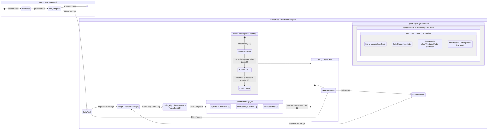

---
tags:
  - CO3008
  - Honours-Degree-Project
  - 30-12-2025
---
[[CO3008 Honours Degree Project]]

---
# Database SQL

```db-schema
CREATE DATABASE IF NOT EXISTS mvp_database; 
USE mvp_database;

CREATE TABLE users (
    uuid VARCHAR(36) PRIMARY KEY,
    first_name VARCHAR(10),
    email VARCHAR(255) UNIQUE NOT NULL,
    password_hash VARCHAR(255) NOT NULL,
    created_at DATETIME NOT NULL DEFAULT CURRENT_TIMESTAMP
);

CREATE TABLE notes (
    uuid CHAR(36) NOT NULL,
    title VARCHAR(30) NOT NULL,
    body TEXT NOT NULL,
    created_at DATETIME NOT NULL DEFAULT CURRENT_TIMESTAMP,
    updated_at DATETIME NOT NULL DEFAULT CURRENT_TIMESTAMP
        ON UPDATE CURRENT_TIMESTAMP,

    PRIMARY KEY (uuid, title),
    CONSTRAINT fk_notes_user
        FOREIGN KEY (uuid)
        REFERENCES users(uuid)
        ON DELETE CASCADE
);

CREATE TABLE calendar_events (
    id INT AUTO_INCREMENT PRIMARY KEY,
    uuid CHAR(36) NOT NULL,
    title VARCHAR(255) NOT NULL,
    start DATETIME NOT NULL,
    end_time DATETIME,
    location TEXT,
    description TEXT,
    created_at DATETIME NOT NULL DEFAULT CURRENT_TIMESTAMP,
    
    CONSTRAINT fk_events_user
        FOREIGN KEY (uuid)
        REFERENCES users(uuid)
        ON DELETE CASCADE
);
```

![[ERD.png]]

---
# Endpoint Testing
## Auth Endpoint Testing
![[CO3008 MVP - Postman Auth Working.png]]
## Login Testing
### Empty
![[CO3008 MVP - Postman Empty Login Body.png]]
### Using Existing Email with Wrong Password


---
# Frontend API Testing
## Registration
### Register with New Account
![[CO3008 MVP - Postman Login Successful Test.png]]
### Register with Wrong Password using Existing Email
![[CO3008 MVP - Postman Failed to Create User.png]]
### Login with Successful Account
![[CO3008 MVP - Postman Successfully Redirect User.png]]
Automatically Directed to Dashboard Page
### Login with Email and Wrong Password
![[CO3008 MVP - Postman Invalid Login Attempt.png]]
## Notes Markdown Rendering/Editing
![[CO3008 MVP - Edit Test Note.png]]
![[CO3008 MVP - Preview Test Markdown.png]]

---
# AFTER MVP
[[React JS Explained In 10 Minutes]] react explained useful similarities to flutter.
## State Transition Diagram for React Version
