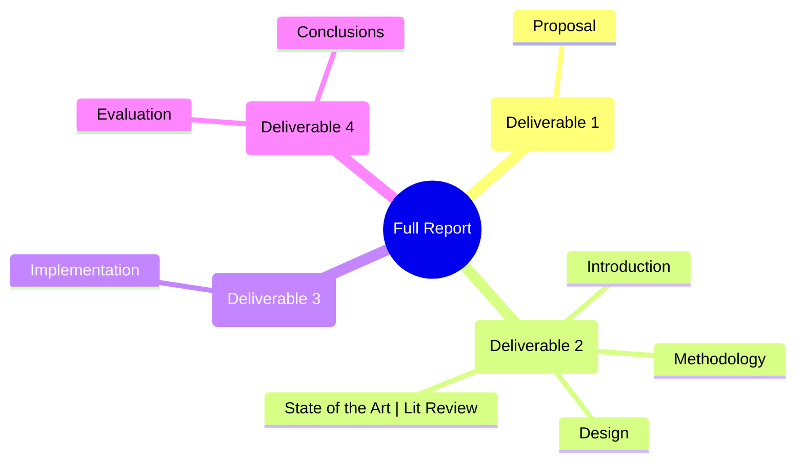
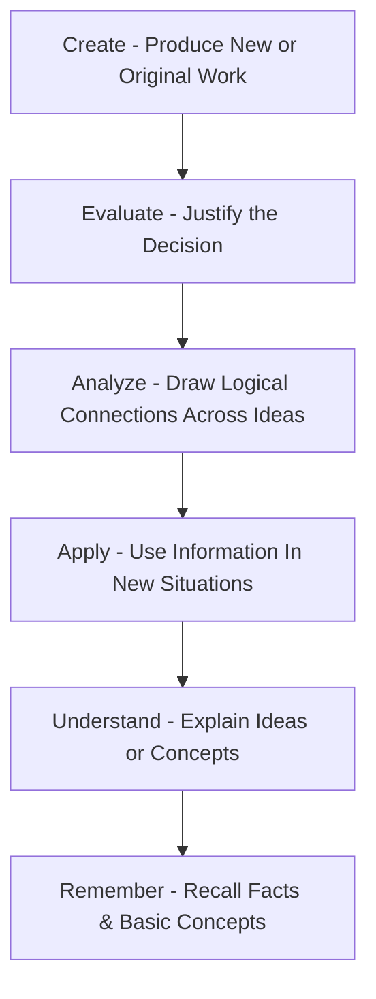

---
tags:
  - CO3008
  - Honours-Degree-Project
---
[[CO3008 Honours Degree Project]]

---
# Lecture Documents
[[CO3008 Lecture 1.pdf]]

---
# Written Lecture Notes
![[CO3008 Lecture 1 - Note 1.png]]
![[CO3008 Lecture 1 - Note 2.png]]
![[CO3008 Lecture 1 - Note 3.png]]
![[CO3008 Lecture 1 - Note 4.png]]
Notes Written During Lecture 29/09/2025

---
# Overview & Ideation
## Lecture Goals
- Outline module structure, aims and learning objectives
- Outline module deliverables
- Explore project ideas 
- Look at past project ideas
## End of Week 1 Goals
- Give overview of overall structure and deliverables of the module.
- Identify areas of interest
- Identify `course relevant` problem

---
# Area of Interest Survey
Complete the area of interest for the project proposal survey before the `23:59 Wednesday 1st October` to obtain supervisor (Should have one by early Week 2)

> Failure to complete form may result in receiving a random available supervisor.
## Supervisor's Role
The following are some of the `do`(s) and `don't`(s) of the supervisor:
### Supervisor Will
- Advise on expectations for deliverables for the chosen project as they will be the one marking it
- May request justification of choices made (Beneficial for report reflection) (Any alternatives?)
- Try and help the student stay on the right track with the work pacing (Via Formative Deliverables)
- Highlight or ask about any potential Ethical or Moral concerns around then project (Ethical clearance is necessary but proposal acceptance)
### Supervisor Will Not
- Provide technical responsibility for the project. (It is the student's responsibility to justify the choices, tools, and skills utilised to complete the stated problem)

---
# Module Details
## Module Information Pack / Project Handbook
[[CO3008 Module Information Pack 2026.pdf]] 

The handbook contains information regarding the assignment brief and provides tips about the module and completing the final year project.

> MIP Analysis: [[CO3008 Module Information Pack]]
## Module Aims
- Provide Confidence & competence in problem-solving
- Provide opportunity to practice creativity, time management, project planning, control and reflection
- Develop skills to critically evaluate work and peer-review
- Improve communicative abilities
- Provide an opportunity for students to research and analyse relevant literature and produce an academic report
- Provide an opportunity for the consideration of enterprise, ethics, social, enterprise and equality, diversity, and inclusion issues
## Core Deliverables
- Computer artefact
 - Two formative iterations
 - One final summative artefact (Early March)

- Report
 - Split into four formal submissions throughout the year
## Last Years Report Structure

> A template will be provided for the report, and separately for the project proposal.
## Submission Process
- All submissions are completed via `Blackboard`
- Templates are provided for `Proposal` & `Report`.

The report is iterative and therefore it is perfectly acceptable to add and resubmit cumulatively.
### Deliverables in Order
- D2 will contain Introduction, Literature Review, and Methodology
- D3 will contain Design and Implementation
- D4 will contain Evaluation and Conclusions

> Each deliverable will add more content to the report with D4 finalising the full report.

> Any significant changes to your project will need to be explained clearly in the evaluation.

---
# Assignment Timetable
![[CO3008 Academic TimeTable CO3008.png]]

|                  Component                  |         Deadline          | Weighting |       Words        |
| :-----------------------------------------: | :-----------------------: | :-------: | :----------------: |
|                  Proposal                   | Friday 24th October 2025  |    10%    |        1000        |
|                Deliverable 1                | Friday 28th November 2025 |    15%    |        4000        |
|        MVP (Minimum Viable Product)         |   W/B 19th January 2026   | Formative | Demo To Supervisor |
|                 Show & Tell                 |  W/B 23rd February 2026   | Formative | Demo To Supervisor |
| Design & Implementation (Includes Artefact) |  Friday 13th March 2026   |    45%    |        3000        |
|          Evaluation & Conclusions           |  Friday 27st March 2026   |    20%    |        2500        |
|             Poster / Viva Exam              |    W/B 13th April 2026    |    10%    |     A1 Poster      |

> Must attend poster demo / viva (`pass/fail`) requirement.

---
# BCS Report Requirements
- Decomposing the problem and objectives of the project
- An in-depth investigation of the context and literature of other similar products
- References
- Projects must pass without compensation
## Where appriopriate
- Clear description of the life cycle undertaken
- Description of how verification validation were applied
- Description of the tools to support the development process
- Description of any research hypothesis.

---
# Proposal (Due Friday 24th October)
The proposal is split into 6 different sections.
## Problem Statement
Brief outline of then problem the project aims to address.
## Ethical Analysis
Discussion of potential ethical issues surrounding the problem and any considerations that are made to ensure the project is completed in line with any moral or ethical standards expected of a computing professional.
## Risk Assessment
An investigation into the potential risks of the project, and plans and contingencies to mitigate those risks.
## Health & Safety Assessment
An investigation into the potential risks both to the public and users of the crafted artefact. 
## Potential for Commercial Development
 A short outline of any envisioned potential for commercialisation/commercial development of the solution. 
## Time & Resources Plans
The time and resource plan should detail the intended time to spend working on the project and any resources utilised while doing, in order to continue towards the outlined problem statement.

---
# Subject Areas
- AI (Artificial Intelligence) / Data Science
- General OO (Object-Oriented) Development
- Web Development
- Embedded Systems
- Games (Commercial Engines OR C++)
- Graphics
- VR/AR/XT
- Mobile (iOS/Android)
- Distributed Systems / Cloud
- General Networking
- Databases

---
# Ideation
> A **good** project _solves a problem_.

The first deliverable will provide a question requesting a 'problem statement'. There are a variety of problems to be solved.
## Identifying The Problem
While the honours degree project may not lead to solving the *big* global societal problems such as but not limited to:
- Climate Change (e.g. Energy Monitor App)
- Crime (e.g. Security Notification System)
- War (e.g. )

Could be an economic problem such as:
- Cost of Living (e.g. Budget Tracking App)
- Inflation (e.g. Store Price (and RRP) Inflation Tracking App)
- Unemployment (e.g. Job Hunting Aggregator Website)

> Perhaps using `APIs` or `Web Scraping` from multiple sources to gather into a webpage to demonstrate economic changes.

Could be related to a user group:
- Elderly (e.g. Support Group Contact Aggregator (i.e. based on location))
- Students (e.g. )
- Parents (e.g. Points for Chores App)

Could be related to a particular interest:
- Hobbies (e.g. Sports Centre Locator (i.e. based on location, and sport))
- Pets (e.g. Pet Keeping Game)
- Music (e.g. Music Lyric Retriever (sources like Spotify))

Could be related to a particular industry:
- Education
- Retail
- Travel

> [!NOTE]
> The solution could come from real life however no matter what it **must be related to the course**.

> [!IMPORTANT]
> The score for the project is determined by the level of technical challenge achieved.
>- There are many solutions to a problem.
>- Feature-Creep should be avoided in favour of creating a Minimum Viable Product which can then be added, to increase the scope.
## Bloom's Taxonomy
The purpose of bloom's taxonomy is to help explain the *process of learning*.

Before a concept can be *understood* it must be **remembered**.
To be able to *apply* a concept it must be **understood**.
In order to *evaluate* a concept it must be **analysed**.
For an *accurate conclusion* to be reached a thorough **evaluation** must be completed.

### Past Project Examples
- Remote Lab Deployment
- Movie Application
- Honeypot
- Personal Security Manager 
- Network Testing
- Virtual Desktop Infrastructure
- Forensic Windows Upgrade
- AI Diamond Appraiser Tool
- VR Archery Simulator
- OSI Animation
- VR Magical Simulation
- Chat Application
- Multi-Genre Video Game Showcase
- Adaptive Generation using Generative Grammars
- Secure Health Fitness Application 
- 3D Platformer Game
- Machine Learning Financial Markets
- Boardgame AI
- File Sorting System
- Radar Interface Testing Tool
- Facial Recognition for Safety
- Procedural Content Generation
- Education Cyber-Security Application
- Fundamental Analysis App
- Operating System Security System
- Real-time Monitoring Solution
- Crypto Tracker
- Facial Recognition Software
- Vehicle Interaction
- Automatic Test File Updater
- System Integration of Microservice REST APIs
- DNS-based File System
- Malware Analysis
- Sport Event Management System
- Social Media Scraper
- Dungeon Crawler RPG
- Realistic Water with Object Interactions
- Natural Language Processing for Spam Detection
- Car Dealership DBMS
- Analysis of User Biometrics using Keylogging
- Raspberry Pi Doorbell with Facial Recognition
- Emergency Services Management Game
- Football Fundraiser Application
- Student Organisation App
- Graphical Physics and Collision Engine
- Card-Based Game using AI
- Food Shopping/Cooking App
- AI Prediction of Greyhound Racing Results
- Procedural Terrain Generation
- Web Application for League of Legends
- Discord Investigation on Windows
- Full-Stack Marketplace Application
- Motion Capture & Synthesis with CV and Robotics
- Learning Management System
- Fitness and Progression Tracking App
- Doctor–Patient Communication System
- 3D Spooky Dungeon Game
- Password Strength Application
- Crypto Miner Malware Analysis
- Typhoon Mission Data Generator
- Zombie Shooter with Procedural Levels
- Human Attraction Analysis Tool
- Creative Football Database
- 2D Role-Playing Game
- School Network Development
- Beauty Studio Reservation System
- Healthcare and Fitness Application
- MANET Development
- Text Messenger 
- Encryption Application
- Tabletop Note-Taking App
- Remote Access Application
- Twitter Scraper

---
# Summary
>[!NOTE]
>You need to start your project early! 
>
>• First deliverable just after reflection week.
>• Split into formal submission points throughout the year to help – Your final report is an *aggregate* of all these submissions.
>• You need to complete the survey by `Weds Oct 1st 23:59` (*Time Passed*).
>• You should have supervisors by end of week 1.
>• Your project should aim to solve a problem.
>• You will be asked to define the problem in your first deliverable (proposal).

---
[[CO3008 Lecture 2 - Proposal]]

