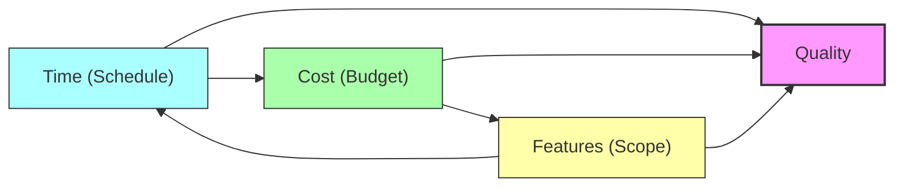

---
tags:
  - CO3008
  - Honours-Degree-Project
---
[[CO3008 Honours Degree Project]]
[[CO3008 Lecture 1 - Overview & Ideation]]

---
# Lecture Documents
[[CO3008 Lecture 2.pdf]]

---
# Written Notes
![[CO3008 Lecture - Note 1.png]]
![[CO3008 Lecture 2 - Note 2.png]]

---
# This Lecture Covers
- Outline what a good proposal consists of
- Outline the Proposal Components as follows:
  - Problem Statement
  - Ethical Analysis
  - Risk Assessment
  - Health & Safety
  - Potential for Commercial Development
  - Time & Resources Plan

---
# Assignment Brief Update
>[!NOTE]
>Available in Assignments folder on Blackboard

It is recommended to read and analyse the brief in full, not just the next deliverable, as well as to avoid accidentally repeating previously made statements.

> The template for the report is not yet available and will be updated shortly.

---
# Supervisors
- Supervisors have been allocated.
- Notified by email today or tomorrow, in which an appointment should be arranged with the assigned supervisor as soon as possible. 

---
# Report Structure
[[CO3008 Proposal Template.pdf]]
[[CO3008 Report Template.pdf]]

- Report Template will be provided structure as follows:
  - Introduction
  - State of the Art
  - Methodology
  - Design
  - Implementation
  - Evaluation
  - Conclusions

---
# The Proposal
- High-Level outline of what the project is 

Working title over time can change some suggestions as per past projects:
- Precedural Dungeon Generation
- AI Diamond Apprasier
- Car Dealership Database Management System
- Crypto Miner Malware Analysis

The point of **submission** the *problem space* should be outlined clearly.

Currently, it is not required to know exactly what technologies will be used or the exact problem to be addressed.
- However at this point exploring options and discussing the possibilities with supervisor is optimal.

It is also important to address any moral or ethical areas.
## Proposal Submission
- Submission by TurnItIn only.
- Must submit a `Word` file.
- Must only submit 1 proposal.
- For time and resources plan (in the event of visual) images can be used to demonstrate progress.

---
# Report Must Include
>[!QUOTE]
>• Elucidation of the problem and the objectives of the project 
>• An in-depth investigation of the context and literature, and where appropriate, other similar products (this section is likely to be emphasised less for an IEng project) 
>• Where appropriate, a clear description of the stages of the life cycle undertaken
>• Where appropriate, a description of how verification and validation were applied at these stages
>• Where appropriate, a description of the use of tools to support the development process
>• A critical appraisal of the project, indicating the rationale for any design/implementation decisions, lessons learnt during the course of the project, and evaluation (with hindsight) of the project outcome and the process of its production (including a review of the plan and any deviations from it)
>• A description of any research hypothesis
>• references

---
# Ethical Requirements
- Do No Harm
- Acquire & Maintain Knowledge & Skills
- Maintain & Deliver True & Accurate Data
- Respect Personal Privacy
- Put The User First - Deliver Systems That Work For The User
- [Use Earth Resources Economically](https://www.bcs.org/articles-opinion-and-research/give-the-planet-a-seat-at-the-table/)
- Build & Deploy Systems That Are Power Efficient

>[BSC Ethical Standards](https://www.bcs.org/articles-opinion-and-research/ethics-doing-the-right-thing-in-it/)

---
# Risk Assessment
All projects carry a risk of failure, this risk is what should be evaluated in the risk assessment, not to be confused with the Health & Safety risks which are related to the user or developer of the project.
## Considerations
- What factors could pose a risk to the project?
- What factors are beyond control?
- What factors are within control?
- How to mitigate risk factors?
## Suggested Table
| Risk | Severity | Likelihood | Action To Take/Mitigation |
| :--: | -------- | ---------- | ------------------------- |
|      |          |            |                           |

---
# Health & Safety
Neglecting health & safety would be unethical, as such these are considered separately from the risk assessment to ensure systems are safe to use.

Health & Safety Assessment should be assessed within the **defined problem space**.
- Identify potential health & safety risks
- Identify mitigating measures
- Consider both the artefact & development process

> It is essential to consider the potential users and general public, as well as the equipment utilised in the process of the project.

---
# Time Planning
There are certain milestones that are expected to be submitted within the module.
## Milestones
- Formative Implementation Deadlines
- Written Submission Deadlines

> There is a note to ensure not to fall behind, and in the event of that how will it be caught back up, to not squander time, and ensure control of the resources available.

>[!WARNING]
>It is **not possible** to produce a successful project solely based on a period of intense activity immediately before final deadline.

It is recommended to work consistently and effectively logging progress throughout the duration of the project. (e.g. *Kanban Board*, *Gantt Chart*, etc)

>[!For Help & Advice] 
>Supervisor is a resource.
>Academic Coach is a resource.
## Time Planning Techniques
- Kanban Charts + Estimation (Suggested: [`Trello`](https://trello.com/))
- Goal Setting
- ABCD Technique
  - Do not ignore most important or valuable tasks
  - Prioritise (MoSCoW at a finer level)
  - Consider the Pareto Principle (80/20 Rule)

---
# Iron Triangle
A symbol used within agile.

![[CO3008 the-iron-triangle.png]]

> If **any** of the above elements become *variable* so must **all the others**.
> - Assuming *Quality* is a constant.

---
# The Pomodoro Technique
- Time Management Methodology
- Created by a student to help with studies
- Uses timer to break down work into set intervals
- Traditionally 25 minutes, proceeded by breaks and repeated sequentially
- Widely popularised by online timers & tools
- Closely related to [timeboxing](https://en.wikipedia.org/wiki/Timeboxing) & [incremental development](https://en.wikipedia.org/wiki/Iterative_and_incremental_development)

---
# Resource Planning
- Time may only be **one** resource for your project
- May require specialised equipment which maybe, acquired at the university stores
- Supervisor is a resource
- University labs are a resource
- University library is a resource

> It is important to make note of any resources that are gathered during the potential success of the project and plan accordingly.

---
# Proposal Structure (Due Friday 24th October)
- Problem Statement - Brief outline of problem to be addressed
- Ethical Analysis - Discussion of potential ethical or moral implementations and how they are to be addressed ensuring the project meets ethical standards.
- Risk Assessment - Assessment of risks to the project itself (e.g. setting too limiting time constraints leading to failure.)
- Health & Safety Assessment - Individual, Users, and Public health and safety implications.
- Potential for Commercial Development - Short outline of potential of commercialisation of project
- Time & Resources Plan - Plan for managing time and project resources, it should detail how the time and what resources were spent over the duration of the project, as to outline a clear projection working towards the problem.

---
# Summary
- Supervisor Updates
- Reviewed Proposal Components
- Explored Time & Resource Plan Options

---
[[CO3008 Lecture 3 - Ethics]]