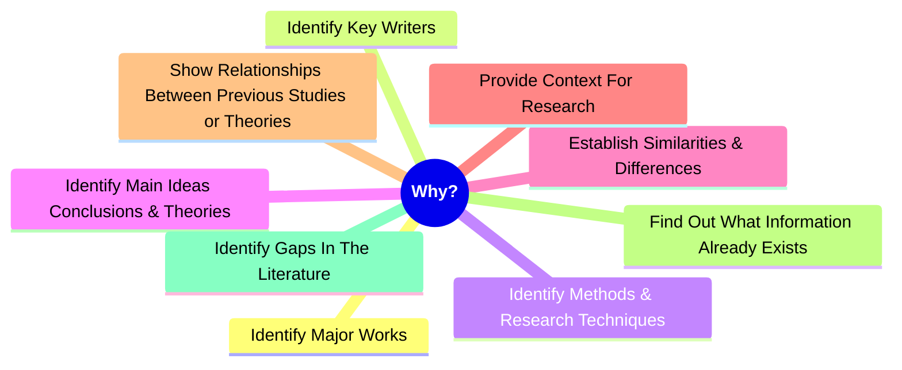
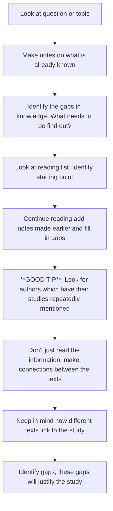
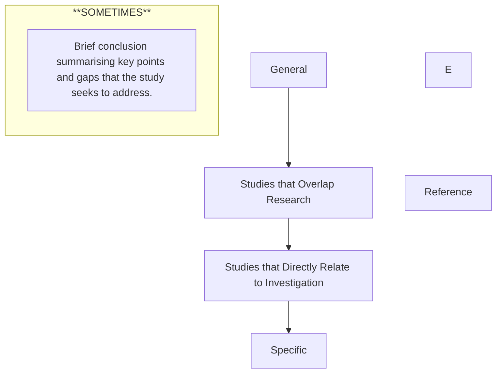

---
tags:
  - CO3008
  - Honours-Degree-Project
---
[[CO3008 Honours Degree Project]]
[[CO3008 Lecture 4 - Guest Speaker (Gillian Kendall) - Careers & Employability]]

---
# Lecture Documents
[[CO3008 Lecture 5.pdf]] (Slides: 1 - 27)

---
# Written Notes
![[CO3008 Lecture 5 - Note 1.png]]

---
# What is the State of the Art Section
"Background reading is a select analysis of existing research which is relevant to your topic, showing how it relates to your investigation or project. It explains and justifies how your investigation may help some of the questions or gaps in this area of research."

---
# Purpose of State of The Art
- Helps define and limit research area.
- Puts study into context/perspective.
- Helps avoid unnecessary duplication.
- Can evaluate promising research methods

---
# Skills Required For Section
>[!faq]
># Before Writing
>## **Information Searching**
>Locate sources, subject journal list.
> > It is recommended to create own reading list of sources.
>## **Source Evaluation**
>Is it reliable relevant, and up-to-date?
>## **Reading Skills**
>Scanning, skimming, and critical reading.
>## **Note-Taking**
>Organised, memorable, and structured.
>## **Planning & Organisation**
>Structure ideas for the writing stage.
># During Writing
>## **Referencing**
>Check [[CO3008 Assignment Brief Notes]] for requirements.
>## **Academic Style**
>Clear, concise, & explicit.
>## **Paragraph Structure**
>One theme/focus per paragraph.
>## **Spelling & Grammar**
>Use spellchecker and check for common errors.
>
>**Proofread as go**.

---
# State of the Art Process

---
# Writing Advice
## What Should Be Written About?
- What has already been written about the topic
- What has not been written on the topic
- How research conducted or project addresses the gap or weakness in the existing knowledge base
- Reviewing the literature is not simply reproducing/summarising but showing how the literature relates to the research project.
## How Should It Be Structured
- A background reading section - organised around and related directly to research or artefact being developed.
- Group authors who worked on similar themes & link ideas.
- Make clear links between ideas inside the background reading, research, and progress on artefact.
- Evaluate material according to the main concept (i.e. problem statement) of the research problem/artefact.
- Voice (tone) of writing should be neutral, the sources should support what is being assessed by the material.
## Typical Structure

---
# Literature Review Should
- **Introduce** - introduce the reader to the topic area (i.e. the problem to be solved) and provide information needed to understand the research study.
- **Create Summary** - What is and not is known about the topic area.
- **Formulate Questions** - What requires further more extensive research
- **Specify Aims** - The aims and objectives of the project.
- **Justify** - Justify the need for the artefact.
## Reviewing Literature
- **Compare & Contrast** - Different authors may have different views on the issue and it is important to assess different sides.
- **Grouping** - Authors who draw similar conclusions.
- **Criticising** - Problems that may exist within aspects of the chosen methodology.
- **Exemplary Studies** - Highlighting high quality sources.
- **Gaps in Research** - Highlight gaps in the research.
- **Research Progression (Generally)** - How the literature review will build on the work of previous studies.

>[!WARNING] Literature Review Should **NOT**
>- Present a *list* of studies or authors that are discussed one-by-one.
>- Sound like a *story* or *descriptive account*.

---
# Literature Review Examples
>[!IMPORTANT] **BAD EXAMPLE**
>JACHOWSKI (1964) developed a model investigation conducted on the interlocking precast concrete block seawall. After a result of a survey of damages caused by the severe storm at the coast of USA, a new and especially shaped concrete block was developed for use in shore protection. 
>
>HOM-MA and HORIKAWA (1964) studied waves forces acting on the seawall which was located inside the surf zone. On the basis of the experimental results conducted to measure waves forces against a vertical wall, the authors proposed an empirical formula of wave pressure distribution on a seawall. 
>
>SELEZOV and ZHELEZNYAK (1965) conducted experiments on scour of sea bottom in front of harbor seawalls, basing on the theoretical investigation of solitary wave interaction with a vertical wall using Boussinesque type equation.

>[!IMPORTANT] **GOOD EXAMPLE**
>Research in the area of AS/RS has followed several avenues. Early work by Hausman, Schwarz and Graves (2007) was concerned with storage assignment and interleaving policies, based on turnover rates of the various items. Elsayed (2009) and Elsayed and Stern (2008) compared algorithms for handling orders in AR/RS. Additional work by Karasawa et al. (2007), Azadivar (2009) and Parry et al. (2007) deals with the design of an AS/RS and the determination of its throughput by simulation and optimization techniques. Several researchers addressed the problem of the optimal handling unit (pallet or container) size, to be used in material handling and warehousing systems. Steudell (2006), Tanchoco and Agee(2005), Tanchoco et al. (2009) and Grasso and Tanchoco (2007) studied various aspects of this subject.
## Good Example Reasoning
- **Grouped Similar Information** - Steudell (2009), Tanchoco (2008) and Agee(2008), Tanchoco et al. (2005) and Grasso and Tanchoco (2009) studied various aspects of this subject.“
- **Shows The Relationship** - Between the work of different researchers, discussing similarities and differences: "The general results, reflect the stochastic nature of the flow of goods, are *similar* to those reported by Rosenblatt and Roll (2008)".
- **Indicator of Position** - Indicated the position of the work in the research area history: "Early work by Hausman, Schwarz and Graves . . . "
- **Discussed General to Specific Area** - Moved from a *general* research in AS/RS to the more *specific* area (optimal container size) previous work to their own define it, justify it, and explain it.

---
# Formal Academic Style
- Write concisely
- In the 3rd Person (i.e. **do not** use 'I', 'we', 'you', etc)
- Be objective and respectful of others' opinions.
- Don't use emotive language or express strong personal opinions.
- Choose your reporting verb carefully: don't use "says" but use "argues", "claims", or "states".

>[!EXAMPLE] Provided Wordbank
>[Manchester Academic Wordbank](https://www.phrasebank.manchester.ac.uk/referring-to-sources/)

## Tense
- Use **present** tense for general opinions and theories, or the **past** when referring to specific research and experiments:
  - "Although Trescovick (2001) argues that attack is the best form of defence, Boycott (1969) claims that..."
  - "In a field study carried out amongst the homeless of Sydney, Warne (1999) found out that ..."
## Flow
- Flow is interrupted when the reader pauses to understand.
- Provide clear explanations.
- Avoid one sentence paragraphs.
- Leave out material that does not contribute directly to the discussion, argument, or development of a theme or idea.

---
# Final Suggestions
- Keep revising the work in this section as it will be a work in progress.
- Continue reading around the subject and adding to the section.
- Re-read the State of the Art at least once a week and keep improving it incrementally.

---
# Summary
- Stay strictly relevant to the research topic.
- Reference accurately and consistently.
- make it obvious why you are carrying out your research in light of your readings.

---
# Lecture References
- Higher Education Academy (2011). Deep and surface approaches to Learning. [online] Available at: http://exchange.ac.uk/learning-andteaching-theory-guide/deep-and-surface-approaches-learning.html [Accessed 9th April 2015].
- Lincoln University. (n.d.). What is a literature review? http://library.lincoln.ac.nz/Research/Writing-your-research/LiteratureReviews/What-is-a-literature-review/ 19/02/15
- University of Reading. (n.d.). Starting a literature review. http://www.reading.ac.uk/internal/studyadvice/StudyResources/Essays/ sta-startinglitreview.aspx 19/02/15

---
[[CO3008 Lecture 6 - State of the Art - Part 2]]