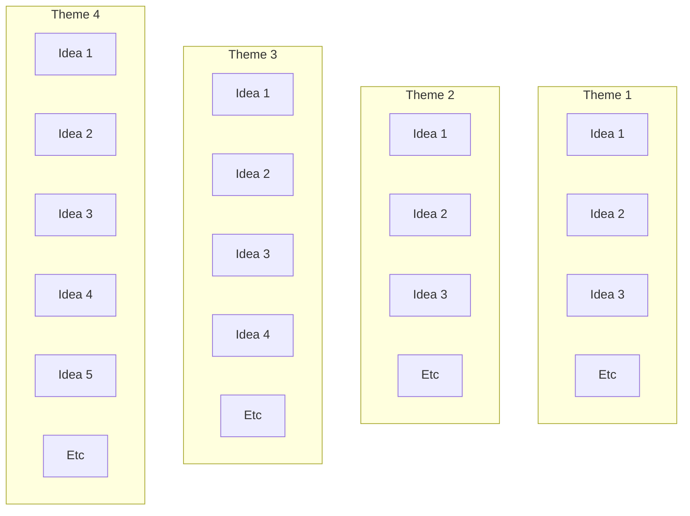
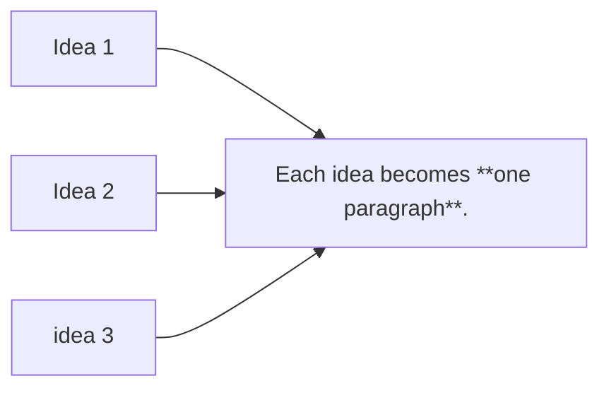

---
tags:
  - CO3008
  - Honours-Degree-Project
---
[[CO3008 Honours Degree Project]]
[[CO3008 Lecture 5 - State of the Art - Part 1]]

---
# Lecture Documents
[[CO3008 Lecture 5.pdf]] (Slides: 28 - 37)

---
# Written Notes
![[CO3008 Lecture 6 - Note 1.png]]

---
# Plans & Paragraphs
Make a plan before writing the State of the Art.

## Paragraphs
- Paragraphs have a structure.
- A paragraph should have one **main idea**.
- This main idea is usually expressed clearly in one sentence, the first or 'topic sentence'.
- Paragraphs have a beginning, middle and end.
- Middle section is the explain, develop, and illustrate or modify the main idea in the topic sentence.
- The last sentence often returns to the first in the topic sentence to show it has progressed.
- Read the main idea first and understand the idea will develop before moving on.
- Plan each paragraph so that it develops a single point. They can be used to link related points or plan an overall structure.
- Write the start with a clear concise statement of the point that is being made, then add detail. 
- Start a new paragraph when a new point is started.
## Theme 1

---
# Theme Paragraph Example
>[!EXAMPLE]
>For offsite construction to make a significant contribution to the UK market, it is necessary to consider its perceived benefits and shortcomings. Factors such as quality, time and cost are integral to such deliberations. In a study exploring the options of groups involved in the UK construction, Goodier and Gibb (2007), through respondents identified reduced initial and whole list costs as a clear advantage, overall cost of offsite construction. Similarly, despite the proposal of various costing solutions, the research marked that many still failed to fully take into consideration the hidden financial effects that improved quality and reduced snagging could have. It is therefore critical that project teams consider offsite construction do so following a more engaged, deeper assessment of its merit and limitations. Furthermore, with the age of such research, and no concrete measure to prove or disprove the opinions obtained, it is essential that more up-to-date, robust research is undertaken to confirm or refute these perceptions. Not doing so could mean that the UK continues failing to fully capitalise on the financial advantages offsite construction can have in a changing market.

---
# If Stuck
1) Ask `Why am 'I' writing this?` Justify your text and direction in your own head.
2) Try to write content that means the reader/marker doesn't have to ask themselves `So What?...` If they are, you have a problem because they don't understand or follow your content or know why it is there.
## Usage of 'I'
Permitted but warned to be careful
>[!QUOTE]
>Using *I* tends to lead to informal writing so use it sparingly.

---
# EDIT ONE
>[!EXAMPLE]
>**EDIT ONE**
In the mid 2000’s, the empirical evidence for the effectiveness of games as learning environments was scant (O’Neil et al., 2005). While some research claimed that learning with interactive environments such as games and simulations is only effective when supported by effective instructional measures (Egenfeldt-Nielsen, 2006), other reports record a negative effect of games on learning, but a positive effect on motivation (Rieber, 2005). More recent reviews of empirical evidence on the benefits of computer games for learning across the curriculum find that the most frequently occurring impacts are improved knowledge acquisition and content understanding and affective and motivational outcomes (Connolly et al., 2012: 661). Other publications encourage and validate the use of computer games for learning and suggest the need for a pedagogy of games (Ulicsak and Williamson, 2010). Latest evidence for games based-learning in schools (Perotta et al., 2013) suggests that there is a split in the literature regarding the extent to which computer games impact on academic achievement, where some studies observe improvements and others do not. However, it is a consistent finding that computer games have a positive impact on problem solving skills, broader knowledge acquisition, motivation and engagement. Attitudes to learning are improved when games and simulations are used, compared to traditional methods, but the evidence for improved attainment is less secure (Ibid.). **[218]**

---
# EDIT TWO
>[!EXAMPLE]
>**EDIT TWO**
>In 2005, empirical evidence demonstrating the effectiveness of games as learning environments was rare (O’Neil et al., 2005). Some research claimed that games and simulations needed supplementing with clear instruction to be effective (Egenfeldt-Nielsen, 2006), while others showed a positive effect on motivation coupled with a negative effect on learning (Rieber, 2005). Recent evidence, taken from across the curriculum, suggests some positive impact on knowledge acquisition, content understanding, as well as affective and motivational outcomes (Connolly et al., 2012). Other publications even propose the need for a games led pedagogy (Ulicsak and Williamson, 2010). In the end, however, the overall evidence supporting the efficacy of games based-learning in schools is inconclusive (Perotta et al., 2013). Attitudes to learning are certainly enhanced when games and simulations are employed in a teaching context, but the evidence for improved attainment is less secure. **[140]**
>

---
# Slide Provided Example & Colours
![[CO3008 Lecture 6 - Theme Colour Code.png]]
![[CO3008 Lecture 6 - Theme Paragraph Example.png]]

---
[[CO3008 Lecture 7 - Introduction, SoA & Methodology]]