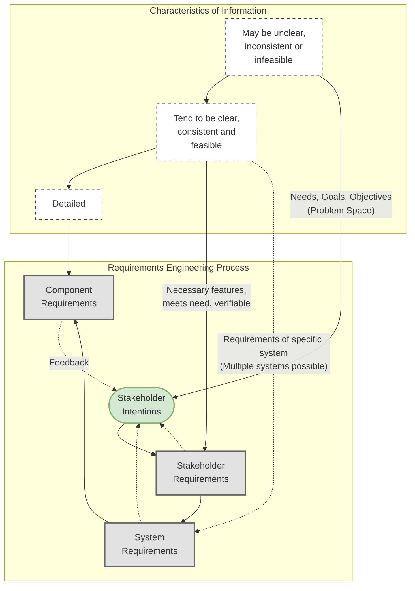
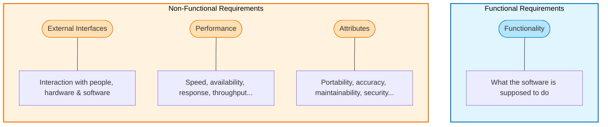
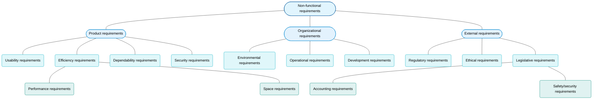
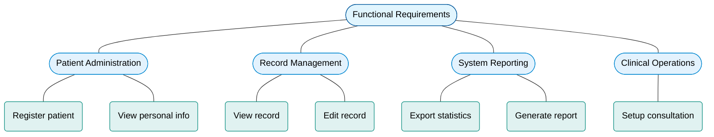
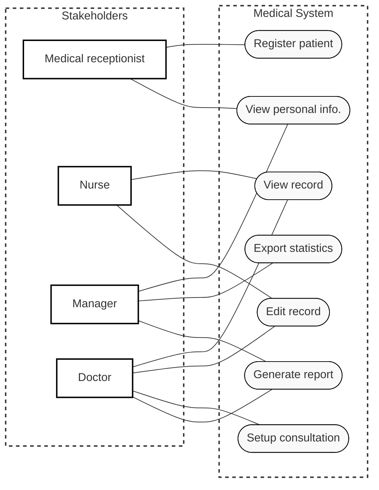

---
tags:
  - CO3008
  - Honours-Degree-Project
---
[[CO3008 Honours Degree Project]]
[[CO3008 Lecture 8 - Prototyping]]

---
# Lecture Documents
[[CO3008 Lecture 9.pdf]]

---
# Written Notes
![[CO3008 L9 - N1.png]]

---
# Lecture Objectives
- Understand the different types of requirements that should be considered/specified in the project.
- Explore approaches to requirements analysis and specification
- Describe the role of Requirements Engineering
- Select an approach appropriate for the specific project
- Have a plan for specifying requirements in the next report deliverable.

---
# Managing Your Supervisor
- Gap in summative submissions now until midway through semester 2
  - Don't lose momentum steady progress throughout the year is optimal
- Your supervisor is not just a marker they are a resource.
- To obtain the most out of the supervisor is it best to put some thought into communications with them to do the following:
  - Show them that thought has been put into the questions being asked
  - Go to meetings with a clear objective so this can be communicated
  - Be prepared to show things and be prepared to talk about them.

---
# Types of Requirements
>[!QUOTE] **User Requirements**
>Statements in natural language plus diagrams of the services the system provides and its operational constraints. Written for customers.

>[!QUOTE] **System Requirements**
>A structured document setting out detailed descriptions of the system's functions, services and operational constraints. Defines what should be implemented so may be part of a contract between client and contractor.
## Mentcare Example

>[!QUOTE] **User Requirements Definition**
>The Mentcare system shall generate monthly management reports showing the cost of drugs prescribed by each clinic during that month.

>[!QUOTE] **System Requirements Specification**
>1.1. On the last day of each month, a summary of the drugs prescribed, their cost and the prescribing clinics shall be generated.
>1.2. The system shall generate the report for printing after 17.30 on the last working day of the month.
>1.3. A report shall be created for each clinic and shall list the individual drug names, the total number of prescriptions, the number of doses prescribed and the total cost of the prescribed drugs.
>1.4. If drugs are available in different dose units (e.g. 10mg, 20mg, etc) separate reports shall be created for each dose unit.
>1.5. Access to drug cost reports shall be restricted to unauthorised users as listed on a management access control list.

---
# Agile Methods and Requirements
- Many agile methods argue that producing detailed system requirements is a waste of time as requirements are not well known or change so quickly
- A formal requirements document is therefore out of date
- Agile methods usually utilise **Incremental Requirements Engineering** and may express requirements as *user stories*.
- This is practical for business systems but problematic for systems that may require pre-delivery analysis (e.g. critical systems) or systems developed by several teams.

---
# Requirements Engineering
- The process of establishing the services that a customer requires from a system and the constraints under which it operates and is developed.
- The system requirements are the descriptions of the system services and constraints that are generated during the process.

---
# What Do Requirements Cover

---
# Functional Requirements Example
- A user shall be able to search the appointments lists for all clinics.
- The system shall generate each day, for each clinic, a list of patients who are expected to attend appointments that day.
- Each staff member using the system shall be uniquely identified by his or her 8-digit employee number.
- Problems arise when functional requirements are not precisely stated.
- Ambiguous requirements may be interpreted in different ways by developers and users. 
- Consider the term ‘search’ in first requirement.
- User intention – search for a patient name across all appointments in all clinics.
- Developer interpretation – search for a patient name in an individual clinic. User chooses clinic then search. 

---
# Non-Functional Requirements
- These define system properties and constraints e.g. reliability, response time and storage requirements.
- Process requirements may also be specified mandating a particular IDE, programming language or development method.
- Non-functional requirements may be more critical than functional requirements. If these are not met, the system may be useless.
## Non-Functional Requirement Types

---
# Demonstrating a Structured Approach
A good set of requirements will require analysis of the problem domain.
- How were the requirements arrived at?

UML diagrams can help with analysis and specification.
- Use Case Model: Diagram & Descriptions
  - Functional, System Behaviour as seen by the user.
- Activity Diagrams
  - Model Business Activities (processes)
  - OR ANYTHING that requires a specific process (e.g. Player Decision Making)

---
# Use Cases
## Functional and Non-Functional Requirements

## Mentcare Use Case Example

---
# Communicating Requirements
- Requirements should be stated concisely and clearly
- How is it known when a requirement has been met?
  - Is it measurable/testable? Makes life easier in later sections of the report
  - Is it achievable?
- Summarise in the report and save any detail for an appendix. E.g. could include use case diagram in the report (doesn't affect word count) and associated use case descriptions in an appendix.
- Practice communicating the functional and non-functional requirements in a supervision discussion
  - In addition to subtly planting the seed with the supervisor that requirement gathering is being taken seriously and also helps check that the requirements are clear, appropriate, and testable.

---
# User Stories
Represent functionality that is valuable to user or owner of system.
- Not a full description
- A note/marker that something is needed.
- In simple language: user/problem domain
  - Starts the process of developers understanding

Detail obtained through conversation between user/client and developer.
- Possibly with prototyping
- A story promises a future conversation

People naturally think in narratives/stories.
As people, humans have a grasp of:
- characters
- desires
- motivations

First thing to think about in user stories is:
- The Character/Role
  - Who is this task being done for
  - Who's perspective do we need to consider when
    - Designing a feature.

Second thing to think about in user stories is:
- What is it that is wanted to be accomplished? (E.g. functionality)
- Usually forms the main part of a user story.

Third thing to think about in user stories is:
- Motivation for wanting the functionality.
  - Why does this character want this thing?
  - How is it going to serve this this person?
  - Motivation provides context.

Often **Needs** will change according to user roles.
### User Story Example
**As a** `Sububan Commuter`,
**I want** `a car`,
**So that** `I can drive to work`.

## User Story Format
- As a `<type of user>`
- I want `<some function>`
- So that `<some reason>`

>[!quote]
>Other formats can be used but this one explicitly identifies:
>- Who?
>- What is needed?
>- Why?

---
# Comparing User Stories To Use Case Models
- User stories - brief indication of a need/feature
  - Should indicate user type/role and reason for feature
    - Try not to be too generic with reason
  - To be expanded by discussion with stakeholders.

---
# Summary
- Explored Types of Requirements  
	• Functional vs Non Functional
  
- Explored Approaches to requirements analysis and specification  
	• Requirements Engineering, Use Case Models, Activity Diagrams.

- Compared to some formal vs traditional approaches to specification  
	• Use Case Model vs User  
Stories

---
[[CO3008 Lecture 10 - Guest Speakers - DWP]]