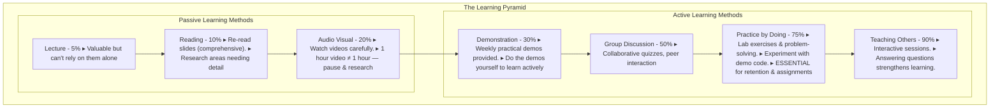
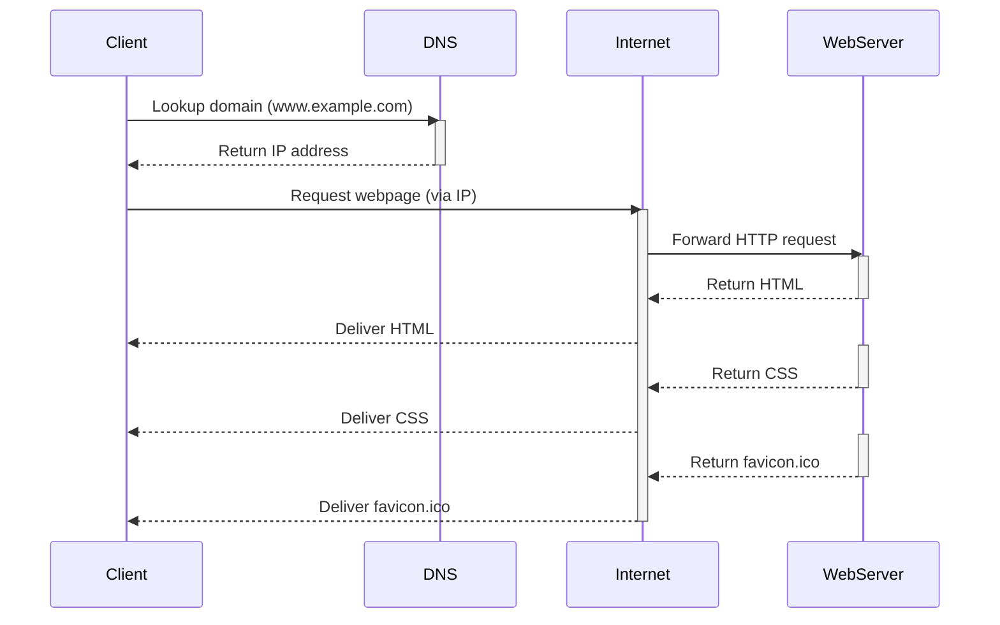

---
tags:
  - CO3404
  - Distributed-Systems
---
[[CO3404 Distributed Systems]]

---
# Lecture Documents
[[CO3404 Lecture 1.pdf]] (Sliders 1 - 18)
[[CO3404 L1 - Lab 1 - Basic HTML.pdf]]
>Lecture Continued in [[CO3404 Lecture 2 - Introduction Continued]])

---
# Written Notes
![[CO3404 Lecture 1 - Note 1.png]]
![[CO3404 Lecture 1 - Note 2.png]]
![[CO3404 Lecture 1 - Note 3.png]]

---
# Value of Module
- Provide knowledge of current industry best practices and standards
- Distributed Modelling described in terms of large enterprises/organisations/governmental departments. (e.g. Amazon, DWP, Asda, Banks, etc)
- This module does not focus on past technologies and concentrates toward the current & the future.

---
# Job Prospects
Areas Covered by this Module:
- RESTful
- Node.js
- NoSQL
- REST
- OAuth
- Azure
- JavaScript
- Kafka

---
# Module Aims Summary
1) Create a distributed-system application.
2) Key design concepts: scalability, security, heterogeneity, concurrency, and containerisation.
3) Analyse technologies and patterns.
4) How modern distributed systems support business
5) The need to deliver business value rather than technical perfection

> Assignment Weighting: 50% Assignment, and 50% Exam.

---
# Learning Pyramid

In summary: The slides state that <b>it is essential to practice</b> to succeed.

---
# Basic 3-Tier Client-To-Server Architecture Monolithic
![[CO3404 AWS 3-Tier Architecture.png]]
3 Tier Architecture Diagram

Example Sequence Diagram for 3 Tier Web Server

---
# Monolithic Architecture
>[!NOTE] ChatGPT Summary on Monolithic Architecture
>A **monolithic architecture** is essentially one large *program*. Even if it’s designed to be modular, in practice it often can become a single behemoth containing hundreds of thousands, or even millions, of lines of code. Typically, the application relies on a single database. This makes managing data straightforward, ensures strong consistency, and often delivers good performance.
>
> For resilience, the monolith may run on a cluster of servers. But scaling becomes inefficient: when demand grows in just one area of the system, the entire application must be replicated. The problem is not that monoliths are slow—quite the opposite, they can be highly performant because everything runs in-process—but their size and complexity create real challenges.
>
> Code changes are risky because the system is tightly coupled. A small change in one part of the application can create unexpected consequences elsewhere. To avoid this, organisations are forced to perform full regression testing—both functional and performance testing—every time changes are introduced. These test cycles can take months. As a result, improvements are often delayed, and users are left to find workarounds until the next major release.
>
> That said, monoliths are not inherently bad. For smaller systems, such as a simple website for a small business, a monolithic approach is perfectly reasonable. The codebase is small enough to understand and test, and updates can be delivered without months of overhead.
>
> The challenge arises in large organisations such as Tesco, Amazon, Netflix, or government departments. Their platforms are huge, their business processes complex, and their user bases massive. They need to adapt quickly to shifting customer needs, market forces, or government policies. For them, waiting six months or more to release changes is unacceptable. This is where the limitations of the monolithic approach become painfully clear, and why a new architectural style—such as microservices—has emerged.

---
[[CO3404 Lecture 2 - Introduction Continued]]