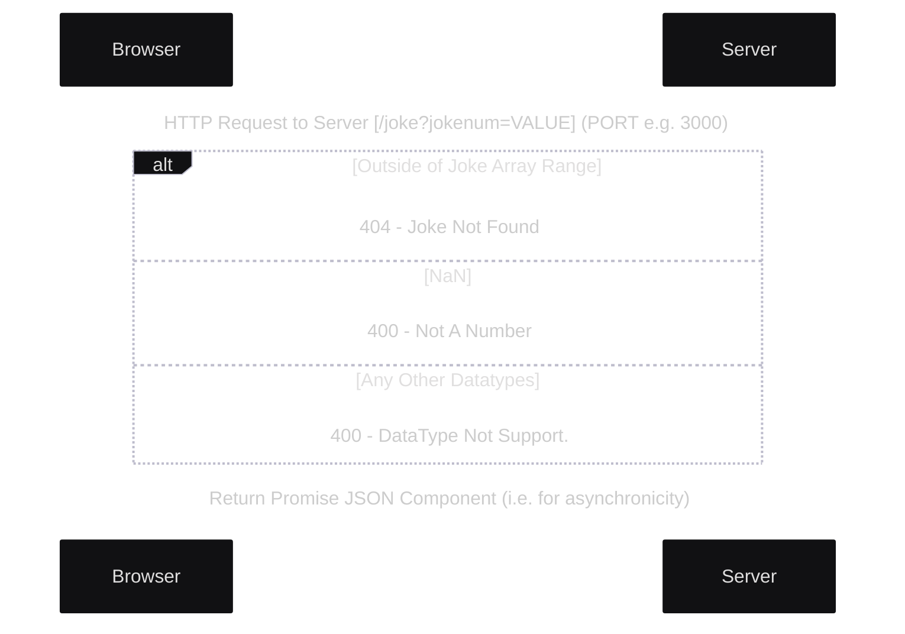

---
tags:
  - CO3404
  - Distributed-Systems
---
[[CO3404 Distributed Systems]]
[[CO3404 Lecture 2 - Introduction Continued]]

---
# Lecture Documents
[[CO3404 Lecture 3.pdf]]
[[CO3404 L3 - Lab 3 - Frontend Calling Node API.pdf]]
# Demos
[[CO3404 L3 - firstAPI.zip]] - Demo showing express route callbacks using named functions.

[[CO3404 L3 - firstAPI2.zip]] - Same demo as firstAPI but using arrow functions in route callbacks.

[[CO3404 L3 - functions.zip]] - How to write and call functions in different ways; arrow functions and callbacks.

[[CO3404 L3 - fetchBasic1.zip]] - Demo showing fetch being used to make a GET request using *async/await* also demonstrates the impact of blocking and non-blocking (i.e. the single JS thread) operations.

[[CO3404 L3 - fetchDemo1.zip]] - Demo covers the following:
- Emulates getting data from a database
- VSCode launch script to debug front, back or both
- Returning data from an API call to then dynamically populate dropdown list and table with product info
- Illustrates POST API call using *fetch*.
- Illustrates some standard middleware to parse JSON from the request body and serve static web pages.
- Heavily commented for code explanation

---
# Written Notes
![[CO3404 Lecture 3 - Note 1.png]]
![[CO3404 Lecture 3 - Note 2.png]]
![[CO3404 Lecture 3 - Note 3.png]]

---
# Learning Objectives
1) Explain how to structure data using [JSON](https://en.wikipedia.org/wiki/JSON).
2) Explain the structure of a [URL](https://en.wikipedia.org/wiki/URL).
> Relevant Existing Note: [URL - Web Requests](HyperText%20Transfer%20Protocol%20(HTTP)#%20Uniform%20Resource%20Locator%20(URL)).
3) Explain the concept and operation of a [Web API](https://en.wikipedia.org/wiki/Web_API).
4) Explain the concept of [RESTful APIs](https://aws.amazon.com/what-is/restful-api/).
5) Design an API URL with path and query parameters.
6) Create and test a [NodeJS](https://en.wikipedia.org/wiki/Node.js) / [ExpressJS](https://en.wikipedia.org/wiki/Express.js) API.

---
# Terminology
- **URL** - Uniform Resource Locator - Full address used to access a resource.
- **Origin** - Origin Host of Web Server - The Scheme, Domain, and Port.
- **Path** - API Path or Website Directory - The part of the URL that comes after the domain.
- **Query String** - - Acts as a filter or limiter of returned data.
- **Endpoint** - API Endpoint - A specific URL (or path) that represents a resource or action in an API, usually a method.
- **Route** - - In backend frameworks (i.e. express js, sprint boot, flask) a route is a *server-side* mapping between a URL pattern and either a function or controller.

---
# Communication using HTTP
> Relevant existing note: [[HyperText Transfer Protocol (HTTP)]] & [[HTTP Headers]].

Some common data structures typically passed using HTTP are:
- [HyperText Markup Language (HTML)]()
- Text
- [eXtensible Markup Language (XML)]()
- JavaScript Object Notation (JSON)

>[!TIP]
> The key commonality in all these data formats is that they are all text (i.e. characters) which avoids incompatibility between different languages, operating systems, processor types, etc this as they all support the basic character set so data transferred as characters is *uniquitous* (however, there are some [exceptions]()).

---
# JSON (JavaScript Object Notation)
| ID  | First Name | Last Name | Age |
| --- | ---------- | --------- | --- |
| 1   | Jim        | Smith     | 35  |
| 2   | Joe        | Soap      | 52  |
| 3   | Jane       | Doe       | 55  |

Data is comma delimited name:value (sometimes called key:value) pairs.
## JSON Table Example

```json
[
	{"ID":1,"firstName":"Jim","lastName":"Smith","age":35},
	{"ID":2,"firstName":"Joe","lastName":"Soap","age":52},
	{"ID":3,"firstName":"Jane","lastName":"Doe","age":55}
]
```

- JSON syntax is native to JavaScript, almost no conversion is *necessary* to send or receive and interpret data.
-  Structure at both ends (Whether sending or receiving JSON data) still needs to be known.
---
# Application Interface Protocols (APIs)
An API is an **Application Programming Interface (API)**.
## What is an API
A well-defined interface contract. (e.g. function name, parameters, and types) enabling one program to use functionality from another.
## API Types
**System API** - Allows software to interact with the operating system. (e.g. files, processes, audio, memory. etc)

>[!EXAMPLE] System API Example
>```cpp
>#include <windows.h>
>int main()
>{
>	PlaySound(TEXT("C:\\Windows\\Media\\my_sound.wav"), NULL, SND_ASYNC);
>	return 0;
>}
>```

**Web API** - Communications over the internet typically using HTTP. Allowing program's send a request and the web server answers back with the [JSON](https://www.json.org).

>[!EXAMPLE] Web API Example
>```javascript
>const collectData = () => { fetch("https://api.example.com/data").then(response => 
>{
>	if (!res.ok) {
>		throw new Error("Network got grumpy: " + response.status);
>		return res.json();
>		}).then(data => 
>		{
> 			console.log("Fetched wisdom:", data);
>		}).catch(error => 
>		{
>			console.error("Fetch gremlins appeared:", error);
>		});
>}
>```

**RPC (Remote Procedure Call) API** - Allows for a single computer to run a function on a different computer, as if it were local to the original. Instead of using web requests (e.g. REST) invokes the action over the network, the system handling the request and sending it to the network. (e.g. [gRPC](https://grpc.io/), [JSON-RPC](https://en.wikipedia.org/wiki/JSON-RPC), [SOAP](https://en.wikipedia.org/wiki/SOAP))

**Database API** - The APIs which allow software to send data and instructions to databases (e.g. MySQL commands), or for NoSQL databases it may use JavaScript objects and methods for queries such as `db.users.find()`.
  **Hardware API** - At the software layer can allow programs to control physical devices without having to communication in machine code. (e.g. GPU APIs like [Vulkan](https://www.vulkan.org/) or [Metal](https://en.wikipedia.org/wiki/Metal_(API)))
## How do Web APIs work


---
# URL
>[!Important] The Uniform Resource Locator Structure
>```
>scheme://host:port/path?query#fragment
>```
>**Scheme** -> Protocol (HTTP, HTTPS, FTP, MailTo, etc)
>**Host** -> Domain or IP Address
>**Port** -> HTTP (80), HTTPS (443)
>**Path** -> Location on the server (i.e. files/folders)
>**Query** -> Data parameters (`key=something&otherkey=somethingelse`)
>**Fragment** -> Page anchor (Handled by *Browser* **is not** sent to server)

Scheme and domain are case insensitive, the rest is case sensitive.
The following characters do not require encoding:
- `0-9` 
- `A-Z`
- `a-z`
- `-` 
- `.` 
- `_`
The rest require URL encoding (i.e. [percent encoding](https://en.wikipedia.org/wiki/Percent-encoding)). For example:
**Space** - `%20`
**?** - `%3F`
**#** - `%23`
**/** (in query values) - `%2F`

>[!QUOTE] In the event of Browser
>The browser will make a request to the server, the server returns a response; this is synchronous - browser has to wait. Could return html for rendering in a browser or data, typically in json format.

>[!EXAMPLE] Web API Examples
>- http://universities.hipolabs.com/search?country=united%20kingdom 
>- http://universities.hipolabs.com/search?country=united%20kingdom&name=university%20of%20central%20lancashire

---
# Web Server (Backend)
The chose of programming environment for the module is nodejs, preferably in visual studio code, using the ExpressJS framework.
## Why use a framework?
Frameworks and libraries avoid programmer's reinventing the wheel, and to avoid having to write all of the necessary parsing and routing code necessary for a backend .
## Types of API Frameworks
- **REST (REprsentational State Transfer)** – An architectural style that uses standard HTTP methods and stateless communication.
- **SOAP (Simple Object Access Protocol)** – A protocol with strict standards, typically using XML for messaging.
- **GraphQL** – Allows clients to request exactly the data they need through flexible queries.
- **gRPC** – Uses HTTP/2 and protocol buffers for fast, strongly-typed communication between services.
- **WebSockets** – Provides real-time, bidirectional communication over a single TCP connection.
- **JSON-RPC / XML-RPC** – Lightweight remote procedure call protocols using JSON or XML.

---
# Architecture
![[CO3404 Lecture 3 - Architecture.png]]

---
# Node JS and NPM Introduction
- NodeJS is just a *runtime* environment so doesn't have a graphical user interface as it is more of a machine to machine type environment.
- Results can be seen in the console window typically found in the devtools of most common chromium-based browsers.
- Rather than needing to bloat the backend with more libraries or packages than what is necessary, and allows the flexibility to only import the essentials for functionality.
> [!EXAMPLE] File Path Parsing
>```JavaScript
>// Import Path Library
>const path = require("path");
>
>// Get the directory name
>const dirName = path.dirname(filePath);
>console.log("Directory name:", dirName);
>```
>
## Creating a New Project
When creating a new project that depends on he external packages, and dependencies are recorded in the `package.json` file.
## Quick Start
Open VSC -> New Project -> Terminal -> New Terminal
```shell
npm init -y
```
- The `-y` parameter is optional it just creates the package with defaults.

> [!IMPORTANT]
> The reason this is done is because it means that the node_modules directory (which can be quite large.) is not required as the package.json contains all project information.
> 
> **Cloning From a GitHub Repo**
> When cloning from a GitHub repository only `npm install` is needed on its own, which will then read the package.json and download all the dependencies listed.

---
[[CO3404 Lecture 4 - JavaScript Functions]]