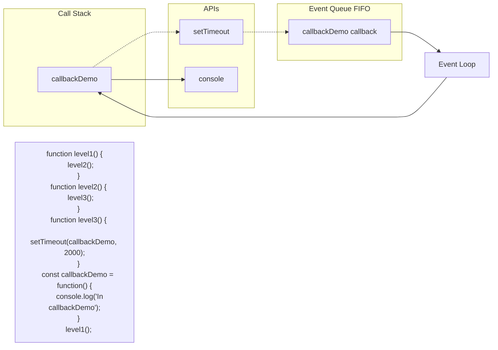

---
tags:
  - CO3404
  - Distributed-Systems
---
[[CO3404 Distributed Systems]]
[[CO3404 Lecture 4 - JavaScript Functions]]

---
# Lecture Documents
[[CO3404 Lecture 5.pdf]]
[[CO3404 L5 - Lab 5 - Improve Database Code with Pooling and Separation of Concerns.pdf]]
## Demos
Students_db slq file to create the demo database:
[[CO3404 L5 - Student Database.sql]]

[[CO3404 L5 - MySQL2 Basic SQL Injection.zip]]

[[CO3404 L5 - Dotenv.zip]]

[[CO3404 L5 - MySQL2 Promise Modular.zip]]

[[CO3404 L5 - ETL.zip]]

---
# Written Notes
![[CO3404 Lecture 5 - Note 1.png]]
![[CO3404 Lecture 5 - Note 2.png]]
![[CO3404 Lecture 5 - Note 3.png]]

---
# Calling an API
Response from backend maybe slow which in a synchronous frontend will block the single javascript thread, causing the UI to become unresponsive for the user. However, the JavaScript fetch function does not block the UI, effectively running in a separate thread (technically a C++ function call to manage a thread). 

It is also important to ensure that the backend server thread is not being blocked given it runs on JavaScript (Express.JS) especially in the event of lengthy requests or lookups.

---
[[CO3404 Lecture 6 - Adding a Database to the Stack]]