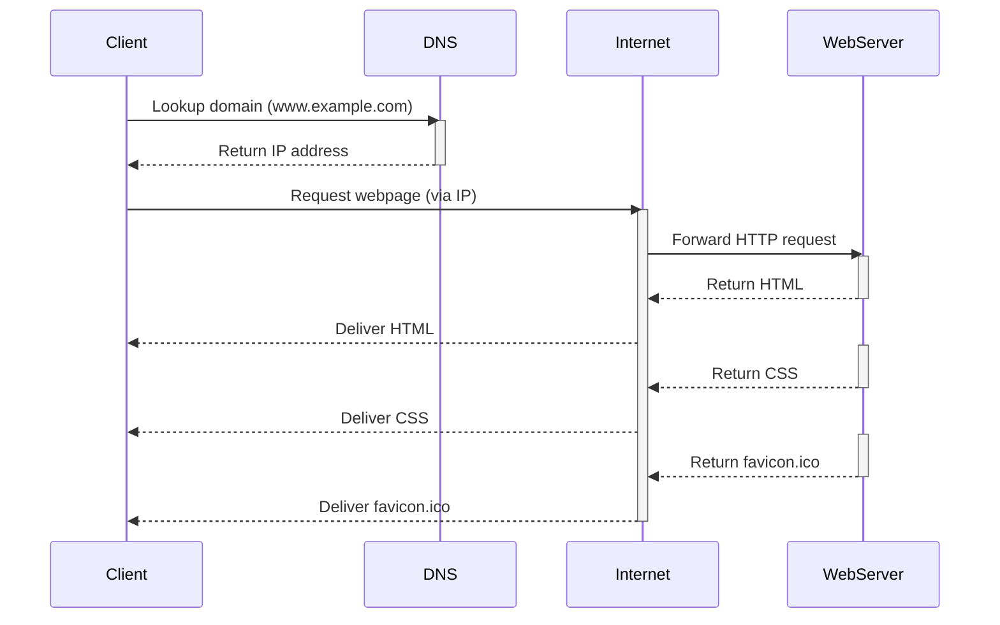

---
tags:
  - CO3404
  - Distributed-Systems
  - Revision
---
[[CO3404 Distributed Systems]]

---
# Lectures
- [[CO3404 Lecture 1 - Introduction To Distributed Systems]] ✔️
- [[CO3404 Lecture 2 - Introduction Continued]] 〰️
- [[CO3404 Lecture 3 - REST & Intro to NodeJS]] ❌
- [[CO3404 Lecture 4 - JavaScript Functions]] ❌
- [[CO3404 Lecture 4 - JavaScript Functions]]

---
# Lecture 1 & 2 - Introduction
# Monolithic Architecture
A monolith is a 3-tier client to server architecture which hosts the presentation layer public external and the application and data layers internally.

3 Tier Architecture Example.

A monolith is essentially one large program, that relies on a single database, sometimes being thousands if not tens of thousands of lines of code, it can become unmanageable and a resource sink, due to its lack of modularity. Furthermore making any code adjustments can be tedious and difficult due to tight-coupled code being contained within a single file, resulting in potentially small adjustments having significant unintended consequences or other aspects of the application. While not inherently bad for smaller systems, they can quickly become unruly for a large organisation wishing to expand their infrastructure to scale with its own growth. 

Large companies like Amazon, Tesco, Waitrose, Aldi, etc cannot run their large-scale infrastructures and maintain their codebases optimally, and efficiently within a monolith architecture. Therefore Distributed systems were created to help separate large systems into smaller more maintainable systems which combined into one.

---
# DS Architecture Patterns
A *Distributed System* can be defined as a single system, split up into smaller sub-systems which when combined appear to be one single complex one.

There are various architecture patterns when designing and implementing these systems:
- **Outdated** - [Service-Orientated Architecture](https://www.youtube.com/watch?v=PA9RjHI463g)
- [Event-Driven Architecture]()
- [Micro-Service Architecture]()

> The **most popular** approach utilises a mix of Microservice Event-Driven Architecture.
> Each system has its own best architecture pattern to utilise and implement, for example a small corner shop would not be advantaged by the benefits of scaling when utilising micro-service website, whereas a Monolith would be cheaper and more affordable to run and maintain.

---
# Micro-Services
![[CO3404R - API Gartner Hype Scale.png]]
>[!quote]
>A microservice architecture aims to provide an agile response to continuous business change.
>

Instead of creating one central big application which seeks to solve the business problem individual, instead the *business domain problems* are resolved potentially using [Domain Driven Design](). I.E. the areas of the business that can be implemented into the solution are independently identified. Similar to general software decomposition where functions and classes are identified, verified, and tested in isolation before being integrated into the main application. In microservice architecture, each component is a business service and is implemented as a **complete application**.

For example Amazon's microservice architecture would include:
- Identification - Login, Registration, etc
- User Profiles - Manage details like name, email, phone number, etc
- Order - Manage order creation, status updates, order history
- Inventory - Track stock levels, product availability
- Payment - Notification, Product Processing, Shipping

---
[[CO3404 - Exam Revision 2 (09-07-2026) 2, 3]]