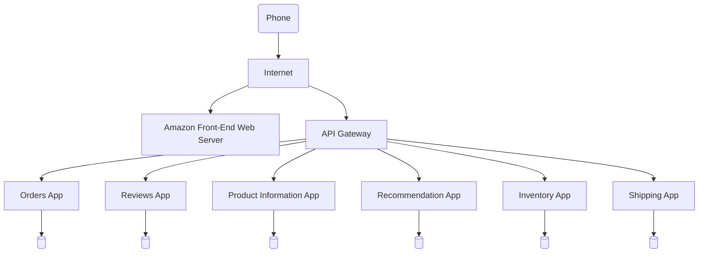

---
tags:
  - CO3404
  - Distributed-Systems
  - Revision
---
[[CO3404 Distributed Systems]]
[[CO3404 - Exam Revision 1 (03-07-2026) - 1, 2, 3]]

---
# Lectures
- [[CO3404 Lecture 2 - Introduction Continued]] 
---
# Continuing Micro-Services (Lecture 2)
## Benefits of Micro-Services
- Independent application running on its own hardware and if required, its own database.
- Databases aren't shared which prevents changes to data models impacting other services.
- Loosely coupled to other microservices 
- Typically developed, deployed and maintained by a single multi-disciplinary team of 5 - 9 people including a product owner.
- Large enough business process but small enough to enable daily, or even hourly application updates where needed.
- Agile in that the product pipeline is generally fully automated using CI/CD (Continuous Integration and Continuous Deployment). 
- Can be scaled independently, so that if one area of the business requires a performance improvement then that microservice scaled independent of any of the others making it more cost effective, rather than scaling one large monolith application.
- Resilient, so that if one microservice fails, and that part of the business system is unavailable, the other parts will not be interrupted.
- A component of [heterogeneous architecture]() therefore, acts independent. (i.e. its own operating system, programming language, database, hardware, etc) and is able to fit and be moulded to whatever is most appropriate for that business requirement.
## Extending the Amazon Example
>[!quote] As written in the powerpoint
>To the user, it looks like one business as the front-end requests resources from various microservices to populate the web page

Amazon as previously discussed utilise a variety of microservices in order to handle all their business processes, as such the goal of their design is appear as one single-page application, so that to the user the front-end website seems like one complex seamless monolith, while in reality being a network of communicating separate microservices transferring and handling data.

Amazon Microservice Example
## Microservice Challenges
- Components of the service interact across a network therefore, latency is introduced unlike with a monolith where communication is local.
- Data consistency, when it comes to data from various databases as opposed to one. E.g. for speed, a local copy of some data is faster for maintaining reliable performance, for a drop-down list rather than individual requests.
- Fault finding can be more difficult as each team focuses on one area it can be difficult to track the problem through the whole system.
- Communication between microservices can become complex.

>[!important] 
>It's a myth that microservices promote reusability or they are cheaper to build and operate.
>
> >[!quote] If the service does not require frequent or at least regular business change, then microservices are probably not approipriate, as the kry benefit is agility to business change.

>[!quote] Garter definition of a Micro-Service
>Microservices are application components that are tightly scoped, highly cohesive, strongly encapsulated, loosely coupled, independently deployable and independently scalable. They are deployed as services behind open, standard network-accessible interfaces with well-defined API contracts. These components own the data they present, and only present data that they own (Gartner, Inc. | G00745207, page 33)

A microservice architecture is an application architecture deployed as a distributed system.
## Business Needs
Systems are not built before their utility has been established. A system is created to satisfy a business need, not to solve a problem that hasn't been found yet. Therefore, the business need may be a new [business line] or an improvement to current business lines to respond quicker and more effectively to changing consumer needs and market trends.

The business needs are gathered by a business analyst, and sometimes a product owner which are then passed onto an architect that will devise the solution around the networking, data, application, and overall enterprise layers and will provide a blueprint which is then implemented by software, network, security, and cloud engineers. None of these team members do **everything** but need an awareness of all processes.

Key point being that the business drives the IT, if a team is assigned a task, with it being a team task, not individual so being able to work in multidisciplinary is important as well as having a working knowledge of the work of the other teams and specialists.

---
[[CO3404 - Exam Revision 3 (18-07-2026) - System Architecture & Cloud Models]]