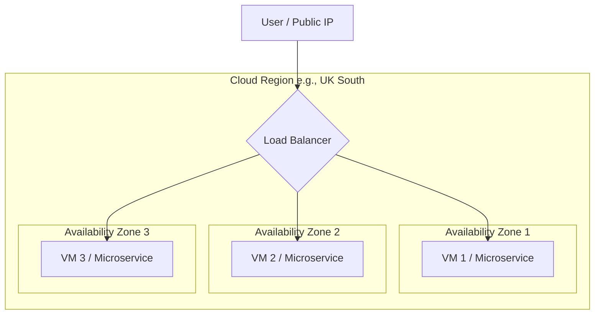

---
tags:
  - CO3404
  - Distributed-Systems
  - Revision
---
[[CO3404 Distributed Systems]]
[[CO3404 - Exam Revision 2 (09-07-2026) 2, 3]]

---
# Lecture 1 & 2
## 3-Tier Architecture (Monoliths)
A monolith is a 3 tier architecture that contains a web server for the frontend, an API for backend connectivity and database for managing persistent data. ]

> A monolith simply can be one big program.

Monoliths benefits:
- Suitable for small businesses that don't have large scaling requirements
- Utilising a single database keeps data management simple, and data consistency and performance stable.
- The monolith is very performant through the in-process function execution, as it calls functions from the same file, as it immediately jumps to that function's memory location.
Monolith challenges:
- Hard to maintain single file can become tens of thousands of lines of code therefore becoming more difficult when scaling with changing business needs.
- Will struggle more under intense loads or demand.
- The whole application must be regression tested, which can take months, to assess functionality and performance when altering the codebase.

> A monolith may also run on a cluster of servers for resilience, however this increases infrastructure costs due to the duplication of these extra servers and the overhead of a load balancer. In addition, the server may experience bottlenecks, in circumstances like Black Friday sales where the demand to access the Orders subsystem is greater, than areas like a User Profile which may have too many resources for the current demand.
## Microservices
A microservice is a single subsystem, typically to resolve a single business need, and provides an independent system that communicates over the private network, therefore introducing latency, however allowing for better maintainability as it is separate from any of the other subsystems typically with its own team.

Microservice benefits:
- Independently scalable,
- Maintained separately,
- Reliable under failure (will not affect any other subsystems) (Loosely coupled to other microservices)
- Suitable for large organisations with a business needs.

An microservice architecture is an application architecture deployed as a distributed system.
Meaning:
`Instead of having one large system for everything, it is broken down into components. Rather than being tightly coupled in a single codebase, the application is decomposed into loosely coupled, independent microservices based on specific business needs. **Because they are distributed, these independent services run on separate containers or servers and communicate with each other over a network (using APIs or message queues) to function as a single application.**`

---
# Lecture 17
## Cloud Service Models
- **IaaS (Infrastructure as a Service):** Creating a VM and manually installing software or Docker containers.
- **PaaS (Platform as a Service):** Deploying a Docker container directly into managed web apps like NodeJS.
- **SaaS (Software as a Service) / DBaaS (Database as a Service):** Using a fully managed cloud service provided by the host (like Azure Cosmos or MongoDB Atlas).
## Scalability
### On Premise
Vertical scaling is when  the current machine is made bigger or in an unlikely case smaller. I.e. Better machines and hardware.

Horizontal scaling means don't increase the size of the machines but provide more of them and load balance the traffic across them. 

>[!note]
>Buying servers is an up-front cost called Capital Expenditure (CapEx).
## Cloud Computing
In cloud computing, vertical scaling refers to altering the VM, such as changing machine size and then mitigating applications, and databases over to the larger machine which has been made easier due to the huge resource investment that cloud providers rent out, while managing the supply and demand of resources, so that as one person finishes renting a VM they can immediately cater to someone else.

Scaling horizontally, elastically, is far more popular. Same type of VMs created within minutes using autoscaling.
- Azure uses scale sets
- AWS uses auto scaling groups
  - Scale on criteria such as %cpu, %memory, number of requests, etc

Containers can also be scaled by replicating them across or within VMs, however adding separate VMs with their own 10 separate IP addresses is impractical, so a load balancer is utilised so that the balancer has one IP address but knows the private IP addresses of the new machines.

>All traffic comes into the load balancer and distributes it according to a distribution algorithm. E.g. [Round Robin](https://en.wikipedia.org/wiki/Round-robin_scheduling)
## Why Data Centres
A data centre offers high availability through various forms of redundancy, including:
- Mains
- Generator
- Battery
- PSU
- NICs
- VM Rack Deployment
- Replicated Data

They allow deployment across AZs (Availability Zones (e.g. "UK South)) in a region for resilience.
- AZs are located away from each other to avoid disaster resilience.
- A load balancer can balance across AZs and scale sets.
VNet (Virtual Network) stretches across all AZs in a region.
- Subnets also stretch across all AZs in a region. i.e. its like they are in the same building but geographically disperse.

>Up to 1000 backend pool instances.
## High Availability
High availability focuses on the system staying up in the event of an expected system failure.
- During that time the system may be under-powered but will recover.
- Employs redundancy to cover failures. I.e. dual NICs, and/or dual network switches
- Spreads VMs across multiple racks/data replication, typically 3 times in the same data centre on different racks/discs.

> The primary goal of these overheads is to ensure the system can maintain for a continuous up-time, to prevent an unrecoverable failure in the business processes.

Resilience refers to more than just high availability, a system may be highly available in one data centre, but resilience refers to high availability in multiple data centres across regions, possibly spanning countries in distance.
- Importantly, a resilient system is able, to maintain data consistency by detecting faults such as corrupt data, halt the replication process, and either process a clean replication, or rollback to the last stable state to maintain expected functionality. Corrupt data that is replicated is useless to the system. 

>[!important] **These terms are often used interchangeably**
>However, they are **different**. 
>- Well designed systems are likely to have **both** resilience and high availability.

>[!note] **Elastic Compute**
>The ability of a computing infrastucture to dynamically adapt and scale its resources based on demand. Utilised in cloud computing environments where the allocation of computational resources, such as virtual machines, can be adjusted automatically in response to varying workloads. Furthermore, its ability to handle fluctuations in demand ensuring optimal resource utilisation and performance while minimising costs.
>
># Key Components:
>- Virtualisation: Foundation of `elastic compute` allowing rapid deployment and scaling of VM instances as needed.
>- Auto-scaling: Automatically adds or deletes VMs based on predefined policies or triggers i.e. CPU, or number of requests.
>-  Load Balancing: Distributes the incoming network traffic across multiple computing resources to ensure even utilisation and prevent overloading of any singular instance.
>- Containerisation: Containers can be rapidly deployed, scaled, and moved between environments in response to varying workloads, particularly if used with orchestration service such as Kubernetes.
>- Orchestration: This deploys containers and VMs, distributes them automatically for elasticity to provide resilience and high-availability e.g. Kubernetes.

---
[[CO3404 - Exam Revision 4 (19-07-2026) - SQL Injection]]