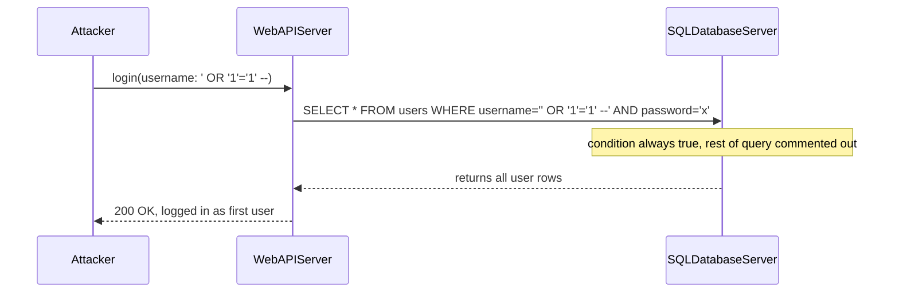

---
tags:
  - CO3404
  - Distributed-Systems
  - Revision
---
[[CO3404 Distributed Systems]]
[[CO3404 - Exam Revision 3 (18-07-2026) - System Architecture & Cloud Models]]

---
# Block 2 — Security & Networking
_Lectures 12, 14, 15_
- [x]  SQL injection: how the attack works (mechanism), how parameterised queries/prepared statements stop it

---
# SQL Injection
SQL (Structured Query Language) injection is a technique used to modify or retrieve data from SQL databases. By inserting specialised SQL statements into an unsensitised entry field allowing an attacker to input arbitrary commands allowing the potential access or destruction of sensitive data. As [defined](https://www.cloudflare.com/learning/security/threats/sql-injection/).

```
`SELECT * FROM students WHERE studentId = 117 OR 1=1;`
```
<sub>SQL Injection Example</sub>

The `--` starts a comment, so everything after it is ignored. Since `'1'='1'` is always true, the query may return every user, potentially allowing the attacker to log in without knowing a password.

> This vulnerability occurs when **user input is treated as part of the SQL command instead of as data**.


<sub>SQL Injection Sequence Diagram</sub>

CAUSATION: The application builds SQL queries by **concatenating user input into SQL strings**.

## Preventing SQL Injection
### Parameterised queries (Prepared Statements)
Prepared statements separate the **SQL command** from the **user's data**.
```javascript
const { pool } = require("../DatabaseHandler.js");

const createDatabaseCon = () => 
{
	pool.execute("SELECT * FROM users WHERE username = ? AND password = ?;")
}
```
## Exam summary
**SQL Injection**
- Occurs when untrusted input is concatenated into SQL queries.
- Allows attackers to alter the intended SQL command.
- Can bypass authentication, read, modify, or delete data.
**Prepared Statements**
- Use placeholders (`?`) for user input.
- SQL structure is fixed before parameters are supplied.
- User input is treated as data rather than executable SQL, preventing SQL injection.

---
[[CO3404 - Exam Revision 5 (20-07-2026) & (28-07-2026) - TLS]]