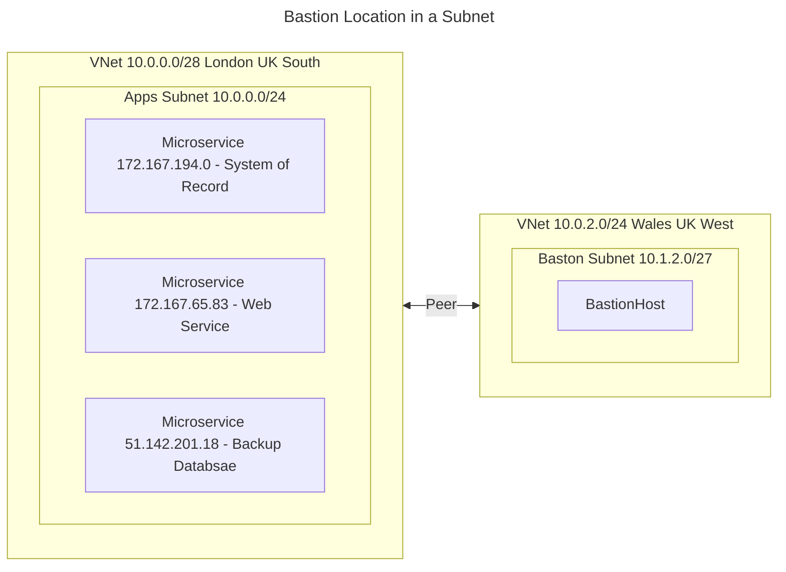
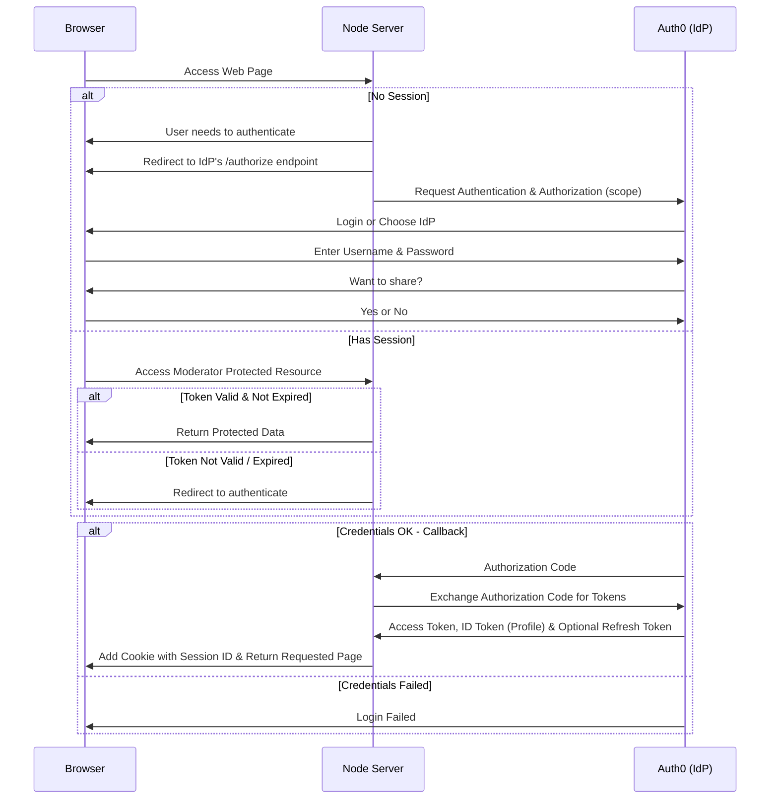

---
tags:
  - CO3404
  - Revision
---
[[CO3404 Distributed Systems]]
[[CO3404 - Exam Revision 5 (20-07-2026) & (28-07-2026) - TLS]]

---
# Block
- [x]  Bastion host / jump-box: what it is, why it reduces attack surface, typical placement in a subnet diagram
- [x]  (Check lecture 16 too — Authentication and Authorisation often pairs with this block)

---
# Relevant Lecture
[[CO3404 Lecture 12.pdf]]
[[CO3404 Lecture 16.pdf]]

---
# Monoliths and Subnets
In a 3-tier monolith run in Azure the default puts all VMs in the same virtual network (typically 10.0.0.0/16), allocates public and private IP addresses to all VMs and finally assigns an NSG to each VM. However, now all VMs are exposed to the internet directly making them easy targets. Each VM has an NSG so could limit to `allow http traffic from private IP 10.0.0.5 from port 3000` but then next problem is if the VMs are scaled then a significant amount of public IPs will be needed, which would require dealing with an ISP.

Instead of having to individually assign an NSG (network security group) to each individual VM instead, the NSG can be assigned to the subnet wrapping around the VMs therefore protecting all resources in that subnet, and allow for communication from within another subnet in the same VNet.
# Bastion Host
A bastion host is a hardened virtual machine used to securely administrate servers in a private network, typically developers will directly login via SSH, then access the VMs from the bastion in the private network.

Modern fully cloud-native and zero-trust architectures are diverging from traditional bastion hosts, but bastion hosts remain widely used and are still very popular in many cloud and hybrid environments and are very much an on-prem access. It is the **only** component SSH accessibility from outside the private network, under the assumption it will be attacked, therefore it is hardened, monitored, and offers limited functionality.
## Benefits
- Not all VMs need public IPs.
- Firewall / NSG limited access only from the Bastion.
- Reduces attack surface.
## Negatives
- Provides a "once in you can access everything" problem meaning it requires significant protections  
  - IDS and IPS
  - Suspicious behaviour notification
  - Commands and User access auditing
  - Does not store private keys - simply forwards SSH to the target system.

>[!info]
>The Bastion is placed in its own region and subnet to separate it from the app subnet.
### NSG Bastion Setup Example

```nsg-rules
NSG rules 

Bastion NSG Source: public IP (x.x.x.x/32) 
Protocol: TCP 
Destination port: 22 
Action: Allow 
Public admin ->bastion and
Source: 10.1.2.0/27 (Bastion) 
Protocol: TCP Destination port: 22 
Action: Allow Bastion->any allowed port 22 API Gateway NSG 
Source: Internet (0.0.0.0/0) 
Protocol: TCP Dest ports: 80,443 
Action: Allow anywhere->Kong and 
Bastion Apps subnet NSG 
Source: 10.0.0.0/28 (API GW) 
Protocol: TCP Dest ports: 4001,4002,4003 
Action: Allow Kong->Microservices and Bastion
```


<sub>typical placement in a subnet diagram</sub>

---
# Authentication & Authorisation
Authentication refers to the question "Can it be confirmed the user is who they say they are?".
Authorisation refers to the question "Once authenticated, what are you allowed to access?"
## Modern Approach
Open Authorization (OAuth) is a modern authorisation approach, now version 2 so OAuth2, is an open standard for ensuring secure authorisation to a protected resource and used in JWT to grant access. Finally, creates an authorisation token and optionally a refresh token (which is used to obtain a new token when the current one expires (and is not an authentication token))). 

Auth0 assumes the user has been authenticated but does not specify how authentication is carried out; this is handled by the authentication process or an identity provider. i.e. it doesn't care whether the user logins in with a username and password, google, apple, etc. As long as its a support login type.
### Prerequisites to Delegated Authentication & Authorisation
An application developer creates an account with a service like auth0 or any other Identify Provider, and registers their application to use OAuth2 / OIDC flows.

Registering the app requires providing some details:
- Callback URL - where the auth server will redirect after authentication
- Logout URL i.e. Goodbye page

Upon being registered the service provides:
- A client ID and secret specific to application
- URL to direct server to and invoke authentication at the IdP (Identify Provider)
- Choose which additional IdP services wanting to be utilised as options

>[!quote]
>Once the app is registered and operational, you can use it to create an identity token which represents an authenticated user, and an access token which contains user roles and / or access permissions.
### Authorisation Code Flow
There are various, but a popular approach to authorisation in web applications is the **Authorisation Code Flow** process.
#### OIDC Authorization Code Flow


```
1) User reuqests a protected page so the app requires the user to authenticate and maybe profile information  (i.e. name, email, photo) to personalise the page.

2) The server checks for an existing application session. Where non exists, redirect the user to the Authorisation Server (IdP) using HTTP 302 (redirect) and a Location header pointing to the IdP's /authorize endpoint.
   
3) The Authorisation server displays its login page. The user chooses how to authenticate e.g. username/password, social login, enterprise login, etc
   
4) User submits credentials. The IdP verifies them, loads the user profile and checks whether the user has previously granted consent to the previously requested scopes.
   
5) If consent is not provided the IdP displays a consent page asking the user to allow the application to access the requested data.
   
6) When accepted consent accepted, the IdP records it.
   
7) IdP redirects the browser back to the application's callback redirect_url with an authorisation code. If the user denied sharing, the IdP redirects back with an error.

8) The application backend exchanges the authorisation code for tokens by calling the IdP's token endpoint, sending the code, client_id, client_secret, and redirect_url.
   - The redirect_url enables the IdP to check confirm the created token contains the same URI as that redirected via the browwser.
     
9) The IdP returns tokens - Access token (OAuth2); ID token (OIDC, only if 'openid' was requested); refresh token (optional depending on IdP settings)

10) The application validates the tokens (signature, issuer, audience, expiry) and extracts identity information from the ID token. It creates an application session and stores the tokens securely. (e.g. In a server-side session in memory)
    
11) The application returns protected page to the user, the browser stores the session cookie automatically.
    
12) When the user later accesses another ptoected resource, the browser sends the session cookie. The application checks the token validity (e.g. expiry) and authorisation (roles/permissions) and returns the protected data or an error.
```

>[!caution] 
> If tokens have expired, either: the user is redirected back to the IdP to authenticate again, or, if a refresh token is available, the application uses it to request new tokens without user interaction

## First Party Authentication Approach
### Creating an Account

```
1) User enters a username and password into a HTML form to register an account.
   - Usually by HTTPS POST
2) Add the hashed password to a database (maybe add salt and pepper).
3) The users roles and access authorisation are added to database if required
4) If OK then the server creates a session object with a random session ID, user ID (primary key), roles/permissions and an expiry date and time.
5) Server creates a session cookie to avoid re-authentication during session.
```

>[!info]
>4)
>- This is stored in memory or a memory-based database like Redis
>5)
>- Typical opaque (meaning no user data is stored, so valueless) 
>- session cookie: connect.sid = `s:<sessionId>.<signature>`
> - sessionId = random number. HMAC of the ID is created and added to the string. 
> - HMAC checked on return for tampering
> - Cookie is returned to client. HTTP headers are set: HttpOnly; Secure; SameSiteLax
>   - HttpOnly means protect from JavaScript. JavaScript cannot access the cookie in the browser.
>   - Secure means only sedn cookie from client using HTTPs
>   - SameSite=Lax means allow get and redirect cross-site but not POST

When something is clicked on the page, the request is sent to the origin domain, and the cookie is sent automatically. The server verifies the cookie's signature (HMAC (Hashed Message Authorisation Code)) once verified, it verifies the expiry date and if not expired, the application code can check access or role before allowing access to any protected resource. E.g. access to a specific API endpoint to be utilised for CRUD database operations. 
## Benefits
- Simple
- Full Control
- No External Dependencies
## Drawbacks
- Manual management of all aspects of credential security:
  - Password resets
  - Email verification
  - MFA
- Implementation of account blocking
- Auditing and legal responsibilities for proper handling of data 
  - including responsibility for any data breach.
  - A salted which may not provide adequate defence if the salt is known, so pepper may be added to prevent as it is not known, or stored in any database.

>[!quote]
>When there are only a few hundred users, this approach is probably ok. However, when scaled to thousands or more, it's a big deal and best left to the security experts so offload this responsibility to a third party. 
>
>Third party authentication and authorisation is very popular with web applications.
## JSON Web Token (JWT)
Security Tokens are used by OAuth and OIDC.
- JSON as opposed to SAML, XML tokens are simpler and more lightweight

JWT is an open standard (RFC 7519) to securely exchange information using JSON objects. As an encoded string, it is URL safe (base64url). I.e. no +/=.

The token is cryptographically signed, similar to SAML. Data is **not** encrypted so best to utilise TLS if protection is needed.

It can be signed using symmetric HMAC or asymmetric RSA or ECDSA (Elliptic Curve Digital Signature Algorithm).
### JTW Parts

```
header - crypto algorithm used
payload - plaindata. Contains no credentials.
signature - digital signature - Generally using an asymmetric key method but symmetric is avaiable. Each is a base64url encoded separated by a full stop.
```

#### Header

```json
{
	"alg":"HS256", (HMAC using SHA256)
	"type": "JWT"
}
```

`eyJhbGciOiJIUzI1NiIsInR5cCI6IkpXVCJ9`

#### Payload

```json
{
 "sub": "1234567890", 
 "name": "John Doe", 
 "iat": 1516239022 
}
```

`eyJzdWIiOiIxMjM0NTY3ODkwIiwibmFtZSI6IkpvaG4gRG9lIiwiaWF0IjoxNTE2MjM5MDIyfQ`

#### Signature
The final part is the signature which is also base64url encoded.

`SflKxwRJSMeKKF2QT4fwpMeJf36POk6yJV_adQssw5c`

#### Real JWT Example

```
eyJhbGciOiJIUzI1NiIsInR5cCI6IkpXVCJ9.eyJnaXZlbl9uYW1lIjoiVG9ueSIsImZhbWlseV9uYW1lIjoiTmljb2wiLCJuaWNrbmFtZSI6InRvbnkiLCJuYW1lIjoiVG9ueSBOaWNvbCIsInBpY3R1cmUiOiJodHRwczovL2xoMy5nb29nbGV1c2VyY29udGVudC5jb20vYS9BQ2c4b2NKOFcwZ041RG5Xd0JHTlJzSzY0Z2ptNTU0dmE5UjdrSWpJVHVKQ09zS2pTakE9czk2LWMiLCJsb2NhbGUiOiJlbi1HQiIsInVwZGF0ZWRfYXQiOiIyMDI0LTAyLTE0VDIwOjMxOjI3LjQ2MVoiLCJlbWFpbCI6InRvbnluaWNvbEBnbWFpbC5jb20iLCJlbWFpbF92ZXJpZmllZCI6dHJ1ZSwiaXNzIjoiaHR0cHM6Ly90b255bmljb2wudWsuYXV0aDAuY29tLyIsImF1ZCI6IkV5bkd3T1ROZGhIcEFXYkxzWDN3Y0lBSmUwMlNxaDYzIiwiaWF0IjoxNzA3OTQyNjg3LCJleHAiOjE3MDc5Nzg2ODcsInN1YiI6Imdvb2dsZS1vYXV0aDJ8MTAxNDQ1NzEzOTA0MjkzMzYzNzYxIiwic2lkIjoiUlJQbG9ZRWt3VHg0aUZPXzg0bGNWazVWIiwibm9uY2UiOiJaWUZhOXd4WkJqR3Fuc1o4Z1BOemZmb1NMbUNDQVFOUzdTc2RmeXZNa2NvIn0.X8mJaQpJ5OtEBg7kbE1CHHizdxJ1r4MsKqtFDgNtVVg
```

##### Example Parts Labelled

```
eyJhbGciOiJIUzI1NiIsInR5cCI6IkpXVCJ9 (Header) 

eyJnaXZlbl9uYW1lIjoiVG9ueSIsImZhbWlseV9uYW1lIjoiTmljb2wiLCJuaWNrbmFtZSI6InRvbnkiLCJuYW1lIjoiVG9ueSBOaWNvbCIsInBpY3R1cmUiOiJodHRwczovL2xoMy5nb29nbGV1c2VyY29udGVudC5jb20vYS9BQ2c4b2NKOFcwZ041RG5Xd0JHTlJzSzY0Z2ptNTU0dmE5UjdrSWpJVHVKQ09zS2pTakE9czk2LWMiLCJsb2NhbGUiOiJlbi1HQiIsInVwZGF0ZWRfYXQiOiIyMDI0LTAyLTE0VDIwOjMxOjI3LjQ2MVoiLCJlbWFpbCI6InRvbnluaWNvbEBnbWFpbC5jb20iLCJlbWFpbF92ZXJpZmllZCI6dHJ1ZSwiaXNzIjoiaHR0cHM6Ly90b255bmljb2wudWsuYXV0aDAuY29tLyIsImF1ZCI6IkV5bkd3T1ROZGhIcEFXYkxzWDN3Y0lBSmUwMlNxaDYzIiwiaWF0IjoxNzA3OTQyNjg3LCJleHAiOjE3MDc5Nzg2ODcsInN1YiI6Imdvb2dsZS1vYXV0aDJ8MTAxNDQ1NzEzOTA0MjkzMzYzNzYxIiwic2lkIjoiUlJQbG9ZRWt3VHg0aUZPXzg0bGNWazVWIiwibm9uY2UiOiJaWUZhOXd4WkJqR3Fuc1o4Z1BOemZmb1NMbUNDQVFOUzdTc2RmeXZNa2NvIn0 (Payload)

X8mJaQpJ5OtEBg7kbE1CHHizdxJ1r4MsKqtFDgNtVVg (Signature)
```

### JWT VS JWS VS JWE
JWT is effectively an umbrella term for a base64 encoded token. JWT is either as JWS or JWE.

JWS is a JSON Web Signed token. Signed JWT but not encrypted.
- Provides integrity, authentication and non-repudiation.
- Has 3 parts each base64 url encoded.

JWE is a JSON Web Encryption token. JWT Payload is encrypted, not signed.
- Provides confidientiality.
- Has 5 parts, each base64url encoded
  - Header: algorithm that protects the encryption key e.g. A256GCM
  - Encrypted Key: if alg=dir, no key (default). Could be share - encrypted with recipient public key.
  - IV: initialisation vector. A random number used by the encryption algorithm.
  - Ciphertext: The encrypted payload
  - Tag: Value created by the encryption algorithm - likee an HMAC value.

>[!quote] Claim's List
>- nonce: Number used once. Random number to avoid replay attack. Server can check it hasn't seen it before
>- alg: Signature algorithm. e.g., HS256=HMAC + SHA256, RS256=RSA + SHA256, ES256=Elliptic curve + SHA256
>- x5t: X509 certificate thumbprint. Hash of the issuer's / signer's public key. Used to uniquely identify the public key in a compact form
>- kid: Key ID. Unique identifier for the crypto key used to sign the JWT. i.e. used to find the key in a key vault to use to verify the signature
>- aud: Audience. Typically, the name of the resource server or services the JWT is intended for
>- iss: Issuer. Typically, identifier or url of issuer
>- iat: Issued at. Num seconds after Unix epoch (Jan 1st, 1970, UTC). i.e. data and time of issue
>- nbf: Not before. It can be issued before it can be used
>- exp: When it expires
>- acct: User account or profile
>- acr: Authentication Context-class Reference: e.g. low is UN & PW. medium may mean 2fa. Level of auth strength of the process used to create the token
>- aio: Azure AD object Id. Unique identifier of the user within the Azure AD environment
>- amr: Authentication methods reference. Authentication methods used during authentication. e.g. pwd, 2fa,otp
>- appid: UUID of the client that requested the token. 128 bits in 8-4-4-4-12 hex digits format
>- appidacr: Strength of authentication of the application authentication. Similar to acr but for the app
>- auth_time: time the user was authenticated 
>- family and given name need no explanation 
>- ipaddr: IP address from where the authentication request came 
>- name.: Name to display - e.g. on a web page. Often given and family name 
>- oid: object ID. UUID of the user object in Azure active directory to identify the user in the directory 
>- onprem_sid: User active directory ID in situations where on-prem AD is synchronised with Azure AD 
>- puid: persistent user ID. Single ID used across multiple accounts 
>- rh: Refresh history. How many times has this been refreshed. Usually at least a number. But this is Microsoft - they don't always follow standards 
>- scp: Scope. Specifies the permissions granted and what actions the app can perform on behalf of the user 
>- signin-state: sign in status. Values vary on ID provider. e.g. pending, success, failure …. kmsi means keep me signed in. Long session or refresh token
>- sub: Subject. UUID of the subject, typically the user or whatever the token signifies within the scope of the issuer. In this case, Azure AD
>- tid: Tenant ID. Azure tenancy the user belongs to.
>- unique_name: Could be unique username, email address or something else 
>- upn: User principal name. Basically, the unique user again. 
>- uti: Token ID. UUID of the token itself ▸ ver: Version of the token format / standard

---
# Summary
- Authentication: are you who you say you are 
- Authorisation: when we know you are who you say you are, what are you authorised to access
- OAuth, now at version 2 is an authorisation protocol 
- Although OAuth2 flow does include authentication, but it doesn't retain any identification data. I.e., using OAuth, we don't know who authenticated or when 
- OpenID connect extends the authorisation capability of OAuth2 to also enable Authentication 
- Active Directory works within one domain to hold user credentials, resource access and SSO
- Active Directory Federation Service enables AD to be accessed across domains using SAML 
- SAML is an XML file used to securely exchange information between an IdP and an SP across domains for authentication - typically using ADFS / AD 
- OAuth2 is used for delegated authorisation - can be used with SAML and JWT 
- JWT is a JSON web token used to securely exchange data. Used typically in place of SAML as it's lightweight based on simple JSON structure rather than a complex and verbose XML structure

---
[[CO3404 - Exam Revision 7 (01-07-2026) - Terraform]]