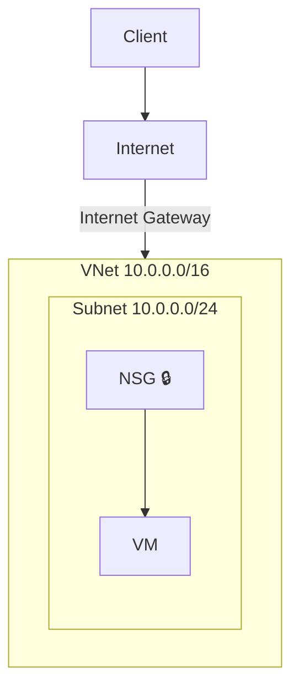
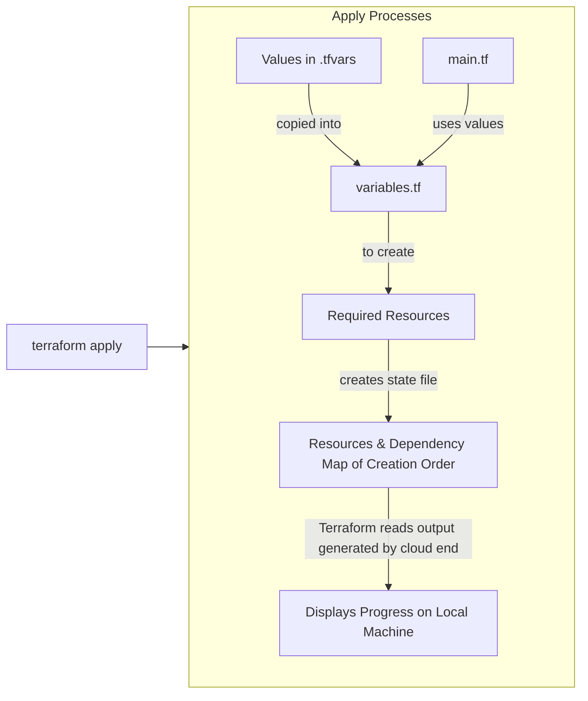
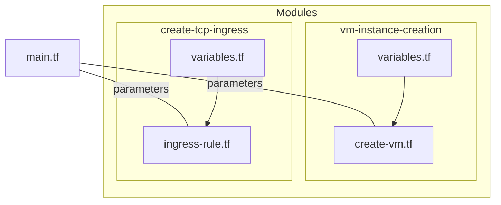

---
tags:
  - CO3404
  - Revision
---
[[CO3404 Distributed Systems]]
[[CO3404 - Exam Revision 6 (30-07-2026) - Baston Hosts & Authentication-Authorisation]]

---
# Block 4
_Lecture 13_
- [x]  Terraform benefits vs manual portal provisioning: version control, repeatability, drift detection, faster rebuild after failure
- [x]  Be able to read and explain a `.tf` file section (resources, providers, variables)

---
# Relevant Lectures
[[CO3404 Lecture 13.pdf]]

---
# Basic Portal VM Infrastructure
Creating a VM / EC2 from the Azure portal, takes a lot of background processes and various defaults are used automatically, which is fine for experimenting, but not in real design.
## In Real Design
The following needs to be specified:
- The VM Type and Size
- A VM OS Image
- A system disk for the VM image
- Network so that the VM can communication
- VMs need NICs (Network Interface Card) for network communication
- Firewall to allow only ports being utilised for security
- Subnets for efficiency and security
- VMs need private and public IP addresses.

>[!important]
>While all of this gets created using defaults and can be seen in the resource group, but for automated deployment and system design control, specifying these things manually is required.
## Deleting Resources
Deleting resources to for example save cost can be time consuming, as they need to be recreated again.

In *Azure* if the resource group itself is deleted then all resources inside the group are deleted with it, whereas in *AWS* resources needed to be deleted manually. Regardless to recreate the system all, the console must be manually used, which is time consuming, especially in a more large complex system.

Organisations need the ability to automate the creation and destruction of resources programmatically, so Cloud Providers enable various ways of creating, managing and destroying resources.
- SDK (Software Development Kit) utilising a preferred language, to use a function to call the creation of a VM.
- CLI (Command-Line Interface) install a CLI interface to provide various functions to interact with the cloud provider.
- Shell or Batch script to execute command line commands imperatively to automate
- Using the cloud provider's built-in shell e.g. online cloud shell to issue commands and control resources

An another method is utilising a resource manager:
- Azure Resource Manager (ARM) templates for declarative IaC (infrastructure as code).
- AWS CloudFormation templates
- Use third part software such as Terraform, which is a cloud provider agnostic declarative approach.
## Azure Basic Infrastructure



---
# Terraform
In industry, more control is needed for the infrastructure than using the defaults. What is needed is *reliable*, *repeatable*, and *maintainable* automation.

```
main.tf   ->   terraform <- Internet -API-> Cloud Provider
  ^               ^
  |               |
  v               v
variables.tf  terraform.tfstate
  ^
  |
terraform.tfvars
```
## Terraform Commands
- `terraform init` - check which provider then download plugin
- `terraform apply` - does a few things:
  - Builds dependency graph
  - Checks for changes in state
  - Deletes and creates resources as required
- `terraform destroy` - all resources in state destroyed
## Benefits
- Declarative so don't need to worry about the creation order usually.
- Don't need to wait for resource reaction to move on e.g. to get IP as it is declarative
- Only one language to learn for any cloud provider i.e. HashCorp Configuration Language (HCL)
## Terraform Documentation
- [AWS](https://registry.terraform.io/providers/hashicorp/aws/latest/docs)
- [Azure](https://registry.terraform.io/providers/hashicorp/azurerm/latest/docs)
- [Terraform App](https://developer.hashicorp.com/terraform/install)
## Initial Key Components
### Configuration File
One or more `.tf` files containing Terraform code, typically called `main.tf`.
- Used to define the components like the VNet, VMs, NICs, NSGs, Subnets, etc
- This is declarative, as opposed to imperative - Declaring the outcome and letting terraform work out the how.
### Provider
Defines the plugin to connect to the provider's API to construct and manage resources based on the declarative Terraform code.
### Resource (A single 'thing')
Represents resource components such as the VM, Storage, Network, etc and consists of:
- Resource Type - Defined by the provider's API. e.g. AWS instance, or a Azure virtual machine.
- Resource Name - Unique name to refer to in the code. i.e. like a constant.
- Arguments and Attributes - Configuration detail for a specific resource e.g. instance_type - e.g. a VM Type.
### Variable
- Like parameters passed into the file or between blocks within the file have similarity to function parameters 
- Input variables: pass in values from cli, environmental vars or a variables file to, say, config a resource - e.g. VM type 
- Local values: used within the code to reduce repetition - like constants 
- Output values: extract values from configurations for display or pass into other config files - a bit like function return values 
- Various types: string, number, bool, list (like array), map (like json object)

>[!important]
>Don't hard-code properties such as image and instance type use in and out variables. Generally store variables in `variables.tf`
#### Variables TF Example
```
variable "machine_type"
{
	description = "Azure Virtual Machine"
	type = string
	default = "Standard_B2s"
}
```
<sub>Terraform Code Variable Example</sub>

The variable `machine_type` is initialised to the Standard_B2s unless a non-default value is passed.

A variable value can be passed in from a file with terraform `.tfvars` extension or at the command line during *apply*.

This approach promotes *code reuse*. in `terraform.tfvars`: `machine_type = "Standard_B1s`, which overrides the default value.

The variable `instance_type` is not fixed but assigned to the value of *machine_type*, if not provided it defaults to *Standard_B2s*. Defaults are optional and often not desirable. Generally best to manually specify exactly what is needed.

>[!note]
>Could have various `.tfvars` files for separate flows, like dev and test. i.e. dev.tfvars and test.tfvars which may have different values. 
>
>The benefit of this is that variables do not need to be provided during runtime by manual input, and are instead deprived from the separate tfvar files depending on which one is specified on the command line during *apply*.

Output variables are added to a default file called `output.tf` if required ot left in the main.tf file.

>[!important]
>All files for tf and tfvars are combined on *apply*.


<sub>Underlying processes of the `terraform apply` command</sub>

>[!important] Alterations & Changes
>Note: if a change is made and some resources are not affected, the unaffected resource definitions are ignored

For common actions like VM creation, code can be structured into modules like functions.

A main.tf references the module by pointing to its location so it's just a file that references one or more modules to create a more complex infrastructure without duplicate code. Values are passed from main to module (or module to module) in a similar way to calling functions.

Main would specify the provider and region which is inherited by modules.


## Terraform Provisioners
Terraform is an *infrastructure deployment application* but it is also capable of deploying code.

A **provisioner** enables *OS command execution* on the client or remote machine and are added to the resource block.
### Provisioner Types
- Local-Exec Provisioner - Executes commands on client machine i.e. laptop
  - For example, pipe terraform output to a file instead of cluttering console.
- Remote-Exec Provisioner - Execute system commands on the remote machine i.e. Azure
  - Can be used to install node, docker, etc
- File Provisioner
  - Securely transfer files from the host to the remote machine. E.g. alternative to scp or winget

>[!note]
>Resource blocks are *only* called when creating the source. Provisioners are only executed during resource creation. E.g. During VM creation, a copy of a docker installation script to the remote VM, and to command run it, which would occur during the VM creation stage.
>
>This is useful for configuration feature for small or test projects. In industry be more likely to use:
>- Ansible
>- Chef
>- Puppet
### Terraform Null-Resource
Provisioners are useful when creating VMs, like for installing docker. However, if something else was wanting to be automated e.g. sending a copy of a file, in the event that file changes. E.g. a source code file or compose yaml.

This is not possible with Provisioners as it would require deleting the resource and recreating it with the changed files.

Terraform provides a special "*fudge*" resource block called a **null-resource** that doesn't create a resource but acts like it does. i.e. It is called like attempting to create a resource, but since it is a null-resource nothing is created that affects the infrastructure, but its provisioners are still activated.

When `terraform apply` is executed, terraform compares the current state held in the `.tfstate` file to the desired state held in the .tf files. It creates a plan indicating any changes it needs to make when accessing the cloud provider's API.

Changing the content of a file that is wanted to be copied to the vm that is not a resource change, so it will not trigger the file-deployment within the resource. A null-resource can deal with this using a trigger
#### Null-Resource Example

```
resource "null_resource" "copy_file" { 
	triggers = { 
		file_md5 = filemd5("path/to/local/file.txt") 
	} 
	
	provisioner "file" { 
		source = "path/to/local/file.txt" destination = "/home/ubuntu/file.txt" 
		
		connection { 
			type = "ssh" 
			user = "user" 
			private_key = file("path/to/private_key.pem") 
			host = azurerm_linux_virtual_machine.demo-vm.public_ip_address } 
		}
```

>[!note]
> The resource block is triggered by some condition and executed. In this case, the file hash is compared to that in the state and if different, triggers this resource block so the file provisioner is executed.
## Terraform Authentication
Terraform needs to login to Azure and while there are various ways to do it the easiest is the Azure CLI. 

Terraform doesn't use the CLI to create resources but it can use it to authenticate. [Download the CLI](https://learn.microsoft.com/en-us/cli/azure/install-azure-cli-windows?view=azure-cli-latest&pivots=winget).
### Commands
- `az version` - confirms working by providing version.
- `az login` - authenticate and login to azure through browser
- `az account list --output table` - get a list of accounts
- `az account set -subscription ""` - set subscription number obtained from portal.

---
# Exam Specific Requirements
## Version Control
Terraform infrastructure is just text files, therefore they can be stored and tracked on GitHub, changes can be reviewed and allows for rollbacks to a previous version.

Whereas the manual portal changes are often not logged and difficult to track.
## Repeatability
The same `.tf` files can be used to create the same identical infrastructure every time. 

The benefit of this is that all use the same code can be used with different `.tfvars` values. Rather than creating everything manually.
## Drift Detection
Terraform stores the deployed infrastructure in `terraform.tfstate`. 

When `apply` is run Terraform compares the desired infrastructure in `.tf` files, the already created cloud resources, and the current state stored in the local file.

If a VM is changed manually in the Azure portal, Terraform notices the different (i.e. configuration drift) and proposes changes to return it to the desired configuration.
## Faster Rebuild After Failure
If the entire resource group is deleted then every single resource must be manually recreated. I.e. all vms, networking, firewalls, configuration settings.

Whereas with terraform the `apply` command just needs to be run to recreate the infrastructure automatically from the `.tf` code files.

>[!important]
>Especially useful in:
>Disaster Recovery
>Testing Environments
>Temporary Cloud Infrastructure

---
[[CO3404 - Exam Revision 8 (02-07-2026) - Block 3, 5]]