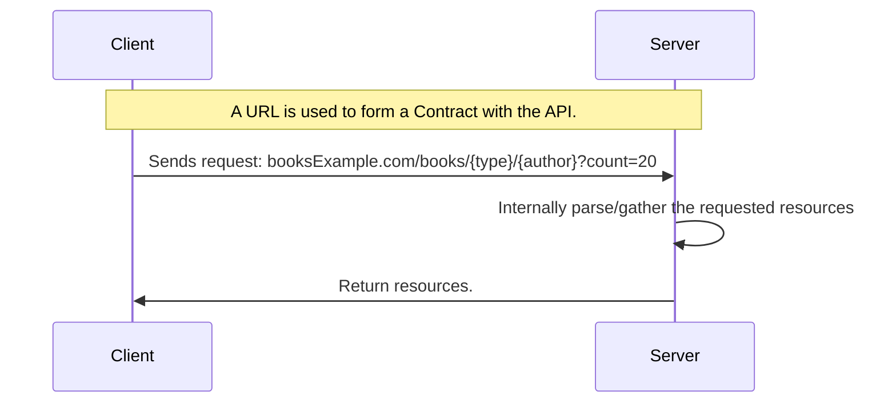
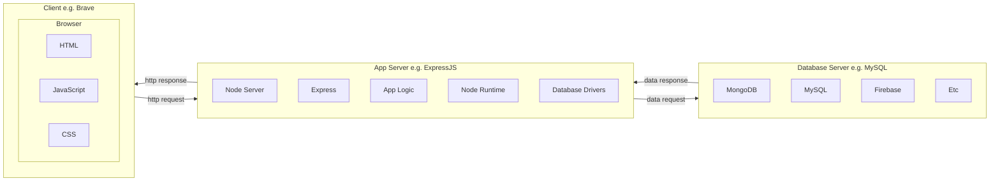
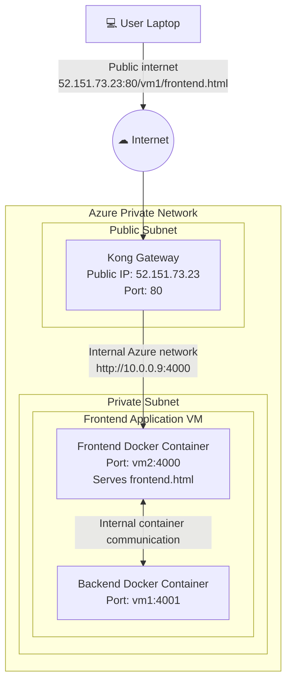

---
tags:
  - CO3404
  - Distributed-Systems
  - Revision
---
[[CO3404 Distributed Systems]]
[[CO3404 - Exam Revision 7 (01-07-2026) - Terraform]]

---
# Block 6 — APIs & Documentation
_Lectures 3, 10, 15_

- [x]  REST API operation: verbs, statelessness, resources
- [x]  Swagger/OpenAPI: what it documents and why it matters for consumers
- [x]  KONG API Gateway — role/purpose (came up in lecture 10, worth a quick pass)

---
# Relevant Lecture
- [[CO3404 Lecture 3.pdf]] - [[CO3404 Lecture 3 - REST & Intro to NodeJS]]
- [[CO3404 Lecture 15.pdf]] - [[CO3404 Lecture 15 - TLS Operation & Swagger]]
- [[CO3404 Lecture 10.pdf]] - [[CO3404 Lecture 10 - KONG API Gateway]]

---
# REST API Operations
## How does a Web API Work


<sub>API Request Example</sub>

Node JS is a JavaScript runtime environment. To deal with RESTFul APIs, a framework is easier to utilise to avoid having to write all the parsing and routing logic. Express.JS has been the `de facto` framework for Node, despite other frameworks being available.

>[!important]
>Frameworks and libraries avoid you reinventing the wheel.

REST (REpresentational State Transfer) introduced in 2000s by Roy Fielding in his PhD.
## HTTP
HTTP has 9 methods. POST, GET, PUT, DELETE, PATCH, HEAD, OPTIONS, TRACE. They are not functions but indicate the action, that the client is requesting to make. These methods are sometimes referred to as *http verbs*.
### Other HTTP Headers
```
cookies - small text files that are used to remember 'state' as well as other values
content-type - format the payload is in to inform the client
content-length - number of bytes in the body
user-agent - indication of web browser being used
last-modified - date the file was last modified, if it the server has the same, it returns 304, and no data. i.e. no change so uses cached version.
```
## Terminology
- **URL** - Full address used to access resource.  E.g. `http://localhost:3000`
- **Origin** - the scheme, domain, and port from web server being served. E.g. `/users/123`
- **Query String** - Acts as a filter or limiter of returned data. E.g. `?count=10`
- **Endpoint** - A specific URL (or path) that represents a resource or action in an API. Usually a method. E.g. GET /users/me, DELETE /users/me are different actions.
- **Route** - In backend frameworks (like Express.JS, Springboot, Flask) a *route* is a **server-side mapping** between a URL pattern, and a function or controller.
## Architecture



NodeJS is needed to run JavaScript, the ExpressJS is used to simplify the creation of the server and the process of requests and return responses.

The only logic that needs to be written is the backend handling of the API's processing and data handling logic.

A database driver is also needed / SDK to enable the code to access the database and query it.
## Statelessness
>[!important] In REST
>The server does not store client state between requests. Each request must include all the information needed to process it, with any required long-term data stored separately (e.g. in a database).

---
# Swagger/OpenAPI
## OpenAPI
API documentation is essential, or no one would know to use the API. The standard approach to documentation was defined by the [OpenAPI Specification](https://swagger.io/specification/) as a project of the Linux foundation.

This documentation approach was originally called `Swagger` until the specification was donated to OpenAPI initiative under the linux foundation, so OpenAPI maintain the current standard but some of their tools used in document creation are called Swagger.

Three common approaches to API documentation:
- Design-First
- API-First
- Code-First

> Each of these results in an OPenAPI Specification document (formerly Swagger).
### Design-First
Design-First approach is used when the business works closely with engineers to create a design that satisfies the business requirements either before code is written or potentially to create coding stubs to get a feel for how instances could be used.
#### Use Cases
- Common in large organisations that have many complex APIs.
### API-First
API-First approach is where the endpoints of the documentation/contract are formally defined using an API specification language. I.e. OpenAPI, formally swagger.

The OpenAPI documentation is written in YAML or JSON. Which can be written in either a general text editor, or the [swagger web tool](https://editor.swagger.io).
#### Use Cases
- These specifications could be written by product owners or engineers or ideally both together before coding starts
### Code-First
The Code-First approach, comments need to be added to the openAPI (swagger) YAML style to enable document generation from *code comments*.

This keeps the documentation with the code and enables it to be manually served as a documentation API endpoint itself for easy access.
#### Use Cases
- Could be argued that this approach makes the code file messy, although a counter argument is that the code and documentation are in one place.
## Top Level Elements of OpenAPI Spec
- **info** - used to inform users and make API discoverable
- **servers** - list of servers running the API can run on
- **paths** - a list of endpoints, methods, and parameters
- **components** - data entities for reuse.
- **tags** - used to group endpoints and other elements together. I.e. so they appear as a group in the final documentation i.e. separating payment and user endpoints into their own groups.
- **$ref** - reference to reusable blocks (components).

---
# KONG API Gateway
The KONG API Gateway is a single point of entry for all applications, therefore removing the need for multiple public IP addresses, and ports. The gateway acts like a *reverse proxy* forwarding requests to applications, managing what is available to the public.

All interactions between the containers and gateway are private so they don't need encryption unless extra security is required.



The user connects to the kong's public ip address with the required path. I.e. `52.151.73.23:80/vm1/frontend.html`. Kong will *forward* to the private ip of the vm1 e.g. internally `http://10.0.0.9:4000` on the Azure private network to the VM's docker container. 

The containers communicate between each other on a private docker network if on the same VM. E.g. Vm2 makes a request to Vm1 at its DNS name vm1:4001. 

>[!important]
>The gateway and applications are independently scalable.
## Key Features
- Avoid replicating functionality such as rate limiting and authentication as Kong plugins can handle these.
- Single point of entry so HTTPs can be implemented once.
- Aggregation of API calls E.g. one request to multiple API calls, to reduce bandwidth.
- Acts as a reverse proxy to protect services from the internet. Users never see the endpoint IP.
- Operates in two different modes: With Database & Database-Less Mode
### With Database
Typically **Postgres** or **Cassandra** which centrally stores all configuration data.
### Database-Less
In db-less config is stored on each node which is simpler for deployment as no database dependency is needed.
- Uses declarative code, whereas db approach uses imperative due to API.
## API Gateway Properties 
### Benefits
- Request Routing: route client requests to the appropriate microservices based on the URL or request parameters 
- Load Balancing: load balancing evenly among multiple instances of the same microservice 
- Security: authentication, authorization, and security in one place 
- Rate Limiting: restricts the number of requests per min. Prevents abuse, protects backend resources 
- Throttling: sets rate of processed requests, often by slowing down responses (queue) to smooth traffic spikes 
- Caching: cache microservice responses. Reduce backend load and improve response times 
- Logging and Analytics: provide logging to analyse traffic patterns and API usage
- Aggregation: aggregate multiple microservice responses into a single client response 
- reduces latency for client as they can make one rather than several individual calls
### Drawbacks
- Single point of failure. Must be designed to be resilient and scalable - multi-node with load balancer
- Extra hop may introduce a bit of extra latency 
- Adds complexity to the architecture - needs configuring, monitoring and maintenance (e.g. patching) 
- Extra cost: cost to run and knowledgeable staff to understand the technology so adds to cost 
- Security, this is an advantage but, as all services are accessible from here, it increases the attack surface for hackers so security of the gateway must be carefully designed
## How To Use
The gateway is simple to use, as routes are defined in the `kong.yaml` and assocaiated with a forwarding address.

```yaml
- name: vm1
  url: http://10.0.2.4:4000
  routes:
	- name: vm1
	  paths:
	    - /vm1
	  strip_path: false
```
<sub>VM1 Route in Kong YAML</sub>

> `http:// 52.151.73.23/yin` is matched on path then origin changed to `http://10.0.2.4:4000/yin` because *strip_path* is **false**.

```yaml
- name: vm2
  url: http://10.0.2.4:4001
  routes:
	- name: vm2
	  paths:
	    - /vm2
	  strip_path: true
```
<sub>VM2 Route in Kong YAML</sub>

> `http://52.151.73.23/yang/home` is forwarded to `http://10.0.2.4:4001/home` because *strip_path* is **true** so yang is removed.

>[!important]
>strip_path is true by default and will remove from the source path, the path element specified in the path property

>[!example]
> >[!quote]
> >- Can be useful for example, for versioning: kongIP/api/v1-1-2/books/:media could be routed to 10.0.2.3/books/:media by specifying /api/v1-1-2 in the paths and strip_path: true
> >
> >- KongIP/api/v1-2-0/books/:media could be routed to 10.0.3.5/books/:media as kong will match the source path to the paths definition to find a match, then remove the source path and replace the IP address

>For more complex path filtering, regex can be used

---
[[CO3404 - Exam Revision 9 (03-07-2026) - Message Patterns]]