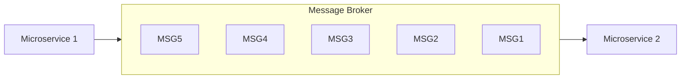
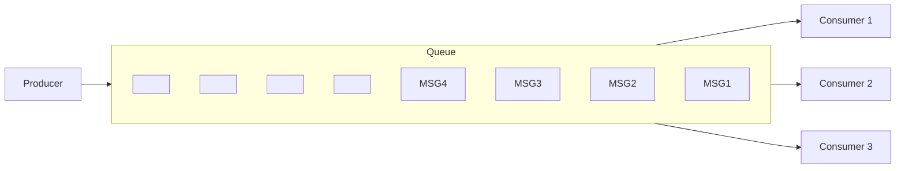
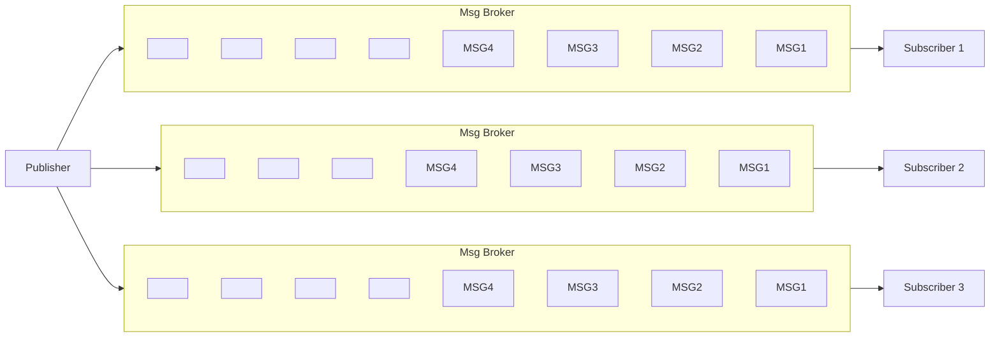
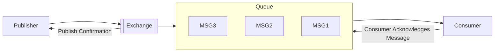

---
tags:
  - CO3404
  - Revision
---
[[CO3404 Distributed Systems]]
[[CO3404 - Exam Revision 8 (02-07-2026) - APIs & Documentation]]

---
## Block 5 — Messaging & Event-Driven Patterns
_Lectures 9, 11_

- [x]  Message pattern pros/cons: async decoupling, queueing (RabbitMQ)
- [ ]  Message vs event — the core distinction (command/intent vs "a fact that happened")
- [ ]  Event pattern pros/cons: pub/sub, event streams, eventual consistency (RabbitMQ & Kafka)
- [ ]  Be ready to compare RabbitMQ vs Kafka use-cases if asked

---
# Relevant Lectures
## Block 5
- [[CO3404 Lecture 9.pdf]] - [[CO3404 Lecture 9 - Asynchronous Messaging with RabbitMQ]]

---
# Asynchronous VS Synchronous JavaScript
JavaScript is single-threaded, meaning it has one call stack and executes one task at a time. 

The difference between synchronous and asynchronous code is that synchronous code blocks the execution of subsequent code until the current task finishes, whereas asynchronous code can start a task and continue executing other code without waiting for that task to complete. 

Once the asynchronous task completes, its callback or Promise is handled when the call stack is empty.
# Inter Microservice Communication
## Asynchronous Messaging
Asynchronous Messaging involves microservices posting messages to a queue.

A producer sends a message to a message broker, which stores it in a queue. The producer does not wait for the consumer to process the message and can continue executing immediately.
### Example

## Key Features
- M1 and M2 are decoupled the contract is with the queue. 
- Dynamic FIFO data structure. 
- M1 doesn't need to know if M2 can handle a large amount of messages at once.
- M1 is unaffected if M2 does down.
## Message Brokers
Message brokers implement the *asynchronous* message pattern. Some brokers are:
- RabbitMQ - Open Source
- Apache Kafka - Open Source
- Amazon Simple Queue Service (SQS) - AWS
- Azure Message Broker, & Azure Storage Queue (ASQ)

> RabbitMQ and Apache Kafka as they are cloud agnostic.

>[!note]
>If all-in with a particular cloud provider, their services may be preferential.
### Messaging Patterns
## Producer / Consumer
Asynchronous service to service messaging 
One producer and one consumer
Generally, uses push to consumer 
Resilience is built-in to avoid SPOF 
Implemented using a message broker

## Publisher / Subscriber
Asynchronous service to service messaging
One publisher and many subscribers
Use fan-out for pub/sub - adding a new microservice 
Resilience is built-in to avoid SPOF 
Implemented using a message broker

---
# RabbitMQ
## Basic Information
RabbitMQ uses the AMQP (Advanced Message Queueing Protocol) standard which is a platform agnostic protocol to transfer information between applications. The source and destination are the Producer and Consumer.
### Connection
This is a network connection between an app and the queue. Similar to a database connection
### Channel
Virtual connection inside a connection. Multiple channels can be created within a single connection, allowing for concurrent operations and communication between different parts of a client application 

>[!example]
>May have one channel for produced messages and another for consuming messages within the same connection to RabbitMQ
### Queue
A FIFO-based message storage and delivery component ▹ It holds messages sent by producers until they are consumed by consumers
### RabbitMQ Docker Container
It can implement queues and message routing through a message exchange component which can route messages to various queues based on a routing key. 

It has a management interface to setup and monitor the queues
## Key Terms
### Producer / Publisher
An application that sends a message to the broker. The broker confirms the message is queued.
### Consumer / Subscriber
Application that consumes the message. Consumer informs rabbitmq that it received the message (acknowledges it) so it can be removed from the queue. 
### Exchange
Receives messages from producers and routes them to the correct queue based on rules associated with a routing key.
### Routing Key
This can be a word, series of words, wildcard. e.g. all messages that contain pr* as a post code are sent to a queue for consumers of Preston based messages e.g. for a survey.
### Virtual Host
 Segregates applications using the same rabbitmq instance. Think of it as separate broker instances each with different permissions and credentials but built into a single instance, e.g. a single container.
## Exchange Types
### Direct
A producer and consumer are using one queue based on the binding key (we use this & default exchange).
### Topic
A wildcard match between the routing key and the routing pattern determines the queue. Like the earlier example.
### Fanout
Routes a message to all the queues. E.g. message sent to multiple microservices - pub / sub pattern

RabbitMQ Message Broker

---
[[CO3404 - Exam Revision 10 (04-07-2026) - Event Patterns & Containersation]]