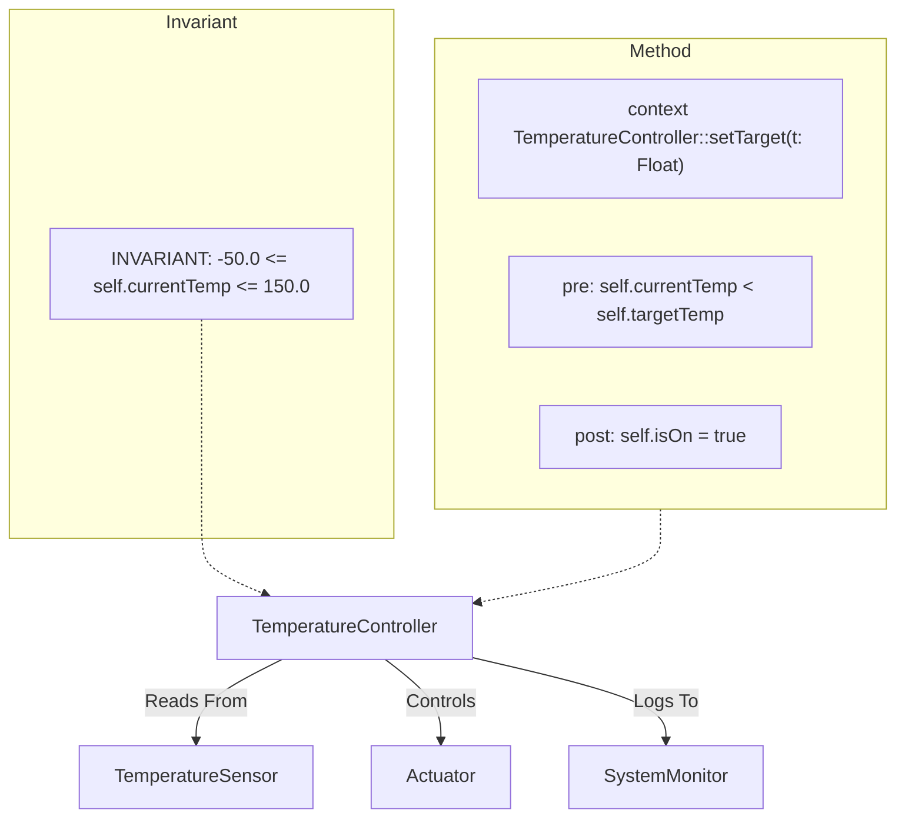
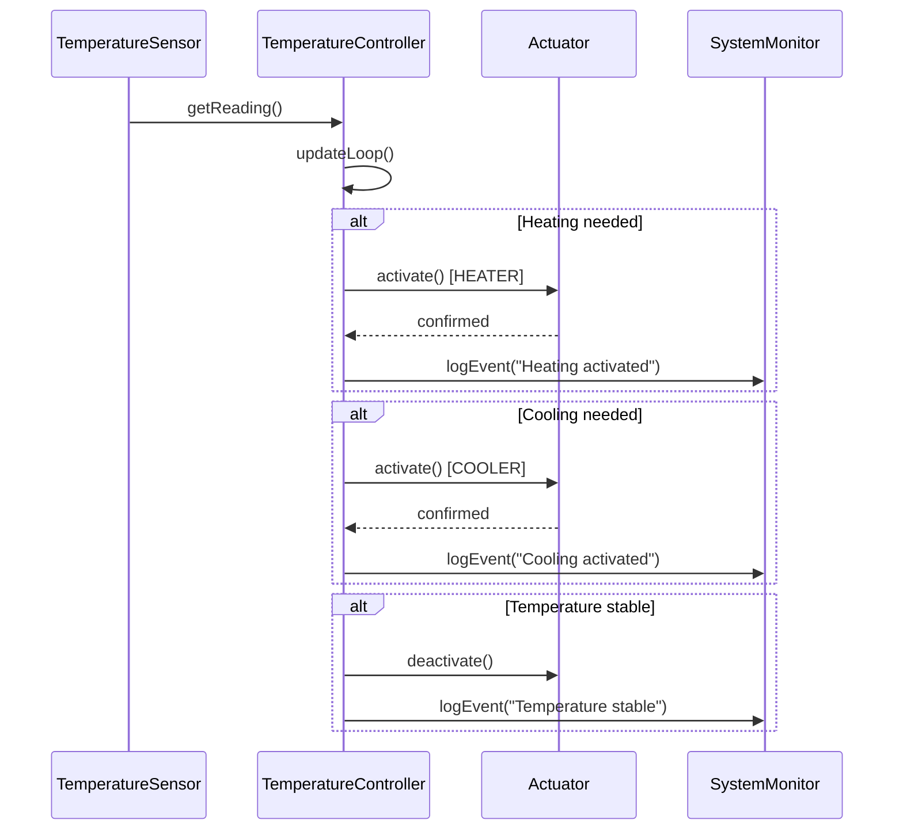
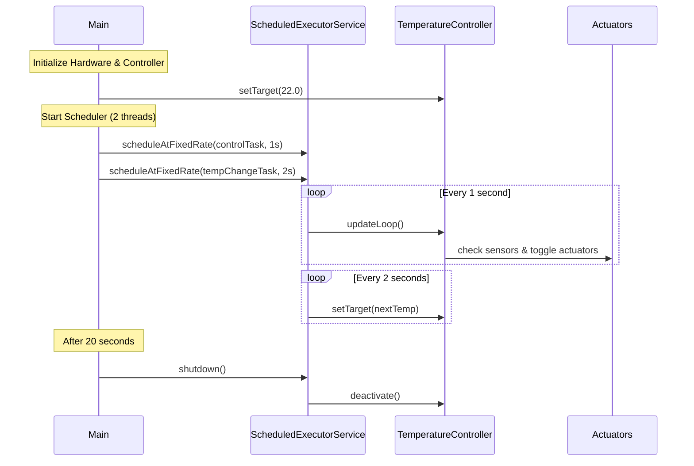
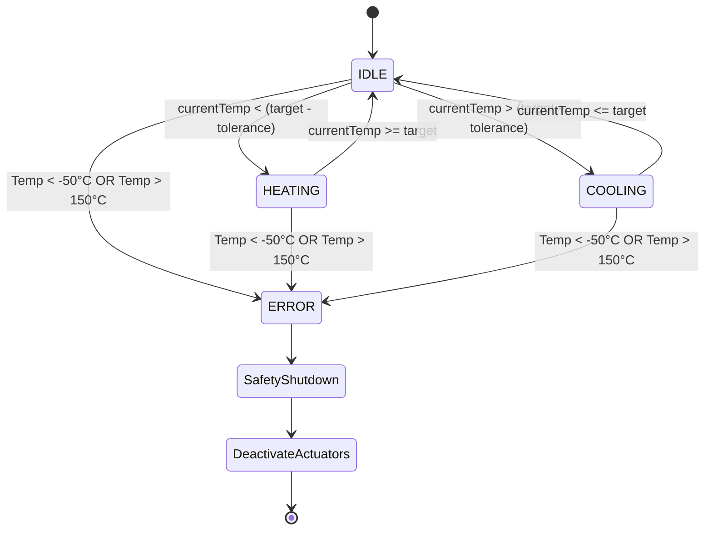

```mermaid
sequenceDiagram
    participant US as User/System
    participant TC as TemperatureController
    participant TS as TemperatureSensor
    participant SM as SystemMonitor

    US->>TC: setTarget(75.0)
    
    alt [currentTemp < targetTemp]
        TC->>TC: check precondition
        
        rect rgb(60, 60, 30)
            Note over TC: pre: currentTemp < targetTemp
        end
        
        TC->>TS: getReading()
        TS-->>TC: return currentValue
        
        TC->>TS: calibrate(calibrationValue)
        TS->>TS: adjust offset
        TS-->>TC: calibration complete
        
        TC->>TC: set isOn = true
        
        rect rgb(60, 60, 30)
            Note over TC: post: isOn = true
        end
        
        TC->>SM: logEvent("Target set: 75.0°C, System ON")
        TC-->>US: success
        
    else [currentTemp >= targetTemp]
        TC->>SM: logEvent("ERROR: Precondition failed")
        TC-->>US: error: precondition not met
    end
```

---
tags:
  - CO3408
  - Advanced-Software-Modelling
  - Assignment-Report
---
[[CO3408 Advanced Software Modelling]]

---
# Assignment Brief
[[CO3408 Assignment 1 Brief.pdf]]

---
# Assignment Feedback
Good Work! Your submission demonstrates strong effort and engagement with the system, and the diagrams are generally clear and well organised. The use case diagram shows thoughtful coverage of functionality, though some relationships such as the extension from “Control Temperature” to “Trigger Safety Shutdown” could be modelled as internal behaviour to better reflect the system’s operation. The class diagram is detailed and includes OCL constraints, showing rigour, but clarifying associations and method responsibilities, especially around sensor readings and actuator coordination, would strengthen separation of concerns. The sequence diagrams capture the flow of operations, and with minor refinements to notation, guards, and activation bars, they could be easier to read and interpret. The state machine diagram is a strong element, providing a clear overview of behaviour, and with slightly more detailed transitions and consistent error handling, the models would become even more precise and polished.

---
# Contents
1. Introduction  
2. System Requirements & Decomposition  
   2.1. Requirements Table
   2.2. System Decomposition  
   2.3. Use Case Diagram  
3. UML Class & Behavioural Modelling with OCL  
   3.1. Class Diagram with OCL
   3.2. Behavioural Modelling (Sequence/Activity)
4. Formal Specification & Design by Contract 
5. Concurrency & Real-Time Behaviour
6. Conclusion
7. References

---
## 1. Introduction
The purpose of this report is to present the formal specification and modelling of a real-time temperature regulation system designed for smart laboratory equipment. The system monitors multiple temperature sensors and controls heating and cooling components to maintain stable operating conditions.
## 2. System Requirements & Decomposition
### 2.1. Requirements Table

| Requirement Type | Requirement                                                                                                                                   | Purpose                                                                           |
| ---------------- | --------------------------------------------------------------------------------------------------------------------------------------------- | --------------------------------------------------------------------------------- |
| Functional       | System must continuously read temperature values from multiple sensors.                                                                       | Ensure real-time data is maintained throughout the equipment.                     |
| Functional       | System must compare each sensor reading to a configurable target temperature range.                                                           | Determine whether current state deviates from acceptable operational limits.      |
| Functional       | System must activate cooling or heating components immediately when temperature deviates from set range.                                      | Restore environment to target state within acceptable timeframe.                  |
| Functional       | System must log readings and monitor performance to identify potential faults, triggering alerts when thresholds are breached.                | Enable immediate safety interventions when system deviates from normal operation. |
| Non-Functional   | System must ensure all temperature readings are accurate within ±0.1°C.                                                                       | Maintain integrity of sensitive laboratory equipment.                             |
| Non-Functional   | System must respond to temperature changes within 1 second.                                                                                   | Prevent breaching of temperature threshold.                                       |
| Non-Functional   | System must ensure consistent operation under varying conditions and be resilient against errors; heating elements default to OFF on failure. | Prevent uncontrolled behaviour and ensure fail-safe reliability.                  |

### 2.2. System Decomposition
The first module to decompose in the system is the **SensorInput** module, which acquires the temperature data from multiple sensors. The module detects and handles sensor failures or disconnections and communicates these events to the **SystemMonitoring** module.

The second module is the **TemperatureController** module, which compares sensor readings against the configurable target temperature range and determines the appropriate corrective action, whether heating, cooling, or in *standby* mode. The module implements control logic to maintain system stability and must operate within the 1-second real-time constraint to ensure temperature deviations are addressed promptly.

The third module is the **ActuatorControl** module, which translates control decisions from the **TemperatureController** into commands for heating and cooling components. It executes these commands and manages the fail-safe mechanism to ensure all heating elements default to **OFF** in the event of system failure.

The fourth module is the **SystemMonitoring** module, which logs all sensor readings and system events. The module monitors performance against defined thresholds and triggers alerts when temperature deviations exceed acceptable limits or sensor failures occur.
### 2.3. Use Case Diagram

![[CO3408 Assignment 1 - UML Use Case Diagram.png]]
<sub>Use Case Diagram for Lab Temperature Regulation System</sub>
## 3. UML Class & Behavioural Modelling with OCL
## 3.1. Class Diagram with OCL


<sub>Graph demonstrating a Class Diagram with OCL</sub>

## 3.2. Behavioural Modelling (Sequence/Activity Diagrams)


<sub>Temperature Regulation Sequence Diagram</sub>


<sub>User Interaction Sequence Diagram</sub>

---
## 4. Formal Specification & Design by Contract
### 4.1. JML/OCL Specification
```java
// SystemStatus.java
public enum SystemStatus {
    HEATING,
    COOLING,
    IDLE,
    ERROR
}

// TemperatureController.java
public class TemperatureController {
    private float currentTemp;
    private float targetTemp;
    private float tolerance;
    private SystemStatus status;
    private boolean isOn;

    // CLASS INVARIANT
    //@ invariant -50.0 <= currentTemp && currentTemp <= 150.0;
    /**
     * Sets the target temperature
     * @param t the new target temperature
     */
    //@ requires currentTemp < t;  // PRECONDITION
    //@ ensures isOn == true;      // POSTCONDITION
    //@ ensures targetTemp == t;   // POSTCONDITION
    public void setTarget(float t)
    {
        this.targetTemp = t;
        this.isOn = true;
    }

    /**
     * Updates the control loop
     */
    //@ requires isOn == true;
    //@ ensures status != null;
    public void updateLoop() 
    {
        // Check temperature and adjust
        if (currentTemp < targetTemp - tolerance) 
        {
            status = SystemStatus.HEATING;
        } 
        else if (currentTemp > targetTemp + tolerance) 
        {
            status = SystemStatus.COOLING;
        } 
        else 
        {
            status = SystemStatus.IDLE;
        }
    }

    /**
     * Monitors system safety
     */
    //@ requires -50.0 <= currentTemp && currentTemp <= 150.0;
    //@ ensures \result == true || status == SystemStatus.ERROR;
    public boolean monitorSafety() 
    {
        if (currentTemp < -50.0 || currentTemp > 150.0) 
        {
            status = SystemStatus.ERROR;
            return false;
        }
        return true;
    }
```
### 4.2. Design by Contract Principles
Design by Contract (DbC) is a software developmental approach which defines precise and mathematically verifiable specifications for software components. The DbC approach establishes contractual relationships between software modules through preconditions, postconditions, and invariants. The preconditions specify conditions that must be satisfied before method execution, while the postconditions define guarantees provided upon successful completion. The invariants establish properties that remain true throughout the object lifetime. This methodology ensures software components interact correctly and prevents invalid system states (Meyer, 1992).

The class invariant in the temperature regulation program represents the temperature bounds, which reflect the regulated temperature range acceptable for the physical hardware of the sensors. The TemperatureController class constrains the currentTemp attribute to remain within -50.0°C to 150.0°C. This invariant is specified in JML (Java Modelling Language) as: //@ invariant -50.0 <= currentTemp && currentTemp <= 150.0;. The invariant must hold true before and after every public method call (Leavens et al., 2006). This constraint prevents the system from operating if it falls outside of the temperature boundary limits, acting as a safety mechanism that protects hardware components from damage due to extreme temperature conditions.

The other formal language specification provided in the code is OCL (Object Constraint Language), which expresses constraints on object-oriented models that cannot be captured through visuals alone. OCL provides precise mathematical notation for defining invariants, preconditions, and postconditions on class operations, serving as the declarative language that complements UML structural diagrams (Object Management Group, 2014).

OCL is used in the temperature control system to formally specify constraints on the UML class diagram that define valid system states and operation behaviors. The class diagram implements an invariant constraint on the TemperatureController which ensures the currentTemp attribute remains within the safe operating range of -50.0°C to 150.0°C, acting as a boundary condition that must hold throughout all system operations. The precondition constraint on the setTarget() method specifies that currentTemp must be less than the target temperature before the method executes, providing a validation rule that prevents unnecessary heating activation when the system already meets or exceeds the desired temperature. The postcondition constraints guarantee that after setTarget() completes, the isOn attribute is set to true and the targetTemp stores the specified value, providing state guarantees that ensure correct system configuration. OCL constraints attached to the class diagram provide design-level specifications that guide implementation and serve as verification criteria during development, effectively creating formal documentation that bridges the gap between system requirements and executable code.

JML and OCL serve complementary roles in the formal specification process, operating as tools at different stages of the software development lifecycle. OCL operates at the design level by specifying constraints on UML models before implementation begins, capturing system requirements and design decisions (Object Management Group, 2014). JML operates at the implementation level by annotating Java source code with executable specifications that can be verified during compilation and runtime, translating design constraints into enforceable programming contracts (Leavens et al., 2006). The temperature control system uses OCL to specify constraints on the UML class diagram and JML to implement these same constraints in the Java code, utilizing a dual-specification approach that maintains consistency between design models and executable implementation. Both languages share similar syntax for expressing preconditions, postconditions, and invariants, providing a common foundation that enables seamless transition from design to code. The OCL constraint specifying the temperature invariant on the UML diagram corresponds directly to the JML invariant annotation in the TemperatureController class, ensuring design specifications are faithfully implemented in the final system.

Design by Contract principles prevent software faults through multiple defensive mechanisms that enforce correctness at method boundaries. The preconditions act as entry barriers which reject invalid method invocations before execution begins, serving as the first line of defense that prevents the system from processing incorrect inputs that could lead to undefined behavior (Meyer, 1992). For example, the setTarget() method precondition requires currentTemp < targetTemp, which prevents unnecessary system activation when the current temperature already meets or exceeds the desired value, providing validation that stops wasteful operations and potential state corruption. The postconditions provide verifiable guarantees about method behavior, ensuring operations complete correctly or fail explicitly rather than leaving the system in undefined states. The setTarget() postconditions guarantee that isOn becomes true and targetTemp stores the specified value, providing state guarantees that prevent scenarios where a target is configured but the system remains inactive. The class invariant establishes a continuous validation mechanism that must hold before and after every operation, providing the foundation that prevents the temperature control system from entering physically impossible or hardware-damaging states. When any contract is violated, the system immediately rejects the operation and provides diagnostic information rather than continuing execution with invalid data, utilizing a fail-fast approach that stops faults at their source before they can propagate through the system and cause cascading failures (Meyer, 1992).

The formal specifications enable comprehensive verification and testing approaches which significantly improve system reliability and correctness assurance. Static analysis tools examine the JML annotations and verify that method implementations satisfy their contracts without executing the code, providing a mathematical proof approach that can guarantee correctness for critical operations before deployment (Leavens et al., 2006). Runtime assertion checking validates that preconditions are satisfied before method execution and postconditions hold after completion, acting as a runtime defense mechanism that detects contract violations during development and testing phases. When contract violations occur during testing, the system provides immediate feedback identifying the specific condition that failed and the exact location of the violation, offering a diagnostic capability that accelerates debugging and fault localization by pinpointing errors at their source.

The formal contracts enable development of systematic test suites that validate precondition enforcement, confirm postcondition guarantees, and verify invariant preservation across sequences of operations. Test cases can verify that setTarget() correctly rejects calls when currentTemp >= targetTemp, confirming the precondition enforcement works as specified. The specifications provide objective criteria for measuring test adequacy and enable automated test generation tools to produce test inputs which exercise boundary conditions and edge cases, providing a comprehensive testing strategy that ensures the temperature control system handles all valid operational scenarios correctly while properly rejecting all invalid inputs that could compromise system integrity or hardware safety.
## 5. Concurrency & Real-Time Behaviour

<sub>Sequence Diagram for scheduling execution of the temperature control system.</sub>


<sub>State Transition Diagram showing the temperature controller's operating modes and transitions between idle, heating, cooling, and error states.</sub>

The temperature regulation system is designed as a concurrent application to meet the strict real-time requirement of responding to environmental changes within one second. To achieve this, the implementation utilises a ScheduledExecutorService with a thread pool of size two, which ensures that the monitoring of sensors and the execution of control logic occur independently of administrative tasks like changing target parameters (Oracle, 2024a). The control task is scheduled at a fixed rate of 1 second, providing a deterministic execution window which prevents temperature drift and satisfies the performance constraints defined in the requirements.

```java
// Main.java
// Monitors system safety
// requires -50.0 <= currentTemp && currentTemp <= 150.0;
//@ ensures \result == true || status == SystemStatus.ERROR;
public boolean monitorSafety()
{
   if (currentTemp < -50.0 || currentTemp > 150.0)
   {
       status = SystemStatus.ERROR;
       return false;
   }
   return true;
}
```

To manage communication and synchronisation between these concurrent tasks, the system employs thread-safe constructs which protect the integrity of the data. For instance, an AtomicInteger is used to track the index of target temperature changes, which prevents race conditions that could occur if multiple threads attempted to update the system's operational state simultaneously (Oracle, 2024b). This approach ensures that the TemperatureController always operates on consistent data when executing its updateLoop(), which maintains the integrity of the feedback loop between the TemperatureSensor and the Actuator classes.

Potential concurrency issues such as deadlocks or race conditions are mitigated by the system’s modular design which isolates critical tasks. By encapsulating the 'hardware' dependencies—the heater, cooler, and sensors—within the TemperatureController and using a single-threaded execution for the update cycle, the system effectively avoids resource contention. Furthermore, the fail-safe mechanism ensures that in the event of a system failure or scheduled shutdown, all actuators are explicitly deactivated which prevents uncontrolled heating or cooling and fulfils the non-functional requirement for resilient and safe operation.
# 6. Conclusion
The development of the laboratory temperature regulation system demonstrates the effectiveness of integrating formal methods with real-time software engineering to ensure high-integrity operation. By applying Design by Contract principles, the system establishes a robust safety framework where JML and OCL constraints act as mathematical guarantees for software correctness. The implementation of the temperature safety invariant, which constrains the system to operate within the defined limits of -50oC and -150oC ensures that the 'hardware' components are protected from extreme conditions that could lead to physical damage. Furthermore, the modular decomposition of the system into distinct units for sensor input, control logic, and actuator management facilitates a maintainable architecture which supports complex concurrent behaviours. The use of real-time scheduling ensures that the system remains responsive to environmental fluctuations within the required one-second threshold, which maintains the stable conditions necessary for sensitive laboratory equipment. This transition from design-level OCL specifications to executable JML annotations provides a consistent verification path, which ultimately reduces the risk of runtime failures and enhances the overall reliability of the embedded control unit.
# 7. References
- Leavens, G.T., Baker, A.L. and Ruby, C. (2006) ‘Preliminary Design of JML: A Behavioral Interface Specification Language for Java’, ACM SIGSOFT Software Engineering Notes, 31(3), pp. 1–38. Available at: [https://dr.lib.iastate.edu/server/api/core/bitstreams/60d9832f-f81f-4260-a9c1-08ea2fb9fcea/content](https://dr.lib.iastate.edu/server/api/core/bitstreams/60d9832f-f81f-4260-a9c1-08ea2fb9fcea/content) (Accessed: 31 January 2026).
- Meyer, B. (1992) ‘Applying “Design by Contract”’, Computer, 25(10), pp. 40–51. Available at: [https://se.inf.ethz.ch/~meyer/publications/computer/contract.pdf](https://se.inf.ethz.ch/~meyer/publications/computer/contract.pdf) (Accessed: 31 January 2026)
- Object Management Group (2014) Object Constraint Language (OCL), Version 2.4. Available at: [https://www.omg.org/spec/OCL/2.4/PDF](https://www.omg.org/spec/OCL/2.4/PDF) (Accessed: 31 January 2026).
-            Oracle (2024a) Class ScheduledExecutorService (Java SE 17 & JDK 17). Available at: [https://docs.oracle.com/en/java/javase/17/docs/api/java.base/java/util/concurrent/ScheduledExecutorService.html](https://docs.oracle.com/en/java/javase/17/docs/api/java.base/java/util/concurrent/ScheduledExecutorService.html) (Accessed: 31 January 2026).
-            Oracle (2024b) Class AtomicInteger (Java SE 17 & JDK 17). Available at: [https://docs.oracle.com/en/java/javase/17/docs/api/java.base/java/util/concurrent/atomic/AtomicInteger.html](https://docs.oracle.com/en/java/javase/17/docs/api/java.base/java/util/concurrent/atomic/AtomicInteger.html) (Accessed: 31 January 2026).

---
[[CO3408 Advanced Software Modelling]]