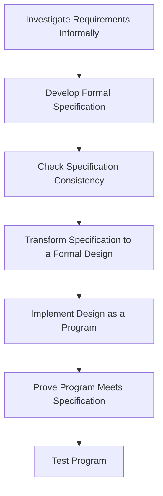

---
tags:
  - CO3408
  - Advanced-Software-Modelling
---
[[CO3408 Advanced Software Modelling]]

---
# Lecture Documents
[[CO3408 Lecture 1.pdf]]
[[CO3408 L1 - Lab 1 - Worksheet.pdf]]
[[CO3408 L1 - Lab 1 - Worksheet Solution.pdf]]

---
# Written Notes
![[CO3408 Lecture 1 - Note 1.png]]
![[CO3408 Lecture 1 - Note 2.png]]
![[CO3408 Lecture 1 - Note 3.png]]

---
# Aims & Objectives
Module examines the use of formal methods for the specification, development, and verification of software.

Aiming to present a range of techniques for analysis and implementation of real-time solutions.

Investigation into the theory and problems in concurrent systems as follows:
1) Develop an understanding of formal methods
2) Develop skills & techniques to enable the usage of formal methods
3) Develop understanding of the theory of concurrent systems
4) Develop skills & techniques in the implementation of complex software

---
# Assignment Information
|                                                                   Assignment                                                                   | Weighting | Word Limit | Assignment Type | Learning Outcomes Assessed |
| :--------------------------------------------------------------------------------------------------------------------------------------------: | :-------: | :--------: | :-------------: | :------------------------: |
| Practical Work (Involving a specification using formal and semi-formal methods for the implementation of concurrent systems and an evaluation) |    50%    |    2000    |   Coursework    |         1,2,3,4,5          |
|                                                                  Examination                                                                   |    50%    |  2 hours   |  Written Exam   |          1,2,3,5           |

---
# Why Use Formal Language
# Formality Benefits
- Precision
- Clarity Specification
  - Forces greater thought
  - More chance that specification is correct
- Identify inconsistencies in specification
- Proof covers "all" possibilities
  - Tests only cover a sample of the possibilities
- Potential for automated checking for
  - Specification Consistency
  - Proof
# Formality Problems
- Difficult to understand
  - Mathematical language
- Difficult to write
  - Similar to programming
- Errors still possibly
- Complex
  - Especially if it covers all hardware details
- Unable to express all requirements.

---
# What are Formal Methods
Formal methods use math to prove and verify that software works.

The reason formal methods are used to *prove* that a program works as intended.
## Formal Benefits
- find mistakes early
- ensure reliable and safe systems
- verify that software acts with intended behaviour.
### Application Examples
Formal methods are utilised in numerous applications, some examples are as follows:
- Safety-Critical Systems
- Banking Software
- Aerospace
- Healthcare Systems
## Formal Methods Over-Time
Developed in the 1980s (Z & VDM (Vienna Development Method) popular)
- These used abstract specifications (based on mathematical models) to specify how software should behave.
- Developers would refine the abstract models and turn into code via series of refinement steps
  - Each refinement verified by *formal reasoning* to ensure no errors were introduced.

- Much later systems like JML aim to make specification more "programmer friendly"
  - Over-Time researchers realised that traditional formal methods were *too mathematical* and difficult for the everyday programmer to use.
## Example Formal Method
```java
double squareRoot(double val) // Signature
requires: val >= 0 // Pre-Condition
ensures: val == result * result // Post-Condition
```
<sub>SquareRoot Function Formal Method Example</sub>
#### Example Explanation
**Signature** - Describes the *function name*, *parameters*, and *return type*.
- The function `squareRoot` takes a `double` parameter for the variable `val`.

**Pre-Condition**: Defines what **must be true** for the function to *run*
- `val >= 0` - the input value must be *greater than or equal to* `0`.

**Post-Condition**: Defines what **must be true** *after* the function finishes.
- `val == result * result` - the returned value, when squared, must equal the original input. (Proving *Correctness*
## Applying Formal Methods
A systematic application of:
- **Mathematical notations**
- **Mathematical reasoning (proofs)**

The notations can be used for:
- **Functional requirements** – defining what the system should do
- **Program design** – outlining how the system will achieve it
- **Program proving** – mathematically verifying that the design works correctly

The proofs can then be applied to:
- **Code development** – ensuring the code correctly implements the design
- **Verification** – confirming that the final code matches the specified behaviour

---
# Informal Specifications
Informal Specifications describe what a system or program should do without mathematics or formal logic. 

>[!Example]
>"When the user clicks a button I want them to see a message"
>
>Describes what should happen, but is not specific or precise.
## Issues
There are issues that present themselves when working with informal specifications.

Some issues of informal specifications are as follows:
- Ambiguity - Informal language can create different interpretations of the requirement.
- Incompleteness - Often error error conditions
- Inconsistency - Contradiction between two parts of the specifications
- Lack of Expressive Power
  - Language cannot express intention
  - Somethings can be expressed through example

---
# Informal Formal Specification
```java
public int findPosition(int target, int[] items)
{
	// Implementation
}
```
## Informal Pre & Post Conditions
Requires: The input `target` should be an number, and `items` should be a list of numbers.

Ensures: The returned value should be an index to indicate the position of the `target` in the array of `items`, and if not found return **-1**.

---
# Design By Contract
Design by contract is a programming approach where the pre and post conditions define a *contract* between `the method` (which can also be referred to as `the supplier`) and the `client` (the code that calls it).
## The Contract Relationship
The `Client` **must** ensure the *pre-condition* is **true** before calling the `method`.

The `Supplier` can **assume** the pre-condition has been met, and **must** make the *post-condition* **true** *before* returning.

The `Client` after call can **assume** the *post-condition* is accurate and does not need to know how the solution was achieved.
## Contracts with JML
JML is a java-based language supporting the creation of "programmer friendly" specification and verification of methods and/or classes.

>JML is supported in [Visual Studio Code Extension](https://marketplace.visualstudio.com/items?itemName=wadoon.jml-vscode)

---
# Formal Development Approach


---
# Why Study Formal Methods
- Used for some safety critical applications
- Serious Developers must study them as a professional expectation
- Will help in development of programming skills (more thoughtful and critical, requires attention to detail)
- Can help in design and checking (Informal reasoning based on a formal approach)

---
# Summary
- Informal Specifications have Problems
- Formal Method
  - Formal Specification
  - Formal Development
  - Proving Correctness
- Contracts
  - Pre and Post Conditions
  - Automatic run-time assertion checking
  - Static checking (program verification)

---
[[CO3408 Lecture 2 - Formal Specification & Contracts]]