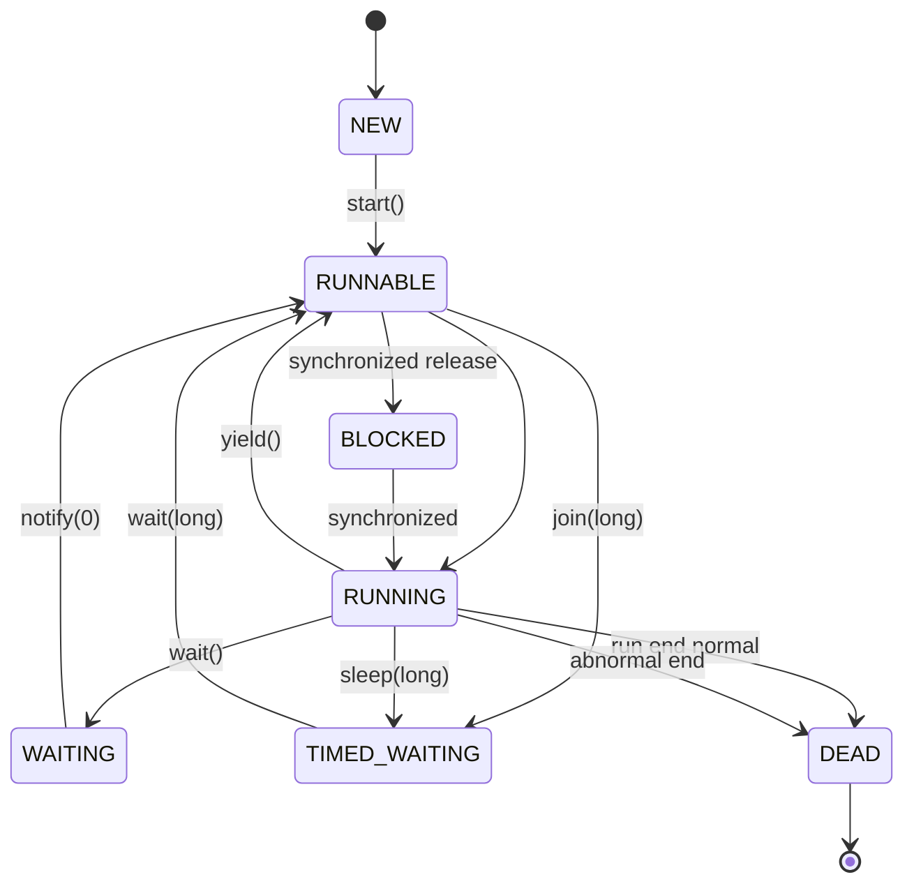

---
tags:
  - CO3408
  - Advanced-Software-Modelling
---
[[CO3408 Advanced Software Modelling]]
[[CO3408 Lecture 1 - Introduction to Formal Specification]]

---
# Lecture Documents
[[CO3408 Lecture 2.pdf]]
[[CO3408 L2 - Lab 2 - Worksheet.pdf]]

---
# Written Notes
![[CO3408 Lecture 2 - Note 1.png]]
![[CO3408 Lecture 2 - Note 2.png]]
![[CO3408 Lecture 2 - Note 3.png]]

---
# Modelling System Behaviour
- Many systems can be described in terms of states and transitions.
- A STD (State Transition Diagram) models how the system moves between states.
- Arrows represent transitions; labels represent events or conditions that trigger them.
- States are high-level abstractions, they describe what the system is doing and not how it has changed internally.

---
# Understanding System State
- A system's state is a *snapshot* of all its variable values at a specific time.
- When an operation executes, it may modify variables causing a change in state.

> [!EXAMPLE] Ordering Example
>```mermaid
>stateDiagram-v2
  >  direction LR
 >   [*] --> Created
>    Created --> Paid : Payment Received
  >  Created --> Cancelled : Cancel Requested
 >   Paid --> Shipped : Order Dispatched
 >   Paid --> Cancelled : Cancel Requested
>    Shipped --> Delivered : Order Delivered
 >   Delivered --> [*]
 >   Cancelled --> [*]
>```
>
> - Variable Status in an order object:
> - Initial Status: `Created`
> - After Payment Status: `Paid`
> - After Delivery Status: `Delivered`
>   
>- States: Created -> Paid -> Shipped -> Delivered -> Cancelled
>- Events: Payment Received -> Order Dispatched -> Cancel Requested

---
# State-Based Specification
- A state-based specification expresses the rules governing how state variables change.
- Defined by a mathematical relationship between:
  - Variable values before an operation
  **and**
  - Variable values after an operation

- These relationships are expressed as *predicates* which can be reasoned about logically.
- This provides a precise description of system behaviour focusing on what must happen and not how it is implemented.

---
# State-Diagram Example


---
# Predicates in Specifications
- A predicate is a logical statement that can either be true or false.
- Used to express conditions, constraints or properties of system states.
## Where Predicates Used
- Pre-Conditions -> Must hold before execution
- Post-Conditions -> Must hold after execution
- Invariants -> Must hold always when the system is stable.

```java
/*@
  @ requires x > 0; // Predicate: Pre-Condition
  @ ensures \result == x * x* // Predicate: Post-Condition
  @*/
public int square(int x)
{
	return x * x;
}
```
> Here x > 0 and \result == x * x are predicates defining logical truths about program states.

---
# Quantifiers
- Used to reason about collections or arrays.

- Two key forms:
  - ForAll (∀) every element satisfies a condition.  

```java
// ∀x: x > 0
List<Integer> nums = List.of(1,2,3,4);
boolean allPositive = nums.stream().allMatch(x -> x > 0);
```

  - Exists (∃) at least one element satisfies it.

```java
List<Integer> nums = List.of(10,50,150,70);
boolean anyLarge = nums.stream().anyMatch(x -> x > 100);
```

---
# Design by Contract (DbC) Concept
- Builds on the principle of modularity and clear interfaces.
- Traditionally an interface defines syntax (e.g. method signatures) but not behaviour.
- DbC extends interfaces with behaviour specifications using contracts.
## Interfaces in Programming
- This defines what methods exist but not what they guarantee.
- Design by Contract adds this missing behavioural dimension

> [!EXAMPLE]
> ```java
// Interface defining the contract
public interface Account 
{
 >   void deposit(double amount);
>    // Pre-condition: amount > 0
>
  >  void withdraw(double amount) throws Exception;
 >   // Pre-condition: amount > 0 && amount <= balance
>
  >  double getBalance();
  >  // Post-condition: balance >= 0
>}
>
>// Class implementing the contract
>// Class invariant: balance >= 0
>public class BankAccount implements Account 
>{
>
 >   private double balance = 0;
>
 >   @Override
 >   public void deposit(double amount) 
 >   {
 >       assert amount > 0 : "Precondition failed: amount must be positive";
>
  >      balance += amount;
>
  >      assert balance >= 0 : "Invariant violated: balance negative";
   > }
>
  >  @Override
  >  public void withdraw(double amount) throws Exception
  >  {
 >       assert amount > 0 && amount <= balance
 >           : "Precondition failed: invalid withdrawal";
>
>        balance -= amount;
>
>        assert balance >= 0 : "Invariant violated: balance negative";
>    }
>
>    @Override
>    public double getBalance() 
>    {
>        return balance;
 >   }
>}
> ```
## Core Idea of DbC
- A contract defines obligations and guarantees between two parties:
  - Client (Caller): Must ensure the pre-condition holds before invoking the method.
  - Supplier (Callee): Guarantees the post-condition after execution.

- The client doesn't need to know how the method works, only what it promises to deliver.
## Using Contracts To Specify Behaviour
- Precondition - What must be true before the method runs.
- Postcondition - What must be true after the method runs.
- Invariant - Must always hold for the object's valid state.

>[!EXAMPLE] Contract by Behaviour Example
>```java
>public class BankAccount 
>{
 >  private double balance;
 >   // Class Invariant: balance >= 0
 >   public void deposit(double amount) 
 >   {
 >       assert amount > 0
 >           : "Precondition failed: amount must be positive";
 >       double oldBalance = balance;
 >       balance += amount;
 >       assert balance == oldBalance + amount
 >           : "Postcondition failed: balance not updated correctly";
 >       assert balance >= 0
 >           : "Invariant violated: balance negative";
 >   }
 >   public void withdraw(double amount) 
 >   {
 >       assert amount > 0 && amount <= balance
 >           : "Precondition failed: invalid withdrawal";
 >       double oldBalance = balance;
 >       balance -= amount;
 >       assert balance == oldBalance - amount
 >           : "Postcondition failed: balance not updated correctly";
 >       assert balance >= 0
 >           : "Invariant violated: balance negative";
 >   }
>}
>```

---
# Writing Post-Conditions
- Postconditions link the state before and after execution.
- Postconditions must be pure, they cannot modify the program state.

```java
public class BankAccount 
{

    private double balance;

    public void deposit(double amount) 
    {
        double oldBalance = balance;
        balance += amount;

        // Postcondition: balance must increase by the deposit amount
        assert balance == oldBalance + amount
            : "Postcondition failed: balance not updated correctly";
    }

    public void withdraw(double amount) 
    {
        double oldBalance = balance;
        balance -= amount;

        // Postcondition: balance must decrease by the withdrawal amount
        assert balance == oldBalance - amount
            : "Postcondition failed: balance not updated correctly";
    }
}
```

---
# Specifying Change & Stability
- When writing postconditions it's important to specify:
  - What changes the part of the state that should be modified
  - What stays the same, properties that must remain unchanged.

- Omitting "what doesn't change" can lead to incomplete or ambiguous specifications.

---
# Handling Exceptional Behaviour
- Postconditions can also describe what happens when operations fail.
- Different outcomes (normal or exceptional) can be expressed with implication (->) and logical AND (^).
- For example, specifying postconditions for exceptions ensures consistent system state in the error cases.

```java
public class BankAccount
{
	private double balance;
	
	public void withdraw(double amount) throws Exception
	{
		if (amount <= 0)
		{
			throw new IllegalArgumentException("Amount must be positive")
		}
		
		if (amount > balance)
		{
			throw new Exception("Insufficient Funds");
		}
		
		balance -= amount;
	}
}
```

---
# Class Invariants
- Class invariants are predicates that must always hold true for an object, except temporarily while a method is executing.

> [!EXAMPLE] For Example
>Invariant: `balance > 0` must always hold.
>They define what it means for an object to be in a valid or consistent state.
>Class invariants are checked before and after every public method call.
>
>JML invariants are written using the invariant clause within a class.
>
> >[!EXAMPLE]
> >```java
> >public class BankAccount
> >{
> >	private double balance;
> >
> >	public BankAccount(double initialDeposit)
> >	{
> >		this.balance = initialDeposit
> >		assert invariant();
> >	}
> >
> >	public void despoit(double amount)
> >	{
> >		if (amount <= balance)
> >		{
> >			balance -= amount;
> >		}
> >		assert invariant();
> >	}
> >
> >	public void withdraw(double amount)
> >	{
> >		if (amount <= balance)
> >		{
> >			balance -= amount;
> >		}
> >
> >	assert invariant();
> >	}
> >
> >	private boolean invariant()
> >	{
> >		// Class Invariant: balance should never be negative
> >		return balance >= 0;
> >	}
> >}
> >```

---
# Summary
- The concept and purpose of State Transition Diagrams.
- How to represent system behaviour using state-based specifications
- How Design by Contract formalises method obligations and guarantees
- The use of preconditions, postconditions, and invariants for software reliability.
- How quantifiers express logical relationships over collections.

---
[[CO3408 Lecture 3 - Formal Specification Methods & Their Latest Industry Uses]]