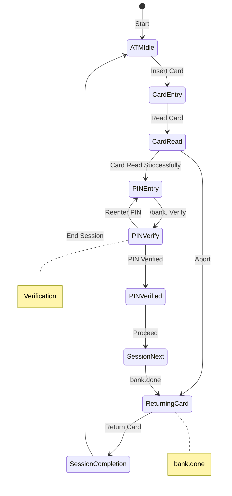

---
tags:
  - CO3408
  - Advanced-Software-Modelling
---
[[CO3408 Advanced Software Modelling]]
[[CO3408 Lecture 2 - Formal Specification & Contracts]]

---
# Lecture Documents
[[CO3408 Lecture 3.pdf]]
[[CO3408 L3 - Lab 3 - Tutorial.pdf]]

>[!info]
>[Formal Methods Meets Readability: Auto-Documenting JML Java Code](https://arxiv.org/pdf/2506.09230) JML latest research paper for reading

---
# Written Notes
![[CO3408 Lecture 3 - Note 1.png]]

---
# ATM State Transition Diagram


---
# Aims & Objectives
- To understand the role and importance of formal specification methods in software engineering.
- To describe key techniques such as set notation, sequences, and recursion.
- To understand how formal methods improve software reliability and safety.
- To explore modern tools and real-world applications of formal methods in industry.

---
# Formal Specification Concepts
- Sets
- Sequences
- Recursion

---
# Sets
- A set is a collection of distinct elements
- Used to describe system states, valid inputs, or relationships.

- A collection of elements which:
  - *Unordered*
  - Contains no duplications

- {6, ..., 9} represents a spread operator meaning {6, 7, 8, 9}
- {} or Ø meaning empty set.

- Other mathematical data types also exist, such as **sequences**, which *do* preserve order and may allow duplicates
## Set Operators
- `∈` means **“is an element of”**  
  - Example: `2 ∈ {1, 2, 5}`
- `∉` means **“is not an element of”**  
  - Example: `1 ∉ {2, 3, 5}`
- `⊆` means **“is a subset of”**  
  - Example: `{1, 2} ⊆ {1, 2, 3}`
- `⊂` means **“is a proper subset of”**  
  - Example: `{1, 2} ⊂ {1, 2, 3}`
- `∪` means **union** (elements in either set)
- `∩` means **intersection** (elements common to both sets)
![[CO3408 L3 - Sets Union Intersection Image.png]]
## Set Notation Example
A banking system:
- {A1, A2, A3} representing all active customer **Accounts**.
- another set, **z** = {A2}, might represent accounts with negative balance.

- **Overdrawn** (⊆) **Accounts** 
This means:
  - Every element in `Overdrawn` is also an element of `Accounts`
  - `A2 ∈ Overdrawn` and `A2 ∈ Accounts`

- We can verify the subset relationship:
  - `∀x (x ∈ Overdrawn ⇒ x ∈ Accounts)`

- This notation allows us to clearly describe system states and reason about conditions such as:
- "All overdrawn accounts must be valid customer accounts”

---
# Sequence
- A sequence is an *ordered* collection.
- Represents event histories, message queues, or ordered data.
## Sequence Notation

|    Expression    | Meaning                            |
| :--------------: | ---------------------------------- |
|  `s = <a,b,c>`   | Sequence of three elements.        |
|       `#s`       | Length of the seqeunce.            |
|   `head s = a`   | First Element.                     |
| `tail s = <b,c>` | Remaining elements after the head. |
## Example in JML Specification
```java
/*@ public model sequence<String> Messages;
	public invariant
		Messages == ("Login", "Request", "Logout");
@*/
```
## Sequence Operations
### Sequence Length
- The length of a sequence is written as `|sequence|`
- It represents the **number of elements** in the sequence.
>[!EXAMPLE]
>- `|[]| = 0` (the empty sequence has a length of 0)
>- Let `t = [23, 44, 42, 1, 99]`  
>  - `|t| = 5`
>- Let `Contents = [[a, b], [c, d], [e, f]]`  
>  - `|Contents| = 3` (length counts top-level elements, not nested ones)

---
# Recursion
- Recursion defines an operation in terms of itself.
- Essential for reasoning about inductive definitions and loops.

```java
public static int fac(int n) {
    return (n == 0) ? 1 : n * fac(n - 1);
}
```

---
# Why Use Formal Methods?
- Specify and prove system properties mathematically.
- Detect inconsistencies early.
- Improve reliability and safety.
- Support certification for critical systems.
## Types of Formal Methods

|         Category          | Description                             | Example Languages / Tools |
| :-----------------------: | --------------------------------------- | ------------------------- |
|        Model-Based        | State & data models.                    | [Z notation](https://en.wikipedia.org/wiki/Z_notation), [B-Method](https://en.wikipedia.org/wiki/B-Method), [VDM](https://en.wikipedia.org/wiki/Vienna_Development_Method) |
|      Property-Based       | Specify temporal or logical properties. | [TLA+](https://en.wikipedia.org/wiki/TLA%2B), [LTL](https://en.wikipedia.org/wiki/Linear_temporal_logic), [CTL](https://en.wikipedia.org/wiki/Computation_tree_logic) |
|      Process Algebra      | Concurrency & communication models.     | [CSP](https://en.wikipedia.org/wiki/Communicating_sequential_processes), [π-Calculus](https://en.wikipedia.org/wiki/Pi-calculus) |
| Constraint/Automata Based | Relations & transitions.                | [Alloy](https://en.wikipedia.org/wiki/Alloy_(specification_language)), [Petri nets](https://en.wikipedia.org/wiki/Petri_net) |
### Example Z Specification
```z
[USER]
LOGIN
ΔUSER
 name?: NAME
 pwd?: PASSWORD
 success!: BOOL
 success! = (name?, pwd?) ∈ USERS
```
### Example Alloy Model
```alloy-model
sig Person {friends: set Person }
fact { all p: Person | p not in p.friends }
```
### Example TLA+ (Temporal Logic of Actions)
```TLA+
VARIABLE counter
Init == counter = 0
Next == counter' = counter + 1
Spec == Init /\ [][Next]_counter
```

---
# Modern Industry Applications

|  Company / Domain   |         Method          |                    Application                     |
| :-----------------: | :---------------------: | :------------------------------------------------: |
| Amazon Web Services |          TLA+           |          Distributed systems verification          |
|    Airbus & NASA    |  B-Method / SPARK Ada   |               Flight software safety               |
|      Microsoft      |        Z / Dafny        |            Verified drivers & protocols            |
|  Siemens / Alstom   |    Event-B, B-Method    |                 Railway signalling                 |
|   Google DeepMind   |    Coq, Isabelle/HOL    |                  AI safety proofs                  |
|       NVIDIA        | SMT solvers (e.g., Z3)  |      Hardware memory models & GPU concurrency      |
|        Intel        | HOL Light, TLA+, Prover | Processor microcode & cache coherence verification |
|       Boeing        |       Coq, Ivory        |   Aerospace avionics & unmanned aircraft systems   |
| Ethereum Foundation | Coq, Isabelle/HOL, Why3 |  Blockchain smart contracts & consensus protocols  |

---
# Known Uses of JML
|               Domain / Type                |           Who / Where            |                                                                                                                                What they use JMl / Application                                                                                                                                |
| :----------------------------------------: | :------------------------------: | :-------------------------------------------------------------------------------------------------------------------------------------------------------------------------------------------------------------------------------------------------------------------------------------------: |
|            Academic / Research             |   Universities & Research Labs   |                                    Used in teaching formal methods;  <br>used in small-scale case studies and to verify Java programs. <br><br>For example, OpenJML was used in several college-level courses. ([arXiv](https://arxiv.org/abs/1404.6608))                                     |
|              Tool Development              | OpenJML Developers, Contributors |                                                  Developing specification tools (static  <br>& runtime checking), integrating JML  <br>with verification backends, code +  <br>spec consistency. ([openjml](https://www.openjml.org/about/))                                                  |
| Documentation /  <br>Specification Quality |     Recent Research Efforts      | A 2025 paper “Formal Methods Meets  <br>Readability: Auto-Documenting JML  <br>Java Code” shows that using JML  <br>specifications improves completeness  <br>of class-level documentation,  <br>especially for invariants often  <br>overlooked. ([arXiv](https://arxiv.org/abs/2506.09230)) |

---
# Case Study
## Amazon Web Services - TLA
- TLA+ used to model S3, DynamoDB.
- Detected subtle design bugs before coding.
- Enhanced reliability and reduced outage risk.
## Airbus A380
- B-Method for flight-control software.
- Code generated from mathematically proven models.
- Achieved zero in-flight software failures.

---
# Benefits & Limitations
## Benefits
- Early error detection
- Mathematical rigour -> safety and certification
- Unambiguous documentation
## Limitations
- Requires specialised skills
- Time-intensive for large systems
- Limited industrial expertise base

---
# Current Trends (2020 - 2025)
- Integration with AI verification and ML fairness.
- Automation with CI/CD pipelines.
- Use in blockchain and smart contracts
- Hybrid approaches combining testing + formal proofs

---
# Summary
- How sets, sequences, and recursion underpin formal methods.
- The main specification approaches and notations
- Industrial applications proving real-world value.
- Trends and practical challenges in adoption.

---
[[CO3408 Lecture 4 - Modelling System Structure & Behaviour with UML & OCL]]