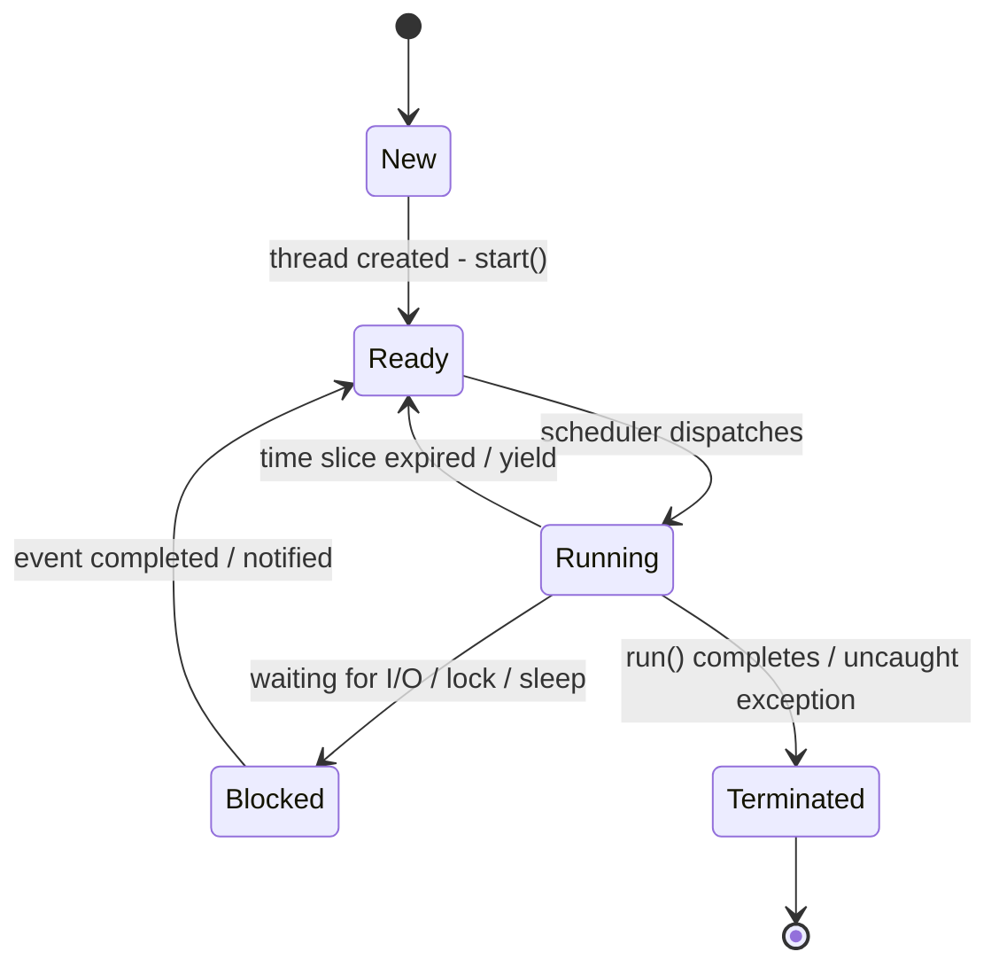
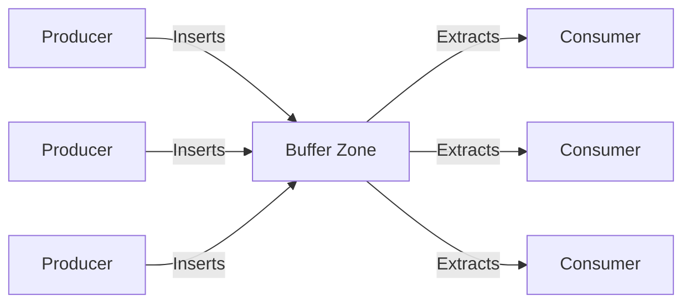

---
tags:
  - CO3408
  - Advanced-Software-Modelling
---
[[CO3408 Advanced Software Modelling]]
[[CO3408 Lecture 6 - Concurrency in Software Modelling]]

---
# Lecture Documents
[[CO3408 Lecture 7.pdf]]
[[CO3408 L7 - Lab 7 - Worksheet.pdf]]

---
# Aims & Objectives
By the end of the lecture, should be able to:
- Explain the concept of concurrency and why multi-threading is useful.
- Describe the Java thread lifecycle and key thread states.
- Use thread priorities and understand issues such as priority inversion.
- Create aand start threads correctly and use join() for coordination
- Identify race conditions and explain why operations like value = value + 1 are not atomic
- Distinguish between:
  - Synchronization (mutual exclusion)
  - Coordination (condition-based waiting)
  - Explain why simple synchronization fails in producer - consumer problems
  - Use atomic variables (AtomicInteger, etc) as lock-free solution for thread-safe operations
  - Evaluate safe thread-stopping mechanisms (volatile, interrupt()), and recognise deprecated/unsafe methods.

---
# Thread Lifecycle
- Threads can be in states:
  - New -> Runnable -> Running -> Waiting -> Terminated
  - Created using new Thread()
  - Started with start()
  - Can be paused or terminated gracefully

---
# The Life of a Thread
- The scheduler gives the thread processor time: 
  - the thread executes part of its run method.
## Thread States & Lifecycle

## Summary of Different Thread States

|  State   |                     Description                     |
| :------: | :-------------------------------------------------: |
|  Ready   | The thread is ready to run and waiting for the CPU. |
| Running  |         The thread is executing on the CPU.         |
| Waiting  |   The thread is waiting for some event to happen.   |
| Sleeping |    The thread has been told to sleep for a time.    |
| Blocked  |      The thread is waiting for I/O to finish.       |

---
# Thread Priorities
- Threads inherit the creator's priority
- Priority constants: MIN_PRIORITY (1) -> MAX_PRIORITY (10)
- Methods: getPriority(), setPriority()
- Higher-priority threads are scheduled **first** but not guaranteed

---
# Priority Inversion Problem
- A low-priority thread holds a lock needed by a high-priority thread.
- A medium-priority thread prevents the low-priority one from releasing the lock.
- Result: high-priority thread is effectively blocked.
## Race Condition Demonstration
- A race condition occurs when:
  - Two or more threads across shared data
  - At least one thread writes to it
  - Access is not synchronized

- Result: unexpected, inconsistent, or corrupted values.

- The run() body:
```java
public void run()
{
	int val;
	for (int i = 0; i < numInc; i++) // numInc = Number of Increments
	{
		val = value; // Read 
		val = val + 1; // Compute
		value = val; // Write
	}
	
	value = value - numInc;
}
```
### Why?
- Multiple threads reading and writing value cause inconsistent results.
- "value = value + 1" is not atomic (multiple CPU instructions).

---
# Fixing Race Condition
Option 1 - Synchronized
```java
public synchronized void increment()
{
	value++;
}
```
Option 2 - AtomicInteger
```java
AtomicInteger value = new AtomicInteger(0);
```

---
# Atomic Variables in Multithreading
- Java provides atomic classes in `javaa.util.concuurrent.atomic`
  - `AtomicInteger`, `AtomicLong`, `AtomicBoolean`, `AtomicReference<T>` 
- What makes them atomic?
  - Operations like increment, get, and finally compare and set happen as one indivisble step
  - No other thread can observe aa half-updated value
  - Prevents race conditions without using synchronized
- What use atomic variables?
  - Faster than sychronized for simple counters/flags
  - Lock-free, non-blocking operations
  - Useful for:
```java
AtomicInteger count = new AtomicInteger(0);
count.incrementAndGet(); // atomic increment
``` 
## Atomic VS Non-Atomic Counter

|            Atomic Counter (AtomicInteger)             |                                  Non-Atomic Counter (int)                                   |
| :---------------------------------------------------: | :-----------------------------------------------------------------------------------------: |
|          Uses: atomicCount.incrementAndGet()          |                                  Simple increment: count++                                  |
|            Thread-safe without sychronized            |                                       Not thread-safe                                       |
|    Operation is performed as one indivisible step     | Increment is not atomic (3 separate steps)<br>- Read Value<br>- Add 1<br>- Write Value Back |
| Uses low-level CPU primitives (CAS = Compare-And-Set) |                Multiple threads can interleave these steps -> race condition                |
|     No race condition -> final result is correct      |                          Final result is often lower than expected                          |

## Creating, Starting & Awaiting Thread Completion (Join)
- Creating threads using Runnable / extending Thread.
- Starting a thread using `.start()`
- Why `.run()` is not the same as `.start()`
- Waiting for thread completion using `.join()`

Use case - Ensuring tasks finish before continuing, sequencing work.
## Code Example
```java
public class JoinExample
{
	// A simple task for the thread to run
	static class Worker implements Runnable
	{
		private String name;
		Worker(String name)
		{
			this.name = name;
		}
		
		@Override
		public void run()
		{
			System.out.println(name + " starting work.");
			
			// Simulate some work
			try
			{
				Thread.sleep(500);
			} 
			catch(InterruptedException e)
			{
				System.out.println(name + " interrupted.");
			}
		}
	}
	
	public static void main(String[] args)
	{
		System.out.println("Main Thread Starting:");
		
		Thread t1 = new Thread(new Worker("Worker-1"));
		Thread t2 = new Thread(new Worker("Worker-2"));
		
		// Start Threads
		t1.start();
		t2.start();
		
		// Wait for both to finish
		try
		{
			t1.join(); // Main Thread waits for t1
			t2.join(); // Main Thread waits for t2
		}
		catch (InterruptedException e)
		{
			System.out.println("Main Thread interrupted while waiting.");
		}
		System.out.println("Both Workers Finished. Main Continues");
	}
}
```

---
# IncrementTest Example (Priorities + Join)
- Scenario: multiple threads incrementing a shared counter.
- Focus on *thread priorities* as a scheduling hint.
- Using `.join()` to ensure all worker threads finish before reading the final result.
- Key message: priorities *do not* guarantee order or fairness.
## Code Example
```java
public class IncrementTest implements Runnable
{
	static int numThreads = 5;
	static Thread[] threads;
	
	@Override
	public void run()
	{
		System.out.println(Thread.currentThread.getName()
			+ "running with priority"
			+ Thread.currentThread.getPriority());
	}
	
	public static void main(String[] args)
	{
		threads = new Thread(numThreads);
		
		// Create & Start Threads with Random Priorities
		for (int i = 0; i < numThreads; i++)
		{
			threads[i] = new Thread(new IncrementalTest(), "Worker-"+i);
			
			int p = 1 + (int)(Math.random() * 5); // Priority 1 - 5
			threads[i].setPriority(p);
			threads[i].start();
		}
		
		// Wait for All Threads to Finish
		for (Thread t : threads)
		{
			try { t.join(); } catch (InterruptedException e) {}
		}
		
		System.out.println("All worker threads complete.");
	}
}
```

---
# Coordination VS Synchronization
Synchronization - Ensures the correctness of shared data access.
Coordination - Ensures threads wait for certain conditions before proceeding.
Example - A thread must *wait* until data becomes available.
Coordination - Requires explicit mechanisms (e.g. wait/notify)

---
# Producer-Consumer Problem
Producers - generate data items
Consumers process them
Needs Coordination access to a shared buffer.

Problems:
- Producers may overfill the buffer.
- Consumers may try to consume when empty.
## Why Synchronization Alone Fails
- Synchronized blocks ensure mutual exclusion
But they do not provide a way for a thread to pause until a condition becomes true.

Example - Consumer enters synchronized block but buffer is empty -> no built-in waiting.
Leads to inefficient busy-waiting loops.
Solution use `wait()` / `notify()`
## wait(), notify(), notifyAll()
Due to `synchronized` not being sufficient alone due to a lack of coordination, despite providing mutual exclusion.

Some threads must wait for a condition to become true:
- Buffer not empty
- Buffer not full
- Item available
- Consumer ready

Only the following methods can be called inside a synchronized block/method and operate on the object's `monitor lock`:
- `wait()`
- `notify()`
- `notifyAll()`
## Solution - Buffer Class

- Synchronized Methods: `insert()`, `extract()`
- Guarantees mutual exclusion
But problems waiting for items / space:
- Can't wait inside exclusion zone
  - No other thread can get in to add / remove items
- Can't wait outside exclusion zone
  - Another thread might grab lock first.

---
# Other Thread Methods
**sleep(long milliseconds)**
  - Suspend the task for a fixed period
  - Unless interrupted
  - Keeps hold of the monitors

**interrupt()**
- Interrupt the task
  - stops, wait, sleep

**join()**
- Wait for the thread to finish

**suspend() / stop()**
- Deprecated
  - may **deadlock** if thread holds a lock.

---
# Stopping a Task
```java
volatile int finished;

setDone()
{
	finished = true;
	this.interrupt();
}

run()
{
	while (!finished)
	{
		// Do Things.
		try
		{
			sleep();
		}
		catch (InterruptedException e)
		{
			continue;
		}
	}
}
```

---
# Summary
- Concurrency & Threads
- Lifecycle & Priorities
- Race Conditions & Atomicity
- Synchronization VS Coordination
- Producer-Consumer
- wait/notify
- Atomic Variables
- `join()` for sequencing
- Safe stopping
- Avoid stop() / suspend()

---
[[CO3408 Lecture 8 - Advanced Synchronisation - Semaphores & Scheduling]]