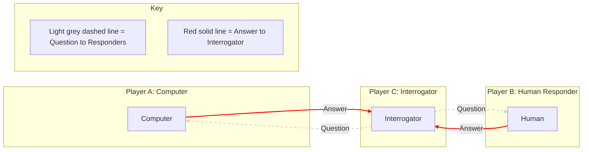
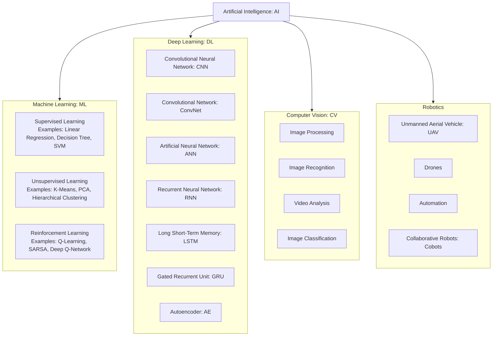

---
tags:
  - CO3519
  - Artificial-Intelligence
---
[[CO3519 Artificial Intelligence]]

---
# Lecture Documents
[[CO3519 Lecture 1.pdf]]

---
# Written Notes
![[CO3519 Lecture 1 - Note 1.png]]

---
# Course Overview
Module - Artificial Intelligence
Course ID - CO3519
Number of Assignments - 2

|            Assignment             | Weighting |
| :-------------------------------: | :-------: |
| Implementation of an AI Algorithm |    50%    |
|     Advanced AI Demonstration     |    50%    |

Programming Language & Setup
- [Python](https://www.python.org) & [Google Collab](https://colab.research.google.com/)
Recommended Book
- [[Artificial Intelligence - A Modern Approach.pdf]]

---
# Lecture Contents
- What is Artificial Intelligence
- History of Artificial Intelligence
- Applications of Artificial Intelligence
- Sub-fields in Artificial Intelligence

---
# Introduction To Artificial Intelligence
Artificial intelligence is about making a machine able to:
- Think like a human
- Understand like human
- Behave like human

---
# Acting Humanly - Turing Test Approach
Designed by Alan Turing in the 1950s as thought which sidestepped the vagueness of the question "Can a machine think?"
## Turing Test Diagram

---
# The Six Principles of AI
For a machine to be able to think it was devised that the following features would be needed:
- **Natural Language Processing** - Communication in human language.
- **Knowledge Representation** - To store what it knows or hears.
- **Automated Reasoning** - Answer questions and draw new conclusions.
- **Machine Learning** - Adapt to new circumstances, detect patterns.
- **Computer Vision** - To be able to view objects.
- **Robotics** - To manipulate and move. 
## Algorithms

---
# History of Artificial Intelligence

```mermaid
flowchart TD
%% --- Early Foundations ---
    A1943["1943 — Warren McCulloch & Walter Pitts<br/>Model of artificial neurons"]
    A1950["1950 — Alan Turing<br/>Proposed the Turing Test for machine intelligence"]
    A1956["1956 — John McCarthy<br/>Coined the term 'Artificial Intelligence'"]
    A1961["1961 — General Motors<br/>Deployed Unimate, the first industrial robot"]
    A1964["1964 — Joseph Weizenbaum<br/>Created ELIZA, the first NLP program"]
    A1966["1966 — Shakey the Robot<br/>First general-purpose robot capable of reasoning"]
    A1997["1997 — IBM Deep Blue<br/>Supercomputer defeated Garry Kasparov"]
    A2002["2002 — Roomba<br/>First mass-produced autonomous home vacuum cleaner"]

%% --- Modern Milestones ---
    A2011["2011 — Apple Siri<br/>Virtual assistant integrated into iPhone 4S"]
    A2014["2014 — Eugene Goostman<br/>Chatbot claimed to pass the Turing test"]
    A2016["2016 — DeepMind AlphaGo<br/>Neural-network-based program defeated Lee Sedol"]
    A2022a["2022 — OpenAI ChatGPT<br/>Conversational AI launched for public use"]

%% --- 2020–2025 Advances ---
    A2020["2020 — GPT-3<br/>Large language model released by OpenAI"]
    A2021["2021 — DALL·E<br/>Text-to-image model by OpenAI"]
    A2022b["2022 — Midjourney & Stable Diffusion<br/>Generative AI art systems democratized creativity"]
    A2023["2023 — GPT-4<br/>Marked a leap in reasoning and multimodal capabilities"]
    A2024["2024 — Rise of AI Agents<br/>Autonomous multi-step, multimodal systems"]
    A2025["2025 — Domain-Specific AI<br/>Specialized applications in healthcare, law, education"]

%% --- Connections ---
    A1943 --> A1950 --> A1956 --> A1961 --> A1964 --> A1966 --> A1997 --> A2002 --> A2011 --> A2014 --> A2016 --> A2020 --> A2021 --> A2022a --> A2022b --> A2023 --> A2024 --> A2025

%% --- Clickable Wikipedia links ---
    click A1943 "https://en.wikipedia.org/wiki/Warren_Sturgis_McCulloch" "Wikipedia: Warren McCulloch"
    click A1950 "https://en.wikipedia.org/wiki/Alan_Turing" "Wikipedia: Alan Turing"
    click A1956 "https://en.wikipedia.org/wiki/John_McCarthy_(computer_scientist)" "Wikipedia: John McCarthy"
    click A1961 "https://en.wikipedia.org/wiki/Unimate" "Wikipedia: Unimate"
    click A1964 "https://en.wikipedia.org/wiki/Joseph_Weizenbaum" "Wikipedia: Joseph Weizenbaum"
    click A1966 "https://en.wikipedia.org/wiki/Shakey_the_robot" "Wikipedia: Shakey the Robot"
    click A1997 "https://en.wikipedia.org/wiki/Deep_Blue_versus_Garry_Kasparov" "Wikipedia: Deep Blue"
    click A2002 "https://en.wikipedia.org/wiki/Roomba" "Wikipedia: Roomba"
    click A2011 "https://en.wikipedia.org/wiki/Siri" "Wikipedia: Siri"
    click A2014 "https://en.wikipedia.org/wiki/Eugene_Goostman" "Wikipedia: Eugene Goostman"
    click A2016 "https://en.wikipedia.org/wiki/AlphaGo" "Wikipedia: AlphaGo"
    click A2020 "https://en.wikipedia.org/wiki/GPT-3" "Wikipedia: GPT-3"
    click A2021 "https://en.wikipedia.org/wiki/DALL-E" "Wikipedia: DALL·E"
    click A2022a "https://en.wikipedia.org/wiki/ChatGPT" "Wikipedia: ChatGPT"
    click A2022b "https://en.wikipedia.org/wiki/Stable_Diffusion" "Wikipedia: Stable Diffusion"
    click A2023 "https://en.wikipedia.org/wiki/GPT-4" "Wikipedia: GPT-4"
```

---
# Applications of Artificial Intelligence
- Healthcare
- Business
- Education
- Autonomous Vehicles
- Social Media
- Tourism
- For a better world
## Example Healthcare Tumour Detection
![[CO3519 Lecture 1 - Tumour Scan Predictions AI.png]]
## Other Applications
![[CO3519 Lecture 1 - AI Applications.png]]
![[CO3519 Lecture 1 - Other Applications.png]]

---
# Next Week
- Types of Artificial Intelligence
- Main Working Areas in AI
- Some Applied Fields.

---
[[CO3519 Lecture 2 - AI Types & Areas in AI]]