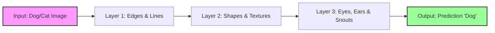
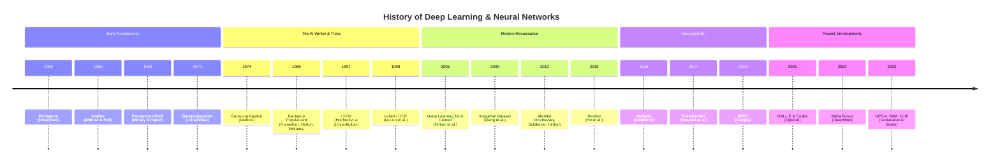
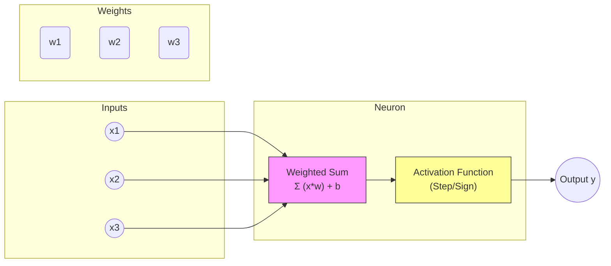

---
tags:
  - CO3519
  - Artificial-Intelligence
---
[[CO3519 Artificial Intelligence]]
[[CO3519 Lecture 10 - Reinforcement Learning]]

---
# Lecture Documents
[[CO3519 Lecture 11.pdf]]

---
# Written Notes
- No written notes made all content from the lecture.

---
# Course Overview (Recap)
- Module: Artificial Intelligence
- Course ID: CO3519
- Number of Assessments: 2
  - 1st Assignment - Weightage => 50%, Contents => Facial Expression Recognition using ML. ✔️
  - 2nd Assignment - Weightage => 50%, Contents => Implementation of Deep Learning Algorithm and its visual demonstration.
- Pre-Requisites: Python, Advanced Programming, Basic Machine Learning
- Study/Support Material: It will be provided along each lecture on blackboard.

---
# Learning Objectives
- Brief recap of traditional AI and ML concepts
- History of advanced AI (Deep Learning)
- What is DL
- What is perceptron

---
# This Semester Covers
How LLM work and CNN (conventional neural networks).

---
# Traditional AI and ML Recap
Key Points Recap:
- AI - Simulating Human Intelligence (rule-based systems, expert systems)
- Machine Learning - Learning patterns from data (Linear Regression, Decision Trees)

Limitations of Traditional ML:
- Feature Engineering - Handcrafting Features is tedious.
- Performance - Struggles with high-dimensional data like images or text.

---
# Why Deep Learning?
## Basic Steps in ML
1) Collect data and extract features
2) Build Modal
3) Optimisation - Mimise Error

DL: Requires large amounts of data
ML: Can be effective with smaller, structured datasets

DL: can outperform machine learning for complex tasks like image recognition and natural language understanding
ML: can be more efficient and easier to implement for simplier tasks.

---
# What is Deep Learning
Sub-field of ML which attempts to learn high-level abstractions in data by utilising hierarchical architectures.

Using a neural network with several layers of nodes between input and output.

The series of layers between input and output do *feature identification* and processing in a series of stages just as a human brain does.

---
# History of DL and Neural Network

---
# Perceptron
Perceptrons, Rosenblatt 1957/58

- Developed first implementation of perceptron
- Machine consist of 400 photocells, classify images
- Perceptron is a one-layer netowkr that an classify things into two parts.
## A simple Neural Network

### Biological Inspiration
- **Neurons:** Inspired by biological neurons in the brain.
- **Synapses:** The "Weights" ($w$) mimic the synaptic strength between neurons. A higher weight means a stronger connection.
- **All-or-None Law:** Just like a biological neuron either fires an action potential or doesn't, the Perceptron uses an activation function to output a crisp **1 (Fire)** or **0 (Don't Fire)** based on whether the signal crosses a **threshold**.

- These neurons receive signals from other neurons
- Depending on the strength, the neuron can either active or off/stay.
## A Perceptron Example
$$z = (x_1 \cdot w_1) + (x_2 \cdot w_2) + (x_3 \cdot w_3) + b$$
x (inputs) - data e.g. water temp.
w (weights) - importance of that data
b (bias) - shifting threshold
z (net input) - total strength of the signal before decision made

---
# Next Week
- Convolutional Neural Networks (CNNs) - Basics
- Introduction To CNNs - Why CNNs are effective for image data
- Key Components:
  - Convolution Layers
  - Pooling Layers
  - Filters
  - Stride
  - Padding 
- Activation Functions
- Loss functions
- Gradient descent

---
[[CO3519 Lecture 12  - Basics of Deep Learning]]