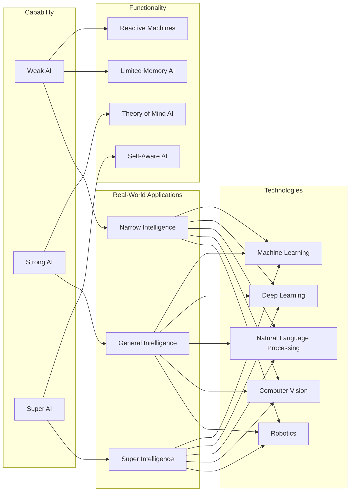

---
tags:
  - CO3519
  - Artificial-Intelligence
---
[[CO3519 Artificial Intelligence]]
[[CO3519 Lecture 1 - Introduction To Artificial Intelligence]]

---
# Lecture Documents
[[CO3519 Lecture 2.pdf]]

---
# Written Notes
![[CO3519 Lecture 2 - Note 1.png]]
![[CO3519 Lecture 2 - Note 2.png]]

---
# Lecture Contents
- Types of AI
  - Based on Capacity
  - Based on Functionality
  - Based on Applications

- Working Areas
  - Facial Expression Recognition
  - Object Detection

- Assessment 1 Released (Guide)

---
# Artificial Intelligence

## Capacity
### Weak AI
- Trained and designed for a specific task or a narrow range of tasks
- Can't perform beyond its defined tasks

>[!Example]
>Voice Assistants (Siri, Alexa, Google)
>Recommendation Systems (Netflix, YouTube, Spotify)
### Strong AI
- Can perform any intellectual task that a human can.
- Ability to learn, reason, and understand across various domains.
- Not restricted to any specific task.

> [!IMAGINE]
> Imagine an AI system that can not only assist with voice commands like Siri but:
> - write essays
> - solve complex math equations
> - understand human emotions
> - drive a car
> - create art
> >[!EXAMPLE]
> > This would be an AI that could perform any task you ask of it, similar to a human with broad knowledge and abilities.
### Super AI
- Far exceeds human intelligence in all respects.
- AI could learn, adapt and evolve much faster than humans.
- Solving problem in innovative ways

>[!EXAMPLE]
>The Matrix or Ex Machina
>- AI Depictions not only outperform human intelligence but also gain consciousness and potentially control the human environment.
>- A Super AI might for example cure all diseases or design technologies far beyond current human capacities but it might also pose ethical risks if it behaves unpredictability.
>- AI can categorise into several types based:
>  - Functionality
>  - Capacity
>  - Real-World Applications
>  - Other Technologies.
## Functionality
### Reactive Machines
- Simplest AI that perform specific tasks by reacting to current conditions without storing any past experiences.
- Cannot 'learn' from the previous actions or improve their performance based on experience.
#### IBM's Deep Blue (Chess-Playing AI)
- Famously beat the chess champion Garry Kasparov is a reactive AI.
- It analysed the chessboard's current state, evaluated possible moves, and chose the best one based on programmed algorithms.

>[!warning] The Problem?
>It couldn't learn or adapt between games and was purely reactive to the current game's conditions.
### Limited Memory AI
- Can learn from historical data to make decisions.
- Can store past experiences or data for a short time and use it to improve their predictions or performance.

>[!EXAMPLE]
>Self-Driving Cars (e.g. Tesla or Waymo)
>- Use limited memory AI
>- Analyse real-time data from sensors, cameras, and radar (like road conditions, traffic, and other vehicles' behaviour) to make decisions.
>- Use previous experiences (like patterns of traffic flow) to navigate better in future.
### Theory of Mind AI
- Designed to understand emotions, intentions and social situations.
- To interpret human needs and respond accordingly.
- To predict how humans will behave in certain situations and adjust its behaviour accordingly.

>[!warning] Currently Theoretical
>- In development however remains theoretical for now.
>- Research into emotional AI is underway.
>- No current AI system fully understands human emotions.
> > [!NOTE] If Developed
> > - Will be able to detect sad, or stressed based on facial expressions, voice tone, or physiological data.
> > - Responds accordingly offering calm music if stressed or providing motivational content if down.
### Self-Aware AI
- Exists only in theory
- Own consciousness and self-awareness
- Understand its own state of existence
- Recognise it's own identity
- Have independent desires or motivations

>[!EXAMPLE]
>- In films like Ex Machina AI systems become self-aware developing independent thoughts, emotions and even desires.
>- Systems start to question their purpose and existence. (Much like humans)
## Types of AI Technologies
- Machine Learning
- Deep Learning
- Natural Language Processing
- Computer Vision
- Robotics

---
# Facial Expression Recognition
![[CO3519 Lecture 2 - Facial Expression Recognition.png]]
Human communication consists of two types being: Verbal and Non-Verbal cues.

Verbal what is spoken out loud.

Non-verbal is through facial expression, eye contact, and subconscious head movements.
## Feature Extraction
![[CO3519 Lecture 2 - FER Feature Extraction.png]]
## Object Detection
[Object Detection in 2024: The Definitive Guide - viso.ai](https://viso.ai/deep-learning/object-detection/)

---
# Assignment 1 Released (Guides)
- **Released** - 06 October 2025 10:00 GMT
- Located `CO3519 Artificial Intelligence (2025 - 2026 Semester 1 and 2)` blackboard.
- Assessment folder contains:
  - *CO3519 Assignment 1 Brief 2025-2026*
  - *Assignment 1 Submission Link - 14th December*

---
# Next Week
- Machine Learning & Key Concepts
- Data, Types of Data
- Supervised Learning
- Key Supervised Algorithms

---
[[CO3519 Lecture 3 - Machine Learning I]]