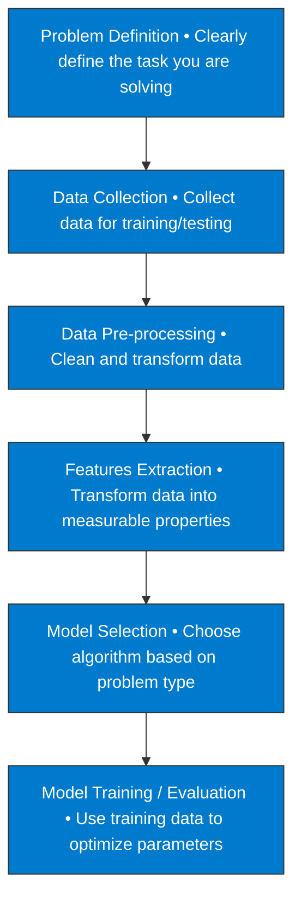

---
tags:
  - CO3519
  - Artificial-Intelligence
---
[[CO3519 Artificial Intelligence]]
[[CO3519 Lecture 2 - AI Types & Areas in AI]]

---
# Lecture Documents
[[CO3519 Lecture 3.pdf]]

---
# Written Notes
![[CO3519 Lecture 3 - Note 1.png]]
![[CO3519 Lecture 3 - Note 2.png]]
![[CO3519 Lecture 3 - Note 3.png]]

---
# Learning Objectives
- Machine Learning (ML)
- Types of Machine Learning
- Relation between ML & AI
- Key steps in developing ML model

---
# Machine Learning
## What is Machine Learning
>[!QUOTE]
>Subfield of AI that focuses on giving machines the ability to learn and make decisions from data without being explicitly programmed.

---
# Types of Machine Learning
- Supervised Learning
- Unsupervised Learning
- Reinforcement Learning
## Supervised Learning
Supervised learning the training of a ML model on **labelled datasets** where both input data and the correct output (label) are known.
### Key Details
The algorithm learns by mapping inputs to their corresponding outputs.
- The algorithm learns by mapping inputs to their corresponding outputs.
- Goal is to predict labels for new unseen data.
- Performance is measured using the metrics:
  - Accuracy
  - Precision
  - Recall
  - F1-Score
### Common Algorithms
- Linear Regression - Predicts continuous values.
- Logistic Regression - Used for binary classification.
- Support Vector Machines (SVM) - Finds the optimal separating hyperplane.
- Decision Trees - Tree-like models for classification or regression.

> [!EXAMPLE] Example Applications
> - Image Classification (e.g. cat vs dog, mouse vs rat)
> - Spam Email Detection
> - Sentiment Analysis
> - Disease Diagnosis
### Lecture Example
![[CO3519 Lecture 2 - Image Classification Cats & Dogs.png]]
A database containing both cat and dog images are separated and labelled before being processed into a trained model which identify which are cat or dog by their assigned label.
## Unsupervised Learning
Unsupervised learning trains a model on **unlabelled data**, meaning the correct outputs are unknown.
### Key Details
- The algorithm discovers **hidden patterns or structures** in data.
- Goal is to **group** or **reduce** data dimensions without prior labels.
- Performance is often evaluated using internal metrics (e.g. Silhouette Score, Davies–Bouldin Index).
### Common Algorithms
- **K-Means Clustering** – Groups data into _k_ clusters based on similarity.
- **Hierarchical Clustering** – Builds a tree of clusters.
- **Principal Component Analysis (PCA)** – Reduces dimensionality while preserving variance.
- **Association Rule Learning (Apriori)** – Finds relationships between variables in large datasets.

> [!EXAMPLE] Example Applications
> - Customer Segmentation
> - Market Basket Analysis
> - Anomaly Detection
> - Topic Modeling
>
>

## Reinforcement Learning
Reinforcement learning (RL) trains an **agent** to make successive decisions by interacting with an **environment** to maximise **rewards** and minimise **punishment**.
### Key Details
- No labelled data — learning via **trial and error**.
- The agent observes a **state**, performs an **action**, and receives a **reward**.
- Goal is to learn a **policy** that maximizes total reward over time.
- Evaluated by convergence speed and long-term reward.
### Common Algorithms
- **Q-Learning** – Learns value of actions using Q-values.
- **Deep Q-Network (DQN)** – Combines Q-learning with neural networks.
- **Policy Gradient Methods** – Directly optimize the policy function.
- **SARSA** – On-policy version of Q-learning.

> [!EXAMPLE] Example Applications
> 
> - Game AI (e.g. AlphaGo, Chess, Dota 2 bots)
>     
> - Autonomous Driving
>     
> - Robotics Control
>     
> - Dynamic Pricing
>

### Lecture Example
Positive reinforcement on a chicken.
<iframe title="Reinforcement learning on a chicken" src="https://www.youtube.com/embed/spfpBrBjntg?start=11&amp;feature=oembed" height="150" width="200" style="aspect-ratio: 1.33333 / 1; width: 100%; height: 100%;" allowfullscreen="" allow="fullscreen"></iframe>
**Agent** - Chicken
**Action** - Touching `PINK` circle.
**Reward** - corn grain

---
# Key Steps in Developing an ML Model

>[!EXAMPLE] **Problem Definition** Examples
>- Predicting House Prices
>- Classify Emails
>- Detect Suspicious Object

>[!EXAMPLE] **Data Collection** Examples
>- Housing datasets from public records or APIs
>- Image datasets (e.g. ImageNet, CIFAR-10)
>- Official medical datasets from research institutions

>[!EXAMPLE] **Data Pre-Processing** Examples
>- **Numerical Data:** Principal Component Analysis (PCA), statistical normalization
>- **Text Data:** Bag of Words, Word embeddings (Word2Vec), TF-IDF
>- **Image Data:** Edge Detection, Histogram of Oriented Gradients (HOG), Convolutional Neural Networks (CNN)

>[!EXAMPLE] **Feature Extraction** Examples
>- Using PCA for dimensionality reduction
>- Extracting statistical features from signals
>- Deriving deep feature maps with CNN layers

>[!EXAMPLE] **Model Selection** Examples
>- Linear Regression for continuous value prediction
>- Logistic Regression for binary classification
>- Decision Trees or Random Forests for mixed-type data
>- Support Vector Machines (SVM) for clear class separation

> [!EXAMPLE] **Model Training & Evaluation** Examples
>- Splitting data into training (70%), validation (15%), and testing (15%) sets  
>- Evaluating models with Accuracy, Precision, Recall, and F1-Score  
>- Testing a spam detector on new email samples

---
# Lab Activity 
Solve house price prediction problem using LR.

---
# Next Week
- Key Challenges in Machine Learning
- Supervised Learning
  - Linear Regression
  - Logistic Regression
  - Support Vector Machines (SVM)
  - Decision Trees

---
[[CO3519 Lecture 4 - Machine Learning II]]