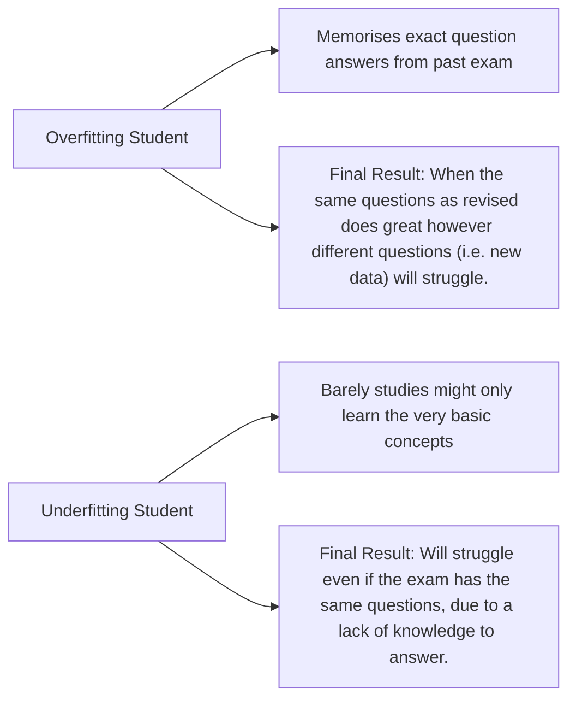

---
tags:
  - CO3519
  - Artificial-Intelligence
---
[[CO3519 Artificial Intelligence]]
[[CO3519 Lecture 3 - Machine Learning I]]

---
# Lecture Documents
[[CO3519 Lecture 4.pdf]]

---
# Written Notes
![[CO3519 Lecture 4 - Note 1.png]]
![[CO3519 Lecture 4 - Note 2.png]]

---
# Lecture Contents
- Key Challenges/Concepts
  - Overfitting VS Underfitting
  - Bias-Variance Trade-off
- Supervised Learning Algorithm 

---
# Overfitting VS Underfitting
## Overfitting
- The model performs well on the training data but fails to generalise new data.
- Usually occurs when the model learns noise or irrelevant details.
### For Model Training
- Model is too complex (i.e. Massive number of layers or DT with too many trees.)
- Perfectly fit, capturing even the smallest variations/noise but fails to generalise (memorises instead of learning)
- Training Accuracy is *very high* but the Test Accuracy is *much lower*.
- A decision tree that splits the data repeatedly until each leaf node has only one data point.
## Underfitting
- The model is too simple and fails to capture the patterns in the data leads to poor performance even on the training data.
- Model is too simple (Very few layers, or DT with few trees)
- Happen if using a linear model for a dataset that has non-linear patterns.
- Training Accuracy and Testing Accuracy are *low* because the model fails to learn the *relationships* between the **features** and the **target**.
## Key Challenges Diagram

---
# Algorithms
Different algorithms are suited for types of problems.
## Supervised Learning - Classification - Discrete Outputs
### K-Nearest Neighbours (KNN)
- Supervised learning algorithm used for both **regression** and **classification**.
- Based on the majority class of its nearest 'k' neighbours.

Example Applications: Simple classification, pattern recognition, recommendation system, etc.

- KNN tries to predict the correct class for the test data by calculating the distance between the test data and all the training points.
- Select the `K` number of points which is closest to the test data.
#### KNN Steps
1) Select the number K of the neighbours
2) Calculate the Euclidean distance of K number of neighbours
3) Take the K nearest neighbours as per the calculated Euclidean distance.
4) Among these k neighbours count the number of data points in each category
5) Assign the new data points to that category for which the number of neighbour is maximum.
#### KNN Example - Shop Example
![[CO3519 Lecture 4 - KNN Example 1.png]]
Imagine owning a shop with two types of customers: those who buy **Yellow** t-shirts and those who buy **Green** t-shirts. The **Red** data point represents a new customer. By looking at which group of existing customers is **standing closest** to the Red point, the algorithm predicts which shirt the new customer is most likely to purchase.

In the following example `K` the amount of neighbours will be 4.

![[CO3519 Lecture 4 - KNN Example 2.png]]
The Euclidian distance is calculated between the **Red** data point and the closest existing customers.
![[CO3519 Lecture 4 - KNN Example 3.png]]
Once the distances are calculated, the values are ranked in descending order.
![[CO3519 Lecture 4 - KNN Example 4.png]]
The votes are counted based on the class majority of `K` neighbour's distances with the closest majority class distance to the red data point, therefore the red data point (the new customer) will purchase the **Orange** t-shirt.

## Supervised Learning - Regression - Continuous Outputs
Linear Regression is a statistical method used to model the relationship between a dependent variable and one or more independent variables.
### The Goal
Find the best-fitting line (or hyperplane in higher dimensions) which predicts the dependent variable based on the existing independent variable(s).
**Dependent Target** - Outcome that is wanted to be predicted. (e.g. A house price)
**Independent Predicator** - Variable used to make predictions. (e.g. Square Foot, Number of Bedrooms, etc)

Equation of a line: `y = mx + b`
`y` - dependent variable
`m` - slope of the line (change in y for a unit change in x)
`x` - independent variable
`b` - y-intercept (value of y when x = 0)

---
[[CO3519 Lecture 5 - Supervised Learning I]]