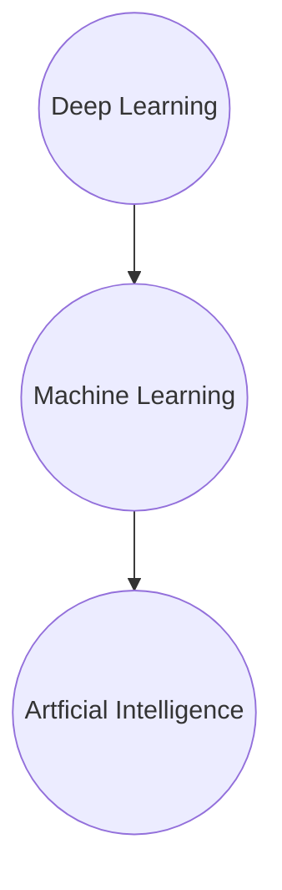
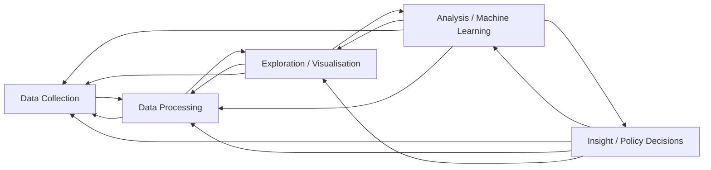

---
tags:
  - ULan
  - CO3722
  - Data-Science
---
[[CO3722 Data Science]]

---
# Lecture Documents
[[CO3722 Lecture 1.pdf]]

---
# Written Notes
![[CO3722 Lecture 1 - Note 1.png]]

---
# An Introduction To Data Science
## Module Overview
- Understanding Data
- Programming (with an appropriate language)
- Data Science for Business
## Learning Objectives
- Perform & Evaluate Basic Descriptive, Exploratory, and Confirmatory Data Analysis
- Write Programs (with an appropriate language) for analysing data
- Visualise the Data in Numerous Ways

---
# Lecture Learning Objectives
- Define Data Science
- Discuss examples of Data Science and its relation to Artificial Intelligence

---
# What is AI

## The [Turing Test](https://en.wikipedia.org/wiki/Turing_test) Approach
The Turing test suggests that computers would require the following:
- [Natural Language Processing](https://en.wikipedia.org/wiki/Natural_language_processing) - To enable it to communicate
- [Knowledge Representation](https://en.wikipedia.org/wiki/Knowledge_representation_and_reasoning) - To store what data it is aware of
- [Automated Reasoning](https://en.wikipedia.org/wiki/Automated_reasoning) - To use the stored data to answer questions or draw new conclusions
- [Machine Learning](https://en.wikipedia.org/wiki/Machine_learning) - To adapt to new circumstances, and detect patterns

---
# Neuroscience
Artificial intelligence in terms of neural networks are inspired by biological, based on neurons and the connections between them.

---
# What is Data Science
Data Science - The application of Computational and Statistical techniques to address or gain insight into a problem in the real world.
## Examples of Data Science
- Data Collection
- Statistics
- Data Processing
- Scientific Inquiry
- AI (Machine Learning)
- Visualisation
- Business Analytics
- Communication and Presentation
## Data Science Model

---
# Summary
- Define Data Science
- Discuss examples of Data Science and its relation to Artificial Intelligence.

---
[[CO3722 Lecture 2 - Ethics]]