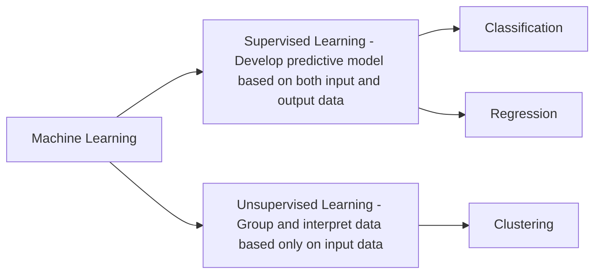

---
tags:
  - MODULE-ID
  - MODULE-NAME
---
[[CO3722 Data Science]]
[[CO3722 Lecture 10 - Case Study - Loan Prediction - P2]]

---
# Lecture Documents
[[CO3722 Lecture 11.pdf]]
[[CO3722 L11 - Lab 11 - Introduction to ML.pdf]]
[[CO3722 L11 - Lab 11 - diabetes.csv]]

---
# Next Steps
- Build a Data Science Model
  - Algorithms include:
    - Linear/Logistic Regression
    - Classification
    - Predictive in Nature could be designed to seek new insights
- Train, test and validate datasets required
- Evaluate outputs and build stories

---
- Remember the stakeholders
- Questions that need to be answered?
- Not a lot of time. Make valuable use of time. In particular a single user group to way up what is feasible and most value within the time-scale.
- If presented how would it be communicated
- How would it be explained?

> Keep in mind `users` and the `business`.

---
# Why Machine Learning?
- With machine learning the following can be done much faster:
  - Determine whether images contain human faces - image recognition
  - Predict whether an ad is appealing or personal enough for a user to click on it - predictions
  - Create accurate YouTube video captions - speech recognition, speech-to-text translation
  - Whether a transaction is fraudulent
  - Whether an email is spam

---
# Data Science
- Asking intelligent questions
- Finding patterns
- Deriving insight
- Decision making
- Machine learning

---
- Justify the machine learning model.
- Potentiallly try two or more different approaches to backup reasoning.

---
# Predictive Model Design Steps
**Data Analysis**:
- Data review, data cleaning including attending to missing data
- Convert inputs (Cateogircla variables)
**Data Science**:
- Import required modules - SciKit-Learn
- Classification using chosen model
- Cross validation and accuracy scores
- Metrics

---
- reminders to quality control
- domain knowledge from first assignment
- any trends?
- is the data of good quality, conform to rules, prove or disprove a working theory, bring any new insights to light, and if not is the data quality source the issue?
- Reminders about hypothesis'
- Revisit feature selection depending on the focus of dataset
- Large datasets tend to have many features, a data science may look to try multiple combinations to see what the best result gives.

---
# In Short...
- Domain knowledge is just as important than data analysis skills
- Asking the right questions is more important than elaborate algorithms
- It's about the 'right' data

---
# Supervised and Unsupervised Learning


---
- Regression Example in Lab Activity

---
# Machine Learning Algorithms
## Question
- Linear Regression
- Logistic Regression (Classification)
- Decision Tree (Random Forest)
- Unsupervised Learning (Clustering)
## Linear Regression - Supervised Learning
- 2 variables

Equation of a line:
$$y=Mx+C$$
M = Gradient
C = Intercept

Line of 'best' fit.
### Linear Regression Example
```python
import numpy as np
from sklearn.linear_model import 
```

---
# Assignment 2 - Next Steps
- Does the data make sense?
- Is the data consistent?
- What do you make of the data's distribution? Does it change over time? Is this expected?
- Use visualisations here to help - Does the data need to be normalised first?
- Is the data complete? Missing values or anomalies?
- Do you understand the features? Any data transformations required? (Consider ordinal and nominal data)
- Balanced or unbalanced? Require a 50/50 split. Consider undersampling and oversampling.
- Any additional data that might be beneficial.

- Metric for evaluation - what is meant by a 'good' model?
- Splitting data - training and testing sets (import train_test_split).
  - What percentage of the dataset would be appropriate for training? 

>[!IMPORTANT]
> Assignment 2 Brief Released!

---
[[CO3722 Lecture 12 - Further Linear Regression]]