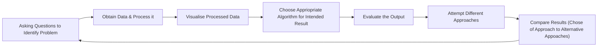
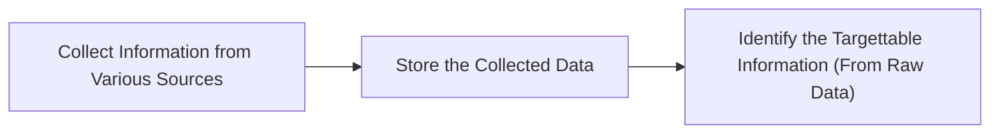

---
tags:
  - CO3722
  - Data-Science
---
[[CO3722 Data Science]]
[[CO3722 Lecture 2 - Ethics]]

---
# Lecture Documents
[[CO3722 Lecture 3.pdf]]

---
# Written Notes
![[CO3722 Lecture 3 - Note 1.png]]

---
# Learning Objectives
- Discuss Data Analysis Design
- Evaluate Tools for Data Science

---
# Data Analysis
- Terms used interchangeably
- Asking intelligent questions
- Finding patterns
- Deriving insight
- Decision making
- Machine learning

---
# Data Science - The Workflow Model

<sub>The data science workflow model</sub>
## Stage 1 of Workflow

## Stage 2 of Workflow

### Classification
Assigning data to `categories` or `labels` pinpointing key data. Once labels are correct around the problem space, for the business case, the problem set can be assessed.

> Algorithms: Decision Trees, Random Forests, Support Vector Machines, Neural Networks.
### Regression
Focuses on a predictable `continuous numerical` value within the data. and `NOT a category`, it finds a relationship between one or more features of the dataset and uses them to reach a numerical target.
#### Example

| Size of House (m^2) | Bedrooms | Price (£) |
| ------------------- | -------- | --------- |
| 60                  | 2        | 150,000   |
| 80                  | 3        | 180,000   |
| 100                 | 4        | 220,00    |

For this example the regression fits the line which fits through all these data points, which can be used to predict new values.
### Clustering

---
# Data Science Libraries
- NumPy
- Matplotlib
- SciPy
- Scikit Learn
- Statmodels
- Seaborn
- Blaze
- Scrapy
- SymPy
- Bokeh
- PANDAS

---
# Data Science using PANDAS
PANDAS has numerous benefits for Data Science:
- Data Analysis & Manipulation
- Extensive Means for Data Analysis
- Methods for Data Filtering
- Fast, Flexible & User-friendly
## Data Structures
DataFrame & Series form the basic data model.
### DataFrame
Similar to an Excel Workbook. Columns (indexs) and row numbers.
### Series
One dimensional Indexed array, allowing for easy access to elements.
## Importing Dataset & Libraries
```python
import pandas as pd
df = pd.read_csv("dataset.csv") # Reads dataset into DataFrame ready for viewing
```
## Data Exploration
```python
df.head(15) # Displays 15 rows
```

```python
df.describe() # Provides the Mean, Quartile, Count, Min, Max & Standard Deviation as well as outputs.
```

```python
df['Column_Name'].value_counts() # Accessing a particular column in the data frame
```

---
[[CO3722 Lecture 4 - Data Cleaning]]