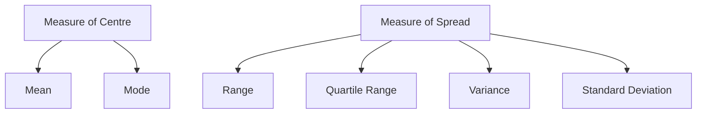

---
tags:
  - CO3722
  - Honours-Degree-Project
---
[[CO3722 Data Science]]
[[CO3722 Lecture 6 - Statistics]]

---
# Lecture Documents
[[CO3722 Lecture 7.pdf]]

---
# Written Notes
![[CO3722 Lecture 7 - Note 1.png]]

---
# Learning Objectives
- Evaluate basic statistics for data analysis
- Examine descriptive and probability (inferential) statistics

---
# Types of Statistics
**Descriptive Statistics** is a method used to describe and understand the *features* of a specific dataset by giving short summaries about the sample and measures of the data. Mainly focused on the main characteristics of the data, it provides a summary of the data.

**Inferential Statistics** make inferences and predictions about a population based on a sample of data taken from the population in question. Generalising a large dataset and applies probability to draw a conclusion. It allows to infer data parameters based on a statistical model using sample data.
## Descriptive Statistics
With descriptive statistics, it simply describes what is or what the data shows and are used to present quantitative descriptions in a manageable form.
## Inferential Statistics (Probability)
Probability is the measure of how likely an event is to occur. To be more precise probability is the ratio of the desired outcomes to total outcomes:
- (desired outcomes) / (total outcomes).
- The probabilities of all outcomes always sums up to 1.

Consider the famous rolling dice example:
- On a rolling dice there are six possible outcomes.
  - Each probability only has one outcome so each has a probability of 1/6.
  - For example, the probability of getting a number '2' on the dice is 1/6.

---
# Descriptive Statistics Categories

## Measures of Centre
There are three main measures of centre:
**Mean** - Measure of the average of all values in the sample.
**Median** - Measure of the central value of the sample.
**Mode** - Most reoccurring value in the sample.
## Measures of Spread
**Range** – How spread apart the values in a data set are (difference between the maximum and minimum values).
**Quartile** – Describes the spread of a data set by dividing it into four equal parts, similar to how the median divides the data in half.
**Variance** – Measures how much values differ from the expected (mean) value by averaging the squared deviations.
**Standard Deviation** – Indicates how dispersed the data values are from the mean, expressed in the same units as the data.

---
# Standard Deviation - Z-Score (Variance)
By definition the z-score simply means how many standard deviations a given value is away from the distribution mean. A z-score can be positive or negative.

Calculate the score as `(X-Mean) / SD`

---
# Cumulative Distribution
The cumulative distribution function (CDF) provides a visualisation of the probability distribution. As its name suggests it is simply the probability that a variable will take a value less than or equal to a particular value.

---
# Uniform Distribution
A uniform distribution is a type of distribution of probabilities where all outcomes are equally likely; each variable has the same probability that it will be the outcome.

- A deck of cards has a uniform distribution because the probability that a heart, club, diamond or spade is pulled is the same.
- A coin also has a uniform distribution because the probability of the head or tail in a coin toss is the same.
- The dice tossing has a uniform distribution too, because each side of a dice has the same probability to be drawn.

---
# Binomial Distribution
If the probability for multiple trials is wanted to be known for example:
- given 10 flips of a fair coin, what is the probability of getting 6 heads?

The answer to this question is to use Binominal Distribution, which is the probability distribution of a sequence of experiments where:
- Each experiment produces a binary outcome
- Each of the outcomes is independent of all the others
## Coin Toss Example
>[!QUOTE]
>Experiment: 3 Heads, 2 Heads, 1 head, None 
>• P(Three Heads) = P(HHH) = 1/8 
>• P(Two Heads) = P(HHT) + P(HTH) + P(THH) = 1/8 + 1/8 + 1/8 = 3/8 
>• P(One Head) = P(HTT) + P(THT) + P(TTH) = 1/8 + 1/8 + 1/8 = 3/8 
>• P(Zero Heads) = P(TTT) = 1/8 
>
>Distribution: Symmetric or skewed 

---
# Normal (Gaussian) Distribution
Normal also known as Gaussian Distribution is a continuous probability distribution that is symmetric about mean, showing that data near the mean are more frequent inn occurrence than data far from the mean.

In graph form normal distribution appears as a bell curve.

One of the main reasons for the popularity of the Normal Distribution is that it occurs very commonly in most of the things we see in nature around us. For example:
- Finance i.e. the salary distribution in an office.
- Healthcare
- Height/Weight Distributions
- Grading Distributions

---
# Reflection on Different Distributions
The common distributions are common because they occur again and again in different and sometimes unexpected domains.

These distributions occur so often in many applications in life. Consider them as `3rd party libarires` that have bee verified and tested so they can be directly used in problems.

It is useful to know, the probability density function for a sample of data, in order to know whether a given observation is unlikely an outlier or an anomaly and whether it should be removed.

Get familiar with common probability distributions as it will help to identify a given distribution from a histogram.

---
# Hypothesis
**A statement or claim!**

Examples of hypotheses':
- All customers aged over 50 will be accepted for a loan
- Loan acceptance requires higher levels of incomes
- Previous history
- Loan amount
## Can These Be Proven
![[CO3722 L7 - Random Histograms.png]]

---
# Feature Selection
- Data Overload - which columns are likely to contribute to results?
- Is some data irrelevant? GIGO
- What is relevant? (This is where feature selection is most beneficial)

How to know what is important?
- Domain knowledge, expertise, experience

Examples:
Retail data - focus perhaps on features that influence purchases a customer makes.
Wine quality - Chemical constituents and how they affect preferences
- Changing constituents could affect the levels of other substances.

Large datasets have many features. Data scientists may look to try different combinations to see what provides the best results.

---
# In Short...
- Domain knowledge is just as important than data analysis skills
- Asking the right questions is more important than elaborate algorithms
- It's about the 'right' data.

---
# Loan Prediction 
>[!summary] Problem Statement
>Finance Associates deal in home loans. Customers apply for a loan which is evaluated and validated for eligibility. The company wants to automate the process in ‘real-time’, which will include details such as: gender, marital status, education, number of dependants, income, credit history and loan amount. Which customer features need identifying to target those that are eligible?

Feature Selection Examples for LP:
- Gender
- Age
- Marital Status
- Education
- Number of Dependants
- Income
- Credit History
- Loan Amount

[Loan Prediction Dataset](https://www.kaggle.com/datasets/altruistdelhite04/loan-prediction-problem-dataset)

---
[[CO3722 Lecture 8 - Case Study - Loan Prediction - P1]]