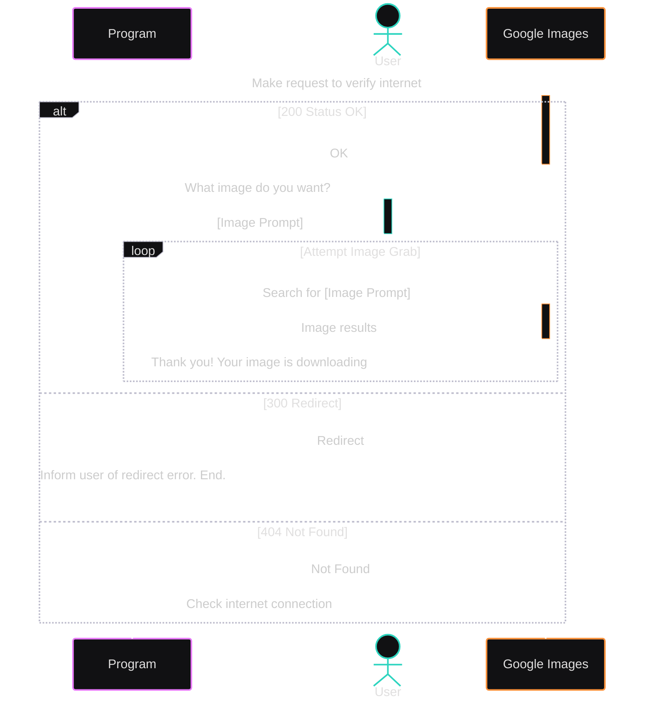
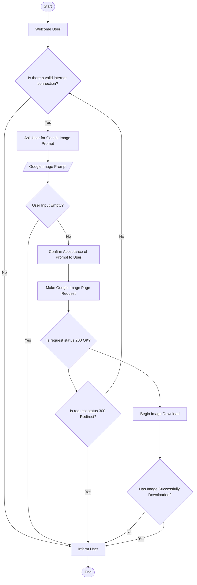

---
tags:
  - Guides
  - Self-Made
---
[[Notes]]

---
# First Brief (Initial Stage)
I want to write a C++ program which can make a HTTP request to google images querying it for the first available image.

Once I am able to scrape the queried web page I will return the first image this I will add additional features to this once this initial stage is complete.
## Sequence Diagram Plan



## Flowchart (Planning)



---
# Pre-Programming Research
## HTTP Request Research
To verify the user's internet connection and be able to connect to the google images web-page to download the first image, in the C++ program I will be using the library [`libcurl`](https://curl.se/libcurl/c/). As laid out in the plan above, I intend to use  `HEAD` request to verify an internet connection, a `GET` request to obtain the webpages.

Another area of consideration will be the domain in question with which to test, against to verify an internet connection. (i.e. `www.google.com`)

> Relevant Note: [cURL with HTTP](HyperText%20Transfer%20Protocol%20(HTTP).md#%20cURL).
### LibCurl Package
This information comes from the `LibCurl` (The library for C++ which is a wrapper for the cURL tool) documentation specifically, [tutorial and information section](https://curl.se/libcurl/c/libcurl-tutorial.html).
##### Installing LibCurl
###### Windows
1) Install [vcpkg]([GitHub - microsoft/vcpkg: C++ Library Manager for Windows, Linux, and MacOS](https://github.com/microsoft/vcpkg) (Visual C++ Package Manager)

> To install vcpkg do the following:
> `git clone https://github.com/microsoft/vcpkg.git`
> `cd vcpkg`
> 
> **Bootstrap vcpkg** (this builds the vcpkg executable):
>- **On Windows**:
>- `.\bootstrap-vcpkg.bat
>
> Note: vcpkg also supports macOS and Linux. 
> For those platforms, use ./bootstrap-vcpkg.sh instead.
>
>If using Visual Studio you will also have to run `.\vcpkg integrate install`.

2) `vcpkg install curl`

Alternatively the **NuGet** (Which was confirmed to stand for "New Get" in the slogan [_A "new" way to "get" libraries._](https://haacked.com/archive/2010/10/29/nupack-is-now-nuget.aspx/) package manager c an be easily used in visual studio as presented below.

![[NuGet LibCurl.png]]
###### Linux
For **Debian / Ubuntu**:
`sudo apt update`
`sudo apt install libcurl4-openssl-dev`
For **Fedora**:
`sudo dnf install libcurl-devel`
For **Arch**:
`sudo pacman -S curl`

> Most linux distros already come with `libcurl` installed.
##### Initialising LibCurl
`#include <curl/curl.h>`
##### Global Preparation
<q>The program must initialize some of the libcurl functionality globally. That means it should be done exactly once, no matter how many times you intend to use the library. Once for your program's entire life time and it takes one parameter which is a bit pattern that tells libcurl what to initialize.</q>
```c
curl_global_init();
```
###### Initialisation Flags
- **CURL_GLOBAL_WIN32** - Only works on Windows machines by making libcurl initialise with the [Win32 Socket](https://ecs.syr.edu/faculty/fawcett/Handouts/coretechnologies/socketsandremoting/presentations/Win32Sockets.pdf).
- **CURL_GLOBAL_SSL** - Only works on libcurl complied and built SSL-enabled systems.
- **CURL_GLOBAL_ALL** - Convenient flag which initialises everything `libcurl` needs. (**Recommended** as the *safe default*)

> While the `curl_global_init` function does not need to be explicitly run, as an internal check performs the function in the event a function such as `curl_easy_perform` with a guessed flag choice. This is **NOT** considered good practice and is not recommended despite being a feasible option.
#### Easy & Multi Interfaces in LibCurl
Libcurl has two interfaces, one which is called the `easy interface` which make all operations easier to perform and are prefixed with `curl_easy` allowing for single transfers at a time, such as in downloading or uploading a file.

> The `easy_interface` is *Synchronous* meaning that it does not support making multiple requests at once and is best used for **single operations**.

💡 **Note for this project:**
>Since this project is focused on C++ revision and doesn’t require handling multiple transfers at once, the `multi interface` is **not** necessary. The `easy interface` is more than sufficient to meet all functional requirements.
#### LibCurl Setup Code#
After installing cURL I made adjustments to the properties of the C++ visual studio project.
![[C++ Google Image Puller Project Language Version Change.png]]
##### What I adjusted & Why
- `C++ Language Standard` I changed this to *ISO C++ 20 Standard* from *ISO C++ 14 Standard*.

> An issue I found was that *#include "curl/curl.h"* the `libcurl` library

To resolve, I found a Stack Overflow discussion on the topic ([Source](https://stackoverflow.com/questions/7623980/intellisense-cannot-open-source-file-curl-h-in-c)) VC++ Directories -> Reference Directories as presented below and added the project's directory for references therefore with curl installed now the project can access the necessary header and program files.

> I confirmed the existence of the header file in Visual Studio by checking the `References` for `curl.h`.

![[C++ Google Image Puller Project Reference Directories.png]]


---
# Coding Begins
```cpp
#include <iostream> // For the std (Standard Template Library)
#include <curl/curl.h> // For curl. (cURL. Command Uniform Resource Locator)
#include <memory> // For memory. (Unique Smart Pointers and make_unique function.)
#include <string> // For strings (String Library)
#include <vector> // For vectors (Dynamic Arrays)
#include <random> // For random number generation (Random Number Generation Library)

const std::string TESTURL = "https://www.google.com";

std::string GetRandUA()
{
    // Array of 15 User-Agent strings
    const std::vector<std::string> userAgents = {
        "Mozilla/5.0 (Windows NT 10.0; Win64; x64) AppleWebKit/537.36 (KHTML, like Gecko) Chrome/58.0.3029.110 Safari/537.3",
        "Mozilla/5.0 (Macintosh; Intel Mac OS X 10_15_7) AppleWebKit/605.1.15 (KHTML, like Gecko) Version/14.0.3 Safari/605.1.15",
        "Mozilla/5.0 (X11; Linux x86_64) AppleWebKit/537.36 (KHTML, like Gecko) Chrome/91.0.4472.114 Safari/537.36",
        "Mozilla/5.0 (Windows NT 6.1; WOW64; rv:40.0) Gecko/20100101 Firefox/40.1",
        "Mozilla/5.0 (iPhone; CPU iPhone OS 14_6 like Mac OS X) AppleWebKit/605.1.15 (KHTML, like Gecko) Version/14.0 Mobile/15E148 Safari/604.1",
        "Mozilla/5.0 (iPad; CPU OS 13_2_3 like Mac OS X) AppleWebKit/605.1.15 (KHTML, like Gecko) Version/13.0 Mobile/15E148 Safari/604.1",
        "Mozilla/5.0 (Linux; Android 10; SM-G975F) AppleWebKit/537.36 (KHTML, like Gecko) Chrome/89.0.4389.105 Mobile Safari/537.36",
        "Mozilla/5.0 (Windows NT 10.0; Win64; x64; rv:89.0) Gecko/20100101 Firefox/89.0",
        "Mozilla/5.0 (Macintosh; Intel Mac OS X 10_14_6) AppleWebKit/537.36 (KHTML, like Gecko) Chrome/83.0.4103.116 Safari/537.36",
        "Mozilla/5.0 (X11; Ubuntu; Linux x86_64; rv:52.0) Gecko/20100101 Firefox/52.0",
        "Mozilla/5.0 (Windows NT 6.1; Win64; x64) AppleWebKit/537.36 (KHTML, like Gecko) Chrome/75.0.3770.100 Safari/537.36",
        "Mozilla/5.0 (Macintosh; Intel Mac OS X 10_11_6) AppleWebKit/601.7.7 (KHTML, like Gecko) Version/9.1.2 Safari/601.7.7",
        "Mozilla/5.0 (Linux; Android 9; Pixel 3 XL) AppleWebKit/537.36 (KHTML, like Gecko) Chrome/77.0.3865.92 Mobile Safari/537.36",
        "Mozilla/5.0 (iPhone; CPU iPhone OS 13_5_1 like Mac OS X) AppleWebKit/605.1.15 (KHTML, like Gecko) Version/13.1.1 Mobile/15E148 Safari/604.1",
        "Mozilla/5.0 (Windows NT 10.0; WOW64) AppleWebKit/537.36 (KHTML, like Gecko) Chrome/56.0.2924.87 Safari/537.36"
    };

    // Random Number Generation Setup
    // Source: https://en.cppreference.com/w/cpp/numeric/random/uniform_int_distribution.html

    std::random_device rd;  // a seed source for the random number engine
    std::mt19937 gen(rd()); // mersenne_twister_engine seeded with rd()
    std::uniform_int_distribution<> distrib(0, userAgents.size() - 1);

    // Select a random User-Agent
    int idx = distrib(gen);
    return userAgents[idx];
}

CURL* GetCurlSession()
{
	// Global Initialisation
	curl_global_init(CURL_GLOBAL_WIN32);

	// libcurl handle object
	CURL* handle = curl_easy_init();

	if (!handle) {
		std::cerr << "Failed to initialize cURL handle." << std::endl;
		return;
	}

	// Set the User-Agent
	std::string userAgent = GetRandUA();
	curl_easy_setopt(handle, CURLOPT_USERAGENT, userAgent.c_str());
	
    // Set the option to follow redirects
	curl_easy_setopt(handle, CURLOPT_FOLLOWLOCATION, 1L);

	// Set the option to return the response as a string
	curl_easy_setopt(handle, CURLOPT_WRITEFUNCTION, nullptr);
	curl_easy_setopt(handle, CURLOPT_WRITEDATA, nullptr);

    return handle;
}

void VerifyInternet(CURL* handle)
{
	if (!handle) {
		std::cerr << "cURL handle is not initialized." << std::endl;
		return;
	}
	// Set the URL to test
	curl_easy_setopt(handle, CURLOPT_URL, TESTURL.c_str());
	// Perform the request
	CURLcode res = curl_easy_perform(handle);
	if (res != CURLE_OK) {
		std::cerr << "cURL error: " << curl_easy_strerror(res) << std::endl;
	}
	else {
		std::cout << "Internet connection verified successfully." << std::endl;
	}
}

void CleanupCurlSession(CURL* handle)
{
	if (handle) {
		curl_easy_cleanup(handle);
	}
	curl_global_cleanup();
}
```
<sub>C++ Basic Google Image Grabber (16/08/2025)</sub>
##### Explaining Coding Choices
I have imported 5 essential libraries for the program to run, as explained in the screenshot's comments here is why I chose to use them:
- `IOStream` - To handle user inputs (cout), communicate back to the user (cin), and other features of the std (Standard Template Library) library.
- `curl/curl.h` - The header file which contains the class blueprints and definitions for the curl program, which interacts with the command-line tool.
- `string` - Imports the string library
- `vector` - Imports vectors (Dynamic Arrays)
- `random` - Random library, to be able to generate a random number for a user agent index.

Currently as you can see the program has some functions here is an explanation of each:
- `GetRandUA()` - Randomly chooses a User Agent string from a vector and returns it.
- `GetCurlSession()` - Returns a curl session, with all of the options pre-set apart from the intended destination URL.
- `VerifyConnection(Curl* Handle)` - Verify existing internet connection with **HEAD** request to test url.
- `CleanupCurlSession(Curl* Handle)` - Clean-up of the handler and globalisation initialisation resources.

Additional Sources:
- [LibCurl Functions List](https://curl.se/libcurl/c/allfuncs.html)


