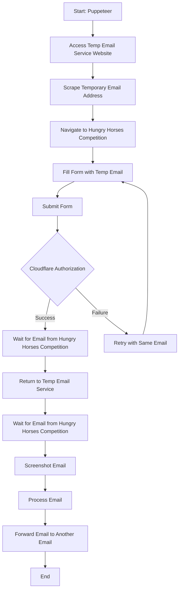

---
tags:
  - Guides
  - Self-Made
---
[[Guides]]

---
# Analysing the [Environment](https://hungryhorsecompetitions.co.uk)
![[Big Wheel.png]]
![[hungryhorse-html]]

---
# Assessing the [TOS](https://www.hungryhorse.co.uk/epic-fun) (Terms of Service)
This is performed to validate the companies TOS, in terms of the usage of the prizes.
![[TOS Articles 17-21.png]]

> Note of statement 19 falsification through the usage of temporary emails, may cause flag in system resulting in the following as per current understanding:
- Prize Revoke
- Legal Involvement dependent on internal tracking of emails and IP address usage

---
# Completion Attempt
![[Filled In Test Entry Spin Form.png]]
Previously I used a@gmail.com (an email that is not mine) to test a successful request. Then processed another due to inconsistent network recordings (failure to produce request as expected) upon second attempt, a request was made and below are the findings
# Request Analysis
## Headers
![[Hungry Horse Request Headers.png]]
![[Hungry Horses Request Headers Network.png]]
![[Request P2.png]]

> Base64 for the API endpoint is interesting. 
### API Endpoint (Possible Point of Discovery)
The Base64 is a specific type `Base64-URL-Safe` which changes characters in the string to be available to be used in URLs.

Replacements are as follows:
- `_` is `/`
- `-` is `+`

Base64 URL Safe to standard base64:
`URCkiJFrNPP6caD7lV/jjGVH4B8hoTyZRvnlmgFZkq7Qb54XnbwSxHuEFIFjfQ5kOvXIMzfIDlLPGt4n8fNx0Q==`

It appears to be some form of non human-formatted data, as a result plans switched to web scraping.

---
# Web Scraping Planning
Puppeteer Plan:
- Obtain Temporary Email with Inbox
- Enter all necessary validation steps.
- Await cloudflare completion (Potential for automation)
- Click play button.
- Record Response Status and Information into Log File (In event of failure, retry)
- Save screenshot to Folder and 

---
# Choosing a Temp Mail Service
[smailpro](https://smailpro.com/temporary-email) provides 3 temporary email addresses, which limits the number of concurrent registrations possible during the program's runtime.

---
# 01/08/2025
**Project Cancellation** but here's a code screenshot, I had during the process, stored.
![[JavaScript Puppetteer.png]]
JavaScript using Puppetteer library running with NodeJS.

---
# **Project Termination**
> **Notice:** Failure to produce result before the *31st of July* :(

![[Big Wheel Hungry Horses Ended.png]]

---
[[Guides]]