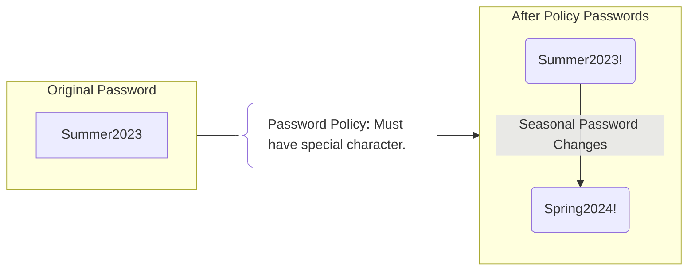
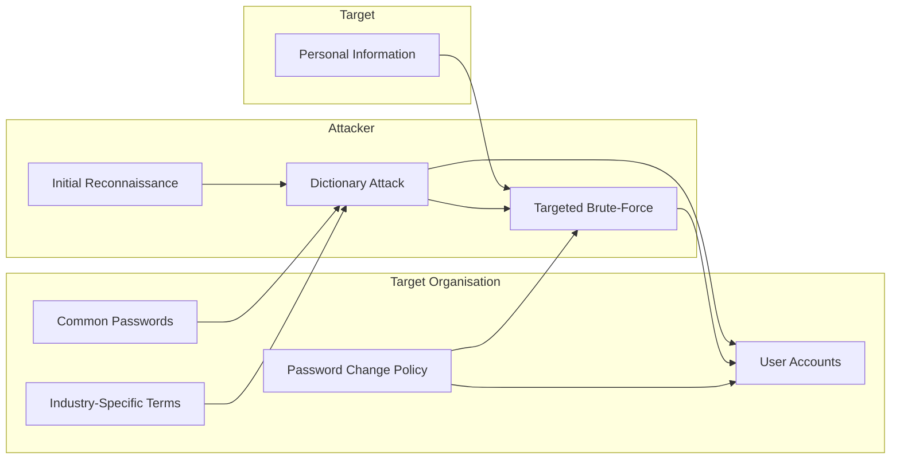
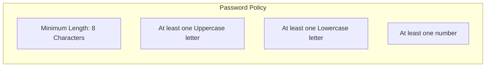
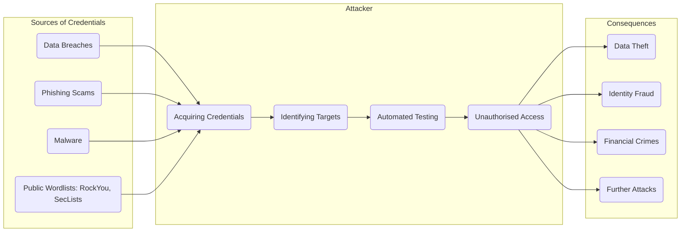

---
tags:
  - HackTheBox
  - Login-Brute-Forcing
---
[[Login Brute-Forcing]]
[Previous Section](Dictionary%20Attacks.md)

Many organisations implement policies to force users to change their password however, this in of itself can inadvertently cause predictable password patterns if not properly educated on proper password etiquette.


<sub>Password Policy changes can result in weak passwords.</sub>

A widespread and insecure practice among users is making very minor modifications of their passwords when forced to change them. Often manifesting as appending a number or a special character to the end of the current password. (e.g. `Summer2023` -> `Summer2023!` --> `Summer2024` --> `Summer2024!`)

> [!quote]
> This predictable behaviour creates a loophole that hybrid attacks can exploit ruthlessly. Attackers capitalize on this human tendency by employing sophisticated techniques that combine the strengths of dictionary and brute-force attacks, drastically increasing the likelihood of successful password breaches.

---
# Hybrid Attacks in Action
Consider the example below which considers an attacker targeting an organisation which enforces regular password policy changes.


## Low-Hanging Fruit Phase
The attacker launches a dictionary attack using a wordlist curated with *common password*, *industry specific terms* and potentially *personal information* related to an organisation or its employees.

> This phase attempts to quickly identify any low-hanging fruit - accounts protected by weak or easily guessable passwords.
## Dictionary Failure Phase
If the dictionary attack proves unsuccessful, the hybrid attack seamlessly transitions into a brute-force mode. Instead of randomly generating password combinations it strategically modifies the words from the original wordlist, appending numbers, special characters or even incrementing years. (e.g. `Summer2023!` -> `Summer2024`)

> This targeted brute-force approach drastically reduces the search space compared to a traditional brute-force attack while covering many potential password variations that users might employ to comply with the password change policy.

---
# The Power of Hybrid Attacks
> [!quote]
> This targeted brute-force approach drastically reduces the search space compared to a traditional brute-force attack while covering many potential password variations that users might employ to comply with the password change policy.

Hybrid attacks are not limited to the password change scenario that was outlined above, and can be tailored to exploit any observed or suspected password patterns within a target organisation.

Consider the following scenario, with access to a common passwords wordlist, and the target is an organisation with the following password policy:



To extract passwords from a wordlist which adhere to the password policy, powerful command-line tools can be utilised which are widely available on Linux/Unix-based systems by default. `grep` (**global regular expression print**) specifically paired with `regex` (**Regular Expressions**).

> The password wordlist that is going to be used will be [darkweb2017-top10000.txt](https://github.com/danielmiessler/SecLists/blob/master/Passwords/Common-Credentials/darkweb2017_top-10000.txt).
## Grep and Regex Password Filtering (WordList Refining)
### Password Policy Filters
#### At Least 8 Characters
```bash
TheMalevolent1@htb[/htb]$ grep -E '^.{8,}$' darkweb2017-top10000.txt > darkweb2017-minlength.txt
```

The regular expression `^.{8,}$` targets the password length minimum requirement being 8 characters, and acts as a filter so only relevant passwords with at least 8 characters as outlined in the password policy are passed through and saved into the temporary file `darkweb2017-minlength.txt`.
#### At Least 1 Uppercase Letter
```bash
TheMalevolent1@htb[/htb]$ grep -E '[A-Z]' darkweb2017-minlength.txt > darkweb2017-uppercase.txt
```

Like before with the previous filter, this will process all the minimum length passwords only passing through ensuring passwords that lack an uppercase letter are discarded, which allows for further refining of the password list, storing in a file called `darkweb2017-uppercase.txt`.
#### At Least 1 Lowercase Letter
```bash
TheMalevolent1@htb[/htb]$ grep -E '[a-z]' darkweb2017-uppercase.txt > darkweb2017-lowercase.txt
```

This regex determines whether the password has a least one lowercase letter to pass as valid to conform to then constraint of the password policy's minimum one lowercase character requirement, storing in a file called `darkweb2017-lowercase.txt`.
#### At Least 1 Number
```bash
TheMalevolent1@htb[/htb]$ grep -E '[0-9]' darkweb2017-lowercase.txt > darkweb2017-number.txt
```

Maintaining the filtering this grep command ensures the passwords passed through are compliant with the password policy's requirement to include a digit, the regex expression filters through the passwords only discarding the ones without a single number, storing in a file called `darkweb2017-number.txt` finishing the filtering change to conclude that all passwords contained match the password policy implemented.
#### Filtering Results
```shell
TheMalevolent1@htb[/htb]$ wc -l darkweb2017-number.txt

89 darkweb2017-number.txt
```

> [!quote]
> As demonstrated by the output above, meticulously filtering the extensive 10,000-password list against the password policy has dramatically narrowed down our potential passwords to 89. This drastic reduction in the search space represents a significant boost in efficiency for any subsequent password cracking attempts. A smaller, targeted list translates to a faster and more focused attack, optimizing the use of computational resources and increasing the likelihood of a successful breach.

---
# Credential Stuffing
Credential stuffing is the process of leveraging stolen data for unauthorised access.



Credential stuffing attacks exploit an unfortunate reality that many users reuse the same passwords across multiple online accounts, such practice often driven by the desire for convenience and the challenge of managing many unique credentials (which is what lead to the rise of password managers) creates a good landscape for attackers to exploit.

Once the attacker has acquired a list of compromised usernames and passwords (which can stem from large-scale data breaches to phishing campaigns, and malware) they begin identifying potential targets.

> For example online services likely to be used by individuals whose information they have. Once identified they shift into the automated phase, using tools and scripts the attacker will systematically test the stolen credentials against the chosen targets, often mimicking normal user behaviour to avoid detection which allows them to rapidly test vast numbers of credentials, increasing their chances of finding a match.

> Social media, email providers, online banking, and e-commerce sites are prime targets due to the sensitive data they often hold.
> 
> Publicly available wordlists like `rockyou` or those found in `seclists` can also serve as a starting point, offering attackers a trove of commonly used passwords.

> [!quote]
> A successful match grants unauthorized access, opening the door to various malicious activities, from data theft and identity fraud to financial crimes. The compromised account may be a launchpad for further attacks, spreading malware, or infiltrating connected systems.

---
# The Password Reuse Problem
> [!quote]
> The core issue fueling credential stuffing's success is the pervasive practice of password reuse. When users rely on the same or similar passwords for multiple accounts, a breach on one platform can have a domino effect, compromising numerous other accounts. This highlights the urgent need for strong, unique passwords for every online service, coupled with proactive security measures like multi-factor authentication.

---
# **No Exercises** for this section.

---
[Next Section](Hydra.md)