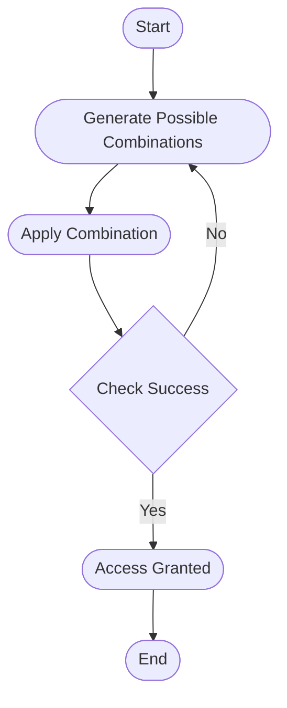

---
tags:
  - HackTheBox
  - Login-Brute-Forcing
---
[[Login Brute-Forcing]]

Brute forcing, is the equivalent of trying to open a door by manually shaping the key by millimetres each iteration every time. However, in the digital world it is locks are combinations, keys, and passwords.

---
# What is Brute Forcing?
Brute forcing is a trial and error method used to crack passwords, login credentials, or encryption keys. It involves systematically trying every possible combination of characters until the correct one is found. The process is similar to attempting to unlock a door with every single individual key of a neighbourhood from a bucket of random keys.
## Brute Force Attack Success Vectors
The success of a brute force attack depends on several factors, including:

> [!quote]
> - The `complexity` of the password or key. Longer passwords with a mix of uppercase and lowercase letters, numbers, and symbols are exponentially more complex to crack.
> ---
> - The `computational power` available to the attacker. Modern computers and specialized hardware can try billions of combinations per second, significantly reducing the time needed for a successful attack.
> ---
> - The `security measures` in place. Account lockouts, CAPTCHAs, and other defenses can slow down or even thwart brute-force attempts.

---
# How Brute Forcing Works

## 1) Start
Attack initiates the brute force process often with aid of specialised software and tools.
## 2) Generate Possible Combination
Software generates a potential password or key combination based on predefined parameters such as character sets and lengths.
## 3) Apply Combination
Generated combination is attempted against the target system such as a login form (e.g. HTTP Basic Authentication) or encrypted file.
## 4) Check if Successful
The system evaluates the attempted combination, if it matches the stored password or key, access is granted. Otherwise, the process continues.
## 5) Access Granted
The attacker gains unauthorised access to the system or data.
## 6) End
Process reiterates, generating and testing new combinations until either the correct one is found, or the attacker gives up.

---
# Types of Brute Forcing
Brute forcing is a collection of diverse techniques, each with their own strengths and weaknesses, and ideal use cases. Understanding the variations is critical for both *attackers* & *defenders* as it enables both to choose the most effective approach to either target, or create countermeasures.
## Brute Forcing Methods

| Method                      | Description                                                                                                                  | Example                                                                                                                                                  | Ideal Circumstance to Use                                                                                                                   |
| --------------------------- | ---------------------------------------------------------------------------------------------------------------------------- | -------------------------------------------------------------------------------------------------------------------------------------------------------- | ------------------------------------------------------------------------------------------------------------------------------------------- |
| **Simple Brute Force**      | Systematically trying all possible combinations of characters within a defined character set and length range.               | Trying all combinations of lowercase letters from 'a' to 'z' for passwords of length 4 <= 8.                                                             | No prior information about the password is available and computational resources are abundant.                                              |
| **Dictionary Attack**       | Pre-complied list of common words, phrases, and passwords.                                                                   | Trying passwords from a list (e.g. rockyou.txt) against a login form.                                                                                    | Target will likely use a weak or easily guessable password based on common patterns.                                                        |
| **Hybrid Attack**           | Combines elements of simple brute force and dictionary attacks often appending or prepending characters to dictionary words. | Adding numbers or special characters to the end of words from a dictionary list.                                                                         | Target might use a slightly modified version of a common password.                                                                          |
| **Credential Stuffing**     | Leverages leaked credentials from one service to attempt other services assuming user reuses the same password.              | Using a list of usernames & passwords leaked from a data breach to try logging into various online accounts.                                             | A large set of leaked credentials is available, and the target is suspected of reusing passwords across multiple services.                  |
| **Password Spraying**       | Attempts a small set of commonly used passwords against a large number of usernames.                                         | Trying passwords like 'password123' or 'qwerty' against all usernames in an organization.                                                                | Account lockout policies are in place, and the attacker aims to avoid detection by spreading attempts across multiple accounts.             |
| **Rainbow Table Attack**    | Uses pre-computed tables of password hashes to reverse hashes and recover plaintext passwords quickly.                       | Pre-computing hashes for all possible passwords of a certain length and character set, then comparing captured hashes against the table to find matches. | A large number of password hashes need to be cracked, and storage space for the rainbow tables is available.                                |
| **Reverse Brute Force**     | Targets a single password against multiple usernames, often used in conjunction with credential stuffing attacks.            | Using a leaked password from one service to try logging into multiple accounts with different usernames.                                                 | A strong suspicion exists that a particular password is being reused across multiple accounts.                                              |
| **Distributed Brute Force** | Distributes the brute forcing workload across multiple computers or devices to accelerate the process.                       | Using a cluster of computers to perform a brute-force attack significantly increases the number of combinations that can be tried per second.            | The target password or key is highly complex, and a single machine lacks the computational power to crack it within a reasonable timeframe. |

---
# The Role of Brute Forcing in Penetration Testing
Brute forcing is a crucial tool in the process of penetration testing particularly when assessing the resilience of a password-based authentication mechanism and is ideally used strategically when:

|          Ideal Situation           |                                                                                                             Description                                                                                                              |
| :--------------------------------: | :----------------------------------------------------------------------------------------------------------------------------------------------------------------------------------------------------------------------------------: |
|  **Other Avenues are Exhausted**   | Initial attempts to gain access, such as exploiting known vulnerabilities or utilising social engineering tactics may prove unsuccessful, in such scenarios brute forcing may be a viable alternative to overcome password barriers. |
|   **Password Polices are Weak**    |                    The target system employs lax password policies it increases the likelihood of users having weak or easily guessable passwords. Brute forcing can be effectively expose these vulnerabilities.                    |
| **Specific Accounts are Targeted** |       Some instances, penetration testers may prioritise on compromising specific user accounts such as those with elevated privileges (i.e. Administrators). Brute forcing can be tailored to target these accounts directly.       |

---
# **No Exercises** for this section.

---
[Next Section](Password%20Security%20Fundamentals.md)