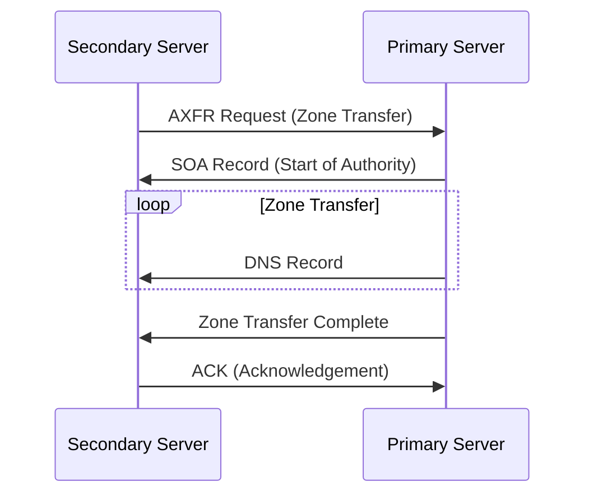

---
tags:
  - HackTheBox
  - Information-Gathering-Web-Edition
---
[[Information Gathering - Web Edition]]
[Previous Section](Subdomain%20Brute-Forcing.md)

Brute-Forcing can be an effective and highly successful approach in collecting DNS information on a target's infrastructure however, there is a less invasive and potentially more efficient method for *uncovering subdomains* - DNS Zone Transfers. 

DNS Zone Transfer; a mechanism which has the purpose of replicating DNS records between *name servers*, can also inadvertently become a mass of wealthy of information, if misconfigured.

---
# What is a Zone Transfer
A *DNS Zone Transfer* is essentially a complete copy of **all** DNS records within a zone (i.e. a zone being a domain and it's subdomains) from one name server to another. Typically a file or database of *DNS records* which are managed by a specific authoritative DNS server.

The DNS Zone transfer process is essential as it *maintains consistency, and redundancy* across DNS servers. A downside, is that if not adequately secured, unauthorised parties can download the entire zone file, which reveals the complete list of *subdomains*, *associated IP addresses*, and other sensitive DNS data.

## Zone Transfer Request (AXFR)
The *secondary DNS server* begins the process by sending a **zone transfer request** (*AXFR Request*) to the primary DNS server.
## SOA Record Transfer
Upon receiving the request (and potentially authenticating the secondary server), the primary server responds with the **SOA record** (Start of Authority). This record contains critical metadata about the zone, including the **serial number**, which the secondary server uses to determine whether its current data is up-to-date.
## DNS Records Transmission
The primary server will proceed to transfer all DNS records in the zone (i.e. in regards to the domain) one by one. 

This includes the following record types:
- A Records (IPv4)
- AAAA Records (IPv6)
- MX Records (Mail Servers)
- CNAME (Aliases which maps subdomain to another domain)
- NS Records (Name Servers)
## Zone Transfer Complete
Once all records have been transmitted, the primary server signals the end of the *zone transfer* therefore confirming the successful receipt and processing of the zone data, which completes the zone transfer process.
## Acknowledgement (*ACK*)
The secondary sever sends an acknowledgement message back to the primary server, which completes the zone transfer. 

---
# The Zone Transfer Vulnerability
Zone transfers are essential for legitimate DNS management, a misconfigured DNS server can transform this process into a significant security vulnerability. The core issue of this vulnerability stems in the access controls that govern who (i.e. the secondary servers) can initiate a zone transfer. A properly configured primary DNS server should enforce strict access controls, such as IP-based restrictions or cryptographic authentication, to ensure only legitimate secondary servers can successfully request an AXFR, thereby safeguarding the zone data.

The early days of the internet allowing any client to request a *zone transfer* from a DNS server was common practice however, the simplified open approach left a massive security flaw, which meant anyone, including malicious actors, who could request a DNS server for a complete copy of its zone file, which contains a vast wealthy of information.
## Unauthorised Zone Transfer Contents#
- Subdomains: A complete list of subdomains; many of which may not be listed through publicly accessible means, which may not necessarily be directly linked to the main website. (CNAME Records)
  These subdomains may include the following:
  -Host Development Servers
  -Staging Environments
  -Administrative Panels
  -Other potentially Sensitive Resources
- IP Addresses (A, and AAAA Records): The IP addresses associated with each subdomain, providing potential targets for further reconnaissance or attacks.
- Name Server Records (NS Records): Provides details about authoritative name servers for the domain, revealing the hosting provider and potential misconfigurations.
### Remediation of Unauthorised Zone Transfers

---
# Exploiting Zone Transfers

---
# Exercises
Q:
A:

[Next Section](Virtual%20Hosts.md)