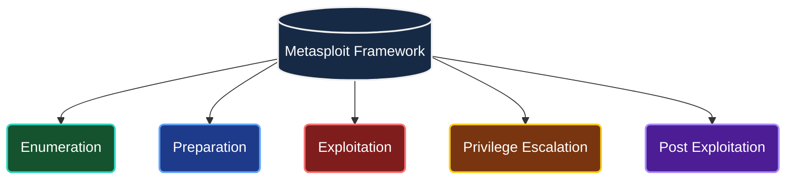

---
tags:
  - HackTheBox
  - Using-The-Metasploit-Framework
  - Correct-Mermaid-Diagram
---
[[Using The Metasploit Framework Contents]]
[Previous Section](Introduction%20To%20The%20Metasploit%20Framework.md)

Terminal Command: `msfconsole`.
**Parrot**, & **Kali** Linux come preinstalled with the **Metasploit Framework**.

---
# Preparation
## Launching MSFConsole
### With Banner

```shell
$ msfconsole
```

![[Metasploit-Console-Banner.png]]
### Without Banner

```shell
TheMalevolent1@htb[/htb]$ msfconsole -q
```


![[Run Msfconsole.png]]
## Installing MSF

```Shell
$ sudo apt update && sudo apt install metasploit-framework
```

![[Updating Linux.png]]
<sub>Updating and Upgrading packages for Kali Linux</sub>

```shell
$ sudo apt install metasploit-framework
```

![[Installing-Metasploit-Framework.png]]
<sub>Installing Metasploit on Linux</sub>

---
# Five Categories of Metasploit Framework


<sub>The five categories of Metasploit Framework Exploitation</sub>

![[S04_SS03.png]]
<sub>The five categories pinned to specific elements of the pen testing process using the Metasploit Framework.</sub>

---
# **No Exercises** for this section.

[Next Section](Modules%20-%20Using%20The%20Metasploit-Framework.md)