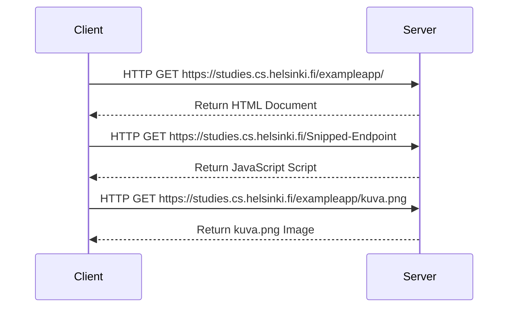
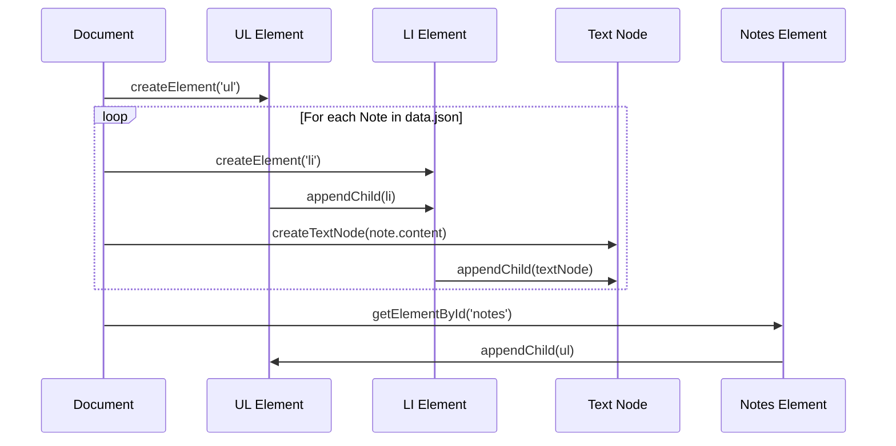
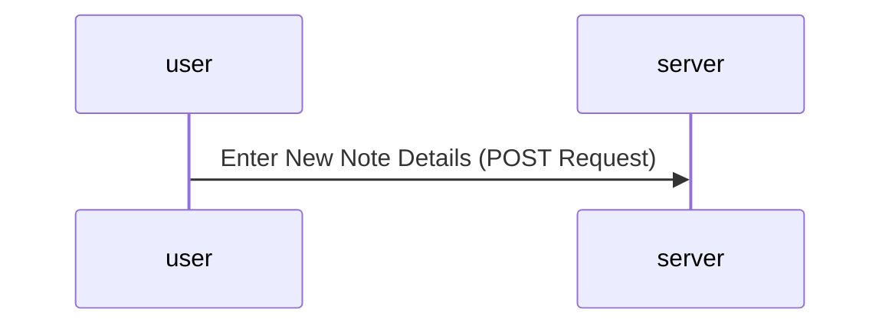

---
tags:
  - Full-Stack-Open
---
[[Full Stack Open Course]]

> [!quote]
> In this part, we will familiarize ourselves with the practicalities of taking the course. After that, we will have an overview of the basics of web development and also talk about the advances in web application development during the last few decades.

---
# [General Information](https://fullstackopen.com/en/part0/general_info)
Introduction to modern web development for single-page applications implemented with React and supported with RESTful and GraphQL web servers which are implemented with NodeJS.

In summary the technologies covered by this course will include:
- [JavaScript](https://developer.mozilla.org/en-US/docs/Web/JavaScript)
- [RESTful](https://restfulapi.net/)
- [GraphQL](https://graphql.org/)
- [TypeScript](https://www.typescriptlang.org/)
- [React Native](https://reactnative.dev/)

> Additional Topics:
> - Continuous Integration
> - Debugging Applications
> - Container Technology
> - Configuration
> - Managing Runtime environments and databases
> - Databases
## Prerequisites
- Good programming skills
- Basic knowledge of web programming and databases
- Know the basics of [Git](https://git-scm.com/) version control
- Capacity for solving problems independently
## Course Materials
> The course guide states that all materials are meant to be read one part at a time and in order.

> [!note]
> The course material contains enough content so that every exercise can be solved as they are encountered. It is also beneficial to read all the materials in the part **before** attempting the exercise.

[Course Materials](https://github.com/fullstack-hy2020/fullstack-hy2020.github.io) can be found on GitHub for each part.
## Taking the Course
> Parts of the course will increment exercises together to bring one larger application a small part at a time.

> [!quote]
> One part corresponds loosely to one week (averaging 15-20 hours) of studying, but the speed of completing the course is flexible.

> Built around the idea of [Mastery Learning](https://en.wikipedia.org/wiki/Mastery_learning) therefore proceeding to the next part is conditional to the amount of completed exercises.

**Mandatory** Parts:
- Parts 1 - 4 are expected for **all** exercises that are not marked with `*` (Which count towards a final grade)

> Skipping the mandatory exercises for the current part, does not result in being unable to do the next part's mandatory exercises.
## Parts & Completion
> Full Stack studies consist of the core course and multiple extensions.
> Parts 0-5 (core course) - Full Stack Web Development (5 credits)

> [!quote]
> The number of credits and the grade for the course are based on the total number of submitted exercises for parts 0-7 (including exercises marked with an asterisk).

>Once enough exercises have been completed for a passing grade, the certificate can be downloaded from the submission system.

Credits and grades are calculated as follows:

| exercises | credits | grade |
| --------- | :-----: | :---: |
| 138       |    7    |   5   |
| 127       |    6    |   5   |
| 116       |    5    |   5   |
| 105       |    5    |   4   |
| 94        |    5    |   3   |
| 83        |    5    |   2   |
| 72        |    5    |   1   |

## Studying the course in a nutshell
How to study the course – instructions in a nutshell: 5 cr core course.
- Do the exercises. The exercises are submitted through GitHub and marking them as done on the [submission system](https://studies.cs.helsinki.fi/stats/courses/fullstackopen).
    - [The course certificate](https://fullstackopen.com/en/part0/general_info#course-certificate) will be available in the submission system.
- Want to get University of Helsinki credits
    - Enroll in the course. Will receive the enrollment link through the submission system once enough exercises have been completed. Read more [here](https://fullstackopen.com/en/part0/general_info#submitting-exercises)
    - Save the student number. After course enrollment, save the University of Helsinki student ID number in the submission system.
    - Do the online exam in the submission system. Read more [here](https://fullstackopen.com/en/part0/general_info#the-course-exam)
    - Mark the course completed in the submission system. Read more [here](https://fullstackopen.com/en/part0/general_info#how-to-get-your-credits)
## Submitting Exercises
Exericises are submitted through GitHub and marked as done with the `My Submissions` tab of the submission application.
![[full stack submissions for full stack.png]]
<sub>Full-Stack Open Submissions Application</sub>

To access the courses submission application, I had to authorise FullStack to access only the publicly accessible data regarding my GitHub profile. This is to handle the submissions and grading.

> If submitting exercises from different parts to the same repository use an appropriate name for directories. 

> If using a private repository, add [_mluukkai_](https://github.com/mluukkai) as a collaborator.

Exercises are submitted **one part at a time**. The number of exercises completed for that module are selected, and once submitted is final.

> Submission being final means that no more exercises for that part can be submitted.

> [!quote]
> A system for detecting plagiarism is used to check exercises submitted to GitHub. If code is found from model answers or multiple students hand in the same code, the situation is handled according to the policy on [plagiarism](https://guide.student.helsinki.fi/en/article/what-cheating-and-plagiarism).

## Course Exam
For official university credits, the course exam (covering parts 1-5) must be completed.
### Exam Conditions
> - In the event of failure, the exam can be retried after one week.
> - Submissions may continue after the exam.

The exam is done in the exercise submission system. 
Follow the instructions below to complete the exam.
- Enrol in the course through Open University.
- You will get the Enrolment link through the [submission system](https://studies.cs.helsinki.fi/stats/courses/fullstackopen/submissions) once you have completed enough exercises.

![[Exam Explanation 1.png]]
<sub>Course Exam Explanation 1</sub>
![[Exam Explanation 2.png]]
<sub>Course Exam Explanation 2</sub>
![[Exam Explanation 3.png]]
<sub>Course Exam Explanation 3</sub>

---
# Before Starting
- The [Chrome Browser](https://google.com/chrome) for the course as it provides the best tools for web development, alternatively is [FireFox Developer Edition](https://www.firefox.com/en-US/channel/desktop/developer/?redirect_source=mozilla-org)

- Git **MUST** be installed as exercises are verified through GitHub

- Install sensible IDE [Visual Studio Code](https://code.visualstudio.com/) Recommended.
> It is recommended to **NOT** use Notepad, Nano, or GEdit.

- Install [Node.js](https://nodejs.org/en) (`Parts 1-5` - using version 22.3.0. `Part 10` - using version 20.11.0. `Part 11 - End` - using version 18.13.0)
> `npm` (Node Package Manager) and `npx` (Node Package Execute) is automatically installed with Node.js.

---
# [Fundamentals of Web Applications](https://fullstackopen.com/en/part0/fundamentals_of_web_apps)
Before programming the course will cover the basic principles of web development by examining the following [example application](https://studies.cs.helsinki.fi/exampleapp).

> The application exists to demonstrate the basic concepts of the course and is **NOT** an example of a *modern web application*, it merely demonstrates the older techniques of web development which could even be considered **bad practice** nowadays.

**The 1st rule** of web development is to always keep the Developer Console open. 
## Opening the Dev Console Shortcuts
MacOS - `fn - F12` or `option-cmd-i`
Windows - `fn - F12` or `ctrl-shift-i` 

Make sure the `Network` tab is open during web development.

![[Disable_Web_Cache.png]]
<sub>Ensure cache is disabled (Ensuring the latest resources are being pulled from the web server.</sub>

There are two other settings of interest:
- Preserve Log - Useful in logging printed by the application when the page is reloaded.
- Hide Extension URLs - Hides requests of any extensions installed in the browser.
![[Hide Extension URLs.png]]
<sub>Additional Web Filters</sub>
## HTTP GET
Server and web browser communicate with each other using the [[HyperText Transfer Protocol (HTTP)]]. 

> Another relevant note: [[HyperText Transfer Protocol Secure (HTTPS)]].

---
# Exploring Network Requests
Reloading the example webpage with the network tab enabled reveals the following requests.
## Homepage
![[ExampleApplicationExpress_Requests.png]]
<sub>Network Requests Loaded upon visiting example application</sub>

![[Image Requested.png]]
<sub>Order of Network Requests</sub>

> The sort is set to `Waterfall` meaning it follows the descending order of requests by client and responses from the server.


### Page Content Request
#### Request
```http
GET /exampleapp/ HTTP/1.1 
Accept: text/html,application/xhtml+xml,application/xml;q=0.9,image/avif,image/webp,image/apng,*/*;q=0.8 
Accept-Encoding: gzip, deflate, br, zstd 
Accept-Language: en-GB,en;q=0.9 
Cache-Control: no-cache 
Connection: keep-alive Cookie: c83c27d4fad704d2abcc94600fc20e48= 
Host: studies.cs.helsinki.fi 
Pragma: no-cache 
Sec-Fetch-Dest: document 
Sec-Fetch-Mode: navigate 
Sec-Fetch-Site: cross-site 
Sec-Fetch-User: ?1 
Sec-GPC: 1 Upgrade-Insecure-Requests: 1 
User-Agent: Mozilla/5.0 (Windows NT 10.0; Win64; x64) AppleWebKit/537.36 (KHTML, like Gecko) Chrome/140.0.0.0 Safari/537.36 sec-ch-ua: "Chromium";v="140", "Not=A?Brand";v="24", "Brave";v="140" 
sec-ch-ua-mobile: ?0 
sec-ch-ua-platform: "Windows"
```
<sub>Request Headers</sub>
#### Server Response
```http
HTTP/1.1 200 OK 
Connection: close 
Content-Length: 487 
Cache-Control: no-cache, no-store, must-revalidate 
Content-Type: text/html; charset=utf-8 
Date: Thu, 18 Sep 2025 20:59:48 GMT 
Etag: W/"141-T/danxJCVua08jxAk4P+sdtBvQY" 
Expires: 0 
Pragma: no-cache 
Server: nginx/1.20.1 
X-Powered-By: Express
```
<sub>Response Headers</sub>
```html
<!DOCTYPE html>
    <html>
      <head><script type='text/javascript' src='https://studies.cs.helsinki.fi/bRGOnOjPS2ms48ZB94NC4eVeo7fXhxBmqPdBb4hsPHJs3taEpMb23v8tRFKzsfeomeWZmK1G-tMl_qyx4a4GRQ=='></script>
      </head>
      <body>
        <div class='container'>
          <h1>Full stack example app</h1>
          <p>number of notes created 100</p>
          <a href='/exampleapp/notes'>notes</a>
          
        </div>
      </body>
    </html>
```
<sub>Response Body</sub>

The response headers contain vital information regarding how the server responded to the request, some key pieces include:
- `Content-Type` - Informs the response is a txt file in the utf-8 format, and the contents have been formatted with HTML
- `Content-Length` - The length of the response in bytes

> Relevant Note: [[HTTP Headers]]

Once the HTTP content is downloaded onto the client's browser the script request is made to pull a script from a `studies.cs.helsinki.fi` endpoint, after this occurs the next request of interest is made being the image request.
### Image Request
#### Request
```http
GET /exampleapp/kuva.png 
HTTP/1.1 Accept: image/avif,image/webp,image/apng,image/svg+xml,image/*,*/*;q=0.8 
Accept-Encoding: gzip, deflate, br, zstd 
Accept-Language: en-GB,en;q=0.9 
Cache-Control: no-cache 
Connection: keep-alive 
Cookie: c83c27d4fad704d2abcc94600fc20e48= 
Host: studies.cs.helsinki.fi 
Pragma: no-cache 
Referer: https://studies.cs.helsinki.fi/exampleapp/ 
Sec-Fetch-Dest: image 
Sec-Fetch-Mode: no-cors 
Sec-Fetch-Site: same-origin 
Sec-GPC: 1 
User-Agent: Mozilla/5.0 (Windows NT 10.0; Win64; x64) AppleWebKit/537.36 (KHTML, like Gecko) Chrome/140.0.0.0 Safari/537.36 sec-ch-ua: "Chromium";v="140", "Not=A?Brand";v="24", "Brave";v="140" 
sec-ch-ua-mobile: ?0 
sec-ch-ua-platform: "Windows"
```
<sub>Img Request Headers</sub>
#### Response
```http
HTTP/1.1 200 OK 
server: nginx/1.20.1 
date: Thu, 18 Sep 2025 21:39:57 GMT 
content-type: image/png 
content-length: 89350 
x-powered-by: Express 
accept-ranges: bytes 
cache-control: public, max-age=0 
last-modified: Fri, 28 Aug 2020 06:06:34 GMT 
etag: W/"15d06-17433acc210"
```
<sub>Image Response Headers</sub>

The example website works as a traditional web application, when entering the page, the browser fetches the HTML document which details the structure of the website content.

Web Servers depending on their internal programming can also dynamically generate HTML for example utilising data from a database.

```javascript
const getFrontPageHtml = noteCount => {
  return `
    <!DOCTYPE html>
    <html>
      <head>
      </head>
      <body>
        <div class='container'>
          <h1>Full stack example app</h1>
          <p>number of notes created ${noteCount}</p>
          <a href='/notes'>notes</a>
          
        </div>
      </body>
    </html>
`
}

app.get('/', (req, res) => {
  const page = getFrontPageHtml(notes.length)
  res.send(page)
})
```
<sub>JavaScript Node.js + Express backend (Server-Side)</sub>

Writing HTML alongside the code is not the smartest course of action to accomplish dynamic pages but it was widely utilised by PHP developers.

Web Servers can be created with some of the following:
- [Java Spring](https://spring.io/)
- [Python Flask](https://flask.palletsprojects.com/en/stable/)
- [Ruby on Rails](https://rubyonrails.org/)
- [Express with Node.js](https://expressjs.com)
## Notes Page
![[network-res-and-html-render.png]]
<sub>Notes HTML Document Response Body & Rendered page</sub>

Despite having an obvious list of notes displayed the HTML code does not contain any list of notes, despite the rendered page clearly having them. The cause of this is the script in the `<head>` section 

```html
<script type="text/javascript" src="/exampleapp/main.js"></script>
```

The fourth request listed in the screenshot indicates a new HTTP GET Request to the web server to download the JavaScript for `main.js`.

```javascript
// main.js script
var xhttp = new XMLHttpRequest()
  
xhttp.onreadystatechange = function () {
  if (this.readyState == 4 && this.status == 200) {
    const data = JSON.parse(this.responseText)
    console.log(data)

    var ul = document.createElement('ul')
    ul.setAttribute('class', 'notes')

    data.forEach(function(note){
      var li = document.createElement('li')
      
      ul.appendChild(li);
      li.appendChild(document.createTextNode(note.content))
    })

    document.getElementById("notes").appendChild(ul)
  }
}

xhttp.open("GET", "/exampleapp/data.json", true)
xhttp.send()
```

The fourth request shown in the screenshot corresponds to the browser fetching `/exampleapp/main.js`, which was triggered by the `<script>` tag in the HTML. After downloading the JSON data, the browser executes this JavaScript to dynamically render the notes.

> The data for the notes is pulled from the [`data.json`](https://studies.cs.helsinki.fi/exampleapp/data.json) file on the web server, which shows the JSON stored data.

> `Chromium-based` browsers are not effective for displaying JSON data, as a set plugins like [JSONView](https://chromewebstore.google.com/detail/jsonview/gmegofmjomhknnokphhckolhcffdaihd) can be installed to improve the development experience.

The `console.log(data)` line in the JavaScript indicates to the browser to output to the Dev Tools Console the contents of the data.json it received.

![[console-log-exampleapp.png]]
<sub>Console Outputted Notes Data</sub>
## Event handlers and Callback functions
In the event of the JavaScript above [`onreadystatechange`](https://developer.mozilla.org/en-US/docs/Web/API/XMLHttpRequest/readystatechange_event) is the an **xhttp** object event handler.

>The `readystatechange` event is fired whenever the [`readyState`](https://developer.mozilla.org/en-US/docs/Web/API/XMLHttpRequest/readyState "readyState") property of the [`XMLHttpRequest`](https://developer.mozilla.org/en-US/docs/Web/API/XMLHttpRequest) changes.

> [!quote]
> The function code checks that the readyState equals 4 (which depicts the situation `The operation is complete`) and that the HTTP status code of the response is 200 indicating a successful connection.

> Event Handling functions in JavaScript are called `Callback` functions.
## HTML Tree Structure
HTML pages can be seen as tree structures, which can be seen in the dev tool's Elements tab in the same structure.
```html
html
  head
    link
    script
  body
    div
      h1
      div
        ul
          li
          li
          li
      form
        input
        input
```
## Document Object Model (DOM)
DOM is an API that enables modification through programming of *element trees*.

```javascript
var ul = document.createElement('ul');

data.forEach((note) => 
{
	var li = document.createElement('li');
	
	ul.appendChild(li);
	li.appendChild(document.createTextNode(note.content))
});

document.getElementById('notes').appendChild(ul)
```
### Code Explanation

<sub>JavaScript Sequence Diagram</sub>
## Manipulating the document object from console
```JavaScript
list = document.getElementsByTagName('ul')[0]; // Get First Element with the tag `ul`
newElement = document.createElement('li');
newElement.textContent = "Client HTML Page manipulation is easy from the console";

list.appendChild(newElement); // Appends to the document's existing notes list.
```
<sub>JavaScript run in Console to append new note</sub>
### JavaScript Result
#### Console
![[Pasted image 20250919144639.png]]
#### HTML Render
![[Pasted image 20250919144654.png]]

> The change is local; limited to the browser client, therefore once refreshed the `newElement` will disappear as it is not stored on the server-side.
## CSS
The _head_ element of the HTML code of the Notes page contains a [link](https://developer.mozilla.org/en-US/docs/Web/HTML/Element/link) tag, which determines that the browser must fetch a [CSS](https://developer.mozilla.org/en-US/docs/Web/CSS) style sheet from the address [main.css](https://studies.cs.helsinki.fi/exampleapp/main.css).

```css
.container {
  padding: 10px;
  border: 1px solid;
}

.notes {
  color: blue;
}
```
<sub>CSS file fetched from web-server</sub>

The file contains two [Class Selectors](https://developer.mozilla.org/en-US/docs/Glossary/CSS_Selector). (`.container` and `.notes`)

Classes are [attributes](https://developer.mozilla.org/en-US/docs/Web/HTML/Reference/Attributes) which can be added to a [HTML Element](https://developer.mozilla.org/en-US/docs/Web/HTML/Reference/Elements).
### How CSS effects the HTML rendered
![[Pasted image 20250919164026.png]]
![[Pasted image 20250919164040.png]]

> HTML elements can also have other attributes apart from classes. The _div_ element containing the notes has an [id](https://developer.mozilla.org/en-US/docs/Web/HTML/Global_attributes/id) attribute. JavaScript code uses the id to find the element.

> The _Elements_ tab of the console can be used to change the styles of the elements.

> Changes made on the console will not be permanent.  To make lasting changes, they must be saved to the CSS style sheet on the server.
## Forms and HTTP POST
The notes page contains a `<form>` element.
```html
<form action='/exampleapp/new_note' method='POST'>
    <input type="text" name="note"><br>
    <input type="submit" value="Save">
</form>
```

This form takes a text for a new note and upon submitting makes a `HTTP POST` request to push the new note onto the server. 

> The form tag has the attributes `action` & `method` in this case define the location to send the HTTP POST request. 

The network tab shows the data which is sent in the `POST` request.
## New Note HTTP Content
![[Pasted image 20250919174126.png]]

As is shown by the blue bullet point the text entered when save is clicked the POST request sends the data to the web server which stores it allowing all users to view it.
### New Note Request
```http
POST /exampleapp/new_note HTTP/1.1 
Accept: text/html,application/xhtml+xml,application/xml;q=0.9,image/avif,image/webp,image/apng,*/*;q=0.8 
Accept-Encoding: gzip, deflate, br, zstd 
Accept-Language: en-GB,en;q=0.9 
Cache-Control: no-cache 
Connection: keep-alive 
Content-Length: 13 
Content-Type: application/x-www-form-urlencoded 
Cookie: c83c27d4fad704d2abcc94600fc20e48= 
Host: studies.cs.helsinki.fi 
Origin: https://studies.cs.helsinki.fi 
Pragma: no-cache 
Referer: https://studies.cs.helsinki.fi/exampleapp/notes 
Sec-Fetch-Dest: document 
Sec-Fetch-Mode: navigate 
Sec-Fetch-Site: same-origin 
Sec-Fetch-User: ?1 
Sec-GPC: 1 
Upgrade-Insecure-Requests: 1 
User-Agent: Mozilla/5.0 (Windows NT 10.0; Win64; x64) AppleWebKit/537.36 (KHTML, like Gecko) Chrome/140.0.0.0 Safari/537.36 
sec-ch-ua: "Chromium";v="140", "Not=A?Brand";v="24", "Brave";v="140" 
sec-ch-ua-mobile: ?0 
sec-ch-ua-platform: "Windows"
```
<sub>New Note Network Request Headers </sub>
### New Note Response
```http
HTTP/1.1 302 Found 
Content-Length: 244 
Cache-Control: no-cache, no-store, must-revalidate 
Content-Type: text/html; charset=utf-8 
Date: Fri, 19 Sep 2025 23:24:21 
GMT Expires: 0 
Location: /exampleapp/notes 
Pragma: no-cache 
Server: nginx/1.20.1 
Vary: Accept 
X-Powered-By: Express
```
<sub>New Note Response Headers</sub>

> The POST request is sent and then the server responses with a `302 Redirect` indicating to the client to go to the location `/exampleapp/notes` essentially refreshing the page for the user.
### New Note Request Body
```
note=Test+Note
```
<sub>New Note Submission Content</sub>
### New Note Server-Side Code
```js
app.post('/new_note', (req, res) => {
  notes.push({
    content: req.body.note,
    date: new Date(),
  })

  return res.redirect('/notes')
})
```
<sub>Posting a new note's content and date sent</sub>

>[!quote]
> The server does not save new notes to a database, so new notes disappear when the server is restarted.
#### Code Explanation
This adds the new note as JSON to an existing `notes` array found at `data.json`, and then provides to redirect the user back to the original notes page.

> The new note data is sent in the [`body`](https://developer.mozilla.org/en-US/docs/Web/HTTP/Methods/POST) of the HTTP POST request.

---
# The Methodology Behind the Notes Page
> [!quote]
> The Notes page of the application follows an early-nineties style of web development and uses "Ajax". As such, it's on the crest of the wave of early 2000s web technology.
## [AJAX](https://en.wikipedia.org/wiki/Ajax_(programming)) (Asynchronous JavaScript and XML)
AJAX is a set of web development techniques which use a variety of technologies on the client-side to create asynchronous web applications, therefore allowing web applications to send and retrieve data from a server asynchronously without interrupting the display or pre-existing behaviour on the page.

>[!IMPORTANT]
> AJAX is a *programming pattern*. 
>- Requests are issued with the [XMLHTTPRequest](https://en.wikipedia.org/wiki/XMLHttpRequest) object using the JavaScript language.

Before **AJAX** all webpages were traditional web applications and all the HTML code that was presented was generated by the server.

>[!NOTE]
>Submitting forms still uses the traditional method to submit web forms.
## Single Page Applications
In an SPAs the logic is entirely server side and the browser/client merely renders the HTML presented.

The notes app example as assessed above, gives some of its responsibilities back to the browser, which requests and runs the JavaScript returned, issuing the retrieval of JSON data.

#Needs-Finishing 

---
# Exercises 0.1 - 0.6
> The exercises are submitted via GitHub, and by marking the exercises as done in the "my submissions" tab of the [submission system](https://studies.cs.helsinki.fi/stats/courses/fullstackopen).
1) Read HTML Tutorial
2) Read CSS Tutorial
3) Read HTML Forms Tutorial
4) New Note Diagram

>[!Task]
>In the section [Loading a page containing JavaScript - review](https://fullstackopen.com/en/part0/fundamentals_of_web_apps#loading-a-page-containing-java-script-review), the chain of events caused by opening the page [https://studies.cs.helsinki.fi/exampleapp/notes](https://studies.cs.helsinki.fi/exampleapp/notes) is depicted as a [sequence diagram](https://www.geeksforgeeks.org/unified-modeling-language-uml-sequence-diagrams/)
>
> **Create a similar diagram** depicting the situation where the user creates a new note on the page [https://studies.cs.helsinki.fi/exampleapp/notes](https://studies.cs.helsinki.fi/exampleapp/notes) by writing something into the text field and clicking the _Save_ button.



