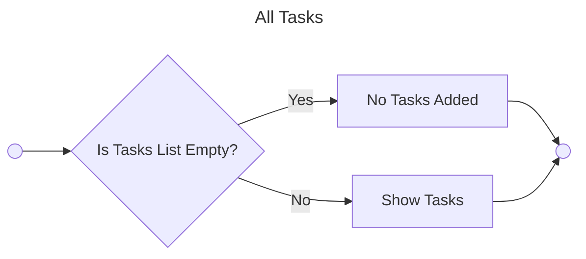
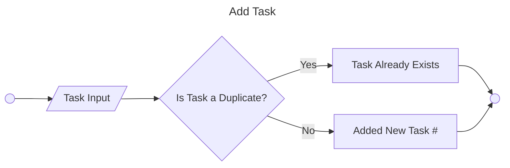
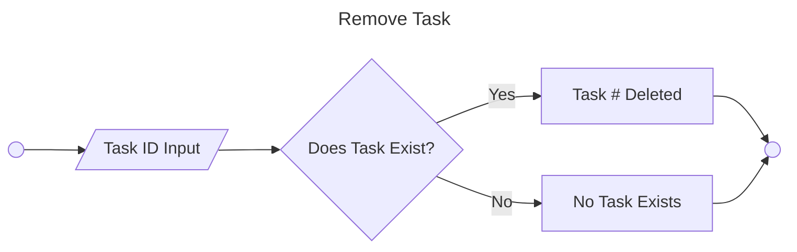
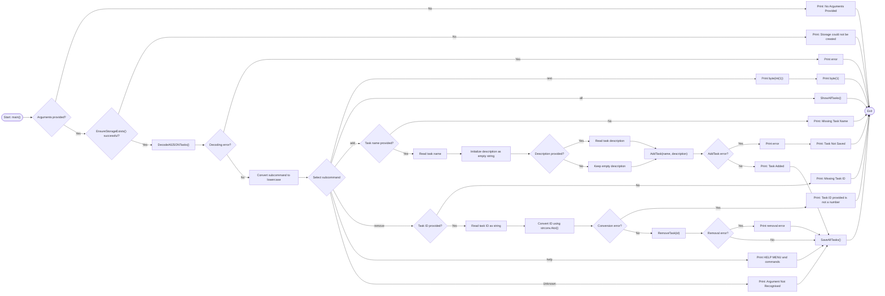
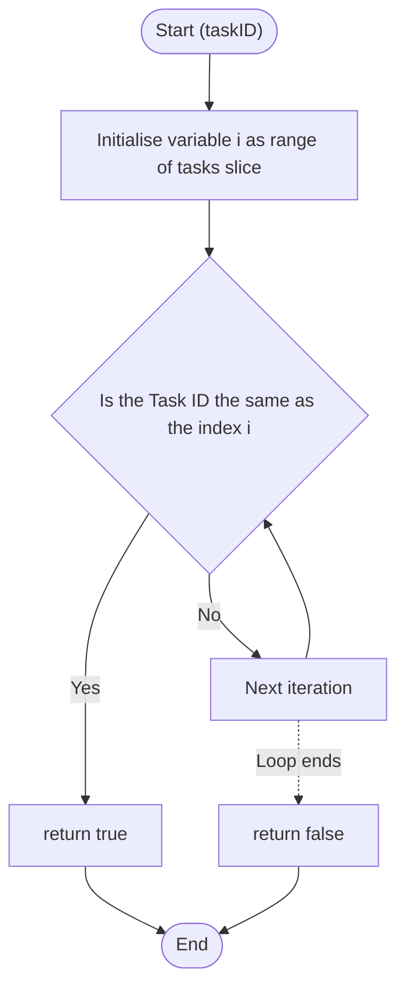

---
tags:
  - Go-Learning
  - Week-One
---
[[Ten Projects in Go Projects]]
# Objective
The focus for week 1 is a Command-Line Interface (CLI) for a **task list** in the **GO** Language.
# Research
## Requirements
### Functional
- The *User* must be able to view all tasks.
- The *User* must be able to add a new task.
- The *User* must be able to remove an existing task.

- The *Program* must be able to access the task file, for persistent storage.
### Non-Functional
- The *User* wants an easily human-readable output.
- The *User* wants to add a task description for additional information on the task needing to be completed.
### MoSCoW
- Must be able to view all tasks.
- Must be able to add a new task. 
- Must be able to remove an existing task.
- Must be able to persist tasks across program restart.
- Must have a unique identifier (`incremental int ID`) for every task.

- Should have a Task Description for more information.

- Could be listed alphabetically.
- Could have minimal error handling e.g. no existing, or duplicate. 
- Could have no stack traces. Clean human-readable outputs

- Won't be able to add or remove tasks with from an interactive CLI menu, only as command-line arguments.
## Required Libraries
- [`os`](https://pkg.go.dev/os) - For File Handling (Reading/Writing). 
- [`errors`] - For creating new Errors.
- [`fmt`] - Format library to display to terminal.
- [`path/filepath`] For Filepath handling
- [`testing`](https://pkg.go.dev/testing) - For Program Unit Testing.
- [`encoding/json`](https://pkg.go.dev/encoding/json) - for JSON parsing.
- [`strings`] For ToLower function.
# Design
## Commands
`tasklist all` - *list* all tasks.
`tasklist add <TASK_NAME> [DESCRIPTION]` - *add* new task.
`tasklist remove <TASK_ID>` - *remove* existing task.

>[!note]
>**`#` represents a unique identifier.**
>**`<>` must have included.**
>**`[]` optional**

### Tasklist All



```
$ tasklist all

|--------------------|
| TASKLIST MANAGER   |
|--------------------|
|  #. Task One!      |
|  #. Task Two!      |
|  #. Task Three!    |
|--------------------|
```

### Tasklist Add



```
$ tasklist add <TASK_NAME> [TASK_DESCRIPTION]

|------------------|
| TASKLIST MANAGER |
|------------------|
|  Task Added - #  |
|------------------|
```

### Tasklist Remove



>[!note] 
>Potentially have an alias: `delete`

```
$ tasklist remove <TASK_ID>

IF NONE

|------------------|
| TASKLIST MANAGER |
|------------------|
|  No Task Found!  |
|------------------|

ELSE

|------------------|
| TASKLIST MANAGER |
|------------------|
|   Task Deleted   |
|------------------|
```
# Implementation
>[!important] 
>
>- Main - Command-Line Arguments ONLY.
>- Tasks - Handles the Struct (Appending to, and From) Tasks Slice, File Handling and JSON Un/Marshaling.
## Main Implementation



## Tasks Implementation
### doesIdExist - Boolean Function

# Testing

# Limitations

# Security Considerations

# Future Progress
