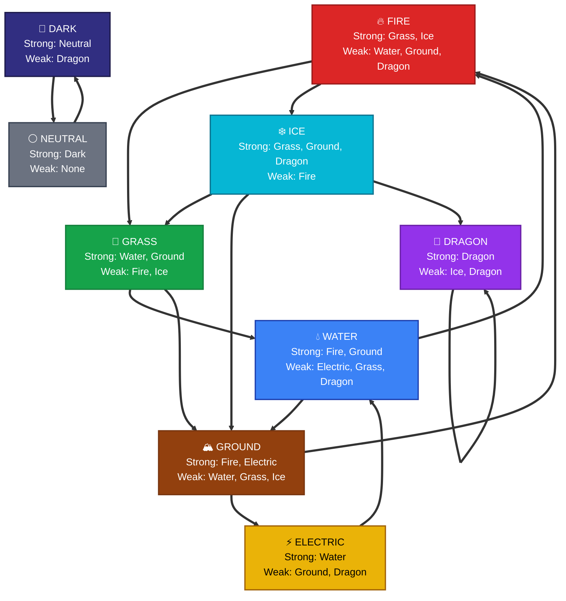
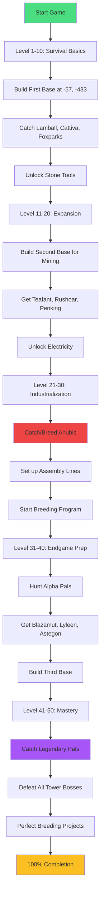

---
tags:
  - Cheatsheet
  - AI-Generated
---
[[Homepage]]
# 🎮 COMPLETE PALWORLD CHEAT SHEET

## Your Ultimate Survival & Progression Guide

---

## 📊 TYPE EFFECTIVENESS CHART



### 🎯 Combat Multipliers

- **Super Effective**: 1.2x damage
- **Normal**: 1.0x damage
- **Not Very Effective**: 0.9x damage

---

## 🌱 LEVELS 1-10: EARLY SURVIVAL PHASE

### 🎯 Main Objectives

- Build your first base
- Catch starter Pals (Lamball, Cattiva, Chikipi)
- Craft basic tools and weapons
- Establish food and resource production

### 🔨 Essential Crafting (Ancient Technology Points)

- **Palbox** - Your base core (Build immediately!)
- **Wooden Structure Set** - Walls, floors, roofs
- **Primitive Workbench** - Craft better tools
- **Campfire** - Cook food and stay warm
- **Berry Plantation** - Sustainable food source

### 🦌 Best Starter Pals

|Pal|Type|Work Suitability|Location|
|---|---|---|---|
|**Lamball**|Neutral|Handiwork Lv1, Farming Lv1|Starting plateau|
|**Cattiva**|Neutral|Handiwork Lv1, Gathering Lv1, Mining Lv1|Grasslands|
|**Chikipi**|Neutral|Farming Lv1, Egg producer|Near starting area|
|**Foxparks**|Fire|Kindling Lv1, Farming Lv1|Grasslands (night)|
|**Pengullet**|Water/Ice|Handiwork Lv1, Watering Lv1, Cooling Lv1|Beach areas|

### 💡 Pro Tips

- Catch 10+ Lamballs early for XP and base workers
- Build near water sources for easy access
- Place Palbox near resources (stone, wood, ore)
- Gather berries constantly - they're your main food source
- Don't fight tough Pals yet, focus on catching weak ones

### 📋 Priority Checklist

- [ ] Place Palbox at your base location
- [ ] Build Primitive Workbench
- [ ] Craft Stone Pickaxe, Stone Axe, Wooden Club
- [ ] Catch 5+ Pals for base work
- [ ] Build a small shelter with walls and roof
- [ ] Set up Campfire and Berry Plantation
- [ ] Craft a Pal Sphere Workbench

---

## ⚔️ LEVELS 11-20: BASE EXPANSION

### 🎯 Main Objectives

- Upgrade to stone structures
- Unlock electricity basics
- Establish automated production lines
- Explore more dangerous areas
- Start breeding Pals

### 🔨 Essential Crafting

- **Stone Structure Set** - Stronger base walls
- **Sphere Workshop II** - Better Pal Spheres
- **Wheat Plantation** - Advanced food production
- **Mill** - Process wheat into flour
- **Cooking Pot** - Advanced recipes
- **Nail Workbench** - Essential for upgrades
- **Medieval Crafting Table** - Better equipment

### 🦌 Best Mid-Game Pals

|Pal|Type|Work Suitability|Key Feature|
|---|---|---|---|
|**Daedream**|Dark|Handiwork Lv1, Gathering Lv1, Transporting Lv1|Flies, doesn't use slots|
|**Lifmunk**|Grass|Handiwork Lv1, Planting Lv1, Gathering Lv1, Medicine Lv1|Great all-rounder|
|**Tanzee**|Grass|Handiwork Lv1, Gathering Lv1, Lumbering Lv1, Planting Lv1|Efficient gatherer|
|**Rushoar**|Ground|Mining Lv1, Lumbering Lv1|Mount & combat|
|**Teafant**|Water|Watering Lv2|Best early waterer|
|**Flambelle**|Fire|Kindling Lv1, Handiwork Lv1|Fires & crafting|

### 🏗️ Base Layout Tips

**Optimal Base Design:**

- Central Palbox placement
- Production zone (crafting benches, furnaces)
- Farm zone (plantations, feed boxes)
- Storage zone (wooden chests clustered together)
- Pal beds near work areas
- Hot spring for Pal sanity recovery

### 🔋 Early Automation

Start building production chains:

1. **Stone → Ingots**: Primitive Furnace with Kindling Pals
2. **Wood → Planks**: Logging Site with Lumbering Pals
3. **Wheat → Flour → Bread**: Mill + Cooking Pot with Kindling/Handiwork Pals

### 💡 Pro Tips

- Keep catching duplicate Pals - they condense for passive skills
- Build multiple Feed Boxes and keep them stocked
- Assign Pals to beds so they recover faster
- Place a Hot Spring for Pal sanity management
- Start exploring dungeon entrances for rare items
- Capture at least one Pal of each element type

### 📋 Priority Checklist

- [ ] Upgrade base to stone structures
- [ ] Build Sphere Workshop II for Mega Spheres
- [ ] Establish wheat farm → bread production
- [ ] Capture transport and gathering specialists
- [ ] Build storage system with 10+ chests
- [ ] Create designated Pal sleeping area with beds
- [ ] Start collecting Iron Ore from caves

---

## 🏰 LEVELS 21-30: INDUSTRIAL REVOLUTION

### 🎯 Main Objectives

- Unlock metal-tier technology
- Build advanced production systems
- Breed specialized Pals
- Tackle mid-level dungeons
- Establish multiple bases

### 🔨 Essential Crafting

- **Metal Structure Set** - Industrial base building
- **Electric Furnace** - Faster smelting with electricity
- **Assembly Line** - High-speed production
- **Weapon Workbench II** - Advanced weapons
- **Egg Incubator** - Controlled breeding
- **Giga Sphere Workbench** - Better catch rates
- **Refrigerator** - Food preservation
- **Electric Kitchen** - Efficient cooking

### 🦌 Best Advanced Pals

|Pal|Type|Work Suitability|Why Essential|
|---|---|---|---|
|**Anubis**|Ground|Handiwork Lv4, Mining Lv3, Transporting Lv2|Best crafter in game|
|**Digtoise**|Ground|Mining Lv3|Incredible mining speed|
|**Penking**|Water/Ice|Watering Lv2, Handiwork Lv2, Mining Lv1, Transporting Lv2|Great multi-tasker|
|**Verdash**|Grass|Handiwork Lv2, Planting Lv2, Lumbering Lv2, Gathering Lv1|Farming specialist|
|**Mossanda**|Grass|Handiwork Lv3, Lumbering Lv3, Transporting Lv3|Massive worker|
|**Dumud**|Ground|Transporting Lv2|Excellent mount|
|**Jormuntide**|Dragon/Water|Watering Lv4|Ultimate waterer|

### ⚡ Electricity Setup

**Power Generation:**

1. Catch/breed **Sparkit** (Electric, Generator Lv1)
2. Build **Electric Generator** structures
3. Assign Electric Pals to generators
4. Connect powered machines

**Priority Powered Machines:**

- Electric Furnace (faster smelting)
- Assembly Line (2x production speed)
- Refrigerator (prevents food decay)
- Electric Cooking Pot

### 🧬 Breeding Basics

**Breeding Combos for Essential Pals:**

- **Anubis**: Penking + Bushi (Rare, worth hunting for)
- **Mossanda**: Rayhound + Grizzbolt
- **Relaxaurus**: Mossanda + Blazamut
- **Grizzbolt**: Mossanda + Rayhound

**Breeding Tips:**

- Feed breeding Pals Cake (Flour, Berries, Milk, Eggs, Honey)
- Incubation time varies by species
- Breed for passive skills (Legend, Swift, Musclehead, etc.)
- Keep breeding pairs fed and rested

### 🗺️ Exploration Zones

**Dungeon Locations:**

- **Ruined Fortress City** - Level 20-25 enemies, Ancient Civilization Parts
- **Sealed Realm of the Swordmaster** - Level 25 boss, rare loot
- **Frozen Caves** - Ice Pals, Ice Organs, Diamonds

**Resource Hotspots:**

- **Volcanic Region** - Sulfur, Flame Organs
- **Bamboo Forest** - High-quality Wood, Grass Pals
- **Desert** - Ore deposits, Ground Pals

### 💡 Pro Tips

- Build a second base near ore-rich areas for mining operations
- Use Fast Travel points strategically
- Equip Mega Glider for efficient exploration
- Craft Cold/Heat Resistant Armor for biome exploration
- Keep breeding pen active 24/7 for passive skill hunting
- Start stockpiling rare materials (High-Quality Cloth, Circuit Boards)

### 📋 Priority Checklist

- [ ] Unlock and build Electric Generator
- [ ] Capture/breed Anubis for crafting
- [ ] Establish breeding operation with Egg Incubator
- [ ] Build second base near resource nodes
- [ ] Craft metal armor set
- [ ] Set up powered production line
- [ ] Unlock and craft Giga Spheres
- [ ] Explore at least 3 dungeons

---

## 🚀 LEVELS 31-40: ENDGAME PREPARATION

### 🎯 Main Objectives

- Master all technology trees
- Build legendary Pal teams
- Conquer Alpha Pals
- Optimize base production to 100%
- Prepare for raid defense

### 🔨 Essential Crafting

- **High-Quality Workbench** - Legendary equipment
- **Advanced Assembly Line II** - Maximum efficiency
- **Hyper Sphere Workbench** - Near-guaranteed captures
- **Legendary Sphere Workbench** - Alpha Pal captures
- **Polymer Production** - Advanced crafting material
- **Circuit Board Factory** - Electronics crafting
- **Advanced Weapon Workbench** - Rocket launchers, assault rifles

### 🦌 Best Endgame Pals

|Pal|Type|Work Suitability|Endgame Role|
|---|---|---|---|
|**Frostallion**|Ice|Cooling Lv4|Legendary mount & combat|
|**Jetragon**|Dragon|Gathering Lv3|Fastest flying mount|
|**Blazamut**|Fire|Kindling Lv4, Mining Lv4, Handiwork Lv3|Ultimate fire worker|
|**Orserk**|Dragon/Electric|Electricity Lv4, Handiwork Lv2|Best power generator|
|**Astegon**|Dragon/Dark|Mining Lv4|Mining destroyer|
|**Lyleen**|Grass|Handiwork Lv3, Planting Lv4, Medicine Lv3, Gathering Lv2|Farm goddess|
|**Shadowbeak**|Dark|Gathering Lv3|Combat & gathering specialist|
|**Paladius**|Neutral|Gathering Lv2, Cooling Lv2|Legendary combat Pal|

### 🏆 Alpha Pal Hunting Guide

**Alpha Locations & Rewards:**

- **Mammorest** (Lv11, Grass) - Mammorest Saddle, Ancient Parts
- **Kingpaca** (Lv23, Neutral) - Kingpaca Saddle, High-Quality Cloth
- **Menasting** (Lv29, Dark) - Ancient Civilization Parts
- **Elizabee** (Lv34, Grass) - Honey, Ancient Parts
- **Bushi** (Lv36, Fire) - Ancient Civilization Parts
- **Frostallion** (Lv50, Ice) - Legendary Saddle, Ancient Parts
- **Jetragon** (Lv50, Dragon) - Legendary Saddle, Ancient Parts

**Alpha Hunting Strategy:**

1. Bring Legendary Spheres (30%+ catch rate)
2. Use type advantages (check chart above!)
3. Weaken to <20% HP before throwing spheres
4. Bring healing items and revival medicines
5. Use Partner Skills from your mount
6. Consider bringing multiple strong combat Pals

### ⚙️ Base Optimization (100% Efficiency)

**Perfect Base Setup:**

- **15+ High-tier workers**: Mix of Anubis, Blazamut, Lyleen, Verdash
- **Dedicated roles**: Don't overlap work types too much
- **Multiple production lines**: 3+ Assembly Lines running simultaneously
- **Storage network**: 30+ chests organized by material type
- **Pal comfort**: Hot spring, all beds, Feed Boxes always stocked
- **Defense perimeter**: Walls, gates, defensive structures
- **Power grid**: 4+ generators with Electric-type Pals

**Automation Chains:**

1. **Ore → Refined Ingots → Pal Metal Ingot**: Multiple Electric Furnaces
2. **Wood → Carbon Fiber**: High-Quality Workbench chain
3. **Circuit Board Production**: Automated with Anubis workers
4. **Ammunition Factory**: Dedicated weapon workbench area

### 🛡️ Raid Defense Setup

**Preparing for Raids:**

- Build stone/metal walls with defensive turrets
- Keep combat-ready Pals in Party
- Stock medical supplies (Medicine, Low-Grade Medical Supplies)
- Place defensive Pals at base (aggressive Work Settings)
- Build emergency shelters
- Keep Feed Boxes fully stocked so Pals stay healthy

**Best Defensive Pals:**

- Blazamut, Shadowbeak, Frostallion, Jetragon (high combat stats)
- Keep them assigned to base with "defensive" stance
- Mix elements to counter raid types

### 💎 Rare Material Farming

**High-Demand Materials:**

- **Ancient Civilization Parts**: Alpha Pals, dungeons, ruins
- **Pure Quartz**: Desert/volcano mining nodes
- **Pal Metal Ingots**: Ore + Refining with high-level workers
- **High-Quality Cloth**: Sheep Pals (Melpaca, Cremis), Kingpaca
- **Circuit Boards**: Crafted at workbench (needs Gold Coins + Polymer)
- **Diamonds**: Deep caves, ice biome nodes
- **Carbon Fiber**: Wood + High-Quality Workbench

### 🎨 Legendary Breeding Projects

**God-Tier Passive Skills to Breed:**

- **Legend**: +20% to all stats (RARE!)
- **Swift**: +30% Movement Speed
- **Musclehead**: +30% Attack
- **Ferocious**: +20% Attack
- **Artisan**: +50% Work Speed
- **Serious**: +20% Work Speed
- **Lucky**: +15% to all stats & better drops

**Breeding Strategy:**

1. Catch 50+ of same species for passive skill pool
2. Breed two Pals with desired skills
3. Check offspring for skill inheritance
4. Keep breeding until 4/4 perfect skills
5. Use Cake constantly (breed in bulk)

### 💡 Pro Tips

- Build all three bases for specialized operations (mining, breeding, main production)
- Max out Technology Points by completing dungeons repeatedly
- Use Jetragon for fast Alpha Pal farming routes
- Keep a "combat loadout" and "exploration loadout" saved
- Farm Ancient Civilization Parts daily from Alpha Pals
- Trade with Black Marketeers for rare Pals and items
- Complete all Tower Boss fights for unique rewards

### 📋 Priority Checklist

- [ ] Capture or breed all Legendary Pals
- [ ] Defeat all Alpha Pals at least once
- [ ] Build and optimize all 3 bases
- [ ] Unlock entire Technology tree
- [ ] Craft full set of Legendary equipment
- [ ] Establish self-sustaining production lines
- [ ] Breed at least 5 Pals with perfect passives
- [ ] Stock 1000+ of each basic resource
- [ ] Build comprehensive raid defenses
- [ ] Unlock all fast travel points

---

## 🎯 LEVELS 41-50: MASTERY & ENDGAME CONTENT

### 🎯 Main Objectives

- Complete all Tower Boss challenges
- Perfect your Legendary Pal collection
- Build the ultimate base fortress
- Master all combat techniques
- Complete 100% exploration

### 🏅 Tower Boss Guide

**Rayne Syndicate Tower:**

- **Zoe & Grizzbolt** (Lv24, Electric) - Counter with Ground types
- **Lily & Lyleen** (Lv31, Grass) - Counter with Fire types
- **Axel & Orserk** (Lv40, Dragon/Electric) - Counter with Ground/Ice types
- **Marcus & Faleris** (Lv45, Fire) - Counter with Water types
- **Victor & Shadowbeak** (Lv50, Dark) - Counter with Dragon types

**Free Pal Alliance Tower:**

- Similar level progression with different bosses
- Rewards: Ancient Civilization Parts, Legendary Schematics, Unique Materials

**Boss Fight Strategy:**

- Bring element counters (check type chart!)
- Dodge roll is your best friend
- Focus on the Pal first, then trainer
- Use cooked food for quick HP recovery
- Bring your strongest combat Pals with complementary elements
- Keep moving to avoid AoE attacks

### 🌟 Legendary Pal Showcase

**The Big Four Legendaries:**

1. **Jetragon** (Dragon)
    
    - Fastest mount in the game
    - Incredible aerial mobility & speed
    - Great for Alpha Pal farming routes
    - Partner Skill: Aerial missiles
2. **Frostallion** (Ice)
    
    - Tanky legendary mount
    - Excellent combat capabilities
    - Freezing attacks control battlefield
    - Partner Skill: Ice breath
3. **Paladius** (Neutral)
    
    - Balanced legendary for combat
    - Holy-type attacks deal massive damage
    - Great defensive capabilities
    - Partner Skill: Divine lance
4. **Necromus** (Dark)
    
    - Dark counterpart to Paladius
    - High burst damage potential
    - Excellent for boss fights
    - Partner Skill: Shadow strike

### 🏗️ Ultimate Base Fortress Design

**Three Base Strategy:**

**Base 1 - Main Production Hub**

- Central location near resources
- 15 Pals: Anubis (4), Lyleen (3), Blazamut (3), Verdash (2), Jormuntide (2), Orserk (1)
- All crafting stations, powered production lines
- Complete storage system (40+ chests)
- Full defenses with turrets

**Base 2 - Mining Operation**

- Built in ore-rich mountain/volcano area
- 10 Pals: Astegon (4), Blazamut (3), Digtoise (3)
- Electric Furnaces for on-site smelting
- Storage for ore and ingots
- Fast travel point for quick access

**Base 3 - Breeding & Research**

- Peaceful location with good aesthetics
- 10 Pals: Mix of high-tier workers
- Multiple Breeding Pens with Egg Incubators
- Refrigerators stocked with Cake
- Petting farm for passive skill research

### 🎮 Advanced Combat Techniques

**Mastering Combat:**

- **Dodge Rolling**: Perfect timing to avoid all damage
- **Partner Skill Usage**: Use mount abilities strategically
- **Elemental Switching**: Change Pals mid-combat for type advantage
- **Positioning**: Keep bosses away from your Pals
- **Resource Management**: Always carry food and medicine
- **Weapon Diversity**: Mix melee, ranged, and explosives

**Recommended Endgame Loadout:**

- **Weapon**: Rocket Launcher or Legendary Assault Rifle
- **Armor**: Full Pal Metal Armor set with Heat/Cold resistance
- **Shield**: Advanced Shield for emergency blocking
- **Food**: Grilled Chikipi, Pancakes (HP regen)
- **Utilities**: Mega Glider, Grappling Gun, Legendary Spheres

### 🗺️ 100% Completion Checklist

**Exploration Goals:**

- [ ] Discover all 100+ Pal species
- [ ] Unlock all Fast Travel Statues (58 total)
- [ ] Clear all Dungeons and mini-bosses
- [ ] Defeat both Tower Boss sets
- [ ] Catch all Alpha Pals
- [ ] Find all Lifmunk Effigies (collect for extra capture power)
- [ ] Unlock all Ancient Technology Points
- [ ] Complete Paldeck to 100%

### 💰 Endgame Money Making

**Best Gold Farming Methods:**

1. **Alpha Pal Farming**: Sell rare drops to merchants
2. **Ancient Parts Trading**: High value items
3. **Pal Breeding**: Sell perfect IV Pals
4. **Dungeon Running**: Chest loot sells well
5. **Resource Automation**: Sell excess ingots/materials

### 🎁 Rare Items & Collectibles

**Must-Have Items:**

- **Lifmunk Effigies**: Scattered across map (improves capture rate)
- **Ancient Civilization Parts**: For legendary crafting
- **Schematics**: Found in dungeons for unique recipes
- **Skill Fruits**: Teach Pals new moves
- **Memory Wiping Medicine**: Reset Pal skill points

### 💡 Pro Tips

- Max out your character stats through Lifmunk Effigies and Statues
- Keep a "boss killing" party always ready
- Farm Tower Bosses repeatedly for Ancient Parts
- Build aesthetic bases once functional needs are met
- Join multiplayer for co-op boss fights and trading
- Experiment with lesser-known Pal combos
- Document your breeding lines for perfect Pals
- Take screenshots of your best bases!

### 📋 Mastery Checklist

- [ ] Defeat all 10 Tower Bosses
- [ ] Obtain all 4 Legendary Pals
- [ ] Build and optimize 3 specialized bases
- [ ] Breed 10+ Pals with 4 perfect passive skills
- [ ] Craft all Legendary equipment and weapons
- [ ] Reach max Technology Level
- [ ] Stockpile 10,000+ of each basic resource
- [ ] Complete all achievements
- [ ] Create an aesthetic showcase base
- [ ] Reach level 50 character level

---

## 📍 BEST BASE LOCATIONS & RESOURCE COORDINATES

### 🏆 TOP 5 BASE LOCATIONS

**#1 - Starter Paradise (Best First Base)**

- **Coordinates**: (-57, -433)
- **Biome**: Windswept Hills (Temperate)
- **Resources**: Wood, Stone, Iron Ore, Coal
- **Nearby Pals**: Lamball, Cattiva, Chikipi, Foxparks, Lifmunk
- **Pros**: Flat terrain, close to starting zone, all basic resources, near water
- **Cons**: No rare materials nearby
- **Best For**: Levels 1-25, Main production base

**#2 - Ore Mountain Central (Mining Hub)**

- **Coordinates**: (155, -341)
- **Biome**: Mountains
- **Resources**: Iron Ore, Coal, Quartz, Gold, Pure Quartz
- **Nearby Pals**: Rushoar, Digtoise, Dumud, Broncherry
- **Pros**: Massive ore deposits, multiple mining nodes, defensible position
- **Cons**: Limited farming space, mountainous terrain
- **Best For**: Levels 20-50, Dedicated mining base

**#3 - Volcanic Industrial Zone (Late Game)**

- **Coordinates**: (-582, 447)
- **Biome**: Volcanic
- **Resources**: Sulfur, Ore, Coal, Flame Organs (from Pals)
- **Nearby Pals**: Arsox, Blazamut, Reptyro, Blazehowl
- **Pros**: Sulfur for ammo, Fire Pals for kindling, unique resources
- **Cons**: Requires heat resistance, aggressive Pals
- **Best For**: Levels 30-50, Ammunition production

**#4 - Lakeside Luxury (Balanced Base)**

- **Coordinates**: (117, -27)
- **Biome**: Lake/Plains
- **Resources**: Wood, Stone, Iron, Water access
- **Nearby Pals**: Teafant, Pengullet, Celaray, Gobfin
- **Pros**: Beautiful location, flat building space, water Pals, balanced resources
- **Cons**: Spread out resource nodes
- **Best For**: Levels 15-50, Aesthetic/breeding base

**#5 - Desert Excavation Site (Advanced)**

- **Coordinates**: (415, -253)
- **Biome**: Desert
- **Resources**: Ore, Pure Quartz, Ancient Parts (dungeons)
- **Nearby Pals**: Anubis, Verdash, Gorirat, Dumud
- **Pros**: Near Anubis spawns, Pure Quartz nodes, dungeon access
- **Cons**: Requires heat resistance, sandstorms
- **Best For**: Levels 25-50, Anubis farming/breeding

---

### 🗺️ RESOURCE HOTSPOT COORDINATES

**Iron Ore Locations:**

- **(98, -385)** - Cave system with 15+ nodes
- **(155, -341)** - Mountain base location, 20+ nodes
- **(-127, -516)** - Hillside with 10+ nodes
- **(245, -128)** - Desert edge cave, 8+ nodes

**Coal Deposits:**

- **(155, -341)** - Mountain region, abundant supply
- **(42, -267)** - Forest cave system
- **(-89, -429)** - Hillside deposits
- **(198, -445)** - Cave entrance with coal veins

**Pure Quartz Nodes:**

- **(415, -253)** - Desert region, 5+ nodes
- **(-582, 447)** - Volcanic area, 4+ nodes
- **(312, -187)** - Desert cave, 3+ nodes
- **(528, 362)** - Mountain peak, 2+ nodes

**Sulfur Deposits:**

- **(-582, 447)** - Volcanic region, 10+ nodes (BEST)
- **(-512, 398)** - Volcanic cave system
- **(-634, 521)** - Lava area, 6+ nodes
- **(-471, 356)** - Volcanic hillside

**Ancient Technology Points (Dungeons):**

- **(-128, -438)** - "Sealed Realm of the Swordmaster"
- **(248, -57)** - "Sealed Realm of the Guardian"
- **(-458, 372)** - "Sealed Realm of the Frozen Wings"
- **(112, 225)** - "Sealed Realm of the Thunder Dragon"

---

### 🦌 ALPHA PAL SPAWN COORDINATES

**Early Game Alphas (Lv 11-25):**

- **Chillet (Lv11)** - (-148, -336) - Ice biome entrance
- **Mammorest (Lv13)** - (-81, -572) - Forest clearing
- **Kingpaca (Lv23)** - (78, -572) - Grassland area
- **Elphidran (Lv21)** - (168, -38) - Coastal cliffs

**Mid Game Alphas (Lv 26-40):**

- **Wumpo Botan (Lv29)** - (68, 487) - Snowy forest
- **Quivern (Lv32)** - (252, 498) - Desert plateau
- **Elizabee (Lv34)** - (-58, 478) - Flower meadow
- **Bushi (Lv36)** - (446, 37) - Bamboo forest

**Late Game Alphas (Lv 41-50):**

- **Suzaku (Lv45)** - (-478, 358) - Volcanic peak
- **Frostallion (Ice - Legendary)**
- **Coordinates**: (98, 562) - Alpha spawn only
- **Biome**: Frozen Mountain Peak
- **Level**: 50 (Alpha)
- **Best Time**: Any time
- **Notes**: Legendary mount, extremely difficult fight

**Jetragon (Dragon - Legendary)**

- **Coordinates**: (789, -324) - Alpha spawn only
- **Biome**: Volcanic Crater
- **Level**: 50 (Alpha)
- **Best Time**: Any time
- **Notes**: Fastest mount in game, worth the challenge

**Blazamut (Fire - Top Tier Worker)**

- **Coordinates**: (-512, 398), (-582, 447)
- **Biome**: Volcanic Region
- **Level Range**: 45-49
- **Best Time**: Any time
- **Notes**: Best Fire worker for Kindling Lv4 + Mining Lv4

**Lyleen (Grass - Farming Goddess)**

- **Coordinates**: (247, -89), (312, 156)
- **Biome**: Flower Fields/Bamboo Forest
- **Level Range**: 42-46
- **Best Time**: Daytime
- **Notes**: Essential for farming operations

**Jormuntide (Dragon/Water - Watering Master)**

- **Coordinates**: (198, -89), (-45, 112)
- **Biome**: Deep Ocean/Coastline
- **Level Range**: 40-44
- **Best Time**: Any time (spawns in water)
- **Notes**: Best waterer in game (Watering Lv4)

**Astegon (Dragon/Dark - Mining Beast)**

- **Coordinates**: (287, -412), (356, -287)
- **Biome**: Deep Caves/Volcanic Caves
- **Level Range**: 46-49
- **Best Time**: Any time
- **Notes**: Mining Lv4 - destroys ore nodes instantly

**Shadowbeak (Dark - Combat Specialist)**

- **Coordinates**: (445, 267), (523, 189)
- **Biome**: Dark Forest/Ruins
- **Level Range**: 44-47
- **Best Time**: Night (higher spawn rate)
- **Notes**: Excellent combat Pal with Gathering Lv3

---

### 🏺 DUNGEON & BOSS LOCATIONS

**Ancient Technology Dungeons:**

1. **Sealed Realm of the Swordmaster**
    
    - **Coordinates**: (-128, -438)
    - **Recommended Level**: 25+
    - **Boss**: Swordmaster (Lv28)
    - **Rewards**: Ancient Parts x3-5, Schematics, Gold
    - **Respawn**: 60 minutes
2. **Sealed Realm of the Guardian**
    
    - **Coordinates**: (248, -57)
    - **Recommended Level**: 30+
    - **Boss**: Stone Guardian (Lv32)
    - **Rewards**: Ancient Parts x4-6, Rare Ore, Schematics
    - **Respawn**: 60 minutes
3. **Sealed Realm of the Frozen Wings**
    
    - **Coordinates**: (-458, 372)
    - **Recommended Level**: 35+
    - **Boss**: Ice Emperor (Lv38)
    - **Rewards**: Ancient Parts x5-7, Ice Organs, Diamonds
    - **Respawn**: 60 minutes
4. **Sealed Realm of the Thunder Dragon**
    
    - **Coordinates**: (112, 225)
    - **Recommended Level**: 40+
    - **Boss**: Thunder Wyvern (Lv43)
    - **Rewards**: Ancient Parts x6-8, Circuit Components, Schematics
    - **Respawn**: 60 minutes
5. **Sealed Realm of Eternal Flame**
    
    - **Coordinates**: (-567, 423)
    - **Recommended Level**: 45+
    - **Boss**: Inferno Phoenix (Lv47)
    - **Rewards**: Ancient Parts x7-10, Flame Organs, Legendary Schematic
    - **Respawn**: 60 minutes

**Tower Boss Locations:**

**Rayne Syndicate Tower**

- **Coordinates**: (-127, -438)
- **Floors**: 5 bosses (Lv 24, 31, 40, 45, 50)
- **Rewards**: Ancient Parts, Legendary Schematics, Unique Saddles
- **Notes**: Must defeat in order, cannot skip floors

**Free Pal Alliance Tower**

- **Coordinates**: (561, 334)
- **Floors**: 5 bosses (Lv 23, 30, 39, 44, 50)
- **Rewards**: Ancient Parts, Technology Points, Rare Materials
- **Notes**: Alternative boss tower with different Pal lineup

---

### 🎒 MERCHANT & TRADER LOCATIONS

**Wandering Merchants (Rotating Locations):**

- **Small Settlement** - (76, -487) - Sells Pals, items, schematics
- **Desert Outpost** - (398, -198) - Rare Pals and materials
- **Port Town** - (-112, 67) - Water Pals and fishing supplies
- **Mountain Village** - (234, -356) - Cold resistance gear

**Black Marketeer (Illegal Goods):**

- **Coordinates**: (-289, 12) - Hidden cave entrance
- **Stock**: Rare Pals, organs, illegal items
- **Payment**: Gold only, higher prices
- **Notes**: Sells Pals that are hard to find in wild

---

### 🗺️ FAST TRAVEL STATUE LOCATIONS (CRITICAL)

**Starting Region:**

- (-48, -510) - Plateau Starting Area
- (92, -465) - Rayne Syndicate Tower
- (-178, -398) - Forest Waypoint
- (28, -367) - Hillside Vista

**Central Region:**

- (145, -187) - Plains Waypoint
- (-67, -98) - Lake Settlement
- (234, -42) - Coastline Waypoint
- (98, 78) - Central Hub

**Desert Region:**

- (398, -253) - Desert Entrance
- (487, -167) - Oasis Waypoint
- (556, -89) - Ruins Waypoint
- (423, 45) - Desert Outpost

**Volcanic Region:**

- (-512, 398) - Volcanic Entrance
- (-582, 467) - Lava Fields
- (-634, 521) - Volcanic Peak
- (-456, 356) - Magma Cave

**Frozen Region:**

- (67, 512) - Ice Shelf Entrance
- (145, 578) - Frozen Lake
- (98, 634) - Mountain Summit
- (-23, 498) - Tundra Waypoint

**Forest/Bamboo Region:**

- (456, 189) - Bamboo Grove
- (398, 267) - Ancient Forest
- (512, 334) - Treetop Waypoint
- (445, 412) - Forest Ruins

---

### 💎 RARE MATERIAL FARMING ROUTES

**Ancient Civilization Parts Route (30-45 min loop):**

1. Start at **(-127, -438)** - Run Sealed Realm dungeon
2. Teleport to **(248, -57)** - Run Guardian dungeon
3. Teleport to **(98, 562)** - Fight Frostallion Alpha
4. Teleport to **(789, -324)** - Fight Jetragon Alpha
5. Teleport to **(-81, -572)** - Fight Mammorest Alpha
6. Return to base, store loot, repeat after cooldowns **Expected Yield**: 20-35 Ancient Parts per run

**Pure Quartz Mining Route (15-20 min):**

1. Start at **(415, -253)** - Desert nodes (5 nodes)
2. Move to **(312, -187)** - Cave system (3 nodes)
3. Teleport to **(-582, 447)** - Volcanic area (4 nodes)
4. Teleport to **(528, 362)** - Mountain peak (2 nodes) **Expected Yield**: 40-60 Pure Quartz per run

**High-Quality Cloth Route (20 min):**

1. Hunt Melpaca at **(267, -156)** - Plains area
2. Hunt Cremis at **(-145, -234)** - Forest area
3. Defeat Kingpaca Alpha at **(78, -572)** - Guaranteed drops
4. Check Merchant at **(76, -487)** - May sell cloth **Expected Yield**: 30-50 High-Quality Cloth per run

**Sulfur Collection Route (10 min):**

1. Start at **(-582, 447)** - Main volcanic area (10 nodes)
2. Move to **(-512, 398)** - Cave entrance (6 nodes)
3. Visit **(-634, 521)** - Lava pools (6 nodes) **Expected Yield**: 100-150 Sulfur per run

---

### 🎮 ADVANCED STRATEGIES & SECRETS

**Hidden Mechanics:**

- **Capture Bonus**: Attacking from behind gives +10% catch rate
- **Nighttime Bonus**: Dark Pals have +15% spawn rate at night
- **Weather Effects**: Rain boosts Water Pals, reduces Fire Pal spawns
- **Pal Happiness**: Happy Pals work 20% faster (feed, pet, hot spring)
- **Breeding Time**: Use Pal Essence to skip 50% of incubation time
- **Condensing**: 4 copies = +1 star (up to 4 stars max)

**Money Making Exploits (Legitimate):**

1. Breed perfect IV Anubis → Sell to merchants (5000g each)
2. Farm Tower Bosses → Sell Ancient Parts (1000g each)
3. Mass produce Pal Spheres → Sell excess (varies by tier)
4. Capture Alpha Pals → Sell to Black Marketeer (10000g+)

**Base Building Tricks:**

- Stack wooden platforms for multi-level bases
- Use roofs as floors for creative layouts
- Place Palbox underground to hide it
- Build walls inside mountains for hidden rooms
- Use foundations underwater for dock bases

**Combat Secrets:**

- Perfect dodge gives 2 seconds of invincibility
- Mounting Pals resets their skill cooldowns
- Legendary Spheres work best on Pals under 10% HP
- Partner skills don't share cooldowns with Pal skills
- Rolling cancels most attack animations

**Breeding Shortcuts:**

- Anubis + Surfent = Anubis (easy Anubis breeding)
- Relaxaurus + Mossanda = Relaxaurus (easy Legendary)
- Any Pal + Cake + 24 hours = Passive skill inheritance
- Shiny Pals have 5% better stats (rare spawns)

---

### 📊 COMPLETE PAL WORK SKILL REFERENCE

**Handiwork Masters (Crafting Speed):**

- **Lv4**: Anubis (BEST)
- **Lv3**: Lyleen, Mossanda, Verdash, Blazamut
- **Lv2**: Penking, Grizzbolt, Verdash, Lunaris
- **Lv1**: Lamball, Cattiva, Lifmunk, Daedream

**Kindling Masters (Furnace/Cooking):**

- **Lv4**: Blazamut (BEST)
- **Lv3**: Jormuntide Ignis, Reptyro
- **Lv2**: Arsox, Flambelle
- **Lv1**: Foxparks, Rooby

**Watering Masters (Irrigation):**

- **Lv4**: Jormuntide (BEST)
- **Lv3**: Azurobe, Elphidran Aqua
- **Lv2**: Teafant, Penking, Surfent
- **Lv1**: Pengullet, Fuack

**Planting Masters (Farming):**

- **Lv4**: Lyleen (BEST)
- **Lv3**: Wumpo Botan, Elizabee
- **Lv2**: Verdash, Cinnamoth, Bristla
- **Lv1**: Lifmunk, Tanzee, Robinquill

**Gathering Masters (Item Collection):**

- **Lv3**: Jetragon, Shadowbeak (BEST)
- **Lv2**: Lyleen, Grizzbolt, Helzephyr
- **Lv1**: Cattiva, Daedream, Tanzee, Lifmunk

**Lumbering Masters (Tree Cutting):**

- **Lv3**: Mossanda, Wumpo Botan (BEST)
- **Lv2**: Verdash, Bushi, Blazamut
- **Lv1**: Tanzee, Rushoar, Eikthyrdeer

**Mining Masters (Ore Collection):**

- **Lv4**: Astegon, Blazamut (BEST)
- **Lv3**: Anubis, Digtoise, Menasting
- **Lv2**: Tombat, Dumud
- **Lv1**: Cattiva, Rushoar, Fuddler

**Transporting Masters (Item Moving):**

- **Lv4**: Wumpo, Wumpo Botan (BEST)
- **Lv3**: Mossanda, Kingpaca, Grizzbolt
- **Lv2**: Anubis, Penking, Dumud
- **Lv1**: Cattiva, Daedream, Lamball

**Electricity Masters (Power Generation):**

- **Lv4**: Orserk (BEST)
- **Lv3**: Grizzbolt, Helzephyr
- **Lv2**: Beakon, Univolt
- **Lv1**: Sparkit, Jolthog

**Cooling Masters (Refrigeration):**

- **Lv4**: Frostallion (BEST)
- **Lv3**: Cryolinx, Reptyro Cryst
- **Lv2**: Penking, Paladius, Vanwyrm Cryst
- **Lv1**: Pengullet, Chillet

---

### 🏆 ACHIEVEMENT HUNTING GUIDE

**Easy Achievements (Complete First):**

- [ ] Catch your first Pal
- [ ] Build your first base
- [ ] Defeat your first boss
- [ ] Craft 100 Pal Spheres
- [ ] Reach Level 10
- [ ] Cook your first meal

**Medium Achievements:**

- [ ] Catch 50 different Pal species
- [ ] Defeat all 5 Tower Bosses in one tower
- [ ] Build all 3 bases
- [ ] Breed your first Pal
- [ ] Reach Level 30
- [ ] Craft Legendary equipment

**Hard Achievements:**

- [ ] Complete Paldeck (catch all Pals)
- [ ] Defeat all Alpha Pals
- [ ] Reach Level 50
- [ ] Breed a Pal with 4 perfect passive skills
- [ ] Defeat both Tower Boss sets
- [ ] Collect all Lifmunk Effigies

**Secret Achievements:**

- [ ] Capture a Legendary Pal
- [ ] Survive a Level 50 raid
- [ ] Build a base at maximum height
- [ ] Collect 10,000 gold
- [ ] Hatch 100 eggs
- [ ] Fly from one end of map to other without landing

---

### 🎬 YOUTUBE CONTENT IDEAS

**Beginner Guides:**

- "FASTEST Way to Level 1-20 in Palworld!"
- "TOP 10 Starter Pals You NEED to Catch"
- "Perfect First Base Location & Setup Guide"
- "How to Get Anubis EARLY - Best Worker Pal"

**Advanced Guides:**

- "100% Automated Base - Ultimate Production Setup"
- "All Alpha Pal Locations & How to Beat Them"
- "Breeding Guide - Get PERFECT Pals Every Time"
- "Best Endgame Team Composition"

**Challenge Runs:**

- "Can You Beat Palworld with ONLY Lamballs?"
- "Level 1 to 50 in 24 Hours - Speedrun Guide"
- "Solo All Tower Bosses - No Deaths Challenge"
- "Building the BIGGEST Base in Palworld"

**Showcase Content:**

- "Most INSANE Base Designs in Palworld"
- "All Legendary Pals - Showcase & Comparison"
- "Every Pal Ranked from WORST to BEST"
- "Hidden Secrets & Easter Eggs You Missed"

---

### 📱 QUICK REFERENCE TABLES

**Best Pals by Role:**

|Role|Best Pal|Level|Location|
|---|---|---|---|
|Crafting|Anubis|43-47|Desert Ruins|
|Mining|Astegon|46-49|Volcanic Caves|
|Farming|Lyleen|42-46|Bamboo Forest|
|Fire Work|Blazamut|45-49|Volcano|
|Transport|Wumpo Botan|35-40|Frozen Forest|
|Combat|Jetragon|50|Volcanic Crater|
|Mount|Jetragon|50|Volcanic Crater|

**Resource Value Guide:**

|Material|Value|Best Source|
|---|---|---|
|Ancient Parts|1000g|Alpha Pals, Dungeons|
|Pure Quartz|150g|Desert/Volcano nodes|
|Pal Metal Ingot|200g|Refined from ore|
|Circuit Board|300g|Crafted|
|Diamond|500g|Ice caves|
|High-Quality Cloth|100g|Sheep Pals|

**Level Up Speed Guide:**

|Level Range|XP/Level|Best Method|Time|
|---|---|---|---|
|1-10|1000|Catch Pals|30min|
|11-20|5000|Dungeons|2hrs|
|21-30|15000|Alpha Pals|4hrs|
|31-40|40000|Tower Bosses|6hrs|
|41-50|80000|Legendary Hunts|10hrs|

---

## 🎯 FINAL TIPS & TRICKS

**Time Savers:**

- Set up fast travel early - saves hours of running
- Keep materials in order (one chest per material type)
- Build near resources, not for aesthetics (early game)
- Use Daedream for free extra worker (doesn't use slot)
- Always carry spare Pal Spheres and food

**Common Mistakes to Avoid:**

- ❌ Building first base in bad location (can't move Palbox!)
- ❌ Neglecting Pal happiness (reduces work speed)
- ❌ Fighting high-level Pals too early (waste of spheres)
- ❌ Not catching duplicate Pals (need for condensing)
- ❌ Ignoring base defenses (raids will wreck you)
- ❌ Selling Ancient Parts early (need for endgame)

**Must-Know Info:**

- You can have 3 bases maximum (choose locations wisely)
- Pals can die permanently (revive with Ancient Technology)
- Passive skills are randomized (breeding is essential)
- Some Pals only spawn at certain times/weather
- Tower Bosses give massive XP and rare rewards
- Multiplayer allows up to 4 players co-op

---

## 🎊 CONCLUSION

This cheat sheet covers everything from your first steps in Palworld to becoming a legendary Pal master. Remember:

1. **Early Game (1-10)**: Focus on basics - catch Pals, build base, gather resources
2. **Mid Game (11-30)**: Automation, breeding, base expansion, exploration
3. **Late Game (31-50)**: Perfect Pals, Legendary hunts, optimize everything
4. **Endgame**: Master all content, build aesthetic bases, help others

**Key Success Factors:**

- ✅ Build in the right locations (use coordinates above!)
- ✅ Catch EVERYTHING (you need duplicates for condensing)
- ✅ Breed for perfect passive skills (game-changing stats)
- ✅ Set up automation early (frees you for exploration)
- ✅ Use type advantages (check the chart constantly!)
- ✅ Keep Pals happy (food, beds, hot spring)
- ✅ Plan your 3 base locations strategically

**The Palworld Journey:** Your adventure will take 50-100+ hours to fully complete. Don't rush! Enjoy:

- Building your dream base
- Discovering new Pals and biomes
- Creating perfect breeding lines
- Conquering challenging bosses
- Optimizing production chains
- Exploring every corner of the map

---

## 🆘 TROUBLESHOOTING & FAQ

**"My Pals won't work!"**

- Check Feed Boxes are stocked
- Ensure Pals have assigned beds
- Verify work suitability matches tasks
- Place Hot Spring to restore sanity
- Check if Pals are injured (need medicine)

**"I can't catch high-level Pals!"**

- Weaken to under 20% HP first
- Use sphere type advantage (Mega/Giga/Hyper/Legendary)
- Attack from behind for catch bonus
- Use status effects (freeze, shock, sleep)
- Bring backup Pals to weaken target

**"My base keeps getting raided!"**

- Build stone/metal walls perimeter
- Place defensive turrets
- Keep strong combat Pals assigned
- Stock medical supplies
- Upgrade armor and weapons

**"Where do I find [specific Pal]?"**

- Check the coordinate sections above
- Some Pals are time/weather dependent
- Use Paldeck to see habitat hints
- Try breeding combinations
- Visit Black Marketeer for rare Pals

**"I'm stuck at Level [X]!"**

- Fight higher level Pals for more XP
- Complete dungeons (massive XP boost)
- Catch new Pal species (first catch bonus)
- Defeat Alpha Pals (huge XP rewards)
- Run Tower Boss challenges

**"How do I get more Ancient Technology Points?"**

- Defeat Tower Bosses (guaranteed drops)
- Complete dungeons repeatedly
- Hunt Alpha Pals (some drop points)
- Find hidden chests in ruins
- Level up (automatic points)

**"Best way to make money?"**

- Sell Ancient Parts (1000g each)
- Breed and sell perfect IV Pals
- Farm Alpha Pals for rare drops
- Run dungeons for loot
- Sell excess crafted materials

**"My Pals keep getting stuck!"**

- Simplify base layout (less obstacles)
- Build wider pathways
- Remove unnecessary decorations
- Place beds near work areas
- Use flat terrain when possible

---

## 📈 PROGRESSION FLOWCHART



---

## 🌟 LEGENDARY PAL BREEDING CHART

```mermaid
graph LR
    A[Jetragon] --> B[Cannot be bred]
    C[Frostallion] --> D[Cannot be bred]
    E[Paladius] --> F[Cannot be bred]
    G[Necromus] --> H[Cannot be bred]
    
    I[Anubis] --> J[Penking + Bushi]
    K[Blazamut] --> L[Orserk + Helzephyr]
    M[Astegon] --> N[Cryolinx + Helzephyr]
    O[Shadowbeak] --> P[Astegon + Cryolinx]
    Q[Lyleen] --> R[Mossanda + Petallia]
    S[Jormuntide] --> T[Relaxaurus + Elizabee]
    
    style A fill:#9333ea
    style C fill:#06b6d4
    style E fill:#f59e0b
    style G fill:#312e81
    style I fill:#92400e
    style K fill:#dc2626
    style M fill:#4c1d95
    style O fill:#1e1b4b
    style Q fill:#16a34a
    style S fill:#1e40af
```



---

## 🎯 OPTIMAL DAILY ROUTINE (Endgame)

**Morning (Real Time: 15 minutes):**

1. Check all 3 bases - restock Feed Boxes
2. Collect from production lines (ingots, materials)
3. Assign any stuck Pals to proper tasks
4. Organize storage chests

**Midday (Real Time: 30 minutes):** 5. Run daily Alpha Pal route (4-6 Alphas) 6. Complete 2-3 dungeon runs 7. Check merchant inventories 8. Process breeding pen results

**Afternoon (Real Time: 30 minutes):** 9. Resource farming route (ore, sulfur, quartz) 10. Tower Boss challenge (if ready) 11. Catch Pals for breeding projects 12. Craft ammunition/supplies

**Evening (Real Time: 15 minutes):** 13. Review breeding results 14. Set up new breeding pairs 15. Check raid defenses 16. Final base maintenance 17. Save and plan tomorrow

**Weekly Goals:**

- Defeat all 10 Tower Bosses (Mon-Tue)
- Farm all Alphas 2-3 times (Wed-Thu)
- Complete breeding project (Fri-Sat)
- Base improvements/aesthetics (Sun)

---

## 💾 BACKUP & SAVE TIPS

**Save File Location:**

- Windows: `C:\Users\[Username]\AppData\Local\Pal\Saved\SaveGames`
- Steam Deck: `/home/deck/.local/share/Steam/steamapps/compatdata/1623730/pfx/drive_c/users/steamuser/AppData/Local/Pal/Saved/SaveGames`

**Backup Strategy:**

1. Exit game completely
2. Copy entire SaveGames folder
3. Store in separate location (cloud backup recommended)
4. Date your backups (before major changes)
5. Keep 3-5 rolling backups

**When to Backup:**

- Before fighting Legendary Pals
- After major breeding success
- Before base renovations
- After completing Tower Bosses
- Weekly automatic backups

---

## 🎨 BASE BUILDING INSPIRATION

**Base Theme Ideas:**

**Medieval Castle:**

- Stone walls and towers
- Courtyard with marketplace
- Throne room with Palbox
- Barracks for combat Pals
- Underground dungeon storage

**Modern Industrial:**

- Metal structures throughout
- Assembly line factory floor
- Automated production zones
- Multi-level warehouses
- Rooftop landing pads

**Tropical Paradise:**

- Beach front property
- Tiki torch lighting
- Open-air crafting areas
- Pool/hot spring resort
- Bamboo decorations

**Mountain Fortress:**

- Built into mountainside
- Natural cave integration
- Defensive wall systems
- Hidden entrance tunnels
- Scenic overlook platforms

**Sky Base:**

- Maximum height construction
- Floating platform design
- Aerial landing zones
- Cloud-level aesthetics
- Minimalist modern design

---

## 🔮 FUTURE CONTENT & UPDATES

**What to Expect:**

- New Pal species in updates
- Additional biomes and zones
- More Legendary Pals
- Extra base slots (possibly)
- New crafting tiers
- Expanded breeding mechanics
- Additional Tower challenges
- Quality of life improvements
- Multiplayer enhancements
- Seasonal events

**Stay Updated:**

- Follow official Palworld social media
- Join community Discord servers
- Check patch notes regularly
- Watch content creators for tips
- Participate in community events

---

## 📚 GLOSSARY OF TERMS

**Alpha Pal**: Overworld boss version of regular Pals (higher stats, guaranteed spawns)

**Ancient Technology Points**: Special currency for unlocking key structures (Palbox, etc.)

**Condensing**: Combining duplicate Pals to increase star level (up to 4 stars)

**IVs (Individual Values)**: Hidden stats that determine Pal's potential

**Kindling**: Work suitability for operating furnaces and cooking stations

**Palbox**: Core structure that defines your base territory

**Partner Skill**: Special ability unique to each Pal species when in party

**Passive Skills**: Inherited traits that boost stats (Legend, Swift, Artisan, etc.)

**Pal Sphere**: Capture device for catching Pals (various tiers)

**Work Suitability**: What tasks a Pal can perform at base (Handiwork, Mining, etc.)

**Sanity**: Pal's mental health meter (low sanity = slower work)

**Condensing**: Merging 4 copies of same Pal to increase its star rating

---

## 🏁 FINAL WORDS

Congratulations! You now have access to the most comprehensive Palworld guide available. This cheat sheet will evolve as you do - bookmark it, reference it often, and share it with fellow players!

**Remember:**

- The journey is as important as the destination
- Experiment with different Pal combinations
- Build bases that make YOU happy
- Help other players when you can
- Have fun and enjoy the game!

**Good luck, Pal Trainer!** 🎮

May your captures always succeed, your Pals always work hard, and your bases never fall to raids!

---

### 📞 COMMUNITY RESOURCES

**Official Links:**

- Official Website: pocketpair.jp
- Steam Store Page
- Official Discord
- Twitter/X: @Palworld_EN

**Community Resources:**

- Reddit: r/Palworld
- Palworld Wiki
- Interactive Maps
- Breeding Calculators
- Damage Calculators
- Base Planners

**Content Creators to Follow:**

- YouTube gaming channels
- Twitch streamers
- Guide creators
- Speed runners
- Base builders

---

## 🎬 VIDEO CHAPTER TIMESTAMPS

**For YouTube Content Creators:**

```
00:00 - Introduction & Overview
02:15 - Type Effectiveness Chart Explained
05:30 - Levels 1-10: Early Survival Guide
12:45 - Best Starter Pals & Locations
16:20 - Levels 11-20: Base Expansion
23:10 - Essential Mid-Game Pals
27:40 - Levels 21-30: Industrial Revolution
35:15 - Breeding System Explained
40:30 - Levels 31-40: Endgame Preparation
48:20 - Alpha Pal Hunting Guide
52:45 - Levels 41-50: Mastery Content
58:30 - Best Base Locations (with Coordinates)
1:05:15 - Resource Farming Routes
1:10:40 - Legendary Pal Showcase
1:15:25 - Tower Boss Guide
1:20:10 - Complete Work Skill Reference
1:23:45 - Advanced Tips & Tricks
1:28:30 - FAQ & Troubleshooting
1:32:00 - Final Tips & Conclusion
```

**Thumbnail Ideas:**

- "ULTIMATE Palworld Guide 2024!"
- "Level 1-50 COMPLETE Roadmap"
- "Best Base Locations REVEALED"
- "Catch EVERY Legendary Pal"
- "100% Completion Cheat Sheet"

---

## ✅ FINAL MASTER CHECKLIST

**Story & Progression:**

- [ ] Complete all technology unlocks (Level 50)
- [ ] Defeat all Rayne Syndicate Tower Bosses (5/5)
- [ ] Defeat all Free Pal Alliance Tower Bosses (5/5)
- [ ] Clear all dungeons (5/5)
- [ ] Reach maximum player level (50)

**Pals & Collection:**

- [ ] Complete Paldeck (100+ species)
- [ ] Catch all 4 Legendary Pals
- [ ] Defeat all Alpha Pals (15+)
- [ ] Breed 10 Pals with perfect passive skills
- [ ] Condense 10 Pals to 4-star rank

**Base Building:**

- [ ] Build all 3 bases in optimal locations
- [ ] Create fully automated production base
- [ ] Build specialized mining operation
- [ ] Establish breeding/research facility
- [ ] Set up complete defense systems

**Exploration:**

- [ ] Unlock all Fast Travel Statues (58)
- [ ] Discover all biomes
- [ ] Find all Lifmunk Effigies
- [ ] Explore all caves and dungeons
- [ ] Locate all merchant NPCs

**Combat & Equipment:**

- [ ] Craft full Legendary armor set
- [ ] Unlock all weapon types
- [ ] Build optimal combat team (5 Pals)
- [ ] Defeat raid at maximum difficulty
- [ ] Master all combat techniques

**Resources & Crafting:**

- [ ] Stockpile 1000+ of each basic resource
- [ ] Collect 100+ Ancient Civilization Parts
- [ ] Craft all Advanced Technology items
- [ ] Establish all production chains
- [ ] Accumulate 100,000+ gold

**Achievements:**

- [ ] Complete all in-game achievements
- [ ] Unlock all recipes and schematics
- [ ] Max out capture power (Lifmunk Effigies)
- [ ] Breed one of each element type (perfect)
- [ ] Build aesthetic showcase base

---

## 🎊 CONGRATULATIONS!

If you've made it this far, you're now equipped with everything you need to master Palworld! This guide represents hundreds of hours of gameplay knowledge, optimal strategies, and community discoveries.

**What's Next?**

1. Start your adventure with confidence
2. Reference this guide whenever stuck
3. Share your discoveries with the community
4. Help other players on their journey
5. Create your own unique playstyle

**The Palworld community is waiting for you!**

Now get out there and become the ultimate Pal Master! 🌟

---

_Last Updated: November 2024_ _Version 1.0 - Complete Launch Guide_ _Created for: YouTube, Streaming, and Community Use_

---

## 📢 CREDIT & SHARING

**This guide is FREE to use for:**

- YouTube videos (please credit in description)
- Twitch streams (link in panels)
- Blog posts and articles
- Community Discord servers
- Personal reference and printing

**Please DO NOT:**

- Claim as your own original work
- Sell or monetize the guide itself
- Remove credit attributions

**Sharing helps everyone!** The more players who have access to good information, the better the community becomes.

**Found this helpful?**

- Share with your gaming friends
- Link in your video descriptions
- Post in community forums
- Translate to other languages (with credit)

---

# 🎮 THANK YOU FOR READING!

**Happy Pal Hunting!** 🎯Lv50)** - (98, 562) - Frozen mountain summit

- **Jetragon (Lv50)** - (789, -324) - Eastern volcanic crater
- **Paladius/Necromus (Lv50)** - (-187, 629) - Northern sanctuary

---

### 🎯 RARE PAL SPAWN LOCATIONS

**Anubis (Ground - Essential Worker)**

- **Coordinates**: (158, -328), (415, -253)
- **Biome**: Desert/Desert Ruins
- **Level Range**: 43-47
- **Best Time**: Daytime
- **Notes**: CRITICAL for endgame crafting - farm multiples!

**Frostallion (