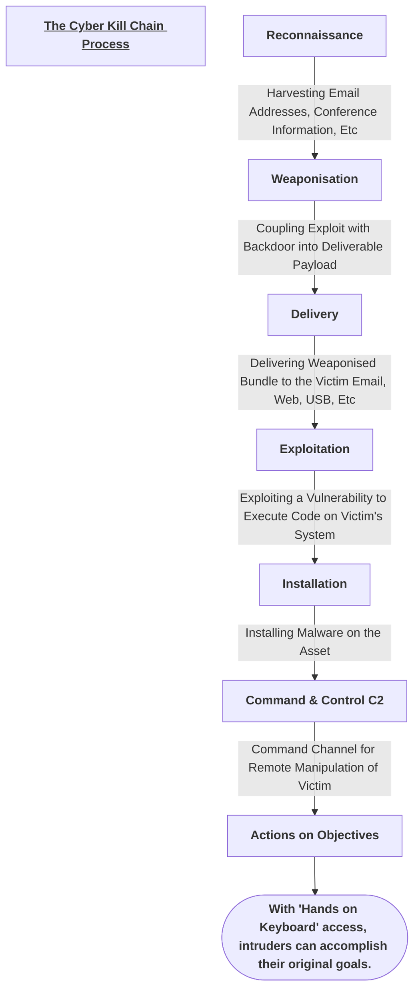

---
tags:
  - LinkedIn-Learning
  - Certified-Ethical-Hacking
---
[[Video Notes]]

---
# Introduction
## [Certified Ethical Hacker (CEH) (4th Edition)](https://www.linkedin.com/learning/certified-ethical-hacker-ceh/certified-ethical-hacker-ceh-introduction?u=42775724)

> All links and information for the course is made available through the [repository](https://hackerrepo.org).

Ethical hackers, use the same tools and techniques as malicious hackers, however the difference is to not exploit for personal gain, but for defence and security.
## Introduction To Ethical Hacking
### Module 1: Information Security, Cybersecurity & Ethical Hacking Overview
Cybersecurity's importance cannot be understated as more pervasive threats arise. This module is to lay the foundation.

Concepts of ethical hacking, red teaming & bug hunting.
### Learning Objectives
- 1.1 Introduction Information Security & Cybersecurity
  -Differences between Information Security & Cybersecurity
- 1.2 Understanding the Cyber Kill Chain & Hacking Concepts
- 1.3 Survey Ethical Hacking Methodologies
- 1.4 Understanding Information Security Controls
- 1.5 Understanding Security Laws & Standards
- 1.6 Planning & Scoping a penetration testing assessment
- 1.7 Building your own hacking lab with WebSploit Labs
### 1.1 Introducing Information Security & Cybersecurity
#### The difference between Information Security & Cyber Security
Information security focuses on protecting the three core elements of security: Confidentiality, Integrity, and Availability of data and the systems relevant to it.

Traditionally InfoSec includes administrative controls, i.e. the policies and controls and how permissions are accessed or training and compliance. E.g. technical controls to protect information and data.

On the other hand, cybersecurity is where actors use malicious techniques to breach systems, which includes understanding how malware is made, social engineering, phishing campaigns, threat intelligence, etc. 

Cybersecurity requires a more specialised set of tools and practices as technologies evolve over time and more emerging technologies like 'artificial intelligence' (LLMs) and machine learning are being more widely coordinated.
### 1.2 Understanding the Cyber Kill Chain & Hacking concepts
#### Cyber Kill Chain
The [`Cyber Kill Chain`](https://www.lockheedmartin.com/en-us/capabilities/cyber/cyber-kill-chain.html) is a framework developed by Lockheed Martin used to understand and counteract cyber attacks. Outlining the stages of a cyberattack to provide a structured approach in identifying and disrupting adversaries at each phase. The framework is useful for defending against APTs (Advanced Persistent Threats).

The Cyber Kill Chains by Lockheed Martin
##### Stages of the Cyber Kill Chain
- **Reconnaissance** - Whenever the attacker is gathering information about their targets to under potential vulnerabilities. (e.g. harvesting emails, identifying employees on social media and discovering internet facing servers) (i.e. Passive & Active Reconnaissance)
> Relevant Past Notes: [[Intro To Web Reconnaissance]]
- **Weaponisation** - This is when the attacker crafts malicious payloads such as malware, exploits, or other tradecraft (i.e. the techniques, methods and tools used by attackers (or defenders)).
- **Delivery** - When the attacker transmits the weapon to the target, and often through phishing emails, malicious code is executed on the target system, exploiting their vulnerability to gain access.
- **Installation** - When the malware installs on the endpoint, or a backdoor is installed on the target device, allowing the attacker to maintain access.
- **Command & Control [C2]** - Whenever the attacker establishes a [communication channel](https://en.wikipedia.org/wiki/Communication_channel) with a compromised system to control a system remotely.
- **Actions on Objectives** - This is when the attacker achieves their goals, which can include:
 - Data Exfiltration
 - Data Destruction
 - Encryption of data (e.g. ransomware)
##### [Mitre Att&ck Framework](https://attack.mitre.org)
The framework has a site `https://attack.mitre.org/` which is a knowledge base, with a series of matrices that allow easy navigation of tactics and techniques that attackers actually use art each stage of an attack from *reconnaissance* all the way to *exfiltration* and impact.

![[Mitre Framework Subcategories Flat.png]]
Some of the Mitre Framework ATT&CK: Selecting Phishing, Subcategories
##### Spearphishing Attachment Subcategory Example
<q>Adversaries may send spearphishing emails with a malicious attachment in an attempt to gain access to victim systems. Spearphishing attachment is a specific variant of spearphishing. Spearphishing attachment is different from other forms of spearphishing in that it employs the use of malware attached to an email. All forms of spearphishing are electronically delivered social engineering targeted at a specific individual, company, or industry.</q>

<q>There are many options for the attachment such as Microsoft Office documents, executables, PDFs, or archived files. Upon opening the attachment (and potentially clicking past protections), the adversary's payload exploits a vulnerability or directly executes on the user's system. The text of the spearphishing email usually tries to give a plausible reason why the file should be opened, and may explain how to bypass system protections in order to do so. The email may also contain instructions on how to decrypt an attachment, such as a zip file password, in order to evade email boundary defenses. Adversaries frequently manipulate file extensions and icons in order to make attached executables appear to be document files, or files exploiting one application appear to be a file for a different one.</q>

Spear-Phishing description as described in the <a href="https://attack.mitre.org/techniques/T1566/001/">Mitre Framework website</a>.

###### In Summary
> Spearphishing Attachment is a targeted social engineering attack where adversaries send emails with malicious attachments to specific individuals, companies, or industries. The attachments, such as Microsoft Office documents, executables, PDFs, or archived files, exploit vulnerabilities or execute malicious payloads upon opening. The email often includes a plausible pretext for opening the file, instructions to bypass protections, or decryption details for evading email defences. Adversaries may disguise executables as legitimate documents by manipulating file extensions or icons.
###### [Procedure Examples](https://attack.mitre.org/techniques/T1566/001/#Procedure-Examples:~:text=Version%20Permalink-,Procedure%20Examples,-ID)
These are attempts utilising the method which were made, and include links to the campaigns. (e.g. [C0028 2015 Ukraine Electric Power Attack](https://attack.mitre.org/campaigns/C0028))
##### [Mitigations](https://attack.mitre.org/techniques/T1566/001/#:~:text=attachment.%5B46%5D-,Mitigations,-ID)
MITRE ATT&CK provides guidance to mitigate spearphishing attachment attack. (e.g. [M1049 Antivirus/Anti-Malware](https://attack.mitre.org/mitigations/M1049))
##### [Detection](https://attack.mitre.org/techniques/T1566/001/#:~:text=and%20spearphishing%20emails.-,Detection,-ID)
MITRE ATT&CK recommends approaches to detect spearphishing attachment attacks. (e.g. [DS0015 Application Log](https://attack.mitre.org/datasources/DS0015))
##### [Mitre Atlas](https://atlas.mitre.org/)
Similar to the attack matrix these tactics and techniques are against targets related to machine learning and generative AI or AI-based implementations. Techniques and sub-techniques maintaining the varying fields from reconnaissance to exploitation.

![[Mitre Atlas Matrix.png]]
Mitre Atlas Matrix for Machine Learning and varying forms of Artificial Intelligence (i.e. generative ai, etc)
##### Difference between Mitre Att&ck Framework & Mitre Atlas
Mitre Attack matrix is general for any system or network, whereas atlas targets specifically machine learning and artificial intelligence systems like large language models, in assessing their vulnerabilities based on found existing factors of attack and exploitation. 

While in AI-Implementations both matrices should be acknowledged in additional to different other tactics.
#### Hacking Concepts
Hacking involves obtaining unauthorised access to devices and networks. It can be categorised into varying types based on a hacker's intent and the methods utilised.

Ethical hacking (Also known as penetration testing, red teaming or offensive security) involves **authorised** attempts to breach a system's security to identify flaws and fix vulnerabilities before malicious actors have the chance to exploit them.

Scope is important, it is the brief when hired which underlines the exact level in which permission is given to simulate real-world attacks, and provide remediation advice.
##### Phases of Ethical Hacking
- **Reconnaissance** & **Footprinting** - Gathering information about the target to identify potential points of entry.
- **Scanning** - Using tools to detect open ports, services and vulnerabilities. (e.g. Web Proxy Scanners (e.g. Burpe Suite, or ZAP))
- **Gaining Access** - Exploiting vulnerabilities to gain unauthorised access to the target system.
- **Maintaining Access** - Establishing backdoors or other methods to retain access to the target system.
- **Covering Tracks** - Erasing evidence of the attack to avoid detection.
### 1.3 Surveying Ethical Hacking Methodologies
#### Pen Testing Execution Standard
The [PTES Methodology](http://www.pentest-standard.org/index.php/Main_Page) which is a community-driven, goes through all the different steps being:
- Pre-engagement Interactions
- Intelligence Gathering
- Threat Modelling
- Vulnerability Analysis
- Exploitation
- Post Exploitation
- Reporting
#### The Technical Guide to Information Security Testing & Assessment
The [Technical Guide to Information Security Testing & Assessment Guide](https://csrc.nist.gov/pubs/sp/800/115/final) is high-level recommendations from the NIST (National Institute of Standards and Technology) on the practices in performing an assessment or test, whether it be through a web application, or large-scale infrastructure.
### 1.4 Understanding Information Security Controls
### 1.5 Understanding Security Laws & Standards
### 1.6 Planning & Scoping a penetration testing assessment
### 1.7 Building your own hacking lab with WebSploit Labs
# Footprinting & Reconnaissance
# Scanning Networks
# Enumeration
# Vulnerability Analysis
# System Hacking
# Malware Threats
# Sniffing
# Social Engineering
# Denial-of-Service
# Session Hijacking
# Evading IDS, Firewalls, and Honeypots
# Hacking Web Servers
# Hacking Web Applications
# SQL Injection
# Hacking Wireless Networks
# Hacking Mobile Platforms
# IoT and OT Hacking
# Cloud Computing
# Cryptography
# Introduction to AI Threats & LLM Security
# Understanding Prompt Injection Insecure Output Handling
# Training Data Poisoning, Model Denial of Service Supply Chain Vulnerabilities
# Sensitive Information Disclosure, Insecure Plugin Design, and Excessive Agency
# Overreliance, Model Theft, and Red Teaming AI Models
# Protecting Retrieval Augmented Generation (RAG) Implementations
# Conclusion
