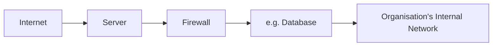

---
tags:
  - Video-Notes
---
[[Video Notes]]

---
# Video Watched
<iframe title="What is a DMZ? (Demilitarized Zone)" src="https://www.youtube.com/embed/dqlzQXo1wqo?start=101&amp;feature=oembed" height="150" width="200" style="aspect-ratio: 1.33333 / 1; width: 100%; height: 100%;" allowfullscreen="" allow="fullscreen"></iframe>
## Potentially Better Altnerative
<iframe title="DMZ Explained | Demilitarised Zone" src="https://www.youtube.com/embed/48QZfBeU4ps?feature=oembed" height="113" width="200" style="aspect-ratio: 1.76991 / 1; width: 100%; height: 100%;" allowfullscreen="" allow="fullscreen"></iframe>
---
# What is a DMZ
DMZ stands for demilitarised zone.

Improves an organisations security by segregating computers and devices.

Could be a web server, or email server. 
## Non-DMZ Structure

- Hackers could use this as an opening to the internal network, as the servers are behind the firewall of the network.