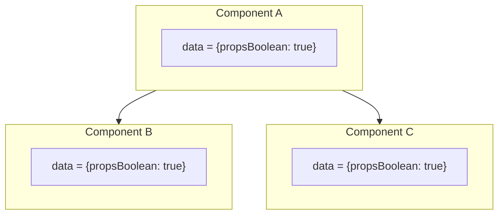
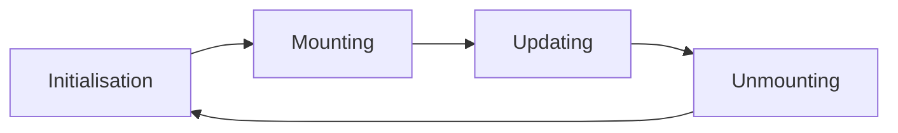
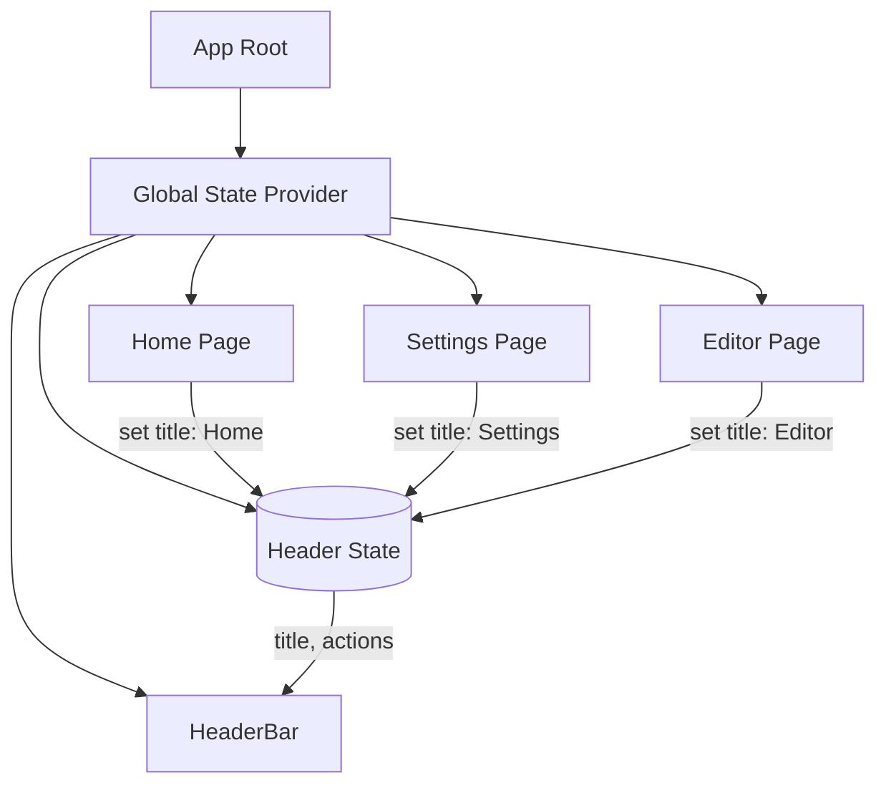

---
tags:
  - Video-Notes
  - React
---
[[Video Notes]]

---

<iframe title="React JS Explained In 10 Minutes" src="https://www.youtube.com/embed/s2skans2dP4?feature=oembed" height="113" width="200" style="aspect-ratio: 1.76991 / 1; width: 100%; height: 100%;" allowfullscreen="" allow="fullscreen"></iframe>

---

[[Claude_Generated_From_These_Notes_React_Slides_Expanded.pdf]]

---
# React Notes
## Creating First React Project & Installing
```bash
npx create-react-app <appname>
npm start
npm run build
```
<sub>Commands to create and start a react app</sub>

>[!NOTE]
>The React Library will be installed by running the first command.

---
[What is React?](https://youtu.be/s2skans2dP4?t=50)
# What are SPA (Single-Page Applications)
In traditional websites each webpage has a template and that template (html, css) is returned to the user.

Whereas a single page application is only one page that's content is being modified within it. Or in other words a single template that is being modified.

---
[React Component's](https://youtu.be/s2skans2dP4?t=93)
# Components
Components are re-usable visual elements of the UI, the UI that is split into individual independent pieces.

Traditionally each piece of UI is it's own component, however this is determined purely by the developer. Each component is added to the parent component which builds the overall UI of the specific page.

A component is a JavaScript class or function that returns html content back. (JSX)

Components can be nested as deeply as required.

> According to video Trend shifts more toward function-based components.
Function-Based Components
```js
function Profile()
{
	return (
		<div>
			<p>Welcome!</p>
		</div>
	);
}
```

Class-Based Components
```javascript
class Profile extends Component
{
	render()
	{
		return (
			<div>
				<p>Welcome!</p>
			</div>
		);
	}
}
```

---
[JSX](https://youtu.be/s2skans2dP4?t=143)
# JSX (JavaScript XML)
Instead of traditional html tags JSX is utilised.
## JSX Function
```jsx
function Profile({name})
{
	return (
		<div>
			<h1>Hello!</h1>
		</div>
	);
}
```
JSX is transpiled at build time into JavaScript function calls, not interpreted by the browser.

>[!Dtldr] Transpiled
>Transpilation, a portmanteau of transformation and compilation, is **the process of converting source code from one high-level programming language to another**.

---
[URL Router](https://youtu.be/s2skans2dP4?t=188)
# React Router
The react router is how multiple pages can exist into a single page application.

URL-Routing is handed by a `router` which syncs the UI with the URL since the page is never actually changing the router will adjust it's URL.

```js
import { BrowserRouter, Routes, Route, Navigate } from 'react-router-dom';
```

---
# Props
When data is needed to be passed down from one component to the next, it can be returned as a prop, so that the data can be utilised.



```jsx
function Tweet()
{
	let item = {
		'author': 'Dennis',
		'tweet': 'My First Tweet!'
	}
	
	return (
		<div>
			<Author>
			<Content body={item.tweet}>
			</Author>
		</div>
	);
}
```

A prop can be passed down like a function parameter.
```jsx
function Content(props)
{
	return (
		<p>{props.body}</p>
	);
}
```
## Prop Drilling
Props can be passed down multiple layers however prop drilling can get messy.

---
[State](https://youtu.be/s2skans2dP4?t=235)
## React States
State is simply a JavaScript object used to represent information about a component.
## Basic State
```javascript
state = {
	user: 'Dennis',
	isAdmin: true,
	notes: [],
}
```
## Class-Based State
```js
class Notes extends Component
{
	constructor(props)
	{
		super(props);
		this.state = {
			user:'Dennis',
			isAdmin: true,
			notes:[],
		}
	}
	
	render() 
	{ 
		//etc 
	}
}
```
## Modern - State React Hooks
For the example of rending a list of notes from the app.

```jsx
function Notes
{
	// set initial state
	let [notes, setNotes] = useState([])
	// notes - state, 
	// function setNotes allows changing of notes array. setState(DATATYPE)
	
	// maps through the notes state to output all the notes titles into ul
	return (
		<ul>
			{notes.map(note => (
				<li>{note.title}</li>
			))}
		</ul>
	);
}
```
## Updating State
```jsx
let [notes, setNotes] = useState([])

let getNotes = async () => {
	let res = await fetch('/notes');
	let data = await res.json();
	setNotes(data); // State Update triggers component lifecycle effect
}
```

---
# The Component Lifecycle
>[!IMPORTANT] Lifecycle is Crutical
>It is important for understanding for every react developer and is a common interview question as a react component has a standard lifecycle. 


Each component has the following lifecycle:
## Mounting Phase
When being added to the DOM.
## Updating Phase
When something is being modified and a component is being changed.
## Unmounting Phase
When the component will be removed from the DOM.

**ONLY** Class components have *methods* to handle the lifecycle.

```jsx
componentDidMount()
{}

componentDidUpdate()
{}

componentWillUnmount()
{}
```

However for *Function Components*:

```jsx
useEffect(() =>
{
	// Handles all 3 lifecycle methods.
}, [Dependencies]);
```

---
# React Hooks (React 16.8+)
React hooks apply `Function-Based Componenets Only`.

Hooks are essential as they allow to `add state` to functional components, without hooks functional components could not hold state, which is why there was a previous reliance on class-based components.

Hooks are simply functions that allow us to 'hook' into a component and manage its state.

```jsx
// Most common beginner hook functions
useState() // Set & Update State
useEffect() // Perform the state changes effects in lifecycle

// Other hook functions provided by React
useContext()
useReducer()
useCallback()
useMemo()
useRef()
```

React also supports the built-in ability to create custom hooks.

---
# State Management
While state can be managed and created there will be a time when a 'global state' will be wanted to make data available across multiple components. E.g. Authentication, or a HeaderBar



Props may not be practical especially if this information is updated somewhere in a components.
## The two solutions
- React Built-In Context API
OR
- Third-Party solution such as Redux, etc.

With these global state can be achieved across multiple components without disrupting the component tree by having to add states or prop drilling.

---
# Virtual DOM
At some point when learning react it is natural to want to understand how the 'virtual dom' works. Learning it will assist in fundamentally understand and make sense how react builds and updates the DOM and the complete lifecycle of a React component.

React creates a `virtual DOM` which is a virtual representation of the actual DOM.

When updating components the virtual DOM is being updated and not the real DOM. The reason React does this is to optimally find a solution to changing the real DOM without having to rebuild the entire solution.

---
# Key Prop
>[!IMPORTANT] To Avoid Console Error
>Every item in a dynamically rendered list should contain the `key property` to avoid a console error.
>
> >[!ERROR]
> >Warning: Each child in an array or iterator should have a unique `key` prop.

```jsx
return (
		<ul>
			{notes.map(note => (
				<li key={note.id}>{note.title}#</li>
			))}
		</ul>
	);
```

---
# Event Listeners
Event handling is similar to traditional JavaScript with a few differences:
```jsx
// Function reference (not invoked)
// CamelCase handler name

<li onClick={openNote}
```

There is no need for `addEventListener` because with React the JavaScript and HTML are mixed together.

---
# Handling Forms
Form handling with React is different than traditional methods as all the information needed as a React developer is wanted to be kept within some form of state within the component.

HTML elements like `<input>`, `<textarea>`, and `<select>` maintain their own state and update based on user input. 

In React however, event listeners are added for each field such as `onChange` and `onSubmit` and update the component state whenever something changes. Therefore resulting in that form behaviour being manually controlled rather than leaving it to the form handler alone.

---
# Content Rendering
Sometimes specific content will need to be rendered in a specific way like the username of a user's profile navigation. 

For example, by using a user's authentication status the user's name will be displayed or not displayed.

```jsx
return (
	<div>
		{isAuthenticated && <span>Hello {user.name}</span>}
	</div>
);
```

OR

```jsx
return (
	<div>
		{isAuthenticated ? (<span>Hello {user.name}</span>) : ( <span>Please Login</span>)}
	</div>
);
```

In both examples above both these outputs are conditional on the isAuthenticated variable in the component's state.

---
# Common Commands
## Create React App
```
npx create-react-app <appname> // Setup Project
npm start // Start Dev Server
npm run build // Build Optimised for Production 
```


